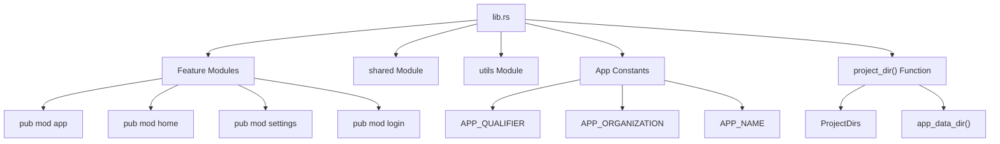
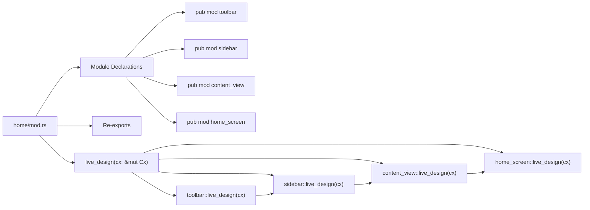
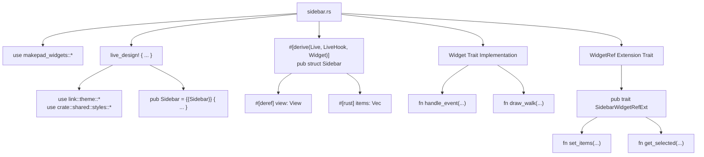
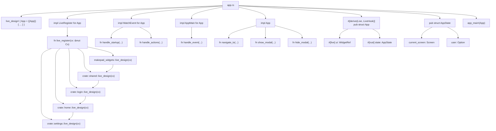

<!-- source: DeepWiki mcp.deepwiki.com · repo ZhangHanDong/makepad-skills · page 2.2 Project Structure · fetched 2026-10-26 -->

# Project Structure

<details>
<summary>Relevant source files</summary>

The following files were used as context for generating this wiki page:

- [skills/00-getting-started/project-structure.md](skills/00-getting-started/project-structure.md)

</details>


This document explains the recommended directory organization and module structure for Makepad applications. It covers source code layout, resource management, configuration files, and module registration patterns based on production applications like Robrix and Moly.

For information about creating a new project from scratch, see [Project Initialization](#2.1). For details about the core widget and event systems, see [Core Development Concepts](#3).

---

## Overview

A well-organized Makepad project follows a feature-based directory structure where each feature (screen or functional area) is contained in its own module. Shared components, styles, and utilities are separated into dedicated modules. The `App` struct in `app.rs` serves as the main orchestrator that registers all modules and coordinates navigation.

**Sources:** [skills/00-getting-started/project-structure.md:1-68]()

---

## Directory Structure

### Standard Layout

The recommended directory structure organizes code by feature modules, with separate directories for shared components and resources:

```mermaid
graph TB
    Root["my_app/"]
    
    Src["src/"]
    Resources["resources/"]
    Packaging["packaging/"]
    Config["Configuration Files"]
    
    AppRS["app.rs"]
    LibRS["lib.rs"]
    
    HomeDir["home/"]
    SettingsDir["settings/"]
    LoginDir["login/"]
    SharedDir["shared/"]
    UtilsRS["utils.rs"]
    
    HomeModRS["home/mod.rs"]
    HomeScreen["home_screen.rs"]
    Sidebar["sidebar.rs"]
    ContentView["content_view.rs"]
    
    SharedModRS["shared/mod.rs"]
    StylesRS["shared/styles.rs"]
    HelpersRS["shared/helpers.rs"]
    AvatarRS["shared/avatar.rs"]
    IconButtonRS["shared/icon_button.rs"]
    
    Icons["icons/"]
    Img["img/"]
    Fonts["fonts/"]
    
    MacOS["macos/"]
    Windows["windows/"]
    Linux["linux/"]
    
    CargoToml["Cargo.toml"]
    RustfmtToml["rustfmt.toml"]
    RustToolchain["rust-toolchain.toml"]
    
    Root --> Src
    Root --> Resources
    Root --> Packaging
    Root --> Config
    
    Src --> AppRS
    Src --> LibRS
    Src --> HomeDir
    Src --> SettingsDir
    Src --> LoginDir
    Src --> SharedDir
    Src --> UtilsRS
    
    HomeDir --> HomeModRS
    HomeDir --> HomeScreen
    HomeDir --> Sidebar
    HomeDir --> ContentView
    
    SharedDir --> SharedModRS
    SharedDir --> StylesRS
    SharedDir --> HelpersRS
    SharedDir --> AvatarRS
    SharedDir --> IconButtonRS
    
    Resources --> Icons
    Resources --> Img
    Resources --> Fonts
    
    Packaging --> MacOS
    Packaging --> Windows
    Packaging --> Linux
    
    Config --> CargoToml
    Config --> RustfmtToml
    Config --> RustToolchain
```



**Directory Purposes:**

| Directory | Purpose | Key Files |
|-----------|---------|-----------|
| `src/` | Rust source code | `app.rs`, `lib.rs` |
| `src/{feature}/` | Feature modules (home, settings, login) | `mod.rs`, widget files |
| `src/shared/` | Reusable components | `styles.rs`, widget components |
| `resources/icons/` | SVG icon files | `add.svg`, `close.svg`, `settings.svg` |
| `resources/img/` | Image assets | `logo.png`, `default_avatar.png` |
| `resources/fonts/` | Custom font files | `.ttf`, `.otf` files |
| `packaging/` | Platform-specific packaging configs | `macos/`, `windows/`, `linux/` |

**Sources:** [skills/00-getting-started/project-structure.md:12-68]()

---

## Module Organization

### lib.rs: Module Registry

The `lib.rs` file serves as the module registry and declares all feature modules, shared components, and utilities. It also defines application constants used for directory resolution:



Key components in `lib.rs`:

- **Module declarations**: `pub mod app`, `pub mod home`, `pub mod settings`, etc.
- **App constants**: `APP_QUALIFIER`, `APP_ORGANIZATION`, `APP_NAME` used for persistent storage paths
- **Directory functions**: `project_dir()` and `app_data_dir()` using `robius-directories` crate
- **Optional feature-gated modules**: Using `#[cfg(feature = "analytics")]`

**Sources:** [skills/00-getting-started/project-structure.md:73-116]()

---

## Feature Module Pattern

### mod.rs Structure

Each feature module contains a `mod.rs` file that declares submodules and provides a `live_design()` function for registration. The registration order is critical - dependencies must be registered before dependents:



**Registration Order Rules:**

1. Base components must be registered first
2. Components that depend on others must be registered after their dependencies
3. Composite components (those that use multiple subcomponents) are registered last

**Sources:** [skills/00-getting-started/project-structure.md:118-142]()

---

## Widget Module Structure

### Widget Definition Pattern

Each widget module follows a standard structure that combines `live_design!` macro definitions with Rust implementations:



**Key Components:**

- **`live_design!` block**: Defines widget structure, styling, and child widgets
- **Struct definition**: Uses `#[derive(Live, LiveHook, Widget)]` with `#[deref] view: View` for base widget functionality
- **Widget trait implementation**: Implements `handle_event()` and `draw_walk()` methods
- **WidgetRef extension trait**: Provides type-safe API for accessing widget state (e.g., `SidebarWidgetRefExt`)

**Sources:** [skills/00-getting-started/project-structure.md:144-213]()

---

## Shared Components and Styles

### styles.rs Organization

The `styles.rs` file centralizes design tokens and reusable component styles. It is organized into sections for icons, colors, typography, spacing, sizes, and component styles:

```mermaid
graph TB
    StylesRS["shared/styles.rs"]
    
    Icons["ICONS"]
    Colors["COLORS"]
    Typography["TYPOGRAPHY"]
    Spacing["SPACING"]
    Sizes["COMPONENT SIZES"]
    Components["REUSABLE COMPONENT STYLES"]
    
    IconAdd["ICON_ADD = dep(crate://self/resources/icons/add.svg)"]
    IconClose["ICON_CLOSE = dep(crate://self/resources/icons/close.svg)"]
    IconSettings["ICON_SETTINGS = dep(crate://self/resources/icons/settings.svg)"]
    
    ColorPrimary["COLOR_PRIMARY = #2196F3"]
    ColorBg["COLOR_BG_PRIMARY = #FFFFFF"]
    ColorText["COLOR_TEXT_PRIMARY = #212121"]
    ColorDivider["COLOR_DIVIDER = #0000001F"]
    
    TextH1["TEXT_H1 = <THEME_FONT_BOLD>{ font_size: 24.0 }"]
    TextBody["TEXT_BODY = <THEME_FONT_REGULAR>{ font_size: 14.0 }"]
    TextButton["TEXT_BUTTON = <THEME_FONT_BOLD>{ font_size: 14.0 }"]
    
    SpacingXS["SPACING_XS = 4.0"]
    SpacingMD["SPACING_MD = 16.0"]
    SpacingXL["SPACING_XL = 32.0"]
    
    ButtonHeight["BUTTON_HEIGHT = 40.0"]
    InputHeight["INPUT_HEIGHT = 44.0"]
    IconSize["ICON_SIZE_MD = 24.0"]
    BorderRadius["BORDER_RADIUS = 8.0"]
    
    FilledButton["FilledButton = <Button> { ... }"]
    OutlinedButton["OutlinedButton = <Button> { ... }"]
    Card["Card = <RoundedView> { ... }"]
    Divider["Divider = <View> { ... }"]
    
    StylesRS --> Icons
    StylesRS --> Colors
    StylesRS --> Typography
    StylesRS --> Spacing
    StylesRS --> Sizes
    StylesRS --> Components
    
    Icons --> IconAdd
    Icons --> IconClose
    Icons --> IconSettings
    
    Colors --> ColorPrimary
    Colors --> ColorBg
    Colors --> ColorText
    Colors --> ColorDivider
    
    Typography --> TextH1
    Typography --> TextBody
    Typography --> TextButton
    
    Spacing --> SpacingXS
    Spacing --> SpacingMD
    Spacing --> SpacingXL
    
    Sizes --> ButtonHeight
    Sizes --> InputHeight
    Sizes --> IconSize
    Sizes --> BorderRadius
    
    Components --> FilledButton
    Components --> OutlinedButton
    Components --> Card
    Components --> Divider
```



**Design Token Categories:**

| Category | Naming Convention | Example |
|----------|------------------|---------|
| Icons | `ICON_{NAME}` | `ICON_ADD`, `ICON_SETTINGS` |
| Colors | `COLOR_{CATEGORY}_{VARIANT}` | `COLOR_PRIMARY`, `COLOR_TEXT_SECONDARY` |
| Typography | `TEXT_{STYLE}` | `TEXT_H1`, `TEXT_BODY` |
| Spacing | `SPACING_{SIZE}` | `SPACING_XS`, `SPACING_MD` |
| Sizes | `{COMPONENT}_{DIMENSION}` | `BUTTON_HEIGHT`, `ICON_SIZE_MD` |
| Components | `{StyleName}` | `FilledButton`, `OutlinedButton` |

**Sources:** [skills/00-getting-started/project-structure.md:217-391]()

---

## App Orchestrator

### App Structure and Registration Flow

The `App` struct in `app.rs` serves as the main application orchestrator. It implements `LiveRegister` to register all modules and `MatchEvent`/`AppMain` to handle events and lifecycle:



**Critical Registration Order:**

1. `makepad_widgets::live_design(cx)` - Framework widgets first
2. `crate::shared::live_design(cx)` - Shared components (styles, utilities)
3. Feature modules in dependency order (e.g., `login`, `home`, `settings`)

The `App` struct maintains application state through `AppState` and orchestrates screen navigation through the `navigate_to()` method which updates widget visibility.

**Sources:** [skills/00-getting-started/project-structure.md:436-622]()

---

## Resource Management

### Icon and Image Organization

Resources are organized by type and purpose. Icons use category-based subdirectories, while images use purpose-based naming:

```mermaid
graph TB
    ResourcesDir["resources/"]
    
    IconsDir["icons/"]
    ImgDir["img/"]
    FontsDir["fonts/"]
    
    ActionIcons["action/"]
    NavIcons["navigation/"]
    StatusIcons["status/"]
    SocialIcons["social/"]
    
    AddSVG["add.svg"]
    EditSVG["edit.svg"]
    DeleteSVG["delete.svg"]
    
    ArrowBack["arrow_back.svg"]
    Menu["menu.svg"]
    Close["close.svg"]
    
    Check["check.svg"]
    Error["error.svg"]
    Warning["warning.svg"]
    
    Person["person.svg"]
    Group["group.svg"]
    Chat["chat.svg"]
    
    LogoPNG["logo.png"]
    LogoDark["logo_dark.png"]
    DefaultAvatar["default_avatar.png"]
    EmptyState["empty_state.png"]
    Onboarding["onboarding/"]
    Providers["providers/"]
    
    ResourcesDir --> IconsDir
    ResourcesDir --> ImgDir
    ResourcesDir --> FontsDir
    
    IconsDir --> ActionIcons
    IconsDir --> NavIcons
    IconsDir --> StatusIcons
    IconsDir --> SocialIcons
    
    ActionIcons --> AddSVG
    ActionIcons --> EditSVG
    ActionIcons --> DeleteSVG
    
    NavIcons --> ArrowBack
    NavIcons --> Menu
    NavIcons --> Close
    
    StatusIcons --> Check
    StatusIcons --> Error
    StatusIcons --> Warning
    
    SocialIcons --> Person
    SocialIcons --> Group
    SocialIcons --> Chat
    
    ImgDir --> LogoPNG
    ImgDir --> LogoDark
    ImgDir --> DefaultAvatar
    ImgDir --> EmptyState
    ImgDir --> Onboarding
    ImgDir --> Providers
```



**Resource Loading in Code:**

Icons are referenced in `styles.rs` using the `dep()` function:
```
ICON_ADD = dep("crate://self/resources/icons/add.svg")
```

This path is then used in widget definitions to display icons.

**Sources:** [skills/00-getting-started/project-structure.md:626-668]()

---

## Build Configuration

### Cargo.toml Profile Settings

The `Cargo.toml` file configures build profiles optimized for different stages of development and deployment:

| Profile | Optimization Level | LTO | Codegen Units | Strip | Purpose |
|---------|-------------------|-----|---------------|-------|---------|
| `dev` | 0 | off | 16 | false | Fast compilation, debug builds |
| `dev.package."*"` | 3 | off | 16 | false | Optimize dependencies in dev mode |
| `release` | 3 | thin | 16 | false | Balanced release builds |
| `release-lto` | 3 | fat | 1 | false | Pre-production optimization |
| `distribution` | 3 | fat | 1 | true | Final production binaries |

**Key Dependencies:**

- `makepad-widgets` - Core framework from git repository
- `robius-directories` - Cross-platform directory paths
- `robius-open` - Opening URLs and files
- `tokio` - Async runtime (optional)
- `serde`, `serde_json` - Serialization
- `unicode-segmentation` - Unicode text handling
- `chrono` - Date/time operations

**Sources:** [skills/00-getting-started/project-structure.md:672-742]()

---

## Additional Configuration Files

### Development Tool Configuration

**rustfmt.toml** - Code formatting rules:
- `max_width = 100` - Maximum line width
- `tab_spaces = 4` - Indentation
- `reorder_imports = true` - Automatic import sorting
- `imports_granularity = "Crate"` - Group imports by crate
- `group_imports = "StdExternalCrate"` - Separate std, external, and local imports

**rust-toolchain.toml** - Rust version specification:
- `channel = "stable"` - Use stable Rust toolchain
- Can be changed to `"nightly"` for nightly features

**.gitignore** - Version control exclusions:
- `/target` - Build artifacts
- `/dist` - Distribution files
- `.idea/`, `.vscode/` - IDE configuration
- `.DS_Store`, `Thumbs.db` - OS files
- `*.log` - Log files
- `.env`, `.env.local` - Local configuration

**Sources:** [skills/00-getting-started/project-structure.md:744-791]()

---

## Quick Reference

### Module Registration Checklist

When adding new modules to your application, follow this registration order:

```
1. Declare module in lib.rs:           pub mod feature_name;
2. Create feature/mod.rs with:         pub fn live_design(cx: &mut Cx)
3. Register in App::live_register():   crate::feature_name::live_design(cx);
4. Register AFTER dependencies         (shared components must come before features)
```

**Sources:** [skills/00-getting-started/project-structure.md:795-804]()

---

### Naming Conventions

| Type | Convention | Example | Where Used |
|------|-----------|---------|------------|
| Module files | `snake_case` | `home_screen.rs` | File names |
| Widget structs | `PascalCase` | `HomeScreen` | Rust code |
| Widget in DSL | `PascalCase` | `<HomeScreen>` | `live_design!` |
| Action enums | `PascalCase + Action` | `HomeScreenAction` | Custom actions |
| Style constants | `SCREAMING_SNAKE` | `COLOR_PRIMARY` | Design tokens |
| Icon files | `snake_case` | `arrow_back.svg` | Resource files |
| Functions | `snake_case` | `navigate_to()` | Rust methods |

**Sources:** [skills/00-getting-started/project-structure.md:807-815]()

---

### Common Patterns

**Widget Extension Trait Pattern:**

```
1. Define trait:    pub trait MyWidgetRefExt
2. Add methods:     fn set_data(&mut self, data: MyData)
3. Implement for:   impl MyWidgetRefExt for MyWidgetRef
4. Use with:        self.ui.my_widget(id!(my_widget)).set_data(data)
```

**Feature Module Pattern:**

```
1. Create directory:     src/my_feature/
2. Add mod.rs:           Module declarations + live_design()
3. Add widget files:     my_screen.rs, my_component.rs
4. Register in lib.rs:   pub mod my_feature;
5. Register in app.rs:   crate::my_feature::live_design(cx);
```

**Resource Reference Pattern:**

```
1. Add file:          resources/icons/my_icon.svg
2. Define in styles:  ICON_MY = dep("crate://self/resources/icons/my_icon.svg")
3. Use in widget:     draw_icon: { svg_file: (ICON_MY) }
```

**Sources:** [skills/00-getting-started/project-structure.md:1-815]()

---

