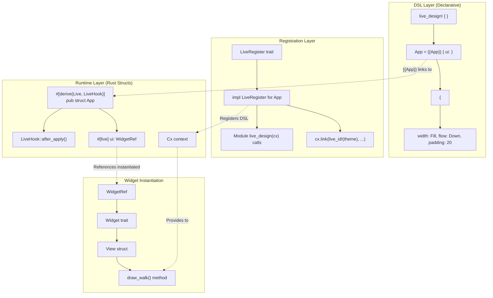
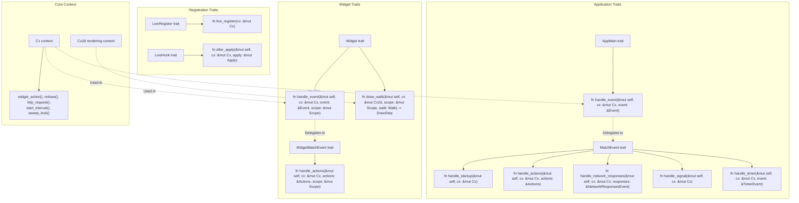
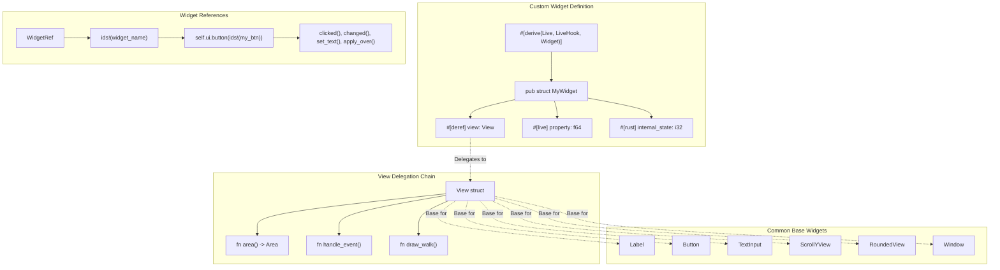
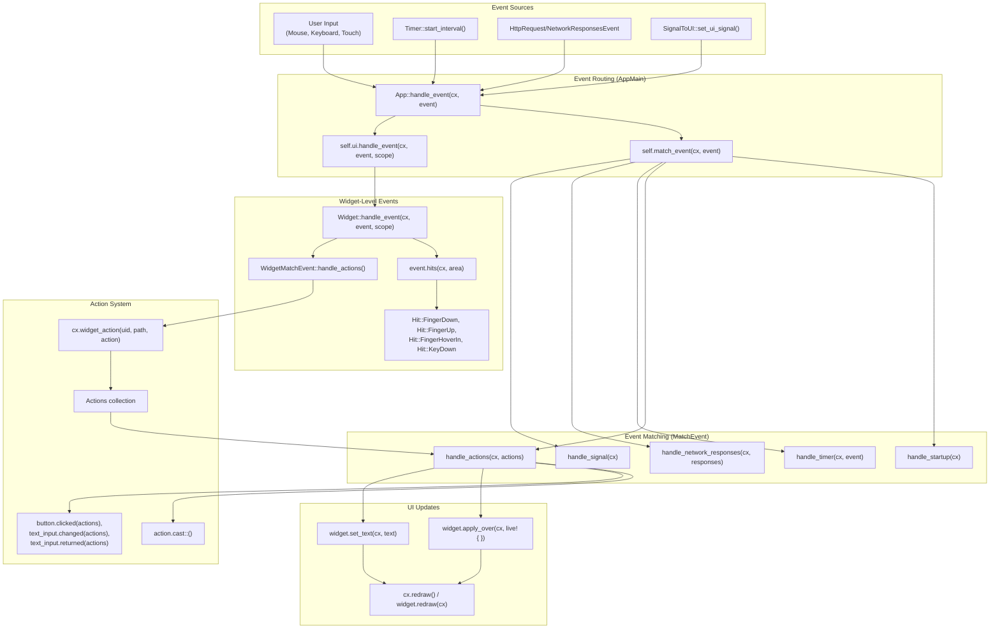

<!-- source: DeepWiki mcp.deepwiki.com · repo ZhangHanDong/makepad-skills · page 3 Core Development Concepts · fetched 2026-10-26 -->

# Core Development Concepts

<details>
<summary>Relevant source files</summary>

The following files were used as context for generating this wiki page:

- [skills/01-core/SKILL.md](skills/01-core/SKILL.md)
- [skills/01-core/events.md](skills/01-core/events.md)
- [skills/01-core/layout.md](skills/01-core/layout.md)
- [skills/01-core/styling.md](skills/01-core/styling.md)
- [skills/01-core/widgets.md](skills/01-core/widgets.md)

</details>


This document introduces the fundamental concepts of Makepad UI development covered in the 01-core skill category. It explains the declarative `live_design!` DSL, the core trait system (`LiveRegister`, `Widget`, `MatchEvent`, `AppMain`), and how these components work together to create reactive user interfaces. 

For detailed information on specific subsystems, see:
- Layout rules and spacing: [Layout System](#3.1)
- Widget creation and common widgets: [Widget System](#3.2)  
- Event handling and actions: [Event Handling](#3.3)
- Text styling and icons: [Styling: Fonts and Icons](#3.4)

For higher-level project organization, see [Project Structure](#2.2). For graphics and animation, see [Graphics and Animation](#5).

**Sources:** [skills/01-core/SKILL.md:1-132]()

## The live_design! Declarative System

Makepad uses a declarative macro system called `live_design!` to define UI layouts, widgets, and their properties. This system bridges the gap between DSL declarations and Rust structs through the `LiveRegister` trait.

### live_design! to Rust Connection



**Diagram: live_design! DSL to Rust Struct Binding**

The `live_design!` macro defines UI structure declaratively. The `{{StructName}}` syntax binds DSL definitions to Rust structs. The `LiveRegister` trait's `live_register()` method registers all modules with the `Cx` context, enabling the runtime to instantiate widgets and resolve references.

**Sources:** [skills/01-core/SKILL.md:44-118]()

### DSL Syntax Reference

| Syntax | Purpose | Code Entity |
|--------|---------|-------------|
| `live_design! { }` | Declare UI elements | Macro from `makepad_widgets` |
| `<Widget>` | Instantiate widget type | Widget trait implementors |
| `name = <Widget>` | Named widget reference | Accessible via `ids!()` macro |
| `{{StructName}}` | Link to Rust struct | `#[derive(Live)]` struct |
| `use link::theme::*` | Import theme definitions | Theme module exports |
| `dep("crate://...")` | Resource dependency | Resource path resolver |

**Sources:** [skills/01-core/SKILL.md:75-86]()

## Core Trait Architecture

Makepad's architecture is built on four primary traits that define the lifecycle and behavior of applications and widgets.

### Primary Trait System



**Diagram: Core Trait System and Method Signatures**

The `AppMain` trait provides the main event loop entry point through `handle_event()`. This delegates to `MatchEvent` for specific event types. Similarly, `Widget` trait provides widget-level event handling and rendering, delegating to `WidgetMatchEvent` for action handling. The `Cx` context is passed to all methods, providing access to the framework's core functionality.

**Sources:** [skills/01-core/events.md:10-53](), [skills/01-core/widgets.md:132-149]()

### Trait Implementation Pattern

The standard pattern for implementing these traits on an application struct:

```rust
// Application struct with derive macros
#[derive(Live, LiveHook)]
pub struct App {
    #[live] ui: WidgetRef,
    #[rust] counter: i32,
}

// Registration lifecycle
impl LiveRegister for App {
    fn live_register(cx: &mut Cx) {
        makepad_widgets::live_design(cx);
        crate::module::live_design(cx);
    }
}

// Event handling lifecycle
impl MatchEvent for App {
    fn handle_startup(&mut self, cx: &mut Cx) { }
    fn handle_actions(&mut self, cx: &mut Cx, actions: &Actions) { }
}

// Main event loop
impl AppMain for App {
    fn handle_event(&mut self, cx: &mut Cx, event: &Event) {
        self.match_event(cx, event);
        self.ui.handle_event(cx, event, &mut Scope::empty());
    }
}

// Entry point
app_main!(App);
```

**Sources:** [skills/01-core/SKILL.md:98-118](), [skills/01-core/events.md:10-53]()

## Widget Composition Model

Makepad widgets follow a composition-based architecture where custom widgets wrap a base `View` and delegate behavior through the `#[deref]` attribute.

### Widget Structure and Delegation



**Diagram: Widget Composition and Reference System**

Custom widgets use `#[deref] view: View` to delegate core functionality. The `#[live]` attribute marks properties configurable from `live_design!`, while `#[rust]` marks internal state. At runtime, widgets are accessed through `WidgetRef` using the `ids!()` macro, which resolves names to widget instances.

**Sources:** [skills/01-core/widgets.md:132-193](), [skills/01-core/events.md:56-66]()

### Field Attributes Reference

| Attribute | Purpose | DSL Accessible | Example |
|-----------|---------|----------------|---------|
| `#[deref]` | Delegate to inner widget | No | `#[deref] view: View` |
| `#[live]` | DSL-configurable property | Yes | `#[live] border_radius: f64` |
| `#[rust]` | Rust-only state | No | `#[rust] counter: i32` |
| `#[animator]` | Animation state machine | Yes | `#[animator] animator: Animator` |
| `#[redraw]` | Auto-redraw on change | No | `#[redraw] #[rust] flag: bool` |
| `#[walk]` | Layout positioning | Yes | `#[walk] walk: Walk` |
| `#[layout]` | Layout rules | Yes | `#[layout] layout: Layout` |

**Sources:** [skills/01-core/widgets.md:152-163]()

## Event-Driven Programming Model

Makepad follows an event-driven architecture where user interactions generate `Event` instances that flow through the application hierarchy, triggering `Actions` that are handled by action handlers.

### Event Flow and Action System



**Diagram: Complete Event Flow from Input to UI Update**

Events originate from user input, timers, network responses, or background threads. The `AppMain::handle_event()` method routes events to `MatchEvent` handlers and the widget tree via `ui.handle_event()`. Widgets perform hit testing through `event.hits()` and emit actions via `cx.widget_action()`. These actions are collected and processed in `handle_actions()`, where widgets can be queried using methods like `button.clicked()`. State changes trigger `apply_over()` or `set_text()`, followed by `redraw()` to update the UI.

**Sources:** [skills/01-core/events.md:1-301](), [skills/01-core/widgets.md:226-276]()

### Key Code Patterns

#### ids! Macro for Widget Access

The `ids!()` macro converts named paths to `LiveId` values for widget lookup:

```rust
// Single widget reference
self.ui.button(ids!(submit_button))

// Nested path navigation  
self.ui.label(ids!(container.header.title))

// Multiple widget set (for radio buttons)
self.ui.radio_button_set(ids!(tab1, tab2, tab3))
```

**Sources:** [skills/01-core/events.md:56-66]()

#### Hit Testing Pattern

Widget event handlers use `event.hits()` to detect interaction types:

```rust
match event.hits(cx, self.view.area()) {
    Hit::FingerDown(fe) => { /* pointer/touch press */ }
    Hit::FingerUp(fe) => { /* pointer/touch release */ }
    Hit::FingerHoverIn(_) => { /* hover enter */ }
    Hit::FingerHoverOut(_) => { /* hover exit */ }
    Hit::KeyDown(ke) => { /* keyboard press */ }
    Hit::KeyFocusLost(_) => { /* lost focus */ }
    _ => {}
}
```

**Sources:** [skills/01-core/events.md:69-83]()

#### Action Handling Pattern

Actions are processed in `handle_actions()` using typed casting or widget-specific methods:

```rust
impl MatchEvent for App {
    fn handle_actions(&mut self, cx: &mut Cx, actions: &Actions) {
        // Method 1: Widget convenience methods
        if self.ui.button(ids!(my_button)).clicked(&actions) {
            self.on_button_click(cx);
        }
        
        // Method 2: Custom action casting
        for action in actions {
            if let MyWidgetAction::ValueChanged(val) = action.cast() {
                self.value = val;
            }
        }
    }
}
```

**Sources:** [skills/01-core/events.md:145-166](), [skills/01-core/events.md:170-191]()

## Core Concepts Summary

The Makepad framework is built on these interconnected systems:

| System | Key Traits/Macros | Primary Purpose |
|--------|------------------|-----------------|
| **Declarative UI** | `live_design!`, `LiveRegister`, `LiveHook` | Define UI structure and link to Rust structs |
| **Widget System** | `Widget`, `WidgetRef`, `ids!()` | Component composition and delegation |
| **Event System** | `AppMain`, `MatchEvent`, `Event`, `Actions` | Handle user interactions and routing |
| **State Updates** | `apply_over()`, `live!()`, `redraw()` | Dynamic UI modifications |
| **Context** | `Cx`, `Cx2d`, `Scope` | Framework services and rendering |

The workflow follows this pattern:
1. Define UI structure in `live_design!` blocks
2. Register modules via `LiveRegister::live_register()`  
3. Handle events in `AppMain::handle_event()` → `MatchEvent` methods
4. Widgets emit actions via `cx.widget_action()`
5. Process actions in `handle_actions()` to update state
6. Call `apply_over()` and `redraw()` to reflect changes

For detailed information on each subsystem:
- **Layout rules and flow control**: [Layout System](#3.1)
- **Creating custom widgets and using built-in components**: [Widget System](#3.2)
- **Event handling patterns and action routing**: [Event Handling](#3.3)
- **Text styling and SVG icon integration**: [Styling: Fonts and Icons](#3.4)

**Sources:** [skills/01-core/SKILL.md:1-132](), [skills/01-core/events.md:1-301](), [skills/01-core/widgets.md:1-350](), [skills/01-core/layout.md:1-402](), [skills/01-core/styling.md:1-479]()

---

