<!-- source: DeepWiki mcp.deepwiki.com · repo ZhangHanDong/makepad-skills · page 3.1 Layout System · fetched 2026-10-26 -->

# Layout System

<details>
<summary>Relevant source files</summary>

The following files were used as context for generating this wiki page:

- [skills/01-core/layout.md](skills/01-core/layout.md)

</details>


## Purpose and Scope

This document explains Makepad's layout system, which controls how widgets are positioned and sized on screen. The layout system operates through declarative properties specified in `live_design!` blocks that define flow direction, sizing behavior, spacing, and alignment.

For information about creating custom widgets that participate in the layout system, see [Widget System](#3.2). For styling visual aspects like colors and fonts, see [Styling: Fonts and Icons](#3.4).

**Sources:** [skills/01-core/layout.md:1-6]()

---

## Layout Property Architecture

The layout system is built on four primary property categories that work together to position and size widgets:

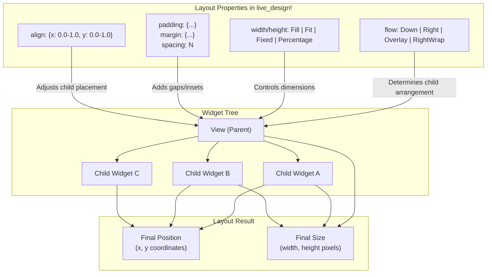

**Sources:** [skills/01-core/layout.md:8-155]()

---

## Flow Direction System

The `flow` property controls how child widgets are arranged within their parent container. This is the primary property that determines layout behavior.

### Flow Direction Types

| Flow Value | Layout Behavior | Use Case |
|------------|----------------|----------|
| `Down` | Vertical stack, top to bottom (default) | Lists, forms, vertical menus |
| `Right` | Horizontal row, left to right | Toolbars, button groups, horizontal navigation |
| `Overlay` | Stack on z-axis, all children at same position | Layered content, backgrounds with overlays |
| `RightWrap` | Horizontal with automatic line wrapping | Tag clouds, responsive button groups |

### Flow Direction Examples

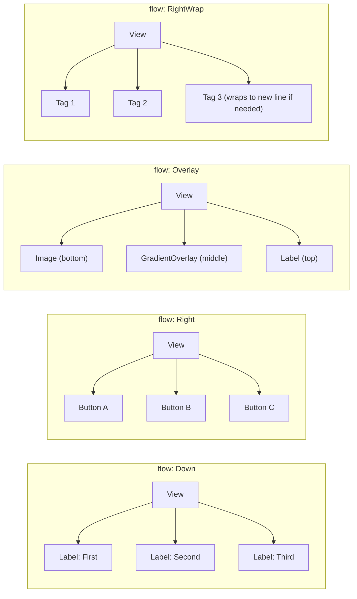

**Code Examples:**
- Vertical stack: [skills/01-core/layout.md:14-20]()
- Horizontal row: [skills/01-core/layout.md:23-28]()
- Overlay stack: [skills/01-core/layout.md:31-36]()
- Right wrap: [skills/01-core/layout.md:39-46]()

**Sources:** [skills/01-core/layout.md:8-55]()

---

## Sizing System

The `width` and `height` properties control how widgets determine their dimensions. Each widget can specify its sizing mode independently for each axis.

### Sizing Modes

| Mode | Behavior | Code Syntax | Common Usage |
|------|----------|-------------|--------------|
| Fill | Expand to consume available parent space | `width: Fill` | Content areas that should grow |
| Fit | Shrink to minimum size required by content | `width: Fit` | Labels, buttons with dynamic text |
| Fixed | Exact pixel value | `width: 200` | Fixed-size elements like icons |
| Percentage | Relative to parent dimension | `width: 50%` | Proportional layouts |
| All | Fill in both dimensions (shorthand) | `width: All, height: All` | Full-screen containers |

### Sizing Interaction with Flow

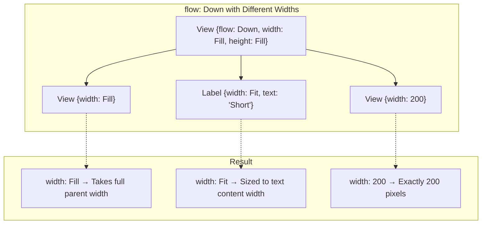

**Important Behavior:**
- `width: Fill` in `flow: Right` parent: Widget takes remaining horizontal space
- `height: Fill` in `flow: Down` parent: Widget takes remaining vertical space
- Multiple `Fill` children: Space is divided equally among them
- `Fit` with no content: Widget collapses to minimum size (often 0)

**Code Examples:**
- Fill sizing: [skills/01-core/layout.md:61]()
- Fit sizing: [skills/01-core/layout.md:64]()
- Fixed sizing: [skills/01-core/layout.md:67]()
- Mixed sizing: [skills/01-core/layout.md:76-79]()

**Sources:** [skills/01-core/layout.md:56-90]()

---

## Spacing System

Three distinct spacing properties control gaps and insets: `padding`, `margin`, and `spacing`. Understanding their differences is critical for predictable layouts.

### Spacing Property Semantics

```mermaid
graph TB
    subgraph "Widget with Padding and Margin"
        Margin["margin<br/>(space OUTSIDE widget)"]
        Border["Widget Boundary"]
        Padding["padding<br/>(space INSIDE widget)"]
        Content["Widget Content/Children"]
        
        Margin --> Border
        Border --> Padding
        Padding --> Content
    end
    
    subgraph "Parent with Spacing"
        ParentContainer["View {spacing: 10}"]
        Child1["Child A"]
        Gap1["10px gap (from spacing)"]
        Child2["Child B"]
        Gap2["10px gap (from spacing)"]
        Child3["Child C"]
        
        ParentContainer --> Child1
        Child1 --> Gap1
        Gap1 --> Child2
        Child2 --> Gap2
        Gap2 --> Child3
    end
```

| Property | Affects | Direction | Typical Use |
|----------|---------|-----------|-------------|
| `padding` | Inside widget boundary | Inward from edges | Content inset from widget borders |
| `margin` | Outside widget boundary | Outward, between siblings | Spacing between adjacent widgets |
| `spacing` | Between child widgets | Along flow direction | Uniform gaps in lists/toolbars |

### Spacing Syntax

**Padding and Margin:**
```
// All sides
padding: 16
margin: 8

// Partial sides
padding: { left: 10, right: 10 }
margin: { top: 20 }

// All sides explicitly
padding: { top: 10, bottom: 10, left: 16, right: 16 }
```

**Spacing:**
```
// Applied to parent container
<View> {
    flow: Down
    spacing: 10    // 10px gap between each child
    
    <Button> { text: "A" }  // 10px gap after
    <Button> { text: "B" }  // 10px gap after
    <Button> { text: "C" }
}
```

**Code Examples:**
- Padding syntax: [skills/01-core/layout.md:97-100]()
- Margin syntax: [skills/01-core/layout.md:102-105]()
- Spacing syntax: [skills/01-core/layout.md:107-113]()

**Sources:** [skills/01-core/layout.md:91-122]()

---

## Alignment System

The `align` property positions children within their parent container using normalized coordinates (0.0 to 1.0) on each axis.

### Alignment Coordinate System

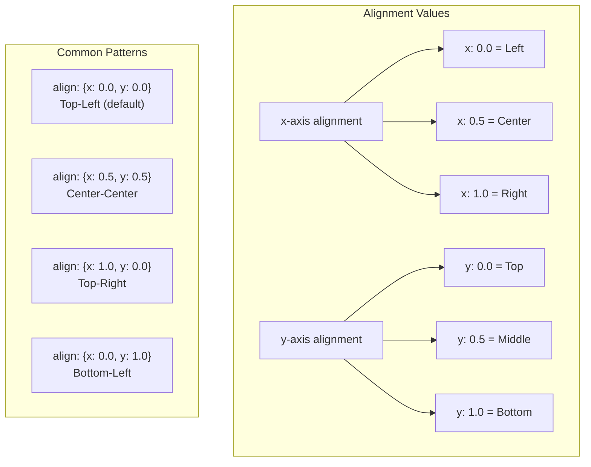

### Alignment Behavior

- Alignment is specified on the **parent** container
- Affects positioning of **child** widgets within the parent's available space
- Works independently on x and y axes
- Default is `{x: 0.0, y: 0.0}` (top-left)

### Alignment Examples

| Code | Visual Result |
|------|---------------|
| `align: { x: 0.5, y: 0.5 }` | Child centered both horizontally and vertically |
| `align: { x: 1.0, y: 0.0 }` | Child positioned at top-right corner |
| `align: { x: 0.5 }` | Child centered horizontally, top-aligned vertically |
| `align: { y: 0.5 }` | Child left-aligned horizontally, centered vertically |

**Code Examples:**
- Center alignment: [skills/01-core/layout.md:128-133]()
- Horizontal alignment: [skills/01-core/layout.md:136-140]()
- Vertical alignment: [skills/01-core/layout.md:143-147]()
- Common patterns: [skills/01-core/layout.md:150-153]()

**Sources:** [skills/01-core/layout.md:123-154]()

---

## Layout Computation Flow

Understanding how layout properties interact during rendering helps debug layout issues and create efficient designs.

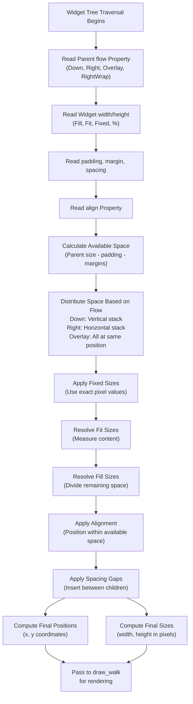

**Key Resolution Order:**
1. Fixed sizes are applied first (exact pixels, percentages)
2. Fit sizes are measured based on content
3. Fill sizes take remaining space after fixed and fit
4. Alignment adjusts final position within allocated space
5. Spacing adds gaps between positioned children

**Sources:** [skills/01-core/layout.md:8-155]()

---

## Common Layout Patterns

The following patterns demonstrate practical combinations of layout properties for typical UI structures.

### Card Layout

A vertically-stacked container with padding, spacing, and rounded corners.

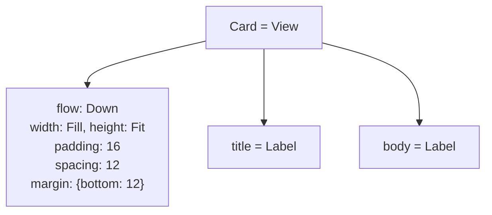

**Implementation:** [skills/01-core/layout.md:158-186]()

**Key Properties:**
- `width: Fill, height: Fit` - Takes full width, sizes to content height
- `flow: Down` - Stacks title and body vertically
- `padding: 16` - Insets content from edges
- `spacing: 12` - Gaps between title and body

---

### List Item (Row with Avatar)

Horizontal layout with left avatar, flexible middle content, and right metadata.

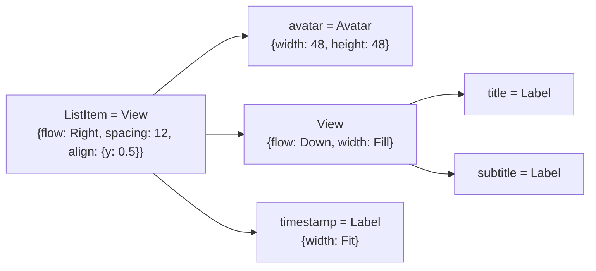

**Implementation:** [skills/01-core/layout.md:188-232]()

**Key Properties:**
- `flow: Right` - Horizontal arrangement
- `align: { y: 0.5 }` - Vertically center all children
- Avatar: Fixed `width: 48, height: 48`
- TextStack: `width: Fill` takes remaining space
- Timestamp: `width: Fit` only as wide as needed

---

### Split View (Sidebar + Content)

Fixed-width sidebar with flexible content area.

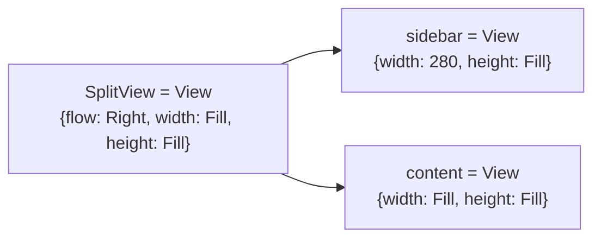

**Implementation:** [skills/01-core/layout.md:266-295]()

**Key Properties:**
- Parent: `flow: Right` - Horizontal split
- Sidebar: `width: 280` - Fixed width
- Content: `width: Fill` - Takes remaining space
- Both: `height: Fill` - Full viewport height

---

### Header + Content + Footer

Three-section vertical layout with fixed header/footer and scrollable content.

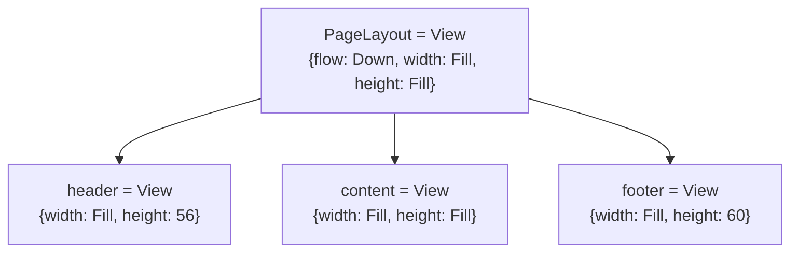

**Implementation:** [skills/01-core/layout.md:297-336]()

**Key Properties:**
- Parent: `flow: Down` - Vertical stack
- Header: `height: 56` - Fixed height
- Footer: `height: 60` - Fixed height
- Content: `height: Fill` - Takes remaining vertical space

---

### Centered Content

Content centered both horizontally and vertically within viewport.

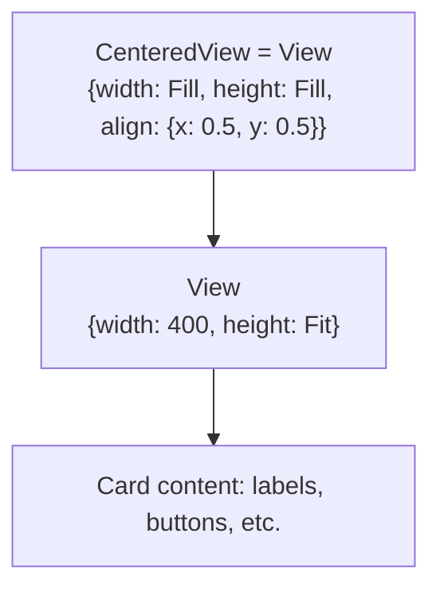

**Implementation:** [skills/01-core/layout.md:338-357]()

**Key Properties:**
- Outer: `align: { x: 0.5, y: 0.5 }` - Centers child
- Inner: `width: 400` - Fixed width card
- Inner: `height: Fit` - Sizes to content

---

### Tag Cloud (RightWrap)

Horizontal layout with automatic wrapping for tag collections.

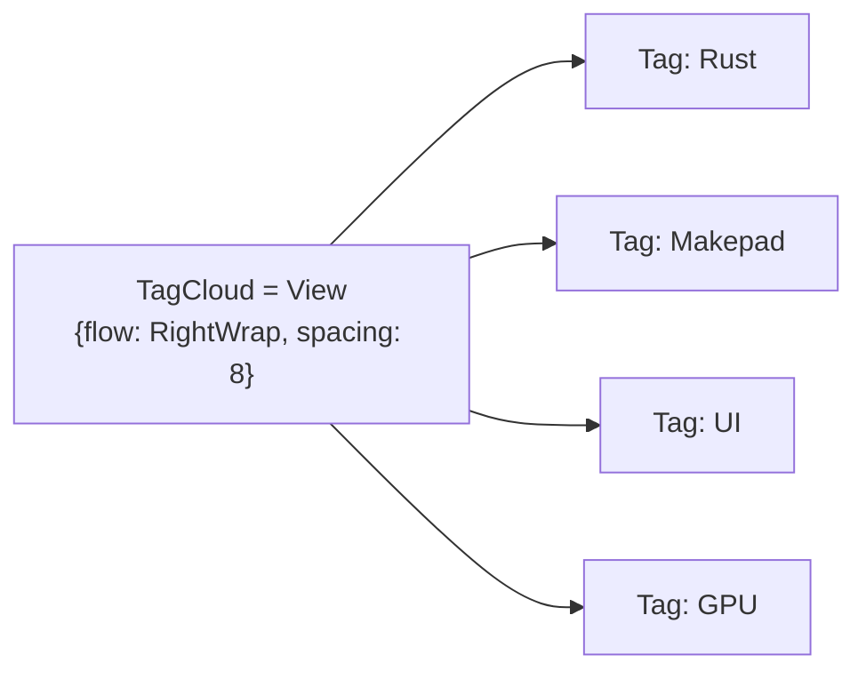

**Implementation:** [skills/01-core/layout.md:359-385]()

**Key Properties:**
- `flow: RightWrap` - Horizontal with line wrapping
- `spacing: 8` - Uniform gap between tags
- Tags: `width: Fit, height: Fit` - Size to content

**Sources:** [skills/01-core/layout.md:156-385]()

---

## Layout Debugging

### Visualization Technique

Make layout boundaries visible by adding background colors to containers:

```
<View> {
    show_bg: true
    draw_bg: { color: #ff000033 }  // Semi-transparent red
    // ... children
}
```

**Code Reference:** [skills/01-core/layout.md:389-395]()

### Common Layout Issues

| Problem | Cause | Solution |
|---------|-------|----------|
| Children overlap | Missing `spacing` property | Add `spacing: N` to parent |
| Widget collapses to zero size | `width: Fill` with no parent width defined | Set explicit parent width or use `Fit` |
| Children take entire parent height | `height: Fill` in `flow: Down` parent | Use `height: Fit` or fixed height |
| Content not visible | Widget has no background and no content | Add `show_bg: true` or ensure children render |

**Sources:** [skills/01-core/layout.md:387-401]()

---

## Summary

The Makepad layout system provides a declarative model for positioning and sizing widgets through four primary property types:

1. **Flow** (`Down`, `Right`, `Overlay`, `RightWrap`) - Determines child arrangement
2. **Sizing** (`Fill`, `Fit`, Fixed, %) - Controls dimensions
3. **Spacing** (`padding`, `margin`, `spacing`) - Adds gaps and insets
4. **Alignment** (`x`, `y` from 0.0-1.0) - Positions within available space

These properties combine to create flexible, responsive layouts that work across desktop, mobile, and web platforms. The layout computation occurs during the widget tree traversal, resolving sizes in order (fixed → fit → fill) before applying alignment and spacing adjustments.

**Sources:** [skills/01-core/layout.md:1-401]()

---

