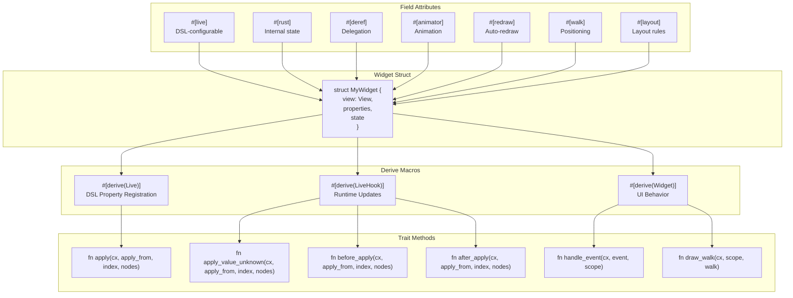
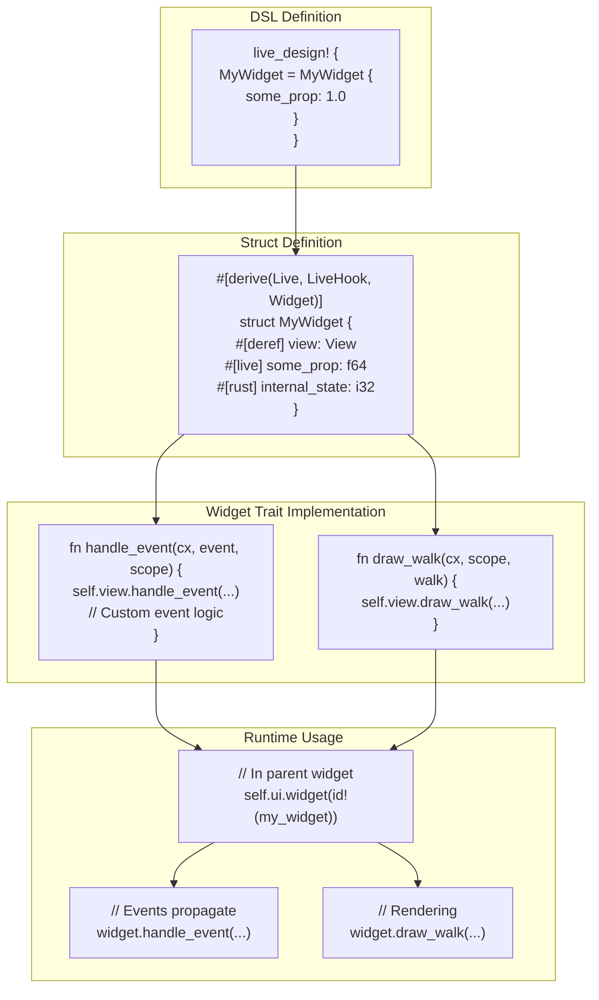
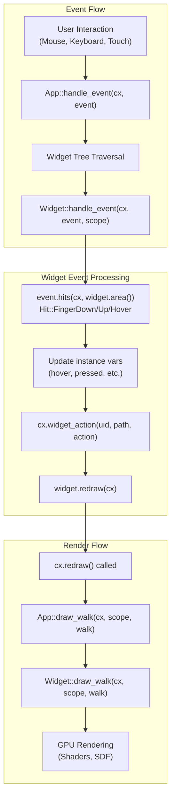
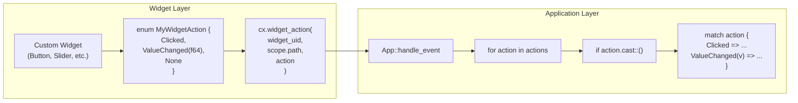
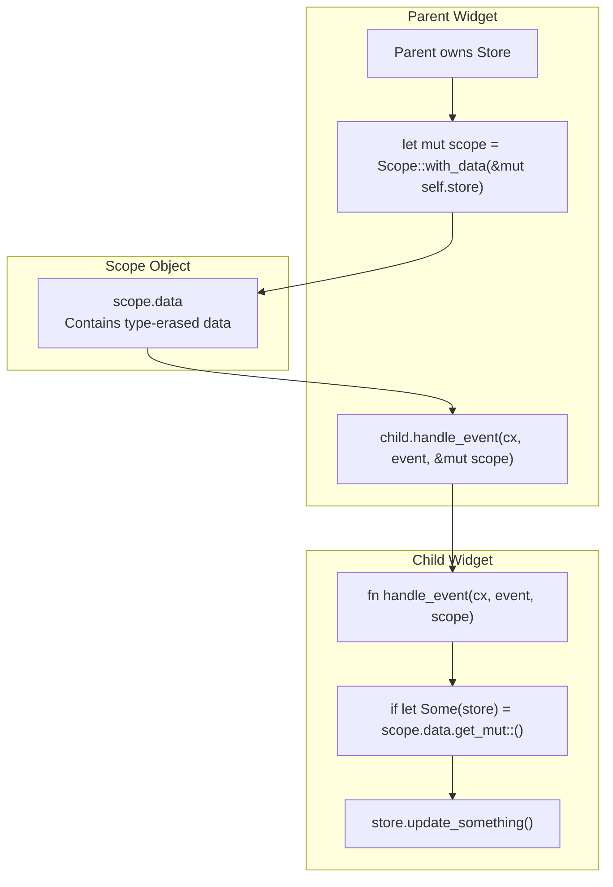
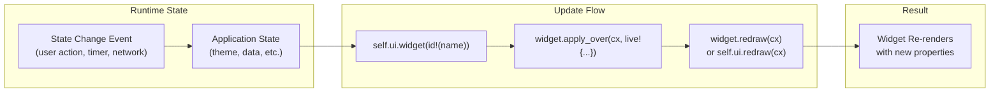
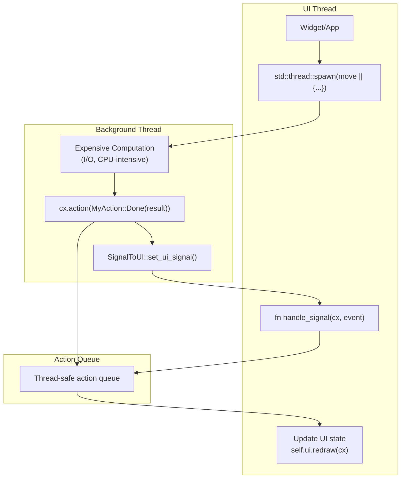

<!-- source: DeepWiki mcp.deepwiki.com · repo ZhangHanDong/makepad-skills · page 3.2 Widget System · fetched 2026-10-26 -->

# Widget System

<details>
<summary>Relevant source files</summary>

The following files were used as context for generating this wiki page:

- [skills/01-core/widgets.md](skills/01-core/widgets.md)

</details>


## Purpose and Scope

This document describes Makepad's widget system, covering both built-in UI components and patterns for creating custom widgets. Topics include widget trait implementation, lifecycle methods, state management, dynamic UI updates, and integration with timers and background operations.

For layout configuration of widgets, see [Layout System](#3.1). For event handling patterns at the application level, see [Event Handling](#3.3). For a comprehensive list of all built-in components, see [Component Gallery](#4). For visual styling including fonts and icons, see [Styling: Fonts and Icons](#3.4).

**Sources:** [skills/01-core/widgets.md:1-350]()

---

## Widget Trait Architecture

The widget system is built on three core traits that work together to enable the `live_design!` DSL, runtime updates, and event handling.

### Core Traits



**Diagram: Widget Trait System Architecture**

| Trait | Purpose | Key Methods |
|-------|---------|-------------|
| `Live` | Registers struct with DSL system | `apply()` - processes DSL properties |
| `LiveHook` | Enables runtime property updates | `before_apply()`, `after_apply()`, `apply_value_unknown()` |
| `Widget` | Defines UI behavior and rendering | `handle_event()`, `draw_walk()` |

**Sources:** [skills/01-core/widgets.md:134-149]()

### Field Attributes

Field attributes control how struct fields integrate with the widget system:

| Attribute | Purpose | Example |
|-----------|---------|---------|
| `#[live]` | DSL-configurable property, can be set in `live_design!` | `#[live] color: Vec4` |
| `#[rust]` | Rust-only state, not accessible from DSL | `#[rust] counter: i32` |
| `#[deref]` | Delegates trait methods to inner widget | `#[deref] view: View` |
| `#[animator]` | Enables animation state machine | `#[animator] animator: Animator` |
| `#[redraw]` | Triggers automatic redraw when field changes | `#[redraw] visible: bool` |
| `#[walk]` | Layout positioning properties | `#[walk] walk: Walk` |
| `#[layout]` | Layout computation rules | `#[layout] layout: Layout` |

**Sources:** [skills/01-core/widgets.md:152-162]()

---

## Common Built-in Widgets

Makepad provides several built-in widgets for common UI patterns. Each widget can be configured in the `live_design!` DSL and manipulated at runtime.

### Label Widget

Displays static or dynamic text with configurable styling.

```rust
// DSL definition
my_label = <Label> {
    width: Fit
    draw_text: {
        text_style: <THEME_FONT_REGULAR>{ font_size: 16.0 }
        color: #ffffff
    }
    text: "Hello World"
}
```

**Key properties:**
- `text: String` - Display text
- `draw_text` - Text rendering properties including `text_style` and `color`
- Standard layout properties (`width`, `height`, `padding`, etc.)

**Sources:** [skills/01-core/widgets.md:10-21]()

### Button Widget

Interactive button with hover states and customizable appearance.

```rust
my_btn = <Button> {
    width: Fit
    height: 40
    padding: {left: 16, right: 16}
    text: "Submit"
    
    draw_bg: {
        color: #2196F3
        color_hover: #1976D2
        border_radius: 4.0
    }
    
    draw_text: {
        text_style: <THEME_FONT_BOLD>{ font_size: 14.0 }
        color: #ffffff
    }
}
```

**Key properties:**
- `text: String` - Button label
- `draw_bg` - Background styling with `color`, `color_hover`, `border_radius`
- `draw_text` - Text styling

**Sources:** [skills/01-core/widgets.md:23-43]()

### TextInput Widget

Single-line text input field with cursor and selection support.

```rust
my_input = <TextInput> {
    width: Fill
    height: Fit
    padding: {top: 12, bottom: 12, left: 10, right: 10}
    text: "Default value"
    
    draw_bg: {
        color: #1a1a1a
        border_radius: 4.0
    }
    
    draw_text: {
        text_style: <THEME_FONT_REGULAR>{ font_size: 18.0 }
        color: #00ff88
    }
    
    draw_cursor: {
        color: #00ff88
    }
}
```

**Runtime interaction:**
```rust
// Detect text changes
if let Some(text) = self.ui.text_input(id!(my_input)).changed(&actions) {
    // Process new text value
    if let Ok(value) = text.parse::<f64>() {
        self.amount = value;
    }
}
```

**Sources:** [skills/01-core/widgets.md:45-76]()

### Container Widgets

**ScrollYView** - Vertical scrolling container:
```rust
<ScrollYView> {
    width: Fill
    height: Fill
    flow: Down
    spacing: 10
    // Child widgets...
}
```

**RoundedView** - Container with rounded corners:
```rust
<RoundedView> {
    width: Fill
    height: Fit
    padding: 16
    draw_bg: {
        color: #1a1a26
        border_radius: 8.0
    }
    // Child widgets...
}
```

**Window** - Top-level application window:
```rust
ui: <Window> {
    window: {
        title: "My App"
        inner_size: vec2(400, 600)
    }
    show_bg: true
    draw_bg: { color: #1a1a1a }
    body = <View> {
        // Window content
    }
}
```

**Sources:** [skills/01-core/widgets.md:78-127]()

---

## Custom Widget Creation

Custom widgets follow a standard pattern using the three core traits and field attributes to integrate with Makepad's DSL and runtime systems.

### Basic Widget Pattern



**Diagram: Custom Widget Creation Flow**

The basic pattern delegates behavior to an inner `View` widget while allowing custom properties and state:

```rust
#[derive(Live, LiveHook, Widget)]
pub struct MyWidget {
    #[deref] view: View,          // Delegate to parent widget
    #[live] some_prop: f64,       // DSL-configurable property
    #[rust] internal_state: i32,  // Rust-only state
}

impl Widget for MyWidget {
    fn handle_event(&mut self, cx: &mut Cx, event: &Event, scope: &mut Scope) {
        // Delegate to view first
        self.view.handle_event(cx, event, scope);
        
        // Custom event handling logic here
    }

    fn draw_walk(&mut self, cx: &mut Cx2d, scope: &mut Scope, walk: Walk) -> DrawStep {
        // Delegate rendering to view
        self.view.draw_walk(cx, scope, walk)
    }
}
```

**Key points:**
- `#[deref]` on `view: View` allows method delegation
- `#[live]` properties can be set in DSL and updated at runtime
- `#[rust]` fields maintain internal state not exposed to DSL
- Call `self.view.handle_event()` to delegate to parent widget
- Return `self.view.draw_walk()` to delegate rendering

**Sources:** [skills/01-core/widgets.md:132-149]()

---

## Widget Lifecycle and Event Handling

Widgets participate in event processing and rendering through two primary lifecycle methods.

### Lifecycle Methods



**Diagram: Widget Lifecycle Flow**

#### handle_event

Processes user interactions and system events. Pattern for custom event handling with hit testing:

```rust
impl Widget for MyWidget {
    fn handle_event(&mut self, cx: &mut Cx, event: &Event, scope: &mut Scope) {
        // Delegate to inner widget first
        self.view.handle_event(cx, event, scope);
        
        // Hit test for this widget's area
        match event.hits(cx, self.view.area()) {
            Hit::FingerDown(_) => {
                // Handle press
                self.is_pressed = true;
                self.redraw(cx);
            }
            Hit::FingerUp(fe) => {
                if fe.is_over {
                    // Handle release over widget
                    self.handle_click(cx, scope);
                }
                self.is_pressed = false;
                self.redraw(cx);
            }
            Hit::FingerHoverIn(_) => {
                self.is_hovering = true;
                self.redraw(cx);
            }
            Hit::FingerHoverOut(_) => {
                self.is_hovering = false;
                self.redraw(cx);
            }
            _ => {}
        }
    }
}
```

**Sources:** [skills/01-core/widgets.md:142-149](), [skills/01-core/widgets.md:175-192]()

#### draw_walk

Renders the widget to the screen. Standard delegation pattern:

```rust
impl Widget for MyWidget {
    fn draw_walk(&mut self, cx: &mut Cx2d, scope: &mut Scope, walk: Walk) -> DrawStep {
        // Delegate to inner view
        self.view.draw_walk(cx, scope, walk)
    }
}
```

For custom rendering, widgets can directly draw using shaders and SDF (see [SDF Drawing](#5.2)).

**Sources:** [skills/01-core/widgets.md:146-148]()

---

## Custom Actions

Widgets can emit custom actions to communicate state changes to parent components.

### Action Definition and Emission



**Diagram: Custom Action Flow**

**Pattern:**

```rust
// 1. Define action enum
#[derive(Clone, Debug, DefaultNone)]
pub enum MyWidgetAction {
    Clicked,
    ValueChanged(f64),
    None,
}

// 2. Emit action from widget
impl Widget for MyWidget {
    fn handle_event(&mut self, cx: &mut Cx, event: &Event, scope: &mut Scope) {
        self.view.handle_event(cx, event, scope);
        
        match event.hits(cx, self.view.area()) {
            Hit::FingerDown(_) => {
                cx.widget_action(
                    self.widget_uid(),
                    &scope.path,
                    MyWidgetAction::Clicked
                );
            }
            Hit::FingerUp(fe) => {
                if fe.is_over {
                    cx.widget_action(
                        self.widget_uid(),
                        &scope.path,
                        MyWidgetAction::ValueChanged(1.0)
                    );
                }
            }
            _ => {}
        }
    }
}

// 3. Handle action in parent (App or container widget)
fn handle_actions(&mut self, cx: &mut Cx, actions: &Actions) {
    for action in actions {
        if let Some(action) = action.cast::<MyWidgetAction>() {
            match action {
                MyWidgetAction::Clicked => {
                    // Handle click
                }
                MyWidgetAction::ValueChanged(value) => {
                    // Handle value change
                    self.current_value = *value;
                }
                _ => {}
            }
        }
    }
}
```

**Key points:**
- Actions must derive `Clone`, `Debug`, and `DefaultNone`
- Use `cx.widget_action()` to emit from widget
- Use `action.cast::<T>()` to handle in parent
- Always pass `self.widget_uid()` and `&scope.path` when emitting

**Sources:** [skills/01-core/widgets.md:164-193]()

---

## State Management

Makepad provides two primary patterns for managing state: thread-local state for UI-only data and scope-based state for parent-to-child data passing.

### Thread-Local State

For data that only exists on the UI thread:

```rust
thread_local! {
    static APP_DATA: Rc<RefCell<AppData>> = Rc::new(RefCell::new(AppData::default()));
}

pub fn get_app_data(_cx: &mut Cx) -> Rc<RefCell<AppData>> {
    APP_DATA.with(Rc::clone)
}

// Usage in widget
fn handle_event(&mut self, cx: &mut Cx, event: &Event, scope: &mut Scope) {
    let app_data = get_app_data(cx);
    let mut data = app_data.borrow_mut();
    data.update_something();
}
```

**Sources:** [skills/01-core/widgets.md:197-207]()

### Scope-Based Data Passing

For passing data from parent to child widgets through the widget tree:



**Diagram: Scope-Based Data Flow**

**Pattern:**

```rust
// Parent passes data
fn handle_event(&mut self, cx: &mut Cx, event: &Event, scope: &mut Scope) {
    let mut scope = Scope::with_data(&mut self.store);
    self.view.handle_event(cx, event, &mut scope);
}

// Child accesses data
fn handle_event(&mut self, cx: &mut Cx, event: &Event, scope: &mut Scope) {
    if let Some(store) = scope.data.get_mut::<Store>() {
        store.update_something();
    }
}
```

**Key points:**
- Use `Scope::with_data()` to attach data to scope
- Child widgets use `scope.data.get_mut::<T>()` to access
- Type-safe data passing without global state
- Data flows down the widget tree only

**Sources:** [skills/01-core/widgets.md:209-222]()

---

## Dynamic UI Updates

Widgets can be updated at runtime using the `apply_over` method to change properties defined in the DSL.

### Using apply_over



**Diagram: Dynamic UI Update Flow**

**Pattern:**

```rust
// Update text color
self.ui.label(id!(my_label)).apply_over(cx, live!{
    draw_text: { color: #ff0000 }
});

// Update background
self.ui.view(id!(my_view)).apply_over(cx, live!{
    show_bg: true
    draw_bg: { color: #ffffff }
});

// Update multiple properties
self.ui.button(id!(theme_btn)).apply_over(cx, live!{
    draw_text: { color: (accent_color) }
    draw_bg: { color: (bg_color) }
});

// Always redraw after updates
self.ui.redraw(cx);
```

**Key points:**
- Use `apply_over()` to update DSL properties at runtime
- Variables in `live!` blocks use parentheses: `(variable_name)`
- Always call `redraw(cx)` after applying changes
- Changes apply to nested properties like `draw_text.color`

**Sources:** [skills/01-core/widgets.md:224-250]()

### Using Variables in live!

```rust
let colors = self.current_theme.colors();

self.ui.label(id!(title)).apply_over(cx, live!{
    draw_text: { color: (colors.accent) }  // Parentheses for variables
});

self.ui.view(id!(card)).apply_over(cx, live!{
    draw_bg: { color: (colors.bg_card) }
});
```

**Sources:** [skills/01-core/widgets.md:252-264]()

### Updating Text

Special methods exist for text updates:

```rust
// Update label text
label.set_text(cx, "New text");
label.redraw(cx);

// Update input text
input.set_text(cx, "1000");
```

**Note:** Always pass `cx` as the first argument to text methods.

**Sources:** [skills/01-core/widgets.md:266-276]()

---

## Timer System

Timers enable periodic updates and animations without blocking the UI thread.

### Timer Setup and Handling

```rust
#[derive(Live, LiveHook)]
pub struct App {
    #[live] ui: WidgetRef,
    #[rust] refresh_timer: Timer,
    #[rust] countdown: i32,
}

impl MatchEvent for App {
    fn handle_startup(&mut self, cx: &mut Cx) {
        self.countdown = 30;
        self.refresh_timer = cx.start_interval(1.0);  // 1 second interval
    }
    
    fn handle_timer(&mut self, cx: &mut Cx, _event: &TimerEvent) {
        self.countdown -= 1;
        self.update_countdown_display(cx);
        
        if self.countdown <= 0 {
            self.countdown = 30;
            self.refresh_data(cx);
        }
    }
}
```

**Key points:**
- Store `Timer` in struct with `#[rust]` attribute
- Call `cx.start_interval(seconds)` to start timer
- Implement `handle_timer()` in `MatchEvent` trait
- Timer fires repeatedly at specified interval

**Sources:** [skills/01-core/widgets.md:277-305]()

---

## Network Operations and Background Threads

Widgets can integrate with asynchronous operations through HTTP requests and background thread communication.

### HTTP Requests

```rust
fn send_request(&self, cx: &mut Cx) {
    let request_id = live_id!(FetchData);
    let mut request = HttpRequest::new(url, HttpMethod::POST);
    request.set_header("Content-Type".to_string(), "application/json".to_string());
    request.set_json_body(&data);
    cx.http_request(request_id, request);
}

// Handle response in MatchEvent trait
fn handle_network_responses(&mut self, cx: &mut Cx, responses: &NetworkResponsesEvent) {
    for event in responses {
        match &event.response {
            NetworkResponse::HttpResponse(response) => {
                if event.request_id == live_id!(FetchData) {
                    // Process response
                }
            }
            _ => {}
        }
    }
}
```

**Sources:** [skills/01-core/widgets.md:307-319]()

### Background Thread Communication



**Diagram: Background Thread Communication Flow**

**Pattern:**

```rust
use makepad_widgets::SignalToUI;

// Spawn background thread
std::thread::spawn(move || {
    let result = expensive_computation();
    
    // Queue action for UI thread
    cx.action(MyAction::ComputationDone(result));
    
    // Wake UI thread
    SignalToUI::set_ui_signal();
});

// Handle in UI thread (MatchEvent trait)
fn handle_signal(&mut self, cx: &mut Cx, actions: &Actions) {
    for action in actions {
        if let Some(MyAction::ComputationDone(result)) = action.downcast_ref() {
            self.update_ui_with_result(cx, result);
        }
    }
}
```

**Key points:**
- Use `SignalToUI::set_ui_signal()` to wake UI thread from background
- Use `cx.action()` to queue actions for UI thread
- Use `action.downcast_ref()` (not `action.cast()`) for non-widget actions
- Never block UI thread with expensive operations

**Sources:** [skills/01-core/widgets.md:320-339]()

---

## Common Mistakes

| Mistake | Fix |
|---------|-----|
| Forgetting `live_design!(cx)` call | Register in `LiveRegister::live_register` |
| Missing `#[deref]` on View | Add `#[deref] view: View` for delegation |
| Not calling `redraw(cx)` after state change | Always call `self.redraw(cx)` or `widget.redraw(cx)` |
| Using `action.cast()` for non-widget actions | Use `action.downcast_ref()` for background thread actions |
| Blocking UI thread with async | Use `SignalToUI::set_ui_signal()` from background threads |

**Sources:** [skills/01-core/widgets.md:341-349]()

---

