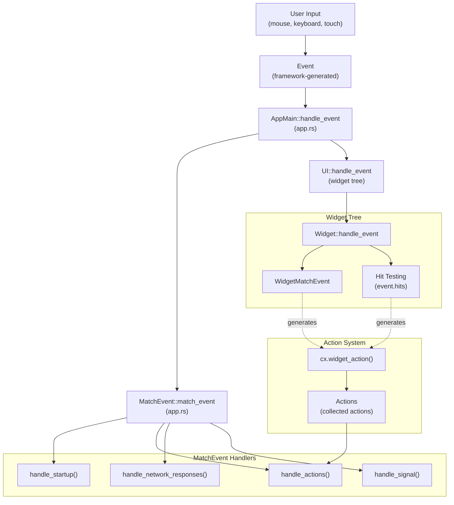
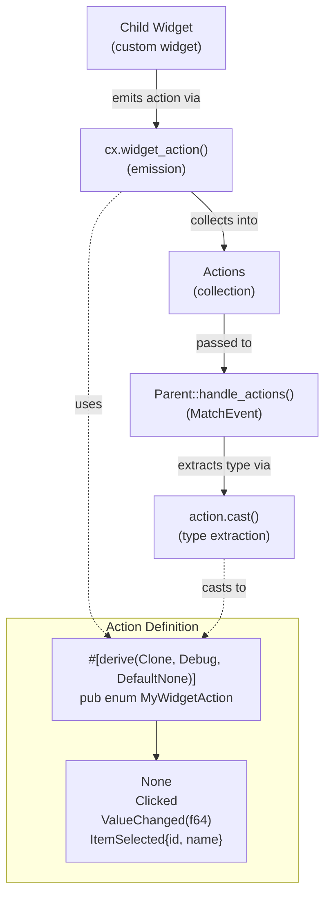

<!-- source: DeepWiki mcp.deepwiki.com · repo ZhangHanDong/makepad-skills · page 3.3 Event Handling · fetched 2026-10-26 -->

# Event Handling

<details>
<summary>Relevant source files</summary>

The following files were used as context for generating this wiki page:

- [skills/01-core/events.md](skills/01-core/events.md)

</details>


## Purpose and Scope

This document describes Makepad's event-driven architecture, including application-level event routing, widget interaction handling, custom action systems, and background operation integration. It covers the `AppMain` and `MatchEvent` traits, the `ids!` macro for widget identification, hit testing with the `Hit` enum, and communication patterns between widgets and the application layer.

For information about widget lifecycle and trait implementation, see [Widget System](#3.2). For specific widget behaviors and APIs, see [Component Gallery](#4).

---

## Event Flow Architecture

Makepad uses a bidirectional event system where user interactions flow down through the widget tree, and custom actions flow back up to the application layer.

**Event Flow Diagram**



**Sources:** [skills/01-core/events.md:8-53]()

---

## Application-Level Event Routing

### AppMain Trait

The `AppMain` trait provides the entry point for all events in a Makepad application. It is implemented on the main `App` struct and delegates to two subsystems: `MatchEvent` for application logic and `UI` for widget tree traversal.

```rust
impl AppMain for App {
    fn handle_event(&mut self, cx: &mut Cx, event: &Event) {
        self.match_event(cx, event);
        self.ui.handle_event(cx, event, &mut Scope::empty());
    }
}
```

**Sources:** [skills/01-core/events.md:45-50]()

### MatchEvent Trait

The `MatchEvent` trait provides specialized handlers for different event categories. Each handler receives the appropriate event type and context.

| Handler Method | Purpose | Invocation Trigger |
|----------------|---------|-------------------|
| `handle_startup()` | Initialization logic | Application launch |
| `handle_actions()` | Widget action processing | Widget interactions |
| `handle_network_responses()` | HTTP response handling | Network request completion |
| `handle_signal()` | Background thread communication | `SignalToUI::set_ui_signal()` call |

**Implementation Pattern:**

```rust
impl MatchEvent for App {
    fn handle_startup(&mut self, cx: &mut Cx) {
        // Initialize application state
    }

    fn handle_actions(&mut self, cx: &mut Cx, actions: &Actions) {
        // Process widget actions
    }

    fn handle_network_responses(&mut self, cx: &mut Cx, responses: &NetworkResponsesEvent) {
        // Process HTTP responses
    }

    fn handle_signal(&mut self, cx: &mut Cx) {
        // Process background thread signals
    }
}
```

**Sources:** [skills/01-core/events.md:11-43]()

---

## Widget Identification with ids! Macro

The `ids!` macro provides compile-time-checked widget identification within the widget tree. It supports single widgets, nested paths, and multiple widget sets.

### Usage Patterns

| Pattern | Syntax | Use Case |
|---------|--------|----------|
| Single widget | `ids!(button_name)` | Direct widget reference |
| Nested path | `ids!(container.header.title)` | Navigate hierarchy |
| Multiple widgets | `ids!(tab1, tab2, tab3)` | Radio button sets |

**Examples:**

```rust
// Single widget reference
self.ui.button(ids!(submit_button))

// Nested path navigation
self.ui.label(ids!(main_panel.sidebar.username))

// Multiple widget set (for radio buttons)
self.ui.radio_button_set(ids!(
    navigation.home_tab,
    navigation.settings_tab,
    navigation.profile_tab
))
```

**Sources:** [skills/01-core/events.md:55-66]()

---

## Widget-Level Event Handling

Custom widgets implement the `Widget` trait to handle events within their scope. The pattern delegates to child widgets first, then processes widget-specific logic.

### Widget Trait Implementation

```rust
impl Widget for MyWidget {
    fn handle_event(&mut self, cx: &mut Cx, event: &Event, scope: &mut Scope) {
        // 1. Delegate to child widgets
        self.view.handle_event(cx, event, scope);

        // 2. Handle widget-specific events
        self.widget_match_event(cx, event, scope);
    }
}
```

**Sources:** [skills/01-core/events.md:88-96]()

### WidgetMatchEvent Trait

The `WidgetMatchEvent` trait provides action handling for custom widgets, allowing them to respond to child widget actions and emit their own actions to parent widgets.

```rust
impl WidgetMatchEvent for MyWidget {
    fn handle_actions(&mut self, cx: &mut Cx, actions: &Actions, scope: &mut Scope) {
        // Process child widget actions
        if self.view.button(ids!(action_button)).clicked(&actions) {
            // Emit action to parent
            cx.widget_action(
                self.widget_uid(),
                &scope.path,
                MyWidgetAction::Clicked
            );
        }
    }
}
```

**Sources:** [skills/01-core/events.md:98-108]()

---

## Hit Testing

Hit testing determines which widget received a user interaction and what type of interaction occurred. The `Hit` enum provides variants for different interaction types.

### Hit Enum Variants

| Variant | Trigger Condition | Common Use Case |
|---------|------------------|-----------------|
| `Hit::FingerDown` | Mouse/touch press | Button press start |
| `Hit::FingerUp` | Mouse/touch release | Button click completion |
| `Hit::FingerMove` | Mouse/touch drag | Slider interaction |
| `Hit::FingerHoverIn` | Mouse enters area | Hover state activation |
| `Hit::FingerHoverOut` | Mouse leaves area | Hover state deactivation |
| `Hit::KeyDown` | Key press | Keyboard shortcuts |
| `Hit::KeyUp` | Key release | Key release handling |
| `Hit::KeyFocus` | Widget gains focus | Focus indicator activation |
| `Hit::KeyFocusLost` | Widget loses focus | Focus indicator deactivation |

### Hit Testing Pattern

```rust
match event.hits(cx, self.draw_bg.area()) {
    Hit::FingerDown(fe) => {
        // Handle mouse/touch down
    }
    Hit::FingerUp(fe) => {
        // Handle mouse/touch up
    }
    Hit::FingerMove(fe) => {
        // Handle drag
    }
    Hit::FingerHoverIn(_) => {
        // Activate hover state
    }
    Hit::FingerHoverOut(_) => {
        // Deactivate hover state
    }
    Hit::KeyDown(ke) => {
        // Handle keyboard input
    }
    _ => {}
}
```

**Sources:** [skills/01-core/events.md:69-83]()

---

## Custom Actions System

Custom actions enable typed communication from child widgets to parent widgets or the application layer. The system consists of three parts: action definition, emission, and handling.

**Custom Actions Communication Pattern**



**Sources:** [skills/01-core/events.md:111-166]()

### Action Definition

Custom action enums must derive `Clone`, `Debug`, and `DefaultNone`. They must include a `None` variant for default cases.

```rust
#[derive(Clone, Debug, DefaultNone)]
pub enum MyWidgetAction {
    None,
    Clicked,
    ValueChanged(f64),
    ItemSelected { id: usize, name: String },
}
```

**Sources:** [skills/01-core/events.md:115-123]()

### Action Emission

Widgets emit actions using `cx.widget_action()`, which requires the widget UID, scope path, and action variant.

```rust
// Emit simple action
cx.widget_action(
    self.widget_uid(),
    &scope.path,
    MyWidgetAction::Clicked
);

// Emit action with data
cx.widget_action(
    self.widget_uid(),
    &scope.path,
    MyWidgetAction::ValueChanged(42.0)
);
```

**Sources:** [skills/01-core/events.md:128-141]()

### Action Handling

Action handlers use the `cast()` method to extract typed action variants from the generic `Actions` collection.

**Method 1: Iterate and Cast**

```rust
for action in actions {
    if let MyWidgetAction::Clicked = action.cast() {
        self.handle_click(cx);
    }
}
```

**Method 2: Widget-Specific Actions**

```rust
if let Some(action) = self.ui.widget(id!(my_widget)).actions(actions) {
    match action.cast() {
        MyWidgetAction::ValueChanged(val) => {
            self.value = val;
        }
        _ => {}
    }
}
```

**Sources:** [skills/01-core/events.md:145-165]()

---

## Common Interaction Patterns

### Button Events

Buttons provide two primary interaction methods: `clicked()` for single clicks and `pressed()` for press-and-hold detection.

```rust
impl MatchEvent for App {
    fn handle_actions(&mut self, cx: &mut Cx, actions: &Actions) {
        // Single click
        if self.ui.button(id!(submit_btn)).clicked(&actions) {
            self.submit_form(cx);
        }

        // Pressed state (held down)
        if self.ui.button(id!(hold_btn)).pressed(&actions) {
            self.on_hold(cx);
        }

        // Multiple button handling
        for (i, btn_id) in [id!(btn1), id!(btn2), id!(btn3)].iter().enumerate() {
            if self.ui.button(*btn_id).clicked(&actions) {
                self.handle_button(cx, i);
            }
        }
    }
}
```

**Sources:** [skills/01-core/events.md:171-191]()

### Radio Button Navigation

Radio button sets return the index of the selected button via `selected()`. This pattern is commonly used for tab navigation.

```rust
let tabs = self.ui.radio_button_set(ids!(
    sidebar.home_tab,
    sidebar.settings_tab,
    sidebar.profile_tab
));

if let Some(selected) = tabs.selected(cx, actions) {
    // Hide all pages
    self.ui.view(ids!(pages.home)).set_visible(cx, false);
    self.ui.view(ids!(pages.settings)).set_visible(cx, false);
    self.ui.view(ids!(pages.profile)).set_visible(cx, false);

    // Show selected page
    match selected {
        0 => self.ui.view(ids!(pages.home)).set_visible(cx, true),
        1 => self.ui.view(ids!(pages.settings)).set_visible(cx, true),
        2 => self.ui.view(ids!(pages.profile)).set_visible(cx, true),
        _ => {}
    }
}
```

**Sources:** [skills/01-core/events.md:196-220]()

### Text Input Events

Text input widgets provide multiple event types: text changes, enter key presses, and focus state changes.

| Method | Return Type | Event Trigger |
|--------|-------------|---------------|
| `changed(&actions)` | `Option<String>` | Text content modified |
| `returned(&actions)` | `Option<String>` | Enter key pressed |
| `focus(&actions)` | `bool` | Widget gained focus |
| `focus_lost(&actions)` | `bool` | Widget lost focus |

```rust
impl MatchEvent for App {
    fn handle_actions(&mut self, cx: &mut Cx, actions: &Actions) {
        // Text changed (live search)
        if let Some(text) = self.ui.text_input(id!(search_input)).changed(&actions) {
            self.search(cx, &text);
        }

        // Enter pressed (execute search)
        if self.ui.text_input(id!(search_input)).returned(&actions).is_some() {
            self.execute_search(cx);
        }

        // Focus gained
        if self.ui.text_input(id!(input)).focus(&actions) {
            self.show_keyboard(cx);
        }

        // Focus lost
        if self.ui.text_input(id!(input)).focus_lost(&actions) {
            self.hide_keyboard(cx);
        }
    }
}
```

**Sources:** [skills/01-core/events.md:224-246]()

---

## Background Operations

### Signal Handling

The `handle_signal()` method processes notifications from background threads via `SignalToUI::set_ui_signal()`. This mechanism enables thread-safe communication from worker threads to the UI thread.

```rust
impl MatchEvent for App {
    fn handle_signal(&mut self, cx: &mut Cx) {
        // Check shared state or receivers for data
        if let Some(receiver) = &self.data_receiver {
            while let Ok(data) = receiver.try_recv() {
                self.process_data(cx, data);
            }
        }
    }
}
```

**Sources:** [skills/01-core/events.md:250-262]()

### Network Response Handling

The `handle_network_responses()` method processes HTTP responses initiated by `cx.http_request()`.

```rust
impl MatchEvent for App {
    fn handle_network_responses(&mut self, cx: &mut Cx, responses: &NetworkResponsesEvent) {
        for event in responses {
            match &event.response {
                NetworkResponse::HttpResponse(res) if res.status_code == 200 => {
                    let data: MyData = res.get_json_body().unwrap();
                    self.process_data(cx, data);
                }
                _ => {}
            }
        }
    }
}
```

**Sources:** [skills/01-core/events.md:32-42]()

---

## Keyboard Shortcuts

Keyboard shortcuts are implemented by checking `KeyCode` variants and modifier states within `Hit::KeyDown` handlers.

### Common Keyboard Patterns

```rust
impl Widget for MyWidget {
    fn handle_event(&mut self, cx: &mut Cx, event: &Event, scope: &mut Scope) {
        match event.hits(cx, self.view.area()) {
            Hit::KeyDown(ke) => {
                match ke.key_code {
                    KeyCode::Escape => self.close(cx),
                    KeyCode::Return => self.submit(cx),
                    KeyCode::KeyS if ke.modifiers.control => self.save(cx),
                    KeyCode::KeyZ if ke.modifiers.control => self.undo(cx),
                    _ => {}
                }
            }
            _ => {}
        }
    }
}
```

**Modifier Flags:**
- `ke.modifiers.control` - Ctrl (Cmd on macOS)
- `ke.modifiers.shift` - Shift
- `ke.modifiers.alt` - Alt (Option on macOS)
- `ke.modifiers.logo` - Windows/Super key

**Sources:** [skills/01-core/events.md:266-283]()

---

## Event Propagation Control

Event propagation can be controlled using `cx.sweep_lock()` and `cx.sweep_unlock()` to prevent events from reaching widgets below in the z-order. This is commonly used for modal dialogs and overlays.

```rust
impl Widget for MyWidget {
    fn handle_event(&mut self, cx: &mut Cx, event: &Event, scope: &mut Scope) {
        // Lock prevents events from reaching widgets underneath
        cx.sweep_lock(self.view.area());

        // Handle events for this widget and its children
        self.view.handle_event(cx, event, scope);

        // Unlock to restore normal event flow
        cx.sweep_unlock(self.view.area());
    }
}
```

**Sources:** [skills/01-core/events.md:287-300]()

---

## Event Handling Summary Table

| System Component | Primary Type | Key Methods | Purpose |
|------------------|--------------|-------------|---------|
| Application Entry | `AppMain` | `handle_event()` | Main event dispatcher |
| Application Logic | `MatchEvent` | `handle_startup()`, `handle_actions()`, `handle_network_responses()`, `handle_signal()` | Specialized event handlers |
| Widget Identification | `ids!` macro | `ids!(name)`, `ids!(path.to.widget)` | Compile-time widget addressing |
| Widget Events | `Widget` | `handle_event()` | Widget-level event processing |
| Widget Actions | `WidgetMatchEvent` | `handle_actions()` | Child action processing |
| Action Emission | `Cx` | `widget_action()` | Emit typed actions |
| Hit Testing | `Hit` enum | `event.hits()` | Interaction type detection |
| Event Control | `Cx` | `sweep_lock()`, `sweep_unlock()` | Propagation control |

**Sources:** [skills/01-core/events.md:1-301]()

---

