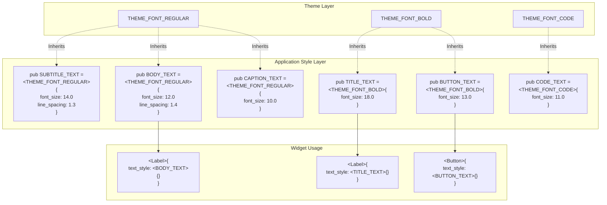
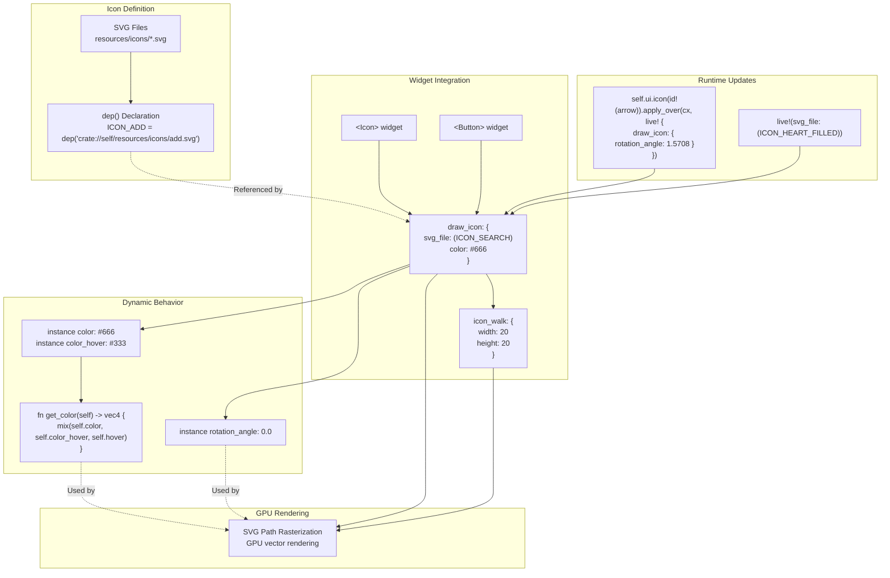

<!-- source: DeepWiki mcp.deepwiki.com · repo ZhangHanDong/makepad-skills · page 3.4 Styling: Fonts and Icons · fetched 2026-10-26 -->

# Styling: Fonts and Icons

<details>
<summary>Relevant source files</summary>

The following files were used as context for generating this wiki page:

- [skills/01-core/styling.md](skills/01-core/styling.md)

</details>


This document covers the styling system in Makepad, focusing on text rendering and icon integration. It explains how to configure fonts using the `text_style` property with theme font inheritance, and how to define and use SVG icons with the `draw_icon` system. For general layout and spacing concepts, see [3.1 Layout System](#3.1). For widget structure and customization, see [3.2 Widget System](#3.2).

---

## Purpose and Scope

This page documents Makepad's visual styling mechanisms for text and icons. It covers:

- The `text_style` property system and why `font:` does not exist
- Theme font inheritance hierarchy (`THEME_FONT_*` constants)
- Creating reusable custom text styles
- Text rendering properties (`font_size`, `line_spacing`, `wrap`, `color`)
- SVG icon integration using `dep()` and `draw_icon`
- Dynamic icon behavior (hover states, rotation, swapping)
- Icon sizing and layout with `icon_walk`

This document does not cover shader-based drawing or animation systems. For those topics, see [5.1 Shader Basics](#5.1) and [5.3 Animation System](#5.3).

---

## Text Styling Architecture

The following diagram illustrates how text styling flows from `live_design!` declarations through theme fonts to rendered text on screen.

**Diagram: Text Styling Pipeline**

```mermaid
graph TB
    subgraph "live_design! Declaration"
        LiveDesign["live_design! block"]
        UseTheme["use link::theme::*"]
        ThemeImport["Theme Font Constants<br/>THEME_FONT_REGULAR<br/>THEME_FONT_BOLD<br/>THEME_FONT_ITALIC<br/>THEME_FONT_CODE"]
    end
    
    subgraph "Widget Definition"
        Label["&lt;Label&gt; widget"]
        DrawText["draw_text: {}"]
        TextStyle["text_style: &lt;THEME_FONT_REGULAR&gt;{<br/>font_size: 14.0<br/>line_spacing: 1.4<br/>}"]
        Color["color: #333"]
        Wrap["wrap: Word"]
    end
    
    subgraph "Custom Style Layer"
        CustomStyle["pub BODY_TEXT =<br/>&lt;THEME_FONT_REGULAR&gt;{<br/>font_size: 14.0<br/>}"]
        StyleUsage["text_style: &lt;BODY_TEXT&gt;{}"]
    end
    
    subgraph "Font Backend"
        IBMPlex["IBMPlexSans<br/>Latin characters"]
        LXGWWenKai["LXGWWenKai<br/>Chinese characters"]
        NotoEmoji["NotoColorEmoji<br/>Emoji glyphs"]
    end
    
    subgraph "Rendered Output"
        GlyphRender["GPU Text Rendering<br/>Multi-script support"]
    end
    
    LiveDesign --> UseTheme
    UseTheme --> ThemeImport
    
    Label --> DrawText
    DrawText --> TextStyle
    DrawText --> Color
    DrawText --> Wrap
    
    ThemeImport -.->|"Inherits from"| TextStyle
    ThemeImport -.->|"Defines"| CustomStyle
    CustomStyle -.->|"Used by"| StyleUsage
    StyleUsage --> DrawText
    
    TextStyle --> IBMPlex
    TextStyle --> LXGWWenKai
    TextStyle --> NotoEmoji
    
    IBMPlex --> GlyphRender
    LXGWWenKai --> GlyphRender
    NotoEmoji --> GlyphRender
```



**Sources:** [skills/01-core/styling.md:1-257]()

---

## Font System Overview

Makepad does **not** use a `font:` property. All font configuration occurs through the `text_style:` property within `draw_text` blocks. This design ensures consistent inheritance and allows theme-based font management.

**Critical Syntax Rule:** Font properties must be specified inside `text_style:`, not at the `draw_text` level.

[skills/01-core/styling.md:10]() explicitly states this requirement and [skills/01-core/styling.md:60-86]() demonstrates correct versus incorrect syntax patterns.

### Three Text Style Patterns

| Pattern | Use Case | Example |
|---------|----------|---------|
| Inline `text_style` | One-off styling | `text_style: { font_size: 14.0 }` |
| Theme font inheritance | Standard app text | `text_style: <THEME_FONT_REGULAR>{ font_size: 14.0 }` |
| Custom named style | Reusable app styles | `text_style: <BODY_TEXT>{}` |

[skills/01-core/styling.md:14-42]() documents these three approaches with complete syntax examples.

**Sources:** [skills/01-core/styling.md:10-86]()

---

## Theme Fonts

Theme fonts provide pre-configured font families accessible through constants. They require importing `link::theme::*` in the `live_design!` block.

### Available Theme Font Constants

| Constant | Purpose | Typical Usage |
|----------|---------|---------------|
| `THEME_FONT_LABEL` | Default label text | Form labels, captions |
| `THEME_FONT_REGULAR` | Body text | Paragraphs, descriptions |
| `THEME_FONT_BOLD` | Emphasis text | Headings, important info |
| `THEME_FONT_ITALIC` | Stylistic variation | Quotes, metadata |
| `THEME_FONT_BOLD_ITALIC` | Strong emphasis | Highlighted warnings |
| `THEME_FONT_CODE` | Monospace code | Code snippets, terminal output |

[skills/01-core/styling.md:44-58]() lists these constants with their semantic purposes.

### Multi-Script Support

Theme fonts automatically handle multiple character sets without configuration:

- **Latin**: IBMPlexSans font family
- **Chinese**: LXGWWenKai font family  
- **Emoji**: NotoColorEmoji font family

[skills/01-core/styling.md:190-207]() explains that text like `"Hello 你好 👋"` renders correctly with a single `text_style: <THEME_FONT_REGULAR>{}` declaration, with no explicit script configuration required.

**Sources:** [skills/01-core/styling.md:44-207]()

---

## Custom Text Styles

Applications should define reusable text styles for visual consistency. Custom styles inherit from theme fonts and can override specific properties.

**Diagram: Custom Text Style Hierarchy**



### Defining Custom Styles

[skills/01-core/styling.md:89-123]() demonstrates the pattern for creating custom text styles:

```rust
// Pattern from skills/01-core/styling.md:93-122
pub TITLE_TEXT = <THEME_FONT_BOLD>{
    font_size: 18.0
}

pub BODY_TEXT = <THEME_FONT_REGULAR>{
    font_size: 12.0
    line_spacing: 1.4
}
```

### Using Custom Styles

[skills/01-core/styling.md:125-150]() shows consumption of custom styles:

```rust
// Import custom styles
use crate::shared::styles::*;

<Label> {
    draw_text: {
        text_style: <TITLE_TEXT>{}
        color: #000
    }
}
```

### Font Size Override

Custom styles can be overridden at the point of use. [skills/01-core/styling.md:152-172]() documents this pattern:

```rust
<Label> {
    draw_text: {
        // Override BODY_TEXT font size
        text_style: <BODY_TEXT>{ font_size: 16.0 }
        color: #333
    }
}
```

**Sources:** [skills/01-core/styling.md:89-172]()

---

## Text Rendering Properties

The following table documents properties available within the `draw_text` block.

| Property | Location | Type | Example |
|----------|----------|------|---------|
| `text_style` | Inside `draw_text` | Style reference | `<THEME_FONT_REGULAR>{}` |
| `font_size` | Inside `text_style` | Float | `14.0` |
| `line_spacing` | Inside `text_style` | Float | `1.3` |
| `color` | Inside `draw_text` | Color hex | `#333` |
| `wrap` | Inside `draw_text` | Enum | `Word`, `Ellipsis` |

[skills/01-core/styling.md:209-217]() provides this property reference with correct nesting locations.

### HTML Widget Text Configuration

Widgets that render HTML content require explicit configuration for each text style variant. [skills/01-core/styling.md:174-188]() shows the pattern:

```rust
html_content = <Html> {
    font_size: 12.0
    draw_normal:      { text_style: <THEME_FONT_REGULAR>{ font_size: 12.0 } }
    draw_italic:      { text_style: <THEME_FONT_ITALIC>{ font_size: 12.0 } }
    draw_bold:        { text_style: <THEME_FONT_BOLD>{ font_size: 12.0 } }
    draw_bold_italic: { text_style: <THEME_FONT_BOLD_ITALIC>{ font_size: 12.0 } }
    draw_fixed:       { text_style: <THEME_FONT_CODE>{ font_size: 11.0 } }
}
```

**Sources:** [skills/01-core/styling.md:174-217]()

---

## Icon System Architecture

Makepad uses SVG icons defined as dependencies and rendered through the `draw_icon` system. Icons support dynamic coloring, rotation, and state-based appearance changes.

**Diagram: Icon Pipeline**



**Sources:** [skills/01-core/styling.md:261-469]()

---

## Icon Definition and Usage

### Defining Icon Dependencies

Icons must be declared as dependencies in a styles file. [skills/01-core/styling.md:263-283]() shows the standard pattern:

```rust
// Define in shared/styles.rs
pub ICON_ADD      = dep("crate://self/resources/icons/add.svg")
pub ICON_CLOSE    = dep("crate://self/resources/icons/close.svg")
pub ICON_SEARCH   = dep("crate://self/resources/icons/search.svg")
pub ICON_SETTINGS = dep("crate://self/resources/icons/settings.svg")
```

### SVG File Requirements

[skills/01-core/styling.md:285-302]() specifies SVG format constraints:

- Must include `viewBox` attribute
- Use `path` elements with `fill` attribute
- Avoid gradients, filters, complex effects
- Single-color paths work best
- Standard sizes: 16×16, 20×20, 24×24

### Basic Icon Usage

[skills/01-core/styling.md:303-330]() demonstrates icon placement in widgets:

```rust
// Icon widget
<Icon> {
    draw_icon: {
        svg_file: (ICON_SEARCH)
        color: #666
    }
    icon_walk: { width: 20, height: 20 }
}

// Icon in button
<Button> {
    draw_icon: {
        svg_file: (ICON_ADD)
        color: #fff
    }
    icon_walk: { width: 16, height: 16 }
    text: "Add"
}
```

**Sources:** [skills/01-core/styling.md:263-330]()

---

## Dynamic Icon Behavior

### Hover State Color Mixing

[skills/01-core/styling.md:332-358]() demonstrates interactive color transitions:

```rust
pub IconButton = <Button> {
    draw_icon: {
        svg_file: (ICON_SETTINGS)
        instance color: #666
        instance color_hover: #333
        fn get_color(self) -> vec4 {
            return mix(self.color, self.color_hover, self.hover)
        }
    }
    icon_walk: { width: 20, height: 20 }
}
```

The `instance` keyword declares per-widget state variables. The `hover` variable (range 0.0-1.0) is automatically managed by the event system and drives color interpolation through `mix()`.

### Icon Button with Background

[skills/01-core/styling.md:360-410]() provides a complete button pattern from the Robrix application:

- Background color transitions via `instance color` and `instance color_hover`
- SDF-based rounded rectangle in `fn pixel()`
- Icon color coordination with background state
- Explicit padding and alignment for icon centering

### Icon Rotation

[skills/01-core/styling.md:412-441]() shows rotation implementation:

```rust
pub IconRotated = <Icon> {
    draw_icon: {
        svg_file: (ICON_ARROW)
        instance rotation_angle: 0.0  // Radians
    }
    icon_walk: { width: 16, height: 16 }
}
```

Runtime rotation update:

```rust
// Rotate 90 degrees (PI/2 = 1.5708 radians)
self.ui.icon(id!(arrow_icon)).apply_over(cx, live! {
    draw_icon: { rotation_angle: 1.5708 }
});
self.ui.redraw(cx);
```

### Dynamic Icon Swapping

[skills/01-core/styling.md:443-458]() demonstrates conditional icon replacement:

```rust
fn update_icon(&mut self, cx: &mut Cx, is_favorite: bool) {
    let icon = if is_favorite {
        live!(svg_file: (ICON_HEART_FILLED))
    } else {
        live!(svg_file: (ICON_HEART_OUTLINE))
    };
    
    self.view.icon(id!(fav_icon)).apply_over(cx, icon);
    self.view.redraw(cx);
}
```

**Sources:** [skills/01-core/styling.md:332-458]()

---

## Icon Sizing Reference

| Use Case | Dimensions | `icon_walk` Syntax |
|----------|------------|-------------------|
| Toolbar button | 16×16 | `{ width: 16, height: 16 }` |
| List item icon | 20×20 | `{ width: 20, height: 20 }` |
| Card action | 24×24 | `{ width: 24, height: 24 }` |
| Large button | 32×32 | `{ width: 32, height: 32 }` |
| Hero icon | 48×48 | `{ width: 48, height: 48 }` |

[skills/01-core/styling.md:460-469]() provides this sizing guideline based on common UI patterns.

**Sources:** [skills/01-core/styling.md:460-469]()

---

## Common Styling Mistakes

### Text Styling Errors

| Mistake | Symptom | Correct Approach |
|---------|---------|------------------|
| Using `font:` property | Compilation error: "no matching field" | Use `text_style:` instead |
| `font_size` outside `text_style` | Compilation error: "no matching field" | Place inside `text_style: {}` block |
| Missing theme import | Unresolved `THEME_FONT_*` constants | Add `use link::theme::*` |

[skills/01-core/styling.md:75-86]() explicitly shows incorrect patterns to avoid.

### Icon Errors

| Mistake | Symptom | Fix |
|---------|---------|-----|
| Icon not visible | No render output | Verify SVG path in `dep()` |
| Wrong icon color | Icon uses default color | Add `fn get_color()` in `draw_icon` |
| Icon not scaling | Fixed size regardless of `icon_walk` | Set explicit `width` and `height` |
| Complex SVG broken | Partial or missing rendering | Simplify to single-color paths |
| Blurry icons | Anti-aliasing artifacts | Use integer sizes (16, 20, 24) |

[skills/01-core/styling.md:470-479]() lists these common icon issues.

**Sources:** [skills/01-core/styling.md:75-86](), [skills/01-core/styling.md:470-479]()

---

