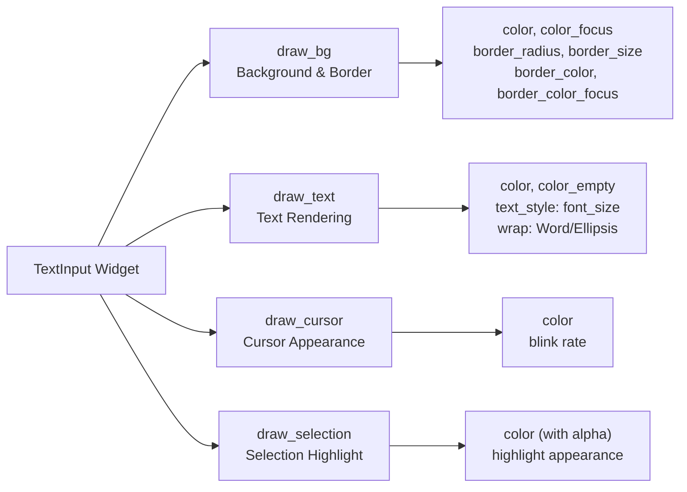
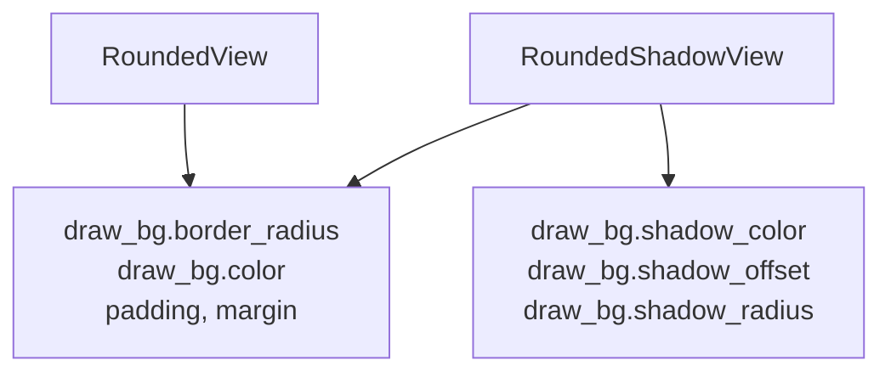
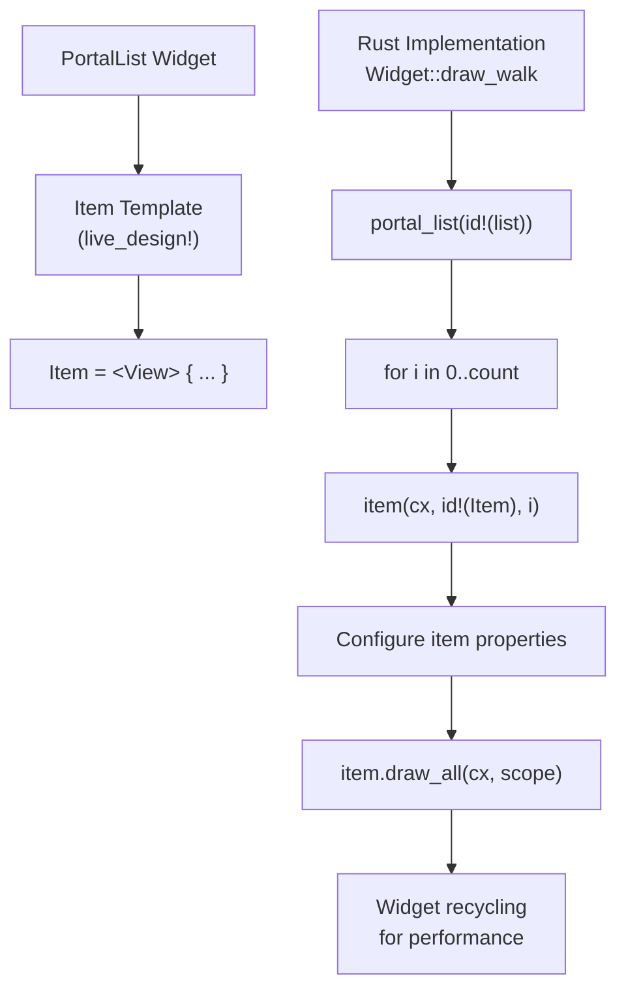
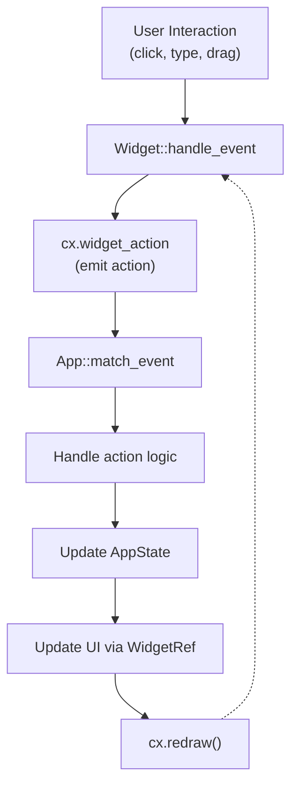

<!-- source: DeepWiki mcp.deepwiki.com · repo ZhangHanDong/makepad-skills · page 4 Component Gallery · fetched 2026-10-26 -->

# Component Gallery

<details>
<summary>Relevant source files</summary>

The following files were used as context for generating this wiki page:

- [skills/02-components/SKILL.md](skills/02-components/SKILL.md)

</details>


This document provides a comprehensive reference to Makepad's built-in UI components from the `02-components` skill category. It catalogs all available widgets, their variants, configuration options, and usage patterns. For creating custom widgets, see [Widget System](#3.2). For styling and theming, see [Styling: Fonts and Icons](#3.4). For layout configuration, see [Layout System](#3.1).

**Sources:** [skills/02-components/SKILL.md:1-8]()

---

## Widget Taxonomy

Makepad provides a comprehensive set of pre-built widgets organized by functional category. All widgets are accessed via `use link::widgets::*;` and configured declaratively in `live_design!` blocks.

```mermaid
graph TB
    subgraph "Interactive Widgets"
        Button["Button<br/>ButtonGradientX/Y<br/>ButtonIcon"]
        TextInput["TextInput<br/>TextInputFlat<br/>TextInputGradientX/Y"]
        Slider["Slider<br/>SliderRound<br/>SliderMinimal<br/>SliderFlat"]
        CheckBox["CheckBox<br/>CheckBoxToggle<br/>CheckBoxFlat"]
        RadioButton["RadioButton<br/>RadioButtonFlat<br/>RadioButtonGradientX/Y"]
        Dropdown["Dropdown<br/>DropdownFlat<br/>DropdownGradientX/Y"]
        Rotary["Rotary<br/>RotaryGradientX/Y"]
    end
    
    subgraph "Display Widgets"
        Label["Label<br/>H1, H2, H3, H4<br/>P"]
        LinkLabel["LinkLabel"]
        Icon["Icon"]
        Image["Image<br/>RotatedImage<br/>ImageBlend"]
        Spinner["Spinner"]
        Markdown["Markdown<br/>Html"]
    end
    
    subgraph "Container Widgets"
        RoundedView["RoundedView<br/>RoundedShadowView"]
        ScrollView["ScrollXYView<br/>ScrollXView<br/>ScrollYView"]
        Fold["FoldButton<br/>FoldHeader"]
    end
    
    subgraph "Navigation Widgets"
        PageFlip["PageFlip"]
        PortalList["PortalList"]
        FileTree["FileTree"]
    end
    
    Button --> draw_bg["draw_bg properties"]
    Button --> draw_text["draw_text properties"]
    Button --> draw_icon["draw_icon properties"]
    Button --> animator["animator states"]
    
    TextInput --> draw_bg
    TextInput --> draw_text
    TextInput --> draw_cursor["draw_cursor properties"]
    TextInput --> draw_selection["draw_selection properties"]
    
    Slider --> draw_bg
    Slider --> draw_text
    Slider --> draw_slider["draw_slider properties"]
    
    CheckBox --> animator
    RadioButton --> animator
    RadioButton --> radio_group["radio_group property"]
    
    Label --> draw_text
    Icon --> draw_icon
    Image --> source["source property"]
    Image --> fit["fit property"]
    
    RoundedView --> draw_bg
    ScrollView --> scroll_bars["scroll_bars properties"]
    
    PortalList --> Item["Item template"]
```



**Sources:** [skills/02-components/SKILL.md:10-25](), [skills/02-components/SKILL.md:669-691]()

---

## Widget Variant System

Most Makepad widgets follow a variant naming pattern where base widgets (e.g., `Button`, `TextInput`) are extended with style suffixes:

| Variant Suffix | Description | Example |
|----------------|-------------|---------|
| _(base)_ | Default themed style | `Button`, `TextInput` |
| `Flat` | Minimalist flat design | `ButtonFlat`, `SliderFlat` |
| `GradientX` | Horizontal gradient | `ButtonGradientX`, `CheckBoxGradientX` |
| `GradientY` | Vertical gradient | `ButtonGradientY`, `SliderGradientY` |
| `Round` | Rounded appearance | `SliderRound` |
| `Minimal` | Ultra-minimal design | `SliderMinimal` |
| `Toggle` | Toggle switch style | `CheckBoxToggle` |

Variants share the same properties and behavior but differ in visual styling through their `draw_bg`, `draw_text`, and `draw_icon` configurations.

**Sources:** [skills/02-components/SKILL.md:32-66](), [skills/02-components/SKILL.md:177-204](), [skills/02-components/SKILL.md:213-237]()

---

## Buttons

### Button Types

Makepad provides three button widget types:

| Widget | Purpose | Key Properties |
|--------|---------|----------------|
| `Button` | Standard text/icon button | `text`, `draw_icon`, `draw_bg`, `draw_text` |
| `ButtonGradientX/Y` | Gradient-styled buttons | Same as `Button` + gradient colors |
| `ButtonIcon` | Icon-only button | `draw_icon`, no text rendering |

**Configuration Example:**

```rust
live_design! {
    <Button> {
        width: 120, height: 40
        padding: { left: 16, right: 16 }
        text: "Click Me"
        
        draw_bg: {
            color: #2196F3
            color_hover: #42A5F5
            color_down: #1976D2
            border_radius: 8.0
        }
        
        draw_text: {
            color: #fff
            text_style: { font_size: 14.0 }
        }
        
        draw_icon: {
            svg_file: dep("crate://self/resources/icon.svg")
            color: #fff
        }
    }
}
```

### Button States

Buttons support animator states for visual feedback:

- `disabled = { default: on }` - Disables interaction
- `hover` - Mouse hover state
- `pressed` - Mouse down state
- `focus` - Keyboard focus state

**Sources:** [skills/02-components/SKILL.md:28-89]()

---

## Text Input

### TextInput Variants

| Widget | Style | Use Case |
|--------|-------|----------|
| `TextInput` | Standard themed | General text input |
| `TextInputFlat` | Flat design | Minimal UI |
| `TextInputGradientX` | Horizontal gradient | Accent inputs |
| `TextInputGradientY` | Vertical gradient | Accent inputs |

### TextInput Properties

| Property | Type | Description |
|----------|------|-------------|
| `text` | `String` | Current input value |
| `empty_text` | `String` | Placeholder text |
| `is_password` | `bool` | Mask input characters |
| `is_read_only` | `bool` | Prevent editing |
| `is_numeric_only` | `bool` | Restrict to numbers |

### TextInput Customization Points



**Configuration Example:**

```rust
<TextInput> {
    width: Fill, height: 44
    padding: { left: 12, right: 12 }
    empty_text: "Enter text..."
    
    draw_bg: {
        color: #f5f5f5
        color_focus: #fff
        border_radius: 8.0
        border_size: 1.0
        border_color: #ddd
        border_color_focus: #2196F3
    }
    
    draw_text: {
        color: #333
        color_empty: #999
        text_style: { font_size: 14.0 }
    }
    
    draw_cursor: { color: #2196F3 }
    draw_selection: { color: #2196F344 }
}
```

**Sources:** [skills/02-components/SKILL.md:93-169]()

---

## Sliders

### Slider Variants

| Widget | Appearance | Use Case |
|--------|-----------|----------|
| `Slider` | Standard track + handle | General numeric input |
| `SliderRound` | Round handle | Modern UI |
| `SliderMinimal` | Minimal track | Compact layouts |
| `SliderFlat` | Flat design | Minimal UI |
| `SliderMinimalFlat` | Ultra-minimal | Dense controls |
| `SliderGradientX/Y` | Gradient styled | Accent controls |

### Slider Properties

| Property | Type | Description |
|----------|------|-------------|
| `min` | `f64` | Minimum value |
| `max` | `f64` | Maximum value |
| `step` | `f64` | Value increment step |
| `precision` | `i32` | Decimal places |
| `text` | `String` | Label text |
| `label_align` | `{x: f64, y: f64}` | Label alignment (0.0-1.0) |

**Configuration Example:**

```rust
<Slider> {
    text: "Volume"
    min: 0.0
    max: 100.0
    step: 5.0
    precision: 0
    label_align: { x: 0.5, y: 0.0 }
}
```

**Sources:** [skills/02-components/SKILL.md:173-205]()

---

## Selection Widgets

### CheckBox

Checkboxes provide binary selection with multiple style variants:

| Widget | Style |
|--------|-------|
| `CheckBox` | Standard themed |
| `CheckBoxFlat` | Flat design |
| `CheckBoxGradientX/Y` | Gradient styled |
| `CheckBoxToggle` | Toggle switch appearance |

**Checked State:**

```rust
<CheckBox> {
    text: "Accept terms"
    animator: { selected = { default: on } }  // Pre-checked
}
```

### RadioButton

Radio buttons provide mutually exclusive selection within groups:

**Radio Group Pattern:**

```rust
<View> {
    flow: Down
    spacing: 8
    
    <RadioButton> { text: "Option A", radio_group: my_group }
    <RadioButton> { text: "Option B", radio_group: my_group }
    <RadioButton> { text: "Option C", radio_group: my_group }
}
```

**Key Property:**
- `radio_group: LiveId` - Groups buttons for mutual exclusion

### Dropdown

Dropdown menus provide selection from a list of options:

**Configuration Methods:**

```rust
// Method 1: Separate labels and values
<Dropdown> {
    width: 200
    labels: ["Option 1", "Option 2", "Option 3"]
    values: [opt1, opt2, opt3]
}

// Method 2: Items with value/label pairs
<Dropdown> {
    items: [
        { value: opt1, label: "First Option" }
        { value: opt2, label: "Second Option" }
        { value: opt3, label: "Third Option" }
    ]
}
```

**Sources:** [skills/02-components/SKILL.md:209-299]()

---

## Display Widgets

### Labels

Label widgets display static or dynamic text:

| Widget | Purpose |
|--------|---------|
| `Label` | Generic text display |
| `H1`, `H2`, `H3`, `H4` | Heading styles |
| `P` | Paragraph text |
| `LinkLabel` | Clickable hyperlink |

**Text Wrapping:**

```rust
// Word wrap
<Label> {
    width: 200
    draw_text: { wrap: Word }
    text: "Long text that wraps"
}

// Ellipsis overflow
<Label> {
    width: 100
    draw_text: { wrap: Ellipsis }
    text: "Text gets truncated..."
}
```

**LinkLabel:**

```rust
<LinkLabel> {
    text: "Click here"
    url: "https://example.com"
    
    draw_text: {
        color: #2196F3
        color_hover: #1976D2
    }
}
```

### Icons

Icon widgets render SVG graphics:

```rust
<Icon> {
    draw_icon: {
        svg_file: dep("crate://self/resources/icon.svg")
        color: #333
    }
    icon_walk: { width: 24, height: 24 }
}

// Gradient icon
<Icon> {
    draw_icon: {
        svg_file: dep("crate://self/resources/icon.svg")
        gradient_fill_horizontal: 1.0
        color: #f00
        color_2: #00f
    }
}
```

### Images

Image widgets support multiple rendering modes:

| Widget | Purpose |
|--------|---------|
| `Image` | Standard image display |
| `RotatedImage` | Image with rotation |
| `ImageBlend` | Blend two images |

**Fit Modes:**

| Mode | Behavior |
|------|----------|
| `Horizontal` | Fit to width |
| `Vertical` | Fit to height |
| `Smallest` | Fit smallest dimension |

**ImageBlend Example:**

```rust
<ImageBlend> {
    width: 200, height: 150
    source_1: dep("crate://self/resources/image1.png")
    source_2: dep("crate://self/resources/image2.png")
    blend: 0.5  // 0.0 = image1, 1.0 = image2
}
```

**Sources:** [skills/02-components/SKILL.md:303-436]()

---

## Container Widgets

### RoundedView

Container widgets with rounded corners and optional shadows:



**Example:**

```rust
<RoundedShadowView> {
    width: 200, height: 100
    padding: 16
    
    draw_bg: {
        color: #fff
        border_radius: 8.0
        shadow_color: #00000033
        shadow_offset: vec2(0., 4.)
        shadow_radius: 8.0
    }
    
    <Label> { text: "Content" }
}
```

### ScrollView

Scrollable container widgets:

| Widget | Scroll Direction |
|--------|------------------|
| `ScrollXYView` | Both horizontal and vertical |
| `ScrollXView` | Horizontal only |
| `ScrollYView` | Vertical only |

**Usage:**

```rust
<ScrollXYView> {
    width: Fill, height: 400
    
    <View> {
        width: 800, height: 800
        // Large content...
    }
}
```

**Sources:** [skills/02-components/SKILL.md:440-489]()

---

## List Widgets

### PortalList (Virtual List)

`PortalList` provides virtualized rendering for large lists, recycling item widgets for performance:



**Pattern:**

```rust
// live_design! definition
<PortalList> {
    width: Fill, height: Fill
    
    Item = <View> {
        width: Fill, height: 60
        padding: 10
        <Label> { text: "Item" }
    }
}

// Rust implementation
impl Widget for MyList {
    fn draw_walk(&mut self, cx: &mut Cx2d, scope: &mut Scope, walk: Walk) -> DrawStep {
        let portal_list = self.view.portal_list(id!(list));
        
        for i in 0..1000 {
            let item = portal_list.item(cx, id!(Item), i);
            item.label(id!(label)).set_text(cx, &format!("Item {}", i));
            item.draw_all(cx, &mut Scope::empty());
        }
        
        DrawStep::done()
    }
}
```

**Key Methods:**
- `portal_list(id)` - Get PortalList reference
- `item(cx, template_id, index)` - Get/create item at index
- `item.draw_all(cx, scope)` - Render item

**Sources:** [skills/02-components/SKILL.md:493-523]()

---

## Navigation Widgets

### PageFlip

Tab-style page switching without animation:

```rust
<PageFlip> {
    width: Fill, height: Fill
    active_page: page1
    
    page1 = <View> {
        <Label> { text: "Page 1 content" }
    }
    page2 = <View> {
        <Label> { text: "Page 2 content" }
    }
    page3 = <View> {
        <Label> { text: "Page 3 content" }
    }
}

// Rust - switch pages
self.view.page_flip(id!(flip)).set_active_page(cx, id!(page2));
```

### Fold / Collapsible

Expandable/collapsible sections:

```rust
<FoldHeader> {
    header = <FoldButton> { text: "Section Title" }
    body = <View> {
        <Label> { text: "Collapsible content" }
    }
}
```

**Sources:** [skills/02-components/SKILL.md:528-570]()

---

## Specialized Widgets

### Spinner

Loading indicator widget:

```rust
<Spinner> {
    width: 40, height: 40
}
```

For custom spinners, use animator-driven rotation:

```rust
<View> {
    width: 40, height: 40
    show_bg: true
    draw_bg: {
        instance rotation: 0.0
        // Custom spinner shader
    }
    animator: {
        spin = {
            default: on,
            on = {
                from: {all: Loop {duration: 1.0, end: 1.0}}
                apply: { 
                    draw_bg: { 
                        rotation: [
                            {time: 0., value: 0.}, 
                            {time: 1., value: 1.}
                        ] 
                    } 
                }
            }
        }
    }
}
```

### Rotary (Knob)

Rotational control widget:

```rust
<Rotary> {
    width: 60, height: 60
    min: 0.0
    max: 100.0
    text: "Volume"
}
```

**Variants:** `RotaryGradientX`, `RotaryGradientY`

### Markdown / HTML

Document rendering widgets:

```rust
// Markdown from file
<Markdown> {
    body: dep("crate://self/resources/readme.md")
}

// Inline markdown
<Markdown> {
    body: "# Title\n\nSome **bold** text"
}

// HTML rendering
<Html> {
    body: "<h1>Title</h1><p>Paragraph</p>"
}
```

### FileTree

Hierarchical file tree widget:

```rust
<FileTree> {
    width: 250, height: Fill
}

// Rust - populate tree
fn populate_tree(&mut self, cx: &mut Cx) {
    let tree = self.view.file_tree(id!(tree));
    tree.set_folder_node(cx, live_id!(root), 0, "Root", false);
    tree.set_file_node(cx, live_id!(file1), live_id!(root), "file.rs");
}
```

**Sources:** [skills/02-components/SKILL.md:574-665]()

---

## Widget Properties Reference

### Common Widget Properties

All widgets support these base properties:

| Property | Values | Description |
|----------|--------|-------------|
| `width` | `Fill`, `Fit`, `Fixed(n)` | Widget width mode |
| `height` | `Fill`, `Fit`, `Fixed(n)` | Widget height mode |
| `padding` | `n`, `{left: n, right: n, top: n, bottom: n}` | Inner spacing |
| `margin` | `n`, `{left: n, right: n, top: n, bottom: n}` | Outer spacing |
| `flow` | `Down`, `Right`, `Overlay`, `RightWrap` | Child layout direction |
| `spacing` | `n` | Gap between children |
| `align` | `{x: 0.0-1.0, y: 0.0-1.0}` | Child alignment |
| `visible` | `true`, `false` | Visibility toggle |
| `cursor` | `Default`, `Hand`, `Text`, `Arrow` | Mouse cursor style |

### Animator States

Common animator states across widgets:

| State | Purpose | Usage |
|-------|---------|-------|
| `disabled = { default: on }` | Disable interaction | All interactive widgets |
| `selected = { default: on }` | Pre-select state | CheckBox, RadioButton |
| `hover` | Mouse hover feedback | Buttons, links, interactive widgets |
| `pressed` | Mouse down feedback | Buttons, interactive widgets |
| `focus` | Keyboard focus | TextInput, interactive widgets |

### draw_bg Properties

Background drawing configuration:

| Property | Type | Description |
|----------|------|-------------|
| `color` | `#RRGGBB` | Background color |
| `color_hover` | `#RRGGBB` | Hover state color |
| `color_down` | `#RRGGBB` | Pressed state color |
| `color_focus` | `#RRGGBB` | Focus state color |
| `border_radius` | `f64` | Corner radius |
| `border_size` | `f64` | Border thickness |
| `border_color` | `#RRGGBB` | Border color |
| `shadow_color` | `#RRGGBBAA` | Shadow color (with alpha) |
| `shadow_offset` | `vec2(x, y)` | Shadow position offset |
| `shadow_radius` | `f64` | Shadow blur radius |

### draw_text Properties

Text rendering configuration:

| Property | Type | Description |
|----------|------|-------------|
| `color` | `#RRGGBB` | Text color |
| `color_hover` | `#RRGGBB` | Hover text color |
| `color_empty` | `#RRGGBB` | Placeholder text color |
| `text_style` | `{ font_size: f64, ... }` | Font configuration |
| `wrap` | `Word`, `Ellipsis`, `None` | Text wrapping mode |

### draw_icon Properties

Icon rendering configuration:

| Property | Type | Description |
|----------|------|-------------|
| `svg_file` | `dep("path/to/icon.svg")` | SVG source file |
| `color` | `#RRGGBB` | Icon color |
| `color_2` | `#RRGGBB` | Secondary color (gradients) |
| `gradient_fill_horizontal` | `0.0-1.0` | Horizontal gradient amount |
| `gradient_fill_vertical` | `0.0-1.0` | Vertical gradient amount |

**Sources:** [skills/02-components/SKILL.md:669-691]()

---

## Widget Event Handling Pattern

Interactive widgets emit actions that are handled in the application's event loop:



**Pattern Example:**

```rust
// In App::handle_event
fn match_event(&mut self, cx: &mut Cx, event: &Event) {
    // Button action
    if self.ui.button(id!(submit_btn)).clicked(&actions) {
        // Handle button click
        self.state.submit_form();
        self.ui.label(id!(status)).set_text(cx, "Submitted");
    }
    
    // TextInput change
    if let Some(text) = self.ui.text_input(id!(name_input)).changed(actions) {
        self.state.name = text;
    }
    
    // Slider change
    if let Some(val) = self.ui.slider(id!(volume)).changed(actions) {
        self.state.volume = val;
    }
    
    // CheckBox toggle
    if self.ui.check_box(id!(agree)).changed(&actions) {
        self.state.agreed = !self.state.agreed;
    }
    
    // Dropdown selection
    if let Some(selected) = self.ui.dropdown(id!(options)).selected(actions) {
        self.state.option = selected;
    }
}
```

**Common Widget Action Methods:**

| Method | Widget Types | Returns |
|--------|-------------|---------|
| `.clicked(&actions)` | Button, ButtonIcon | `bool` |
| `.changed(actions)` | TextInput | `Option<String>` |
| `.changed(actions)` | Slider, Rotary | `Option<f64>` |
| `.changed(&actions)` | CheckBox | `bool` |
| `.selected(actions)` | Dropdown | `Option<LiveId>` |

**Sources:** Event handling pattern inferred from widget interaction model described throughout [skills/02-components/SKILL.md]()

---

## Resources

For additional information:

- Complete widget showcase: [ui_zoo example](https://github.com/makepad/makepad/tree/main/examples/ui_zoo)
- Widget source code: [makepad/widgets](https://github.com/makepad/makepad/tree/main/widgets)
- Custom widget creation: See [Widget System](#3.2)
- Event handling architecture: See [Event Handling](#3.3)
- Layout configuration: See [Layout System](#3.1)

**Sources:** [skills/02-components/SKILL.md:695-699]()

---

