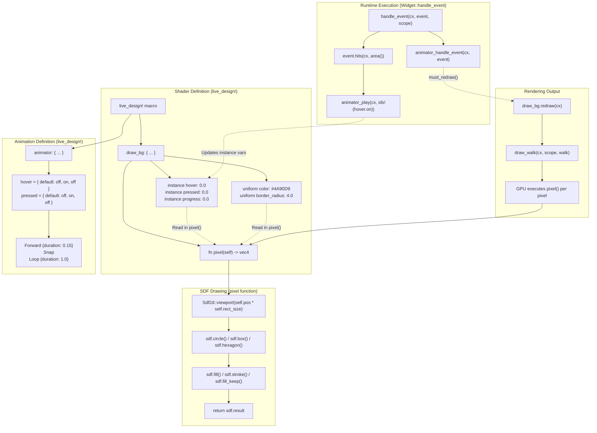
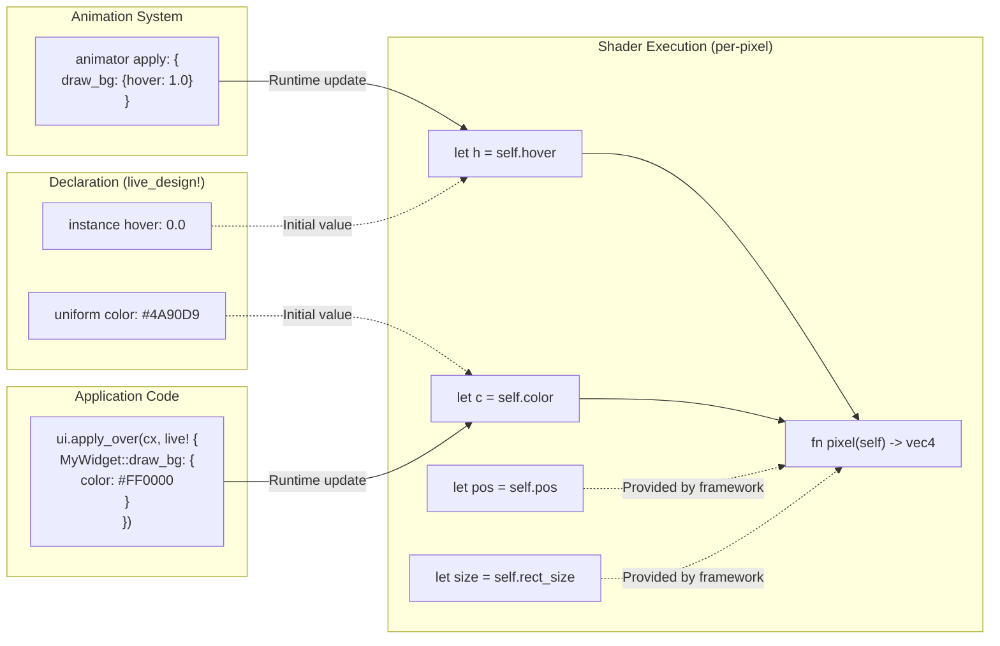
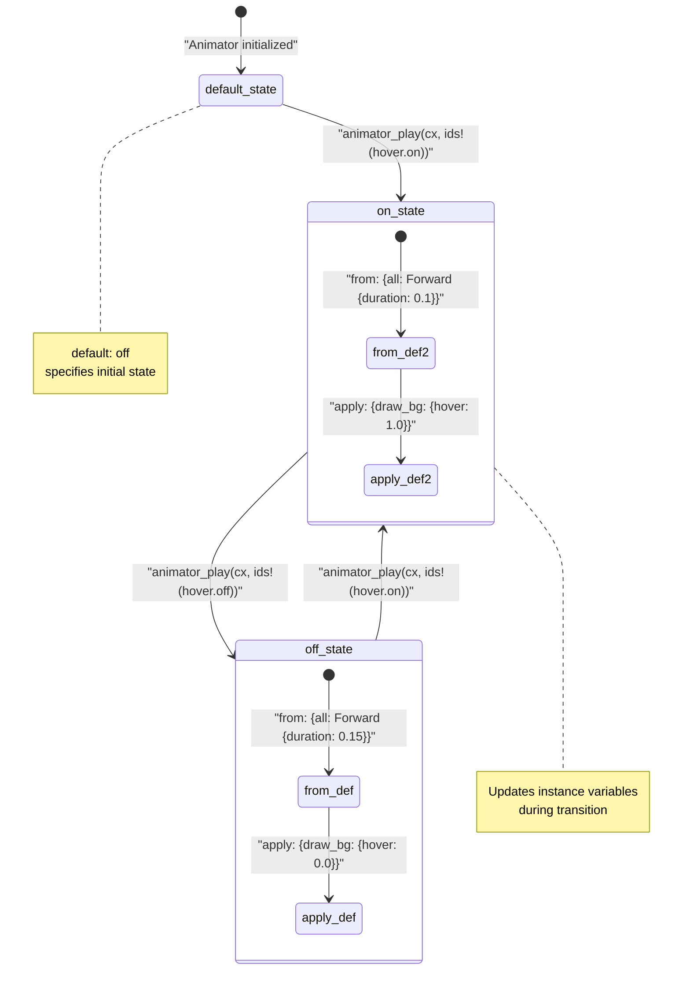
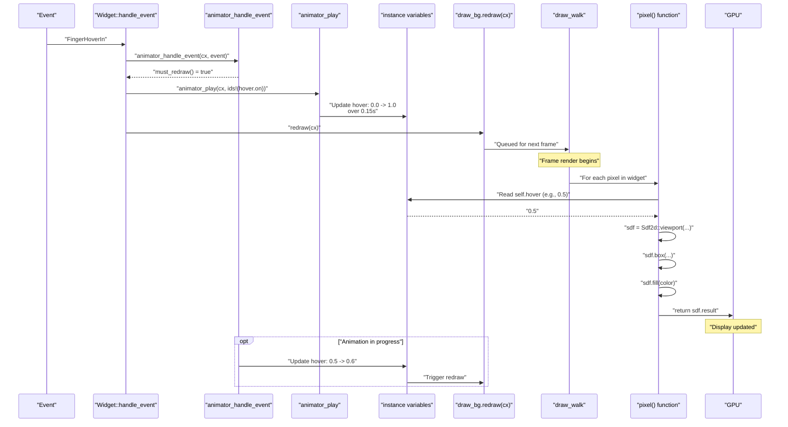

<!-- source: DeepWiki mcp.deepwiki.com · repo ZhangHanDong/makepad-skills · page 5 Graphics and Animation · fetched 2026-10-26 -->

# Graphics and Animation

<details>
<summary>Relevant source files</summary>

The following files were used as context for generating this wiki page:

- [skills/03-graphics/SKILL.md](skills/03-graphics/SKILL.md)
- [skills/03-graphics/_base/01-shader-structure.md](skills/03-graphics/_base/01-shader-structure.md)
- [skills/03-graphics/_base/06-animator-basics.md](skills/03-graphics/_base/06-animator-basics.md)

</details>


This page introduces the graphics and animation capabilities in Makepad, which are provided through the 03-graphics skill category. It covers GPU-accelerated rendering via custom shaders, Signed Distance Field (SDF) drawing for vector graphics, and the declarative animation system. This material focuses on the architecture and integration points; for detailed implementation guides, see [Shader Basics](#5.1), [SDF Drawing](#5.2), and [Animation System](#5.3).

## Purpose and Scope

The graphics and animation system in Makepad enables high-performance, GPU-accelerated UI rendering through three core components:

1. **Shader System**: Custom pixel shaders defined in `live_design!` blocks with typed variables and a `pixel()` function
2. **SDF Drawing**: Vector graphics primitives using Signed Distance Fields via the `Sdf2d` object
3. **Animation System**: Declarative state-based animations with easing functions and keyframes

All three systems are tightly integrated: shaders receive animated values through `instance` variables, execute SDF drawing operations in the `pixel()` function, and trigger redraws through the event system.

**Sources**: [skills/03-graphics/SKILL.md:1-83]()

## Graphics Pipeline Architecture

The following diagram illustrates how shaders, SDF drawing, and animations integrate into the rendering pipeline:

**Diagram: Complete Graphics and Animation Pipeline**



**Sources**: [skills/03-graphics/SKILL.md:1-83](), [skills/03-graphics/_base/01-shader-structure.md:16-37](), [skills/03-graphics/_base/06-animator-basics.md:17-50]()

## Shader Variable System

Makepad shaders use four categories of variables to control rendering behavior. The following table shows their characteristics and usage patterns:

| Variable Type | Keyword | Scope | Mutability | Typical Usage |
|--------------|---------|-------|------------|---------------|
| Instance | `instance` | Per-widget instance | Animated by animator system | `hover`, `pressed`, `selected`, `progress` |
| Uniform | `uniform` | Global (shared across instances) | Static or updated via `apply_over` | `color`, `border_radius`, `shadow_offset` |
| Varying | `varying` | Vertex-to-fragment interpolation | Set in vertex shader | `uv` coordinates |
| Built-in | N/A (accessed via `self`) | Provided by framework | Read-only | `self.pos`, `self.rect_size`, `self.rect_pos` |

**Sources**: [skills/03-graphics/_base/01-shader-structure.md:39-82]()

### Shader Variable Lifecycle

The following diagram shows how different variable types flow from definition to GPU execution:

**Diagram: Variable Lifecycle in Shader Execution**



**Sources**: [skills/03-graphics/_base/01-shader-structure.md:49-72](), [skills/03-graphics/_base/06-animator-basics.md:24-50]()

## SDF Drawing Primitives

The `Sdf2d` object provides the primary interface for drawing vector graphics in shaders. All SDF operations occur within the `pixel()` function and produce anti-aliased results.

### Core SDF Operations

```rust
// Initialization - always first step
let sdf = Sdf2d::viewport(self.pos * self.rect_size);

// Shape primitives
sdf.circle(x, y, radius)
sdf.box(x, y, width, height, border_radius)
sdf.hexagon(x, y, radius)

// Rendering operations
sdf.fill(color)              // Fill shape and clear for next shape
sdf.stroke(color, width)     // Stroke outline and clear
sdf.fill_keep(color)         // Fill but preserve shape for more ops

// Return result
return sdf.result;
```

The `Sdf2d::viewport()` method [skills/03-graphics/_base/01-shader-structure.md:99]() initializes the SDF context with pixel coordinates, converting from normalized `self.pos` (0.0-1.0) to pixel space.

**Sources**: [skills/03-graphics/SKILL.md:53-61](), [skills/03-graphics/_base/01-shader-structure.md:98-102]()

## Animation System Architecture

Animations in Makepad are declarative state machines defined in `animator` blocks. Each animation has named states with timing controls and target values.

### Animation State Structure

**Diagram: Animator State Machine**



**Sources**: [skills/03-graphics/_base/06-animator-basics.md:17-50]()

### Animation Timing Modes

The `animator` system supports several timing modes defined in the `from` clause:

| Timing Mode | Syntax | Behavior | Use Case |
|-------------|--------|----------|----------|
| `Forward` | `Forward {duration: 0.15}` | Linear interpolation over duration | Smooth transitions |
| `Snap` | `Snap` | Instant change | Immediate state changes (e.g., press down) |
| `Loop` | `Loop {duration: 1.0}` | Continuous looping | Loading spinners, pulsing effects |
| `Reverse` | `Reverse {duration: 0.15}` | Reverse direction playback | Undoing animations |

**Sources**: [skills/03-graphics/_base/06-animator-basics.md:52-60](), [skills/03-graphics/SKILL.md:63-69]()

## Runtime Integration

The graphics and animation systems integrate at runtime through the `Widget::handle_event` method. The following diagram shows the complete execution flow:

**Diagram: Event-Driven Rendering Cycle**



**Sources**: [skills/03-graphics/_base/06-animator-basics.md:64-87]()

### Key Runtime Methods

The following methods form the core of the graphics/animation runtime integration:

1. **`animator_handle_event(cx: &mut Cx, event: &Event) -> AnimatorAction`** [skills/03-graphics/_base/06-animator-basics.md:66]()
   - Processes animation frame updates
   - Returns `AnimatorAction` indicating if redraw needed
   - Call at start of `handle_event` implementation

2. **`animator_play(cx: &mut Cx, state_path: &[LiveId])`** [skills/03-graphics/_base/06-animator-basics.md:72-81]()
   - Triggers transition to specified animation state
   - Use `ids!()` macro to specify state path
   - Example: `animator_play(cx, ids!(hover.on))`

3. **`draw_bg.redraw(cx: &mut Cx)`** [skills/03-graphics/_base/06-animator-basics.md:67]()
   - Marks shader for re-execution
   - Call when `animator_handle_event().must_redraw()` returns true
   - Queues GPU rendering for next frame

4. **`draw_walk(cx: &mut Cx, scope: &mut Scope, walk: Walk) -> DrawStep`**
   - Main rendering entry point
   - Framework calls during layout/render phase
   - Executes `pixel()` function on GPU

**Sources**: [skills/03-graphics/_base/06-animator-basics.md:64-87]()

## Practical Example: Animated Button

The following example demonstrates the complete integration of shaders, SDF drawing, and animation for an interactive button:

```rust
// Shader definition with instance variables and SDF drawing
live_design! {
    MyButton = {{MyButton}} {
        draw_bg: {
            // Instance variables for animation
            instance hover: 0.0
            instance pressed: 0.0
            
            // Uniform parameters
            uniform color: #4A90D9
            uniform border_radius: 4.0
            
            fn pixel(self) -> vec4 {
                // Initialize SDF context
                let sdf = Sdf2d::viewport(self.pos * self.rect_size);
                
                // Draw rounded rectangle
                sdf.box(0., 0., self.rect_size.x, self.rect_size.y, 
                       self.border_radius);
                
                // Apply hover/press effects
                let base_color = self.color;
                let hover_brightness = 1.0 + (self.hover * 0.1);
                let press_darkness = 1.0 - (self.pressed * 0.2);
                let final_color = base_color * hover_brightness * press_darkness;
                
                sdf.fill(final_color);
                return sdf.result;
            }
        }
        
        // Animation state machine
        animator: {
            hover = {
                default: off,
                off = {
                    from: {all: Forward {duration: 0.15}}
                    apply: { draw_bg: {hover: 0.0} }
                }
                on = {
                    from: {all: Forward {duration: 0.1}}
                    apply: { draw_bg: {hover: 1.0} }
                }
            }
            pressed = {
                default: off,
                off = {
                    from: {all: Forward {duration: 0.2}}
                    apply: { draw_bg: {pressed: 0.0} }
                }
                on = {
                    from: {all: Snap}
                    apply: { draw_bg: {pressed: 1.0} }
                }
            }
        }
    }
}

// Widget implementation with event handling
impl Widget for MyButton {
    fn handle_event(&mut self, cx: &mut Cx, event: &Event, scope: &mut Scope) {
        // Process animation updates
        if self.animator_handle_event(cx, event).must_redraw() {
            self.draw_bg.redraw(cx);
        }
        
        // Handle user interactions
        match event.hits(cx, self.draw_bg.area()) {
            Hit::FingerHoverIn(_) => {
                self.animator_play(cx, ids!(hover.on));
            }
            Hit::FingerHoverOut(_) => {
                self.animator_play(cx, ids!(hover.off));
            }
            Hit::FingerDown(_) => {
                self.animator_play(cx, ids!(pressed.on));
            }
            Hit::FingerUp(_) => {
                self.animator_play(cx, ids!(pressed.off));
                // Emit click action
                cx.widget_action(self.widget_uid(), &scope.path, 
                                MyButtonAction::Clicked);
            }
            _ => {}
        }
    }
}
```

This example shows:
- **Shader definition**: `draw_bg` block with instance/uniform variables and `pixel()` function [skills/03-graphics/_base/01-shader-structure.md:16-37]()
- **SDF drawing**: `Sdf2d::viewport()` initialization and `sdf.box()` + `sdf.fill()` operations [skills/03-graphics/_base/01-shader-structure.md:29-32]()
- **Animation states**: `hover` and `pressed` states with different timing modes [skills/03-graphics/_base/06-animator-basics.md:24-48]()
- **Event handling**: `animator_handle_event()` and `animator_play()` integration [skills/03-graphics/_base/06-animator-basics.md:64-86]()

**Sources**: [skills/03-graphics/_base/01-shader-structure.md:16-37](), [skills/03-graphics/_base/06-animator-basics.md:17-87]()

## Performance Considerations

The graphics system executes shaders on the GPU with the following characteristics:

1. **Per-pixel execution**: The `pixel()` function runs for every pixel in the widget's bounding box
2. **Animation overhead**: `animator_handle_event()` processes animation state updates each frame during transitions
3. **Redraw triggers**: Only call `redraw(cx)` when necessary (e.g., when `must_redraw()` returns true)
4. **SDF complexity**: More complex SDF operations increase per-pixel computation cost

**Best Practices**:
- Keep `pixel()` functions simple and avoid conditional branches
- Use `Snap` timing for state changes that don't need animation
- Avoid unnecessary `redraw()` calls outside animation updates
- Consider performance impact when stacking multiple SDF operations with `fill_keep()`

**Sources**: [skills/03-graphics/_base/06-animator-basics.md:104-108]()

## Related Documentation

For detailed implementation guides and examples:

- **[Shader Basics](#5.1)**: Variable types, built-in values, and shader math operations
- **[SDF Drawing](#5.2)**: Shape primitives, path drawing, and progress indicators
- **[Animation System](#5.3)**: Easing functions, keyframe animations, and looping effects

For UI integration patterns, see [Event Handling](#3.3) and [Widget System](#3.2).

**Sources**: [skills/03-graphics/SKILL.md:11-43]()

---

