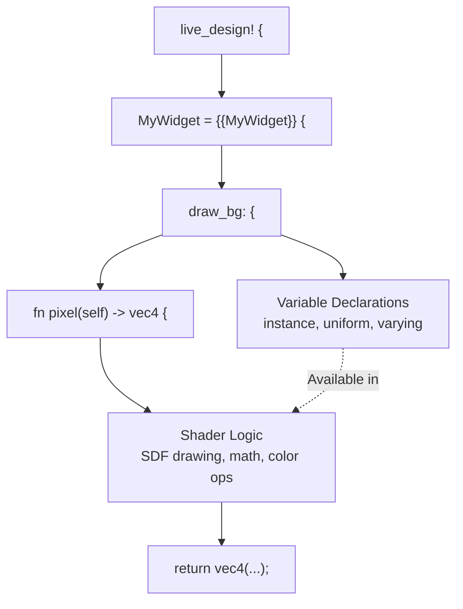
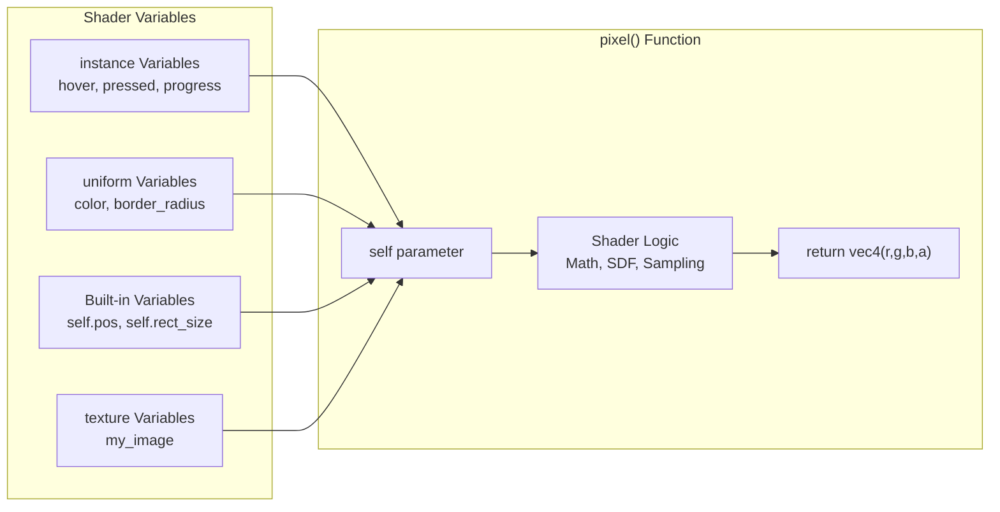

<!-- source: DeepWiki mcp.deepwiki.com · repo ZhangHanDong/makepad-skills · page 5.1 Shader Basics · fetched 2026-10-26 -->

# Shader Basics

<details>
<summary>Relevant source files</summary>

The following files were used as context for generating this wiki page:

- [skills/03-graphics/_base/01-shader-structure.md](skills/03-graphics/_base/01-shader-structure.md)
- [skills/03-graphics/_base/02-shader-math.md](skills/03-graphics/_base/02-shader-math.md)

</details>


## Purpose and Scope

This page covers the fundamental structure of shaders in Makepad, including how to define shaders within `live_design!` blocks, the different variable types available, the `pixel()` function signature, and basic shader math operations. Shaders in Makepad are GPU-accelerated drawing routines that execute for every pixel of a widget.

For information about using shaders to draw shapes and paths with Signed Distance Fields (SDF), see [SDF Drawing](#5.2). For information about animating shader variables over time, see [Animation System](#5.3).

## Shader Definition Structure

Shaders in Makepad are defined within `live_design!` blocks as part of a widget's visual definition. The primary structure consists of a `draw_bg` (or similar draw) block containing variable declarations and a `pixel()` function.

### Basic Shader Template

```
MyWidget = {{MyWidget}} {
    draw_bg: {
        // Variable declarations
        instance hover: 0.0
        uniform color: #4A90D9
        
        // Pixel shader function
        fn pixel(self) -> vec4 {
            // Shader logic here
            return vec4(1.0, 0.0, 0.0, 1.0);
        }
    }
}
```

The `draw_bg` block name is conventional but not fixed; you can use `draw_text`, `draw_icon`, or any custom draw name depending on the widget's purpose.

**Sources:** [skills/03-graphics/_base/01-shader-structure.md:14-36]()

### Shader Definition Flow



**Sources:** [skills/03-graphics/_base/01-shader-structure.md:14-36]()

## Variable Types

Shaders support four primary variable types, each with different scoping and lifecycle characteristics:

| Type | Scope | Mutability | Usage Example |
|------|-------|-----------|---------------|
| `instance` | Per-widget instance | Can be animated | `instance hover: 0.0` |
| `uniform` | Global across all instances | Static or manually updated | `uniform color: #4A90D9` |
| `varying` | Vertex-to-fragment interpolation | Interpolated per pixel | `varying uv: vec2` |
| `texture` | Texture sampler | Immutable reference | `texture my_tex: texture2d` |

**Sources:** [skills/03-graphics/_base/01-shader-structure.md:39-46]()

### Instance Variables

Instance variables hold per-widget state that can be animated via the `animator` system. They are commonly used for interactive states:

```
draw_bg: {
    instance hover: 0.0      // 0.0 to 1.0 for hover animation
    instance pressed: 0.0    // 0.0 to 1.0 for press animation
    instance selected: 0.0   // 0.0 or 1.0 for selection state
    instance disabled: 0.0   // 0.0 or 1.0 for disabled state
    instance progress: 0.0   // 0.0 to 1.0 for progress indicators
}
```

Instance variables are ideal for smooth transitions and per-widget visual states. Each widget instance maintains its own copy of these values.

**Sources:** [skills/03-graphics/_base/01-shader-structure.md:48-60]()

### Uniform Variables

Uniform variables are global parameters shared across all instances of a widget. They are efficient for values that don't change per-instance:

```
draw_bg: {
    uniform color: #4A90D9                    // Color literals
    uniform border_radius: 4.0                // Scalar values
    uniform shadow_offset: vec2(2.0, 2.0)    // Vector values
}
```

Uniforms can be updated programmatically but are not typically animated through the animator system.

**Sources:** [skills/03-graphics/_base/01-shader-structure.md:62-72]()

### Variable Type Selection Guidelines

- **Use `instance`** for per-widget animated state (hover, pressed, progress)
- **Use `uniform`** for global parameters that apply to all instances (colors, sizes, offsets)
- **Use `varying`** for vertex-to-fragment data interpolation (advanced use cases)
- **Use `texture`** for image or pattern sampling

**Sources:** [skills/03-graphics/_base/01-shader-structure.md:104-109]()

## Built-in Variables

The shader system provides several built-in variables accessible within the `pixel()` function via the `self` parameter:

| Variable | Type | Description | Value Range |
|----------|------|-------------|-------------|
| `self.pos` | `vec2` | Normalized position within widget | (0,0) to (1,1) |
| `self.rect_size` | `vec2` | Widget dimensions in pixels | (width, height) |
| `self.rect_pos` | `vec2` | Widget position in window coordinates | Absolute position |
| `self.geom_pos` | `vec2` | Geometry position | Geometry-specific |

**Sources:** [skills/03-graphics/_base/01-shader-structure.md:74-81]()

### Using Built-in Variables

```
fn pixel(self) -> vec4 {
    // Normalized position (0-1 range)
    let x = self.pos.x;  // 0 at left edge, 1 at right edge
    let y = self.pos.y;  // 0 at top edge, 1 at bottom edge
    
    // Convert to pixel coordinates
    let px = self.pos * self.rect_size;
    
    // Access widget dimensions
    let width = self.rect_size.x;
    let height = self.rect_size.y;
    
    // Create SDF viewport (common pattern)
    let sdf = Sdf2d::viewport(self.pos * self.rect_size);
    // ...
}
```

The `self.pos` variable is particularly useful for position-based effects like gradients, patterns, or geometric calculations.

**Sources:** [skills/03-graphics/_base/01-shader-structure.md:83-102]()

## The pixel() Function

The `pixel()` function is the entry point for shader execution and runs once for every pixel in the widget's bounding rectangle.

### Function Signature

```
fn pixel(self) -> vec4
```

- **Parameter:** `self` provides access to all shader variables (instance, uniform, built-in)
- **Return type:** `vec4` representing RGBA color with components in 0.0 to 1.0 range
- **Execution:** Runs in parallel on GPU for all pixels simultaneously

### Variable Access Flow



**Sources:** [skills/03-graphics/_base/01-shader-structure.md:14-36](), [skills/03-graphics/_base/01-shader-structure.md:83-102]()

## Shader Math Operations

### Interpolation Functions

Interpolation functions are essential for smooth transitions and blending in shaders:

| Function | Purpose | Example |
|----------|---------|---------|
| `mix(a, b, t)` | Linear interpolation between `a` and `b` | `mix(#ff0000, #00ff00, 0.5)` |
| `smoothstep(edge0, edge1, x)` | Smooth interpolation with easing | `smoothstep(0.0, 1.0, self.pos.x)` |
| `clamp(x, min, max)` | Constrain value to range | `clamp(value, 0.0, 1.0)` |
| `step(edge, x)` | Hard threshold (0 if x < edge, else 1) | `step(0.5, self.pos.x)` |

```
// Blend between two colors based on hover state
let color = mix(#ff0000, #00ff00, self.hover);

// Smooth gradient across widget
let t = smoothstep(0.0, 1.0, self.pos.x);
let gradient = mix(color_left, color_right, t);
```

**Sources:** [skills/03-graphics/_base/02-shader-math.md:14-28]()

### Trigonometric Functions

```
let angle = self.pos.x * 2.0 * PI;
let wave = sin(angle);
let wave2 = cos(angle);
```

Useful for wave effects, circular patterns, and periodic animations.

**Sources:** [skills/03-graphics/_base/02-shader-math.md:30-36]()

### Vector Mathematics

```
let v = vec2(1.0, 2.0);
let len = length(v);                      // Vector magnitude
let norm = normalize(v);                  // Unit vector (length = 1.0)
let d = dot(v1, v2);                     // Dot product
let dist = length(self.pos - center);    // Distance from point
```

Vector operations are fundamental for geometric calculations and spatial effects.

**Sources:** [skills/03-graphics/_base/02-shader-math.md:38-46]()

## Color Handling

### Color Literals and Components

```
// Define colors using hex notation
let color = #4A90D9;      // RGB
let color = #4A90D9FF;    // RGBA with alpha

// Access color components (0.0 to 1.0 range)
let r = color.r;
let g = color.g;
let b = color.b;
let a = color.a;

// Construct color from components
let red = vec4(1.0, 0.0, 0.0, 1.0);  // Full red, full opacity
```

**Sources:** [skills/03-graphics/_base/02-shader-math.md:48-69]()

### Color Blending and Manipulation

```
// Blend two colors
let blended = mix(color1, color2, 0.5);  // 50% blend

// Adjust transparency
let semi_transparent = vec4(color.rgb, 0.5);

// Animate between colors based on state
let interactive_color = mix(
    self.color_normal,
    self.color_hover,
    self.hover
);
```

**Sources:** [skills/03-graphics/_base/02-shader-math.md:48-69]()

### Texture Sampling

```
draw_bg: {
    texture my_image: texture2d
    
    fn pixel(self) -> vec4 {
        // Sample at current normalized position
        let color = sample2d(self.my_image, self.pos);
        
        // Sample with custom UV coordinates (tiling effect)
        let custom_uv = vec2(self.pos.x * 2.0, self.pos.y);
        let tiled = sample2d(self.my_image, fract(custom_uv));
        
        return color;
    }
}
```

**Sources:** [skills/03-graphics/_base/02-shader-math.md:71-88]()

## Helper Functions and Code Organization

Define reusable functions within the shader block for cleaner code:

```
draw_bg: {
    // Helper function for color calculation
    fn get_color(self) -> vec4 {
        return mix(self.color_normal, self.color_hover, self.hover);
    }
    
    // Pseudo-random noise function
    fn random(st: vec2) -> f32 {
        return fract(sin(dot(st, vec2(12.9898, 78.233))) * 43758.5453);
    }
    
    // Main pixel function uses helpers
    fn pixel(self) -> vec4 {
        let color = self.get_color();
        let noise = random(self.pos);
        return color + vec4(noise * 0.05);
    }
}
```

Helper functions improve readability and enable code reuse within a single shader definition.

**Sources:** [skills/03-graphics/_base/02-shader-math.md:90-110]()

## GPU Performance Best Practices

### Avoid Conditional Branching

GPUs execute more efficiently with mathematical operations than with conditional branches:

```
// Inefficient: Conditional branch
if self.hover > 0.5 {
    return color1;
} else {
    return color2;
}

// Efficient: Use step() for hard transition
return mix(color2, color1, step(0.5, self.hover));

// Efficient: Use smoothstep() for smooth transition
return mix(color1, color2, smoothstep(0.0, 1.0, self.hover));
```

The mathematical approach allows the GPU to execute the same code path for all pixels, maximizing parallelism.

**Sources:** [skills/03-graphics/_base/02-shader-math.md:112-129]()

### When to Use Each Technique

- Use `mix()` for smooth color transitions between states
- Use `smoothstep()` for antialiased edges and gradual transitions
- Use `step()` for hard conditional logic without branching
- Use custom helper functions for complex calculations used multiple times
- Use `instance` variables for per-widget animated values
- Use `uniform` variables for global parameters

**Sources:** [skills/03-graphics/_base/02-shader-math.md:131-136](), [skills/03-graphics/_base/01-shader-structure.md:104-109]()

---

