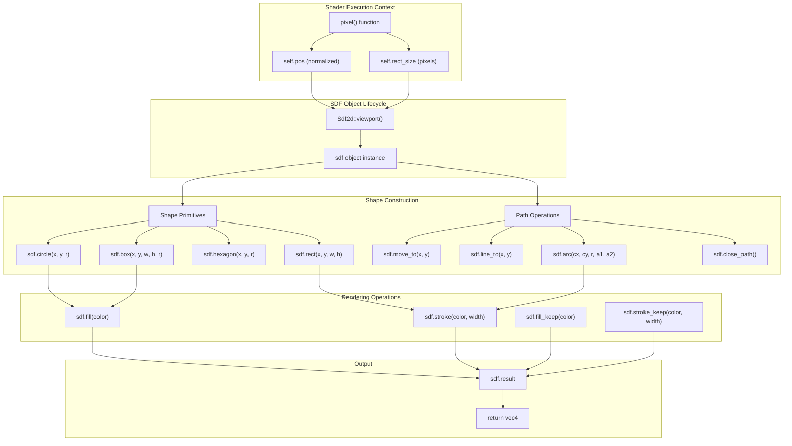
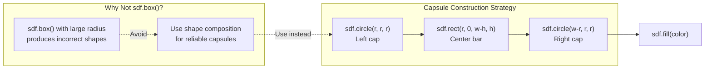
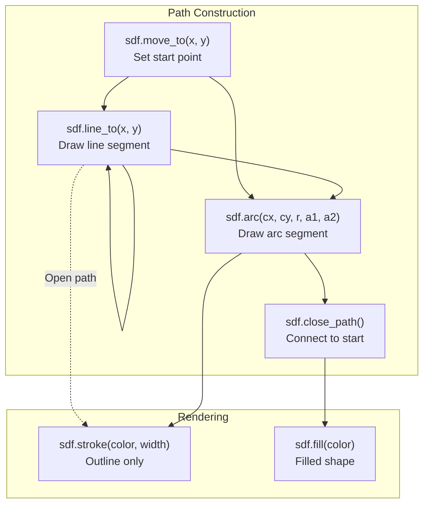
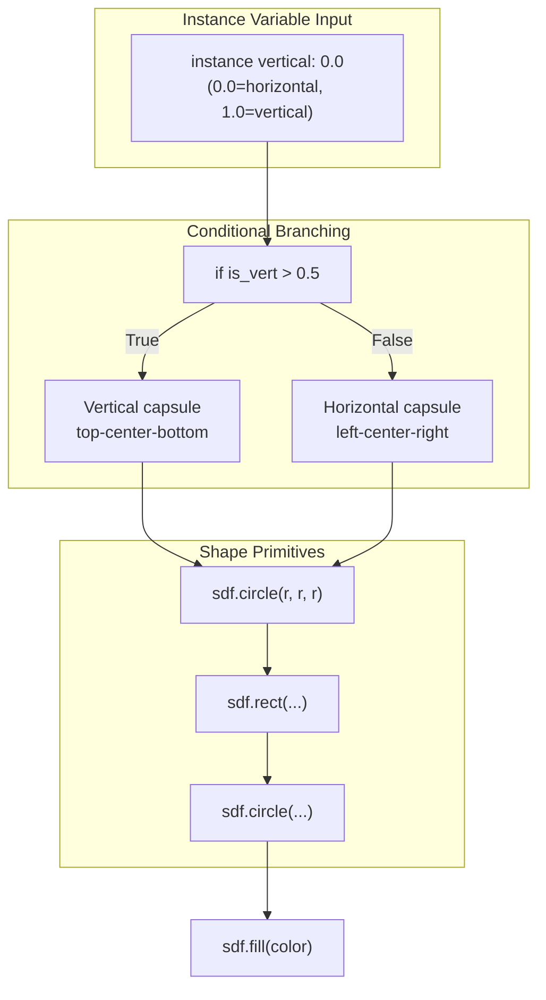
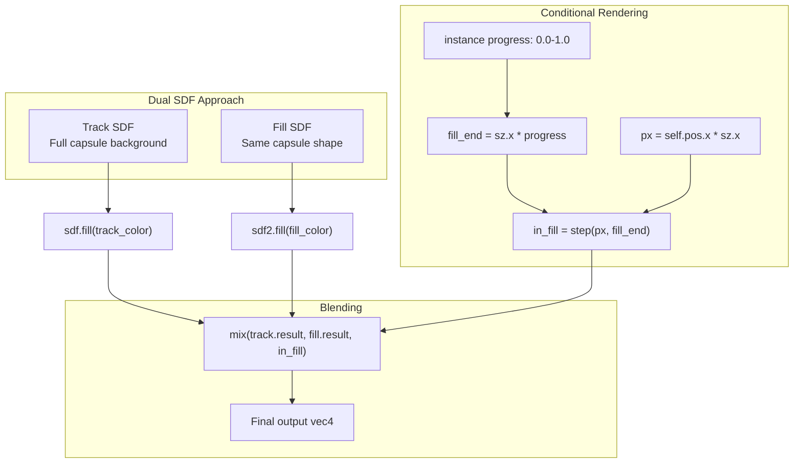
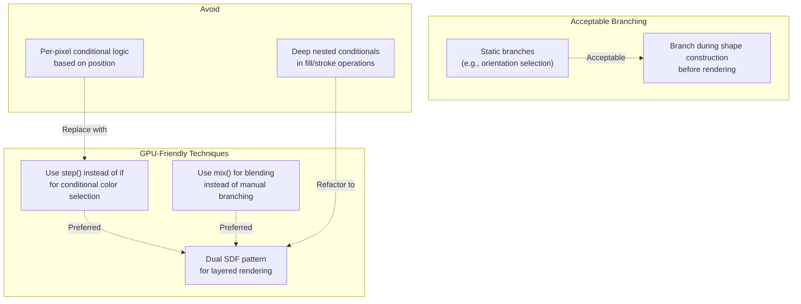

<!-- source: DeepWiki mcp.deepwiki.com · repo ZhangHanDong/makepad-skills · page 5.2 SDF Drawing · fetched 2026-10-26 -->

# SDF Drawing

<details>
<summary>Relevant source files</summary>

The following files were used as context for generating this wiki page:

- [skills/03-graphics/_base/03-sdf-shapes.md](skills/03-graphics/_base/03-sdf-shapes.md)
- [skills/03-graphics/_base/04-sdf-drawing.md](skills/03-graphics/_base/04-sdf-drawing.md)
- [skills/03-graphics/_base/05-progress-track.md](skills/03-graphics/_base/05-progress-track.md)

</details>


## Purpose and Scope

This document describes Signed Distance Field (SDF) drawing techniques in Makepad's shader system. SDF drawing enables GPU-accelerated vector graphics through mathematical distance functions, allowing efficient rendering of shapes, paths, and complex UI elements directly in shaders.

For shader structure and variable types, see [Shader Basics](#5.1). For animating SDF-drawn elements, see [Animation System](#5.3).

## SDF System Overview

The `Sdf2d` object provides the core SDF drawing interface in Makepad shaders. It operates within the `pixel()` function and uses distance field mathematics to render vector shapes.

### Sdf2d Initialization

All SDF drawing begins by creating an `Sdf2d` viewport:

```rust
let sdf = Sdf2d::viewport(self.pos * self.rect_size);
```

[skills/03-graphics/_base/03-sdf-shapes.md:30-30]()

This initializes the SDF coordinate system to match the widget's dimensions, where:
- `self.pos` is the normalized pixel position (0.0 to 1.0)
- `self.rect_size` is the widget size in pixels
- The result maps pixel coordinates to the viewport space

### SDF Drawing Pipeline



**Sources**: [skills/03-graphics/_base/03-sdf-shapes.md:14-24](), [skills/03-graphics/_base/03-sdf-shapes.md:29-38]()

## Basic Shape Primitives

### Core Shape Operations

| Function | Description | Parameters |
|----------|-------------|------------|
| `sdf.circle(x, y, r)` | Draws a circle | Center (x, y), radius r |
| `sdf.box(x, y, w, h, r)` | Draws a rounded rectangle | Position (x, y), size (w, h), corner radius r |
| `sdf.hexagon(x, y, r)` | Draws a hexagon | Center (x, y), radius r |
| `sdf.rect(x, y, w, h)` | Draws a rectangle (sharp corners) | Position (x, y), size (w, h) |

**Sources**: [skills/03-graphics/_base/03-sdf-shapes.md:16-24]()

### Circle Drawing

[skills/03-graphics/_base/03-sdf-shapes.md:28-39]() demonstrates centered circle rendering:

```rust
fn pixel(self) -> vec4 {
    let sdf = Sdf2d::viewport(self.pos * self.rect_size);
    let center = self.rect_size * 0.5;
    let radius = min(center.x, center.y) - 2.0;

    sdf.circle(center.x, center.y, radius);
    sdf.fill(#4A90D9);

    return sdf.result;
}
```

The circle is centered in the widget and sized to fit with a 2-pixel margin.

### Rounded Rectangle

[skills/03-graphics/_base/03-sdf-shapes.md:43-58]() shows box drawing with corner radius:

```rust
sdf.box(
    0.0,                   // x
    0.0,                   // y
    self.rect_size.x,      // width
    self.rect_size.y,      // height
    8.0                    // corner radius
);
sdf.fill(#ffffff);
```

The `box()` function creates rectangles with smooth, rounded corners. Setting radius to `0.0` creates sharp corners (equivalent to `rect()`).

### Capsule Shape Composition

[skills/03-graphics/_base/03-sdf-shapes.md:62-78]() demonstrates capsule construction using shape composition:



**Sources**: [skills/03-graphics/_base/03-sdf-shapes.md:60-78]()

The capsule pattern uses three primitives: left circle, center rectangle, and right circle. This approach produces correct stadium shapes where `sdf.box()` with large radius may fail.

## Fill and Stroke Operations

### Operation Types

| Operation | Behavior | Use Case |
|-----------|----------|----------|
| `sdf.fill(color)` | Fills shape and clears SDF | Single shape rendering |
| `sdf.stroke(color, width)` | Strokes outline and clears SDF | Outlined shapes |
| `sdf.fill_keep(color)` | Fills shape, preserves SDF | Multi-shape composition |
| `sdf.stroke_keep(color, width)` | Strokes outline, preserves SDF | Multi-layer outlines |

**Sources**: [skills/03-graphics/_base/03-sdf-shapes.md:21-24]()

### Fill with Stroke

[skills/03-graphics/_base/03-sdf-shapes.md:82-92]() shows combining fill and stroke:

```rust
sdf.box(2., 2., self.rect_size.x - 4., self.rect_size.y - 4., 6.0);
sdf.fill(#1a1a26);      // Fill color
sdf.stroke(#333348, 1.0);  // Border color, width
```

The shape is inset by 2 pixels to accommodate the 1-pixel stroke, preventing border clipping.

### Image Masking with SDF

[skills/03-graphics/_base/03-sdf-shapes.md:96-109]() demonstrates circular avatar masking:

```rust
fn pixel(self) -> vec4 {
    let sdf = Sdf2d::viewport(self.pos * self.rect_size);
    let c = self.rect_size * 0.5;

    sdf.circle(c.x, c.y, c.x);
    let img_color = sample2d(self.image, self.pos);
    sdf.fill(img_color);

    return sdf.result;
}
```

The `sample2d()` function retrieves the image color at the current pixel position, which is then filled into the circular SDF shape, creating a circular mask.

**Sources**: [skills/03-graphics/_base/03-sdf-shapes.md:94-109]()

## Path Drawing

Path drawing enables construction of arbitrary shapes using line segments and arcs.

### Path Operation Flow



**Sources**: [skills/03-graphics/_base/04-sdf-drawing.md:14-31](), [skills/03-graphics/_base/04-sdf-drawing.md:34-54]()

### Line Drawing

[skills/03-graphics/_base/04-sdf-drawing.md:16-30]() demonstrates basic line construction:

```rust
sdf.move_to(10.0, 10.0);    // Set start point
sdf.line_to(100.0, 50.0);   // Draw line to end
sdf.stroke(#ffffff, 2.0);   // Render 2px white line
```

### Arc Drawing

[skills/03-graphics/_base/04-sdf-drawing.md:36-53]() shows arc rendering for circular UI elements:

```rust
let start_angle = 0.0;
let end_angle = PI * 1.5;  // 270 degrees

sdf.move_to(
    center.x + cos(start_angle) * radius,
    center.y + sin(start_angle) * radius
);
sdf.arc(center.x, center.y, radius, start_angle, end_angle);
sdf.stroke(#4A90D9, 3.0);
```

The arc is positioned by moving to the start point calculated using trigonometry, then drawing the arc segment.

### Polygon Construction

[skills/03-graphics/_base/04-sdf-drawing.md:58-76]() demonstrates triangle drawing with closed path:

```rust
let v1 = vec2(50.0, 10.0);   // Top
let v2 = vec2(10.0, 90.0);   // Bottom left
let v3 = vec2(90.0, 90.0);   // Bottom right

sdf.move_to(v1.x, v1.y);
sdf.line_to(v2.x, v2.y);
sdf.line_to(v3.x, v3.y);
sdf.close_path();

sdf.fill(#4A90D9);
```

The `close_path()` operation connects the last point back to the start, creating a closed polygon suitable for filling.

**Sources**: [skills/03-graphics/_base/04-sdf-drawing.md:56-76]()

## Shape Composition

### Additive Shape Combining

[skills/03-graphics/_base/04-sdf-drawing.md:79-94]() shows combining multiple shapes in one render pass:

```rust
// First shape - fill and preserve SDF
sdf.circle(50., 50., 30.);
sdf.fill_keep(#FF0000);

// Second shape - additive blend
sdf.circle(80., 50., 30.);
sdf.fill(#00FF00);
```

The `fill_keep()` operation renders the first shape while maintaining the SDF state, allowing additional shapes to be added. The final `fill()` completes the composition.

### Orientation-Dependent Shapes

[skills/03-graphics/_base/04-sdf-drawing.md:96-130]() demonstrates instance-variable-driven shape construction:



**Sources**: [skills/03-graphics/_base/04-sdf-drawing.md:100-127]()

The code at [skills/03-graphics/_base/04-sdf-drawing.md:108-121]() uses conditional branching within shape construction:

```rust
instance vertical: 0.0

fn pixel(self) -> vec4 {
    let sdf = Sdf2d::viewport(self.pos * self.rect_size);
    let is_vert = self.vertical;
    
    if is_vert > 0.5 {
        // Vertical capsule construction
        sdf.circle(r, r, r);
        sdf.rect(0.0, r, sz.x, sz.y - sz.x);
        sdf.circle(r, sz.y - r, r);
    } else {
        // Horizontal capsule construction
        sdf.circle(r, r, r);
        sdf.rect(r, 0.0, sz.x - sz.y, sz.y);
        sdf.circle(sz.x - r, r, r);
    }
    
    sdf.fill(#e2e8f0);
}
```

[skills/03-graphics/_base/04-sdf-drawing.md:129-129]() notes that using `if` statements in shape construction is acceptable as it represents a static branch evaluated once per draw call.

## Advanced Techniques

### Progress Bar with Partial Fill

[skills/03-graphics/_base/05-progress-track.md:14-52]() demonstrates GPU-friendly conditional rendering using the `step()` function:



**Sources**: [skills/03-graphics/_base/05-progress-track.md:17-51]()

The implementation at [skills/03-graphics/_base/05-progress-track.md:22-50]() uses two separate SDF objects:

```rust
instance progress: 0.0  // 0.0 to 1.0

fn pixel(self) -> vec4 {
    // First SDF: Track background
    let sdf = Sdf2d::viewport(self.pos * self.rect_size);
    sdf.circle(r, r, r);
    sdf.rect(r, 0.0, sz.x - sz.y, sz.y);
    sdf.circle(sz.x - r, r, r);
    sdf.fill(track_color);
    
    // Calculate fill region using step()
    let fill_end = sz.x * self.progress;
    let px = self.pos.x * sz.x;
    let in_fill = step(px, fill_end);
    
    // Second SDF: Fill region
    let sdf2 = Sdf2d::viewport(self.pos * self.rect_size);
    sdf2.circle(r, r, r);
    sdf2.rect(r, 0.0, sz.x - sz.y, sz.y);
    sdf2.circle(sz.x - r, r, r);
    sdf2.fill(fill_color);
    
    return mix(sdf.result, sdf2.result, in_fill * sdf2.result.w);
}
```

The `step(px, fill_end)` function returns 1.0 when `px <= fill_end`, and 0.0 otherwise. This provides GPU-friendly conditional logic without branching.

### Range Slider Track

[skills/03-graphics/_base/05-progress-track.md:55-92]() extends the pattern to support dual-value range sliders:

```rust
instance progress_start: 0.0
instance progress_end: 0.0

fn pixel(self) -> vec4 {
    // Track background
    let sdf = Sdf2d::viewport(self.pos * self.rect_size);
    sdf.circle(r, r, r);
    sdf.rect(r, 0.0, sz.x - sz.y, sz.y);
    sdf.circle(sz.x - r, r, r);
    sdf.fill(#e2e8f0);
    
    // Calculate fill region between start and end
    let fill_start = sz.x * self.progress_start;
    let fill_end = sz.x * self.progress_end;
    let px = self.pos.x * sz.x;
    
    // Pixel is in fill if: start <= px <= end
    let in_fill = step(fill_start, px) * step(px, fill_end);
    
    // Fill region SDF
    let sdf2 = Sdf2d::viewport(self.pos * self.rect_size);
    sdf2.circle(r, r, r);
    sdf2.rect(r, 0.0, sz.x - sz.y, sz.y);
    sdf2.circle(sz.x - r, r, r);
    sdf2.fill(#3b82f6);
    
    return mix(sdf.result, sdf2.result, in_fill * sdf2.result.w);
}
```

The expression `step(fill_start, px) * step(px, fill_end)` evaluates to 1.0 only when the pixel position is between the start and end values, creating a highlighted range.

**Sources**: [skills/03-graphics/_base/05-progress-track.md:63-89]()

### Updating Progress from Rust

[skills/03-graphics/_base/05-progress-track.md:94-120]() demonstrates dynamic updates using `apply_over()`:

```rust
impl ProgressBar {
    pub fn set_progress(&mut self, cx: &mut Cx, value: f64) {
        self.draw_bg.apply_over(cx, live!{
            progress: (value)
        });
        self.redraw(cx);
    }
}
```

The `apply_over()` method updates instance variables in the shader, and `redraw()` triggers a re-render with the new values.

## Common Patterns and Use Cases

### Shape Selection Guide

| Pattern | Implementation | Use Case |
|---------|---------------|----------|
| Circle | `sdf.circle()` | Avatars, dots, indicators, round buttons |
| Rounded box | `sdf.box()` | Cards, panels, modern UI buttons |
| Capsule | Circle + rect + circle composition | Pill shapes, switches, tags, sliders |
| Arc | `sdf.arc()` | Progress rings, circular indicators |
| Polygon | `move_to()` + `line_to()` + `close_path()` | Custom shapes, icons, arrows |
| Multi-shape | `fill_keep()` | Overlapping elements, complex compositions |

**Sources**: [skills/03-graphics/_base/03-sdf-shapes.md:132-138](), [skills/03-graphics/_base/04-sdf-drawing.md:131-137]()

### Performance Considerations



**Sources**: [skills/03-graphics/_base/05-progress-track.md:16-16](), [skills/03-graphics/_base/04-sdf-drawing.md:129-129]()

### Integration with Rust Widget Code

SDF shaders integrate with widget implementations through:

1. **Instance variables**: Define in shader, update from Rust via `apply_over()` [skills/03-graphics/_base/05-progress-track.md:112-117]()
2. **Redraw triggers**: Call `self.redraw(cx)` after updating instance variables
3. **Event-driven updates**: Update values in response to user interactions or timers

The pattern enables declarative UI rendering where the shader defines the visual appearance, and Rust code manages state and behavior.

---

