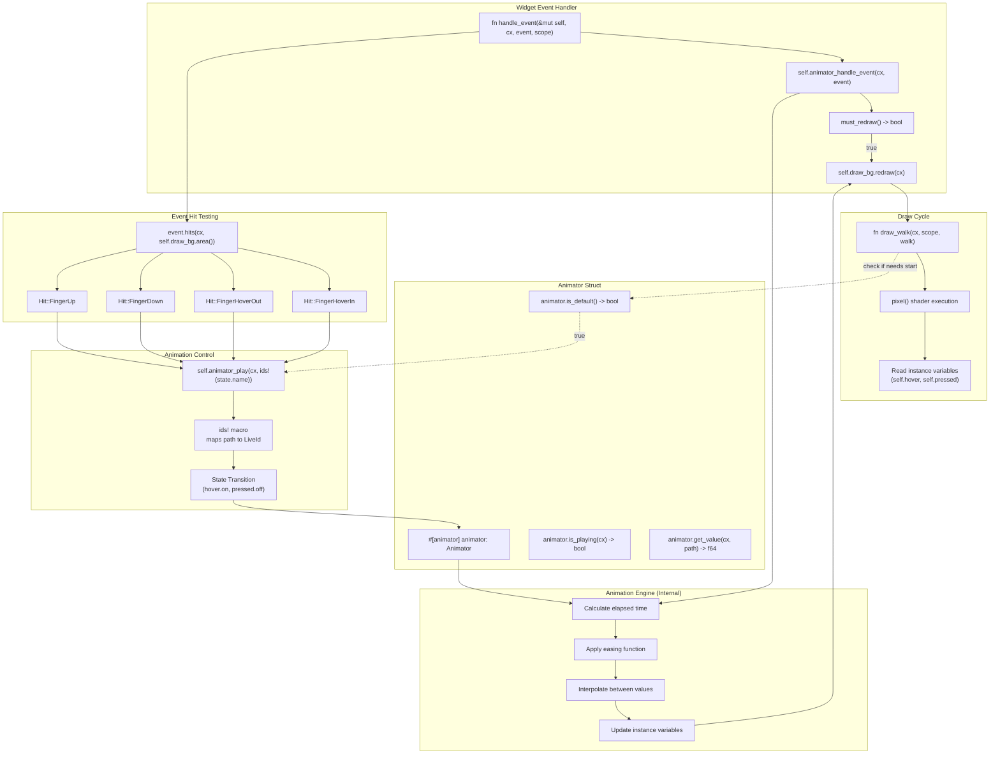

<!-- source: DeepWiki mcp.deepwiki.com · repo ZhangHanDong/makepad-skills · page 5.3 Animation System · fetched 2026-10-26 -->

# Animation System

<details>
<summary>Relevant source files</summary>

The following files were used as context for generating this wiki page:

- [skills/03-graphics/_base/06-animator-basics.md](skills/03-graphics/_base/06-animator-basics.md)
- [skills/03-graphics/_base/07-easing-functions.md](skills/03-graphics/_base/07-easing-functions.md)
- [skills/03-graphics/_base/08-keyframe-animation.md](skills/03-graphics/_base/08-keyframe-animation.md)
- [skills/03-graphics/_base/09-loading-spinner.md](skills/03-graphics/_base/09-loading-spinner.md)

</details>


The Animation System provides declarative, GPU-accelerated animations in Makepad through the `animator` block within `live_design!`. This system controls smooth transitions between states by updating instance variables in shaders over time. The animator integrates with the event system to trigger animations and with the draw system to update visual properties.

For shader variable usage in animations, see [Shader Basics](#5.1). For animating SDF properties, see [SDF Drawing](#5.2).

**Sources:** [skills/03-graphics/_base/06-animator-basics.md:1-14](), [skills/03-graphics/_base/07-easing-functions.md:1-13](), [skills/03-graphics/_base/08-keyframe-animation.md:1-13]()

---

## Animator Architecture

The following diagram shows how the animation system is structured from definition to execution:

```mermaid
graph TB
    subgraph "Definition Layer (live_design!)"
        LiveDesign["live_design! macro"]
        DrawBG["draw_bg block"]
        InstanceVars["instance variables<br/>(hover, pressed, opacity, rotation)"]
        AnimatorBlock["animator block"]
        AnimStates["Animation states<br/>(default, on, off)"]
        FromField["from: timing control"]
        EaseField["ease: easing function"]
        ApplyField["apply: target values"]
    end
    
    subgraph "Timing Control Types"
        Forward["Forward {duration: 0.15}"]
        Snap["Snap"]
        Loop["Loop {duration: 1.0, end: 1.0}"]
        Reverse["Reverse {duration: 0.15}"]
    end
    
    subgraph "Easing Functions"
        Linear["Linear"]
        InQuad["InQuad"]
        OutQuad["OutQuad"]
        ExpDecay["ExpDecay {d1: 0.8, d2: 0.97}"]
    end
    
    subgraph "Runtime Layer (Rust)"
        AnimatorStruct["#[animator] Animator"]
        AnimatorHandleEvent["animator_handle_event(cx, event)"]
        AnimatorPlay["animator_play(cx, ids!(state))"]
        MustRedraw["must_redraw() check"]
        Redraw["draw_bg.redraw(cx)"]
    end
    
    subgraph "Execution Flow"
        EventSystem["Event System<br/>(FingerHoverIn, FingerDown)"]
        AnimationEngine["Animation Engine<br/>(interpolates values)"]
        ShaderUpdate["Shader Instance Update<br/>(updates GPU state)"]
    end
    
    LiveDesign --> DrawBG
    DrawBG --> InstanceVars
    LiveDesign --> AnimatorBlock
    AnimatorBlock --> AnimStates
    AnimStates --> FromField
    AnimStates --> EaseField
    AnimStates --> ApplyField
    
    FromField -.->|"uses"| Forward
    FromField -.->|"uses"| Snap
    FromField -.->|"uses"| Loop
    FromField -.->|"uses"| Reverse
    
    EaseField -.->|"uses"| Linear
    EaseField -.->|"uses"| InQuad
    EaseField -.->|"uses"| OutQuad
    EaseField -.->|"uses"| ExpDecay
    
    ApplyField -->|"targets"| InstanceVars
    
    AnimatorBlock -->|"compiled to"| AnimatorStruct
    
    EventSystem --> AnimatorHandleEvent
    AnimatorHandleEvent --> MustRedraw
    MustRedraw -->|"if true"| Redraw
    AnimatorHandleEvent --> AnimationEngine
    
    EventSystem --> AnimatorPlay
    AnimatorPlay --> AnimationEngine
    
    AnimationEngine --> ShaderUpdate
    ShaderUpdate --> InstanceVars
```



**Animator System Architecture**

The animation system consists of three layers:

1. **Definition Layer**: Animations are declared in `live_design!` using `animator` blocks that define states, timing, easing, and target values
2. **Runtime Layer**: The `#[animator] Animator` struct handles event processing and state transitions through `animator_handle_event()` and `animator_play()`
3. **Execution Flow**: The animation engine interpolates values based on timing and easing, updating shader instance variables that trigger GPU redraws

**Sources:** [skills/03-graphics/_base/06-animator-basics.md:14-50](), [skills/03-graphics/_base/06-animator-basics.md:62-87](), [skills/03-graphics/_base/07-easing-functions.md:14-34]()

---

## Animation State Definition

Animations are defined within an `animator` block using named state machines. Each animation defines multiple states with transitions between them.

### Basic State Structure

```rust
animator: {
    hover = {
        default: off,
        off = {
            from: {all: Forward {duration: 0.15}}
            apply: { draw_bg: {hover: 0.0} }
        }
        on = {
            from: {all: Forward {duration: 0.1}}
            apply: { draw_bg: {hover: 1.0} }
        }
    }
}
```

**Key Components:**

| Component | Description | Example |
|-----------|-------------|---------|
| Animation name | Top-level identifier for the animation | `hover`, `pressed`, `fade` |
| `default` | Initial state when animation is created | `default: off` |
| State name | Named target state | `off`, `on`, `visible`, `hidden` |
| `from` | Timing control for entering this state | `from: {all: Forward {duration: 0.15}}` |
| `ease` | Optional easing function | `ease: OutQuad` |
| `apply` | Target values for instance variables | `apply: { draw_bg: {hover: 1.0} }` |

The `apply` field specifies a path to the target properties using the same structure as in `live_design!`. Multiple properties can be animated simultaneously.

**Sources:** [skills/03-graphics/_base/06-animator-basics.md:24-48](), [skills/03-graphics/_base/07-easing-functions.md:19-34]()

---

## Timing Controls

The `from` field specifies how the animation transitions into a state. Makepad provides four timing control types:

### Timing Control Types

| Timing | Syntax | Behavior | Use Case |
|--------|--------|----------|----------|
| `Forward` | `Forward {duration: 0.15}` | Linear interpolation from previous value to target over specified duration (in seconds) | Standard transitions, smooth animations |
| `Snap` | `Snap` | Immediate change with no interpolation | Instant feedback, pressed states |
| `Loop` | `Loop {duration: 1.0, end: 1.0}` | Continuous animation from start to end, repeating indefinitely | Loading spinners, pulse effects |
| `Reverse` | `Reverse {duration: 0.15}` | Reverse direction of animation | Undoing previous animation |

### Timing Examples

```rust
animator: {
    pressed = {
        default: off,
        off = {
            from: {all: Forward {duration: 0.2}}  // Smooth release
            apply: { draw_bg: {pressed: 0.0} }
        }
        on = {
            from: {all: Snap}  // Instant press feedback
            apply: { draw_bg: {pressed: 1.0} }
        }
    }
}
```

The `{all: ...}` syntax applies the timing to all properties in the `apply` block. Individual properties can have different timing by replacing `all` with specific property paths.

**Sources:** [skills/03-graphics/_base/06-animator-basics.md:52-60](), [skills/03-graphics/_base/06-animator-basics.md:36-48]()

---

## Easing Functions

Easing functions control the acceleration curve of animations, providing natural-looking motion. Without easing, animations use linear interpolation (`Linear`).

### Available Easing Functions

| Easing | Description | Acceleration Profile | Recommended Use |
|--------|-------------|---------------------|-----------------|
| `Linear` | Constant speed throughout | `────────` | Mechanical motion, default |
| `InQuad` | Accelerates (slow start, fast end) | `╱───────` | Exit animations |
| `OutQuad` | Decelerates (fast start, slow end) | `────╲___` | Enter animations, natural stops |
| `InOutQuad` | Accelerates then decelerates | `╱────╲__` | Smooth bidirectional transitions |
| `InCubic` / `OutCubic` | Stronger quadratic curve | `╱╱──────` / `────╲╲_` | More pronounced effects |
| `InExp` / `OutExp` | Exponential acceleration/deceleration | `╱╱╱─────` / `────╲╲╲` | Very dramatic motion |
| `ExpDecay {d1: 0.8, d2: 0.97}` | Natural spring-like deceleration | `────╲___~` | Physics-like motion, spring effects |
| `Ease` | Standard CSS-like ease curve | `╱───╲___` | General purpose, familiar feel |

### Applying Easing

Add an `ease` field to any animation state:

```rust
animator: {
    slide = {
        default: off,
        on = {
            from: {all: Forward {duration: 0.4}}
            ease: ExpDecay {d1: 0.80, d2: 0.97}  // Smooth deceleration
            apply: { draw_bg: {offset_x: 100.0} }
        }
        off = {
            from: {all: Forward {duration: 0.3}}
            ease: InQuad  // Accelerate out
            apply: { draw_bg: {offset_x: 0.0} }
        }
    }
}
```

### Multi-Property Easing

All properties in an `apply` block use the same easing function:

```rust
animator: {
    expand = {
        on = {
            from: {all: Forward {duration: 0.4}}
            ease: ExpDecay {d1: 0.7, d2: 0.95}
            apply: {
                draw_bg: {
                    scale: 1.2,
                    opacity: 0.8,
                    rotation: 0.1
                }
            }
        }
    }
}
```

All three properties (`scale`, `opacity`, `rotation`) animate together with the same `ExpDecay` curve.

**Sources:** [skills/03-graphics/_base/07-easing-functions.md:36-48](), [skills/03-graphics/_base/07-easing-functions.md:49-81]()

---

## Keyframe Animation

Keyframe animations allow properties to transition through multiple values over time, enabling complex animations like color cycling, sequential effects, and looped patterns.

### Keyframe Syntax

Define an array of `{time, value}` pairs in the `apply` block:

```rust
animator: {
    color_cycle = {
        default: on,
        on = {
            from: {all: Loop {duration: 3.0, end: 1.0}}
            apply: {
                draw_bg: {
                    color: [
                        {time: 0.0, value: #ff0000},   // Red at 0%
                        {time: 0.33, value: #00ff00},  // Green at 33%
                        {time: 0.66, value: #0000ff},  // Blue at 66%
                        {time: 1.0, value: #ff0000}    // Back to red at 100%
                    ]
                }
            }
        }
    }
}
```

The `time` field is normalized (0.0 to 1.0), where 0.0 is the start and 1.0 is the end of the animation duration. Values are interpolated between keyframes.

### Common Keyframe Patterns

**Fade In/Out:**

```rust
animator: {
    fade = {
        default: hidden,
        hidden = {
            from: {all: Forward {duration: 0.2}}
            apply: { draw_bg: {opacity: 0.0} }
        }
        visible = {
            from: {all: Forward {duration: 0.3}}
            ease: OutQuad
            apply: { draw_bg: {opacity: 1.0} }
        }
    }
}
```

**Pulse Effect:**

```rust
animator: {
    pulse = {
        default: on,
        on = {
            from: {all: Loop {duration: 2.0, end: 1.0}}
            apply: {
                draw_bg: {
                    glow_intensity: [
                        {time: 0.0, value: 0.3},
                        {time: 0.5, value: 1.0},  // Peak at midpoint
                        {time: 1.0, value: 0.3}   // Back to start
                    ]
                }
            }
        }
    }
}
```

**Sources:** [skills/03-graphics/_base/08-keyframe-animation.md:14-37](), [skills/03-graphics/_base/08-keyframe-animation.md:103-127]()

---

## Runtime Animation Lifecycle

The following diagram shows the complete lifecycle of animations from event trigger to shader update:



**Animation Runtime Lifecycle**

The animation lifecycle follows this sequence:

1. **Event Processing**: `handle_event()` receives user interaction events and calls `animator_handle_event()`
2. **State Transition**: Based on hit testing results, `animator_play()` is called with `ids!(state.name)` to transition to a new animation state
3. **Animation Engine**: The internal engine calculates elapsed time, applies easing functions, interpolates values, and updates instance variables
4. **Redraw Trigger**: If `must_redraw()` returns true, `draw_bg.redraw(cx)` is called to schedule a redraw
5. **Shader Update**: During `draw_walk()`, the shader's `pixel()` function reads updated instance variables and renders the new frame

**Sources:** [skills/03-graphics/_base/06-animator-basics.md:62-87](), [skills/03-graphics/_base/06-animator-basics.md:89-101](), [skills/03-graphics/_base/09-loading-spinner.md:62-86]()

---

## Widget Integration

Widgets integrate the animation system by adding an `#[animator]` field and implementing animation logic in `handle_event()` and `draw_walk()`.

### Widget Struct Definition

```rust
#[derive(Live, LiveHook, Widget)]
pub struct MyButton {
    #[deref] view: View,
    #[animator] animator: Animator,
}
```

The `#[animator]` attribute automatically provides:
- `animator_handle_event(cx, event) -> AnimatorAction`
- `animator_play(cx, id)`
- `animator.is_playing(cx) -> bool`
- `animator.get_value(cx, path) -> f64`
- `animator.is_default() -> bool`

### Event Handler Implementation

```rust
impl Widget for MyButton {
    fn handle_event(&mut self, cx: &mut Cx, event: &Event, scope: &mut Scope) {
        // Process animator state changes
        if self.animator_handle_event(cx, event).must_redraw() {
            self.draw_bg.redraw(cx);
        }

        // Trigger animations based on interaction
        match event.hits(cx, self.draw_bg.area()) {
            Hit::FingerHoverIn(_) => {
                self.animator_play(cx, ids!(hover.on));
            }
            Hit::FingerHoverOut(_) => {
                self.animator_play(cx, ids!(hover.off));
            }
            Hit::FingerDown(_) => {
                self.animator_play(cx, ids!(pressed.on));
            }
            Hit::FingerUp(_) => {
                self.animator_play(cx, ids!(pressed.off));
            }
            _ => {}
        }
    }
}
```

### Auto-Start Animations

For continuous animations (like loading spinners), start the animation in `draw_walk()`:

```rust
fn draw_walk(&mut self, cx: &mut Cx2d, scope: &mut Scope, walk: Walk) -> DrawStep {
    // Start animation on first draw
    if self.animator.is_default() {
        self.animator_play(cx, ids!(spin.on));
    }
    self.view.draw_walk(cx, scope, walk)
}
```

**Sources:** [skills/03-graphics/_base/06-animator-basics.md:62-87](), [skills/03-graphics/_base/09-loading-spinner.md:62-86]()

---

## Practical Examples

### Hover and Pressed States

Basic interactive button with hover and pressed animations:

```rust
live_design! {
    MyButton = {{MyButton}} {
        draw_bg: {
            instance hover: 0.0
            instance pressed: 0.0
            
            fn pixel(self) -> vec4 {
                let base_color = #3b82f6;
                let hover_color = #2563eb;
                let pressed_color = #1d4ed8;
                
                let color = mix(base_color, hover_color, self.hover);
                let color = mix(color, pressed_color, self.pressed);
                
                return vec4(color.rgb, 1.0);
            }
        }

        animator: {
            hover = {
                default: off,
                off = {
                    from: {all: Forward {duration: 0.15}}
                    apply: { draw_bg: {hover: 0.0} }
                }
                on = {
                    from: {all: Forward {duration: 0.1}}
                    apply: { draw_bg: {hover: 1.0} }
                }
            }
            pressed = {
                default: off,
                off = {
                    from: {all: Forward {duration: 0.2}}
                    apply: { draw_bg: {pressed: 0.0} }
                }
                on = {
                    from: {all: Snap}
                    apply: { draw_bg: {pressed: 1.0} }
                }
            }
        }
    }
}
```

**Sources:** [skills/03-graphics/_base/06-animator-basics.md:16-50]()

### Loading Spinner

Continuously rotating arc animation:

```rust
live_design! {
    Spinner = {{Spinner}} {
        width: 40, height: 40

        draw_bg: {
            instance rotation: 0.0

            fn pixel(self) -> vec4 {
                let sdf = Sdf2d::viewport(self.pos * self.rect_size);
                let center = self.rect_size * 0.5;
                let radius = min(center.x, center.y) - 4.0;

                // Rotating arc
                let angle = self.rotation * 2.0 * PI;
                let arc_start = angle;
                let arc_end = angle + PI * 1.5;

                sdf.move_to(
                    center.x + cos(arc_start) * radius,
                    center.y + sin(arc_start) * radius
                );
                sdf.arc(center.x, center.y, radius, arc_start, arc_end);
                sdf.stroke(#4A90D9, 3.0);

                return sdf.result;
            }
        }

        animator: {
            spin = {
                default: on,
                on = {
                    from: {all: Loop {duration: 1.0, end: 1.0}}
                    apply: {
                        draw_bg: {
                            rotation: [{time: 0.0, value: 0.0}, {time: 1.0, value: 1.0}]
                        }
                    }
                }
            }
        }
    }
}
```

**Sources:** [skills/03-graphics/_base/09-loading-spinner.md:16-60]()

### Slide Panel

Panel that slides in from off-screen:

```rust
live_design! {
    SlidePanel = {{SlidePanel}} {
        draw_bg: {
            instance slide_x: -300.0  // Start off-screen

            fn pixel(self) -> vec4 {
                let pos = self.pos + vec2(self.slide_x / self.rect_size.x, 0.);
                // ... draw content at adjusted position
            }
        }

        animator: {
            slide = {
                default: closed,
                closed = {
                    from: {all: Forward {duration: 0.3}}
                    ease: InQuad
                    apply: { draw_bg: {slide_x: -300.0} }
                }
                open = {
                    from: {all: Forward {duration: 0.4}}
                    ease: ExpDecay {d1: 0.8, d2: 0.97}
                    apply: { draw_bg: {slide_x: 0.0} }
                }
            }
        }
    }
}
```

**Sources:** [skills/03-graphics/_base/08-keyframe-animation.md:70-101]()

### Bouncing Dots Loader

Three dots that bounce out of phase:

```rust
draw_bg: {
    uniform anim_time: 0.0
    uniform freq: 0.9
    uniform dot_radius: 3.0

    fn pixel(self) -> vec4 {
        let sdf = Sdf2d::viewport(self.pos * self.rect_size);

        let amplitude = self.rect_size.y * 0.2;
        let center_y = self.rect_size.y * 0.5;

        // Three dots with phase offset
        let phase1 = self.anim_time * 2.0 * PI * self.freq;
        let phase2 = phase1 + 2.0;
        let phase3 = phase1 + 4.0;

        sdf.circle(self.rect_size.x * 0.25,
                   amplitude * sin(phase1) + center_y, self.dot_radius);
        sdf.fill_keep(#4A90D9);

        sdf.circle(self.rect_size.x * 0.5,
                   amplitude * sin(phase2) + center_y, self.dot_radius);
        sdf.fill_keep(#4A90D9);

        sdf.circle(self.rect_size.x * 0.75,
                   amplitude * sin(phase3) + center_y, self.dot_radius);
        sdf.fill(#4A90D9);

        return sdf.result;
    }
}

animator: {
    dots = {
        default: off,
        on = {
            from: {all: Loop {duration: 1.0, end: 1.0}}
            apply: {draw_bg: {anim_time: [{time: 0.0, value: 0.0}, {time: 1.0, value: 1.0}]}}
        }
    }
}
```

**Sources:** [skills/03-graphics/_base/08-keyframe-animation.md:129-173]()

---

## Best Practices

### Animation Durations

| Animation Type | Recommended Duration | Rationale |
|----------------|---------------------|-----------|
| Hover effects | 0.1 - 0.15s | Quick response to maintain interactivity |
| Pressed states | Instant (`Snap`) for press, 0.2s for release | Immediate feedback on press |
| Panel transitions | 0.3 - 0.4s | Perceptible motion without feeling slow |
| Fade effects | 0.2 - 0.3s | Natural appearance/disappearance |
| Loading animations | 0.8 - 1.2s per cycle | Noticeable but not distracting |

### Easing Selection

| Scenario | Recommended Easing | Reason |
|----------|-------------------|--------|
| Element entering screen | `OutQuad` | Fast start, smooth stop feels natural |
| Element exiting screen | `InQuad` | Accelerating away feels intentional |
| Interactive feedback | `OutQuad` or `ExpDecay` | Natural deceleration |
| Bidirectional transitions | `InOutQuad` | Smooth acceleration and deceleration |
| Spring effects | `ExpDecay {d1: 0.7-0.8, d2: 0.95-0.97}` | Physics-like settling |

### Performance Considerations

1. **Always check `must_redraw()`**: Only call `redraw()` when the animator indicates changes
   ```rust
   if self.animator_handle_event(cx, event).must_redraw() {
       self.draw_bg.redraw(cx);
   }
   ```

2. **Use `Snap` for instant feedback**: Avoid unnecessary interpolation for immediate responses
   ```rust
   on = {
       from: {all: Snap}  // No animation overhead
       apply: { draw_bg: {pressed: 1.0} }
   }
   ```

3. **Avoid long animation chains**: Multiple sequential animations can feel sluggish; prefer parallel animations or shorter durations

4. **Test animation frame rates**: Complex shaders with animations may reduce frame rate on lower-end devices

### Animation State Management

1. **Define sensible defaults**: Use `default: off` or `default: hidden` for most animations
2. **Provide clear state names**: Use descriptive names like `visible`/`hidden`, not `state1`/`state2`
3. **Keep state machines simple**: Complex state graphs with many transitions are hard to maintain
4. **Use `is_default()` for auto-start**: Check in `draw_walk()` to start continuous animations only once

**Sources:** [skills/03-graphics/_base/06-animator-basics.md:103-114](), [skills/03-graphics/_base/07-easing-functions.md:108-114](), [skills/03-graphics/_base/08-keyframe-animation.md:175-181]()

---

## Animation Debugging

### Checking Animation State

Use the `Animator` methods to inspect animation state:

```rust
// Check if any animation is running
if self.animator.is_playing(cx) {
    println!("Animation in progress");
}

// Get current interpolated value for a path
let current_hover = self.animator.get_value(cx, &[live_id!(hover)]);
println!("Current hover value: {}", current_hover);

// Check if animator is in default state
if self.animator.is_default() {
    println!("Animator never started");
}
```

### Common Issues

| Issue | Symptom | Solution |
|-------|---------|----------|
| Animation not triggering | No visual change on interaction | Verify `animator_play()` is called with correct `ids!()` path |
| Animation not updating | Single frame drawn, no interpolation | Missing `animator_handle_event()` call in `handle_event()` |
| Constant redraws | Performance issues, high CPU | Check `must_redraw()` before calling `redraw()` |
| Instance variable not changing | Animation plays but no visual effect | Ensure `apply` path matches instance variable name exactly |
| Animation stuck | Plays once then stops | For continuous animations, use `Loop` timing, not `Forward` |

**Sources:** [skills/03-graphics/_base/06-animator-basics.md:89-101]()