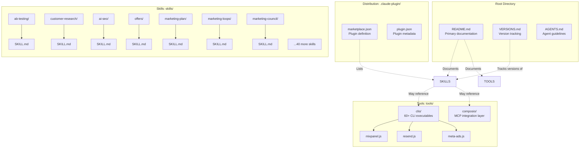
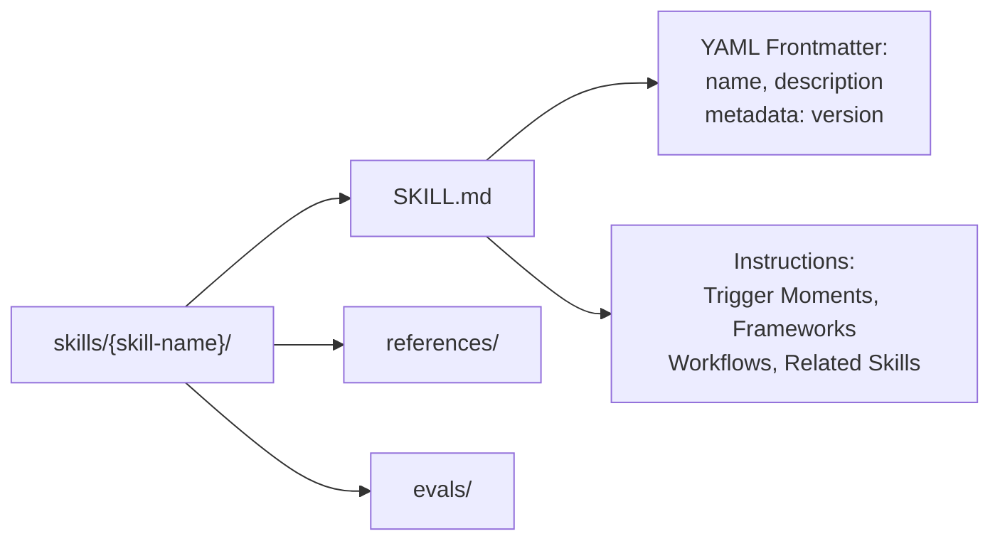
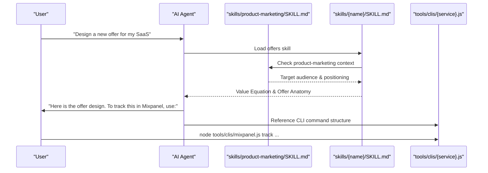

<!-- source: DeepWiki mcp.deepwiki.com · repo coreyhaines31/marketingskills · page 1 Home · fetched 2026-10-26 -->

# Home

Relevant source files

The following files were used as context for generating this wiki page:

- [.claude-plugin/marketplace.json](.claude-plugin/marketplace.json)
- [.claude-plugin/plugin.json](.claude-plugin/plugin.json)
- [AGENTS.md](AGENTS.md)
- [CONTRIBUTING.md](CONTRIBUTING.md)
- [README.md](README.md)
- [VERSIONS.md](VERSIONS.md)

This document provides an overview of the `marketingskills` repository, a collection of AI agent skills and CLI tools for marketing automation. It explains the system's three-tier architecture (distribution, skills, tools), how AI agents consume skills for marketing knowledge, and how CLI tools provide optional API integrations. The repository currently covers **47 skills** and **60+ CLI tools** [VERSIONS.md:5-53](), [AGENTS.md:24]().

## Purpose and Architecture

The `marketingskills` repository implements a dual-purpose system optimized for AI agent consumption. It provides **47 marketing skills** (markdown-based knowledge modules) that give AI agents like Claude Code specialized expertise in conversion optimization, SEO, copywriting, analytics, and growth engineering [README.md:1-5](), [.claude-plugin/marketplace.json:15](). It also includes **60+ CLI tools** (JavaScript single-file executables) for optional API integration with marketing platforms when implementation is required [AGENTS.md:24]().

The system separates knowledge from execution. Skills contain frameworks, best practices, and workflows but do not execute actions directly. CLI tools handle API communication but do not make strategic decisions. This separation enables skills to function independently of specific API availability and allows users to review actions before execution via `--dry-run` modes [AGENTS.md:45]().

**Sources:** [README.md:1-48](), [VERSIONS.md:5-53](), [AGENTS.md:41-46]()

## Repository Structure

The repository organizes content across three primary directories plus documentation and distribution files:

**Directory Breakdown:**

| Directory | Purpose | Count | Key Files |
|-----------|---------|-------|-----------|
| `skills/` | Marketing knowledge modules | 47 skills | Each contains `SKILL.md` [.claude-plugin/plugin.json:11](), [VERSIONS.md:5-53]() |
| `tools/clis/` | API integration executables | 60+ CLIs | Zero-dependency Node.js scripts [AGENTS.md:24]() |
| `tools/composio/` | MCP integration layer | 1 layer | Access to 500+ tools via Composio MCP [AGENTS.md:188]() |
| `.claude-plugin/` | Plugin distribution | 2 files | `marketplace.json` and `plugin.json` [.claude-plugin/marketplace.json:1-19]() |

**Sources:** [README.md:54-136](), [.claude-plugin/marketplace.json:1-19](), [.claude-plugin/plugin.json:1-13](), [VERSIONS.md:5-53](), [AGENTS.md:16-31]()

## Three-Tier Architecture

The system implements three distinct layers that compose to provide AI-assisted marketing capabilities:

```mermaid
graph TB
    subgraph "Layer 1: Distribution"
        direction LR
        README["README.md<br/>Documentation Hub"]
        MARKETPLACE["marketplace.json<br/>Claude Code plugin"]
        VERSIONS["VERSIONS.md<br/>Version Tracking"]
    end
    
    subgraph "Layer 2: Skills - 47 Knowledge Modules"
        direction TB
        
        CRO_CLUSTER["Conversion Optimization<br/>cro, signup, onboarding<br/>popups, paywalls"]
        
        CONTENT_CLUSTER["Content & Copywriting<br/>copywriting, copy-editing, emails<br/>cold-email, social, video, image, sms"]
        
        SEO_CLUSTER["SEO & Discovery<br/>seo-audit, ai-seo, aso, site-arch<br/>programm-seo, schema, content-strategy"]
        
        GTM_CLUSTER["Sales & GTM<br/>revops, sales-enable, launch<br/>pricing, offers, prospecting<br/>directory-submissions"]
        
        STRATEGY_CLUSTER["Strategy & Research<br/>customer-research, mktg-ideas<br/>mktg-psych, comp-profile, competitors"]
        
        MEASURE_CLUSTER["Measurement & Ads<br/>analytics, ads, ad-creative, ab-testing"]
        
        RETENTION_CLUSTER["Retention & Growth<br/>churn-prevent, referrals, free-tools<br/>community, lead-magnt, co-mktg"]
        
        ORCHESTRATION["Orchestration & Automation<br/>marketing-plan, marketing-loops, marketing-council"]
    end
    
    subgraph "Layer 3: Tools - 60+ Integrations"
        direction TB
        
        ANALYTICS_CLI["Analytics: mixpanel.js, ga4.js, segment.js"]
        EMAIL_CLI["Email: resend.js, sendgrid.js, mailchimp.js"]
        ADS_CLI["Ads: meta-ads.js, google-ads.js, tiktok-ads.js"]
        SMS_CLI["SMS: twilio.js, attentive.js, postscript.js"]
        COMPOSIO_MCP["Composio MCP: HubSpot, Salesforce, Slack"]
    end
    
    README --> SKILLS_LAYER["Skills Layer"]
    MARKETPLACE --> SKILLS_LAYER
    
    SKILLS_LAYER -.->|"Reference for implementation"| CLI_LAYER["CLI Tools Layer"]
    
    USER["Technical Marketer"] --> README
    AGENT["AI Agent"] --> SKILLS_LAYER
    SKILLS_LAYER --> AGENT
    USER -.->|"Manual execution"| CLI_LAYER
```

**Layer Responsibilities:**

| Layer | Purpose | Consumed By | Output |
|-------|---------|-------------|--------|
| **Distribution** | Installation and versioning | Developers, Claude Code | Plugin metadata and version checks [VERSIONS.md:3]() |
| **Skills** | Marketing knowledge and workflows | AI agents | Strategic recommendations and content [README.md:15]() |
| **CLI Tools** | API execution | Developers (manual) | HTTP requests to external services [AGENTS.md:41-46]() |

**Key Separation:** Skills provide knowledge, CLIs provide execution. Skills reference CLIs for implementation guidance, but agents generally present the commands for users to run.

**Sources:** [README.md:13-52](), [VERSIONS.md:5-53](), [.claude-plugin/marketplace.json:12-18](), [AGENTS.md:23-27]()

## Skills Layer: Markdown-Based Knowledge

Each skill is a directory in `skills/` containing a `SKILL.md` file. The system uses the `product-marketing` skill as a foundational requirement that all other skills check first to understand product, audience, and positioning [README.md:19-25]().

### Skill File Structure

**Key Skill Groups (Total 47):**

| Category | Key Skills |
|----------|------------|
| **Content & Copy** | `copywriting`, `cold-email`, `sms`, `video`, `image`, `lead-magnets` [README.md:30-40]() |
| **SEO & Discovery** | `ai-seo`, `seo-audit`, `aso`, `site-arch`, `directory-submissions` [README.md:30-40]() |
| **Sales & GTM** | `offers`, `prospecting`, `revops`, `sales-enablement`, `pricing` [README.md:33-40]() |
| **Orchestration** | `marketing-plan`, `marketing-loops`, `marketing-council` [VERSIONS.md:29-32]() |

**Sources:** [README.md:54-136](), [VERSIONS.md:5-53](), [AGENTS.md:98-104]()

## Data Flow: AI Agent to API Execution

The system uses a hub-and-spoke model where skills cross-reference each other to build a comprehensive marketing strategy [README.md:21-50]().

**Key Integration Components:**
- **Product Marketing Context:** The shared foundation for all skills [README.md:23-25]().
- **Marketing Council:** A simulated board of 12 advisors providing conflicting expert perspectives (e.g., Seth Godin, David Ogilvy) [VERSIONS.md:29]().
- **Marketing Loops:** Repeatable agent workflows using state management via `.agents/loops/<loop>.json` [VERSIONS.md:31]().
- **Viral Edit Reverse-Engineering:** A workflow in the `video` skill to decompose reference videos across nine dimensions (shot, rhythm, text, etc.) [VERSIONS.md:59]().

**Sources:** [README.md:17-52](), [VERSIONS.md:29-67](), [AGENTS.md:41-46]()

## Versioning and Updates

The system tracks versions for both the distribution and individual skills in `VERSIONS.md` [VERSIONS.md:1-3]().

| Milestone | Key Changes |
|-----------|-------------|
| **v2.8.11** | Current marketplace version. Includes `marketing-council` and advanced `video` edit reverse-engineering [.claude-plugin/marketplace.json:9](), [VERSIONS.md:57-59](). |
| **v2.8.10** | Added **AirDrop Reveal** ads to `ad-creative` iOS-native family [VERSIONS.md:63](). |
| **v2.8.9** | Added **Demand-signal discovery** to `prospecting` for finding first customers [VERSIONS.md:67](). |
| **v2.8.8** | Added the **creative review page** HTML artifact template to `ad-creative` [VERSIONS.md:71](). |
| **v2.6.0** | Added `marketing-loops` (43 repeatable workflows) [VERSIONS.md:31](). |

**Sources:** [VERSIONS.md:1-71](), [.claude-plugin/marketplace.json:1-19](), [AGENTS.md:48-62]()

---

