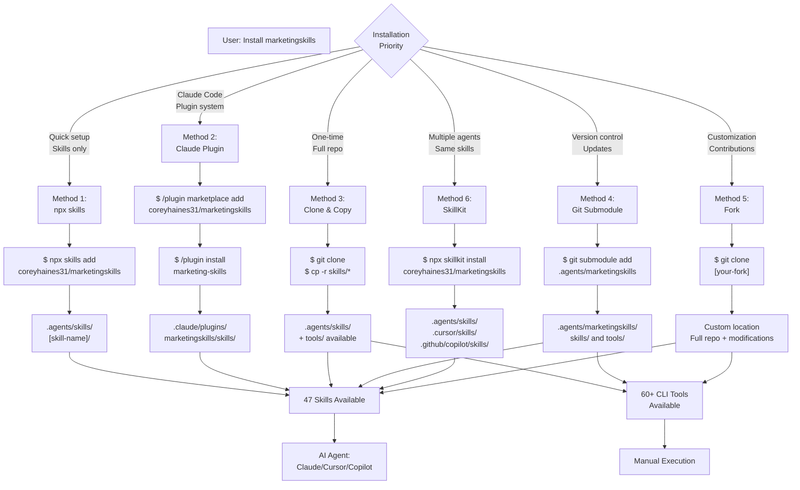
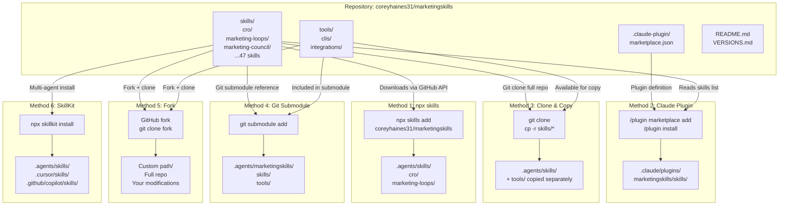

<!-- source: DeepWiki mcp.deepwiki.com · repo coreyhaines31/marketingskills · page 2.1 Installation Methods · fetched 2026-10-26 -->

# Installation Methods

<details>
<summary>Relevant source files</summary>

The following files were used as context for generating this wiki page:

- [.claude-plugin/marketplace.json](.claude-plugin/marketplace.json)
- [.claude-plugin/plugin.json](.claude-plugin/plugin.json)
- [README.md](README.md)
- [VERSIONS.md](VERSIONS.md)

</details>


This document describes all methods for installing the `marketingskills` repository into your project. Installation makes the 47 marketing skills available to AI agents (Claude Code, Cursor, Windsurf, Copilot) and optionally provides access to the 60+ CLI tools for API integrations and the Composio MCP integration layer.

For information about using skills after installation, see [Using Your First Skill](2.2). For CLI tool usage, see [Using CLI Tools](2.3).

## Installation Methods Overview

The repository provides six installation methods, each targeting different workflows and use cases. As of v2.8.11, the repository contains 47 skills and 60+ CLI tools [README.md:1-5](), [.claude-plugin/marketplace.json:9-15](), [VERSIONS.md:57-57]().

| Method | Command | Target Directory | Update Mechanism | Skills | CLI Tools | Best For |
|--------|---------|-----------------|------------------|--------|-----------|----------|
| **npx skills** | `npx skills add coreyhaines31/marketingskills` | `.agents/skills/` | Re-run command | ✓ | ✗ | Quick setup, skills-only |
| **Claude Plugin** | `/plugin marketplace add coreyhaines31/marketingskills` | `.claude/plugins/` | Plugin system | ✓ | ✗ | Claude Code users |
| **Clone & Copy** | `git clone` + `cp -r` | `.agents/skills/` | Manual | ✓ | ✓ | One-time setup |
| **Git Submodule** | `git submodule add` | `.agents/marketingskills/` | `git submodule update` | ✓ | ✓ | Version control, updates |
| **SkillKit** | `npx skillkit install coreyhaines31/marketingskills` | Multiple agent dirs | Re-run command | ✓ | ✗ | Multi-agent setup |
| **Fork** | GitHub fork + clone | User-controlled | Git pull from fork | ✓ | ✓ | Customization |

**Note on Paths:** The context path is standardized to `.agents/` for agent-agnostic compatibility. All skills check `product-marketing` context first to understand product, audience, and positioning [README.md:17-25]().

**Sources:** [README.md:1-25](), [VERSIONS.md:1-58](), [.claude-plugin/marketplace.json:9-11]()

## Directory Structure After Installation

### Skills Directory Layout

After installation, skills are located in one of these directories depending on the method used. Each of the 47 skills follows a standard structure [VERSIONS.md:5-53]().

```
# npx skills or Clone & Copy (Modern Path)
.agents/
  skills/
    cro/
      SKILL.md
      evals/         
      references/
    ai-seo/          
      SKILL.md
      evals/
    marketing-loops/  
      SKILL.md
      evals/
      references/
    marketing-council/ # Added in v2.8.6
      SKILL.md
      evals/
    [... 43 more skills]

# Claude Plugin
.claude/
  plugins/
    marketingskills/
      skills/
        cro/
        [... 46 more skills]

# Git Submodule
.agents/
  marketingskills/
    skills/
      cro/
      [... 46 more skills]
    tools/
      clis/          # 60+ zero-dependency tools
      integrations/  # Integration guides (Composio, etc.)
```

Each skill directory contains:
- `SKILL.md`: The skill definition file containing triggers and logic.
- `evals/`: Automated quality testing files distributed across skills [VERSIONS.md:59-59]().
- `references/`: Supporting documentation and frameworks (e.g., `edit-anatomy.md` in `video` skill or `demand-signals.md` in `prospecting`) [VERSIONS.md:59-67]().

**Sources:** [README.md:54-81](), [VERSIONS.md:7-53](), [.claude-plugin/marketplace.json:12-19]()

### Full Repository Structure

When using **Clone & Copy**, **Git Submodule**, or **Fork**, the complete directory structure is:

```
marketingskills/
  skills/                    # 47 marketing skills
    [skill-name]/
      SKILL.md
      evals/                 
      references/
  tools/
    clis/                    # 60+ CLI integration tools
    integrations/            # Integration guides
  .claude-plugin/
    marketplace.json         # Plugin definition (v2.8.11)
    plugin.json              # Plugin configuration
  README.md                  # Installation instructions
  VERSIONS.md                # Version tracking for updates
```

**Sources:** [README.md:1-81](), [.claude-plugin/marketplace.json:1-19](), [VERSIONS.md:1-58]()

## Installation Method Details

### Method 1: npx skills (Recommended for Skills-Only)

The `npx skills` command provides the fastest installation path for skills. It targets the `.agents/skills/` directory.

#### Install All Skills
```bash
npx skills add coreyhaines31/marketingskills
```

#### Install Specific Skills
```bash
npx skills add coreyhaines31/marketingskills --skill ai-seo marketing-council
```
This downloads only the requested skills (e.g., `ai-seo` or the `marketing-council` skill added in v2.8.6) [VERSIONS.md:9-9](), [VERSIONS.md:29-29]().

**Sources:** [README.md:1-20](), [VERSIONS.md:29-30]()

### Method 2: Claude Code Plugin

The Claude Code plugin system integrates with the marketplace definition at `.claude-plugin/marketplace.json`.

#### Add Marketplace
```bash
/plugin marketplace add coreyhaines31/marketingskills
```
Registers the repository as a plugin marketplace source. This reads [.claude-plugin/marketplace.json:1-19]() which defines the `marketing-skills` plugin [/.claude-plugin/marketplace.json:12-18]().

#### Install Plugin
```bash
/plugin install marketing-skills
```

**Sources:** [README.md:1-20](), [.claude-plugin/marketplace.json:1-19]()

### Method 3: Clone and Copy

Direct cloning provides access to the full repository including the 60+ CLI tools and integration guides.

#### Steps
```bash
# Clone repository
git clone https://github.com/coreyhaines31/marketingskills.git

# Copy skills to Agent directory
cp -r marketingskills/skills/* .agents/skills/

# Optional: Copy CLI tools
cp -r marketingskills/tools ./marketing-tools
```

**Sources:** [README.md:1-20]()

### Method 4: Git Submodule (Recommended for Full Access)

Git submodules provide version-controlled access to the full repository.

#### Add Submodule
```bash
git submodule add https://github.com/coreyhaines31/marketingskills.git .agents/marketingskills
```

AI agents automatically discover skills in subdirectories of `.agents/`. This method is preferred for projects requiring both the 47 skills and the 60+ CLI tools.

**Sources:** [README.md:1-20](), [VERSIONS.md:5-53]()

### Method 5: Fork and Customize

Forking allows you to modify the distributed evals or customize the 47 skills for specific company needs.

#### Use Cases
- Customizing the `product-marketing` skill foundation [README.md:19-25]().
- Modifying the `marketing-loops` state management via `.agents/loops/<loop>.json` [VERSIONS.md:31-31]().
- Customizing the `marketing-plan` state machine or templates [VERSIONS.md:32-32]().
- Modifying the `marketing-council` advisor bench or seating logic [VERSIONS.md:29-29]().

**Sources:** [README.md:9-12](), [README.md:19-25](), [VERSIONS.md:29-32]()

### Method 6: SkillKit (Multi-Agent)

Installs skills across Claude Code, Cursor, and Copilot simultaneously.

```bash
npx skillkit install coreyhaines31/marketingskills
```

**Sources:** [README.md:3-7]()

## Installation Flow Diagram

Title: Installation Decision Flow

**Sources:** [README.md:1-20](), [.claude-plugin/marketplace.json:1-19](), [VERSIONS.md:5-58]()

## File Path Mapping by Installation Method

Title: Repository to Local Path Mapping

**Sources:** [README.md:1-20](), [.claude-plugin/marketplace.json:1-19](), [VERSIONS.md:5-58]()

## Version Tracking and Updates

### Version Information
The `VERSIONS.md` file tracks version numbers and recent changes for all 47 skills. Agents can compare against local versions to check for updates [VERSIONS.md:1-3]().

| File | Purpose | Current Version |
|------|---------|-----------------|
| `VERSIONS.md` | Current versions of all 47 skills | **v2.8.11** (latest bundle) |
| `.claude-plugin/marketplace.json` | Plugin metadata | **2.8.11** |

**Sources:** [VERSIONS.md:1-58](), [.claude-plugin/marketplace.json:9-9]()

### Checking for Updates
The system uses `VERSIONS.md` as the source of truth for updates. For example, in v2.8.11, the `video` skill was updated to v2.1.0 to include reverse-engineering viral edits [VERSIONS.md:57-59](). In v2.8.10, the `ad-creative` skill was bumped to v2.8.0 to add AirDrop reveal ads [VERSIONS.md:61-63]().

**Sources:** [VERSIONS.md:57-63]()

## Installation Validation

### Verify Skills Installation
```bash
# List installed skills in the modern agent directory
ls -la .agents/skills/

# Check specific skill version in SKILL.md metadata (e.g. marketing-council)
grep "Version" .agents/skills/marketing-council/SKILL.md
```

### Verify CLI Tools
For full installations, verify the presence of the 60+ CLIs.

```bash
# List CLI tools
ls -la .agents/marketingskills/tools/clis/
```

**Sources:** [README.md:1-20](), [VERSIONS.md:1-58]()

---

