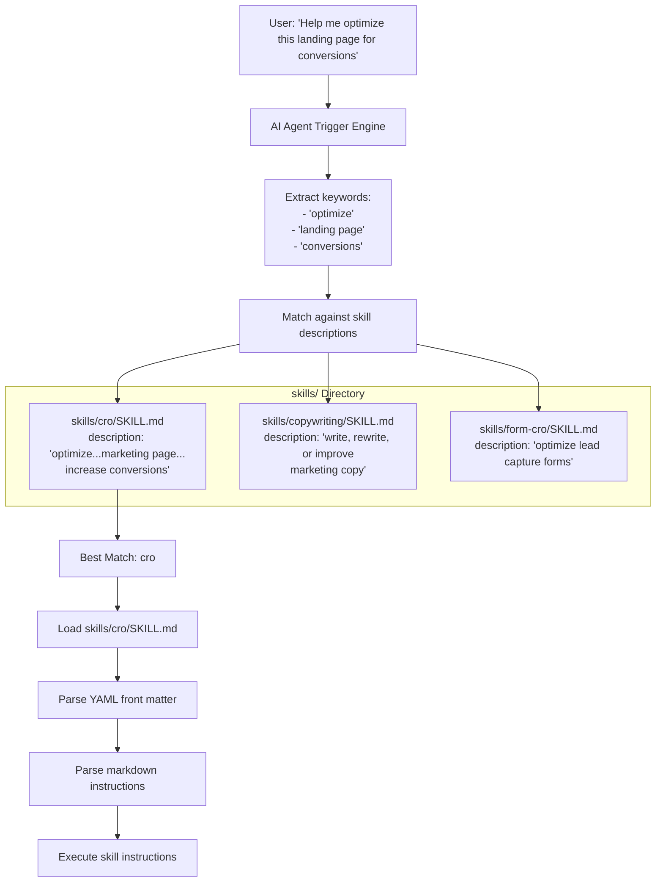
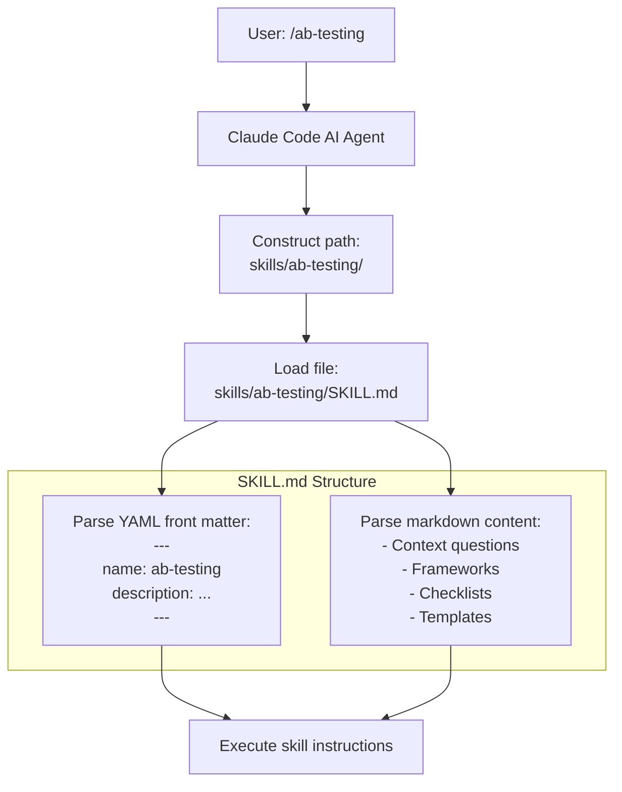
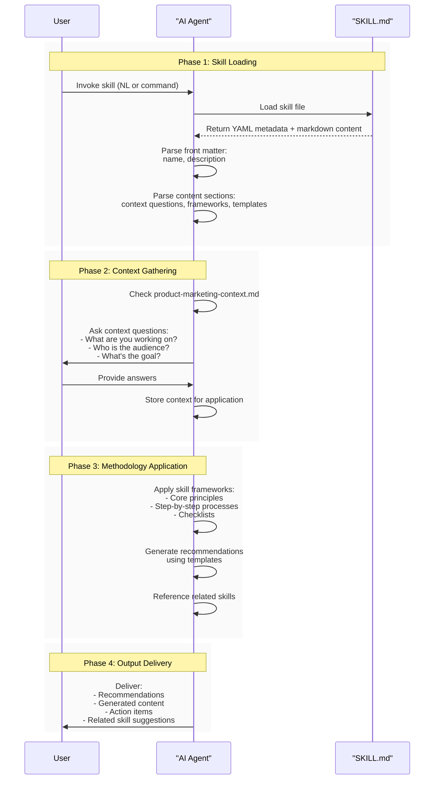
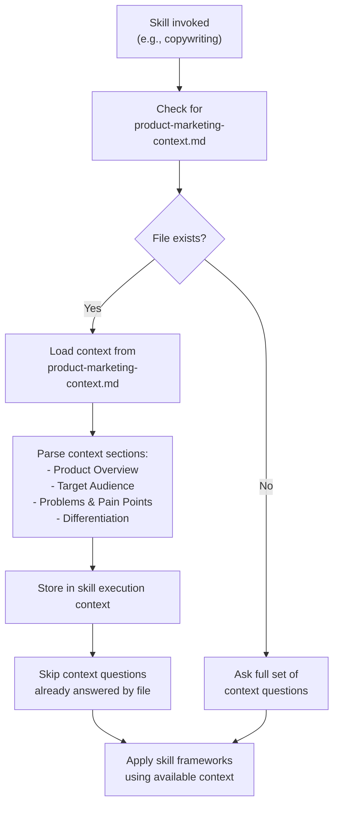
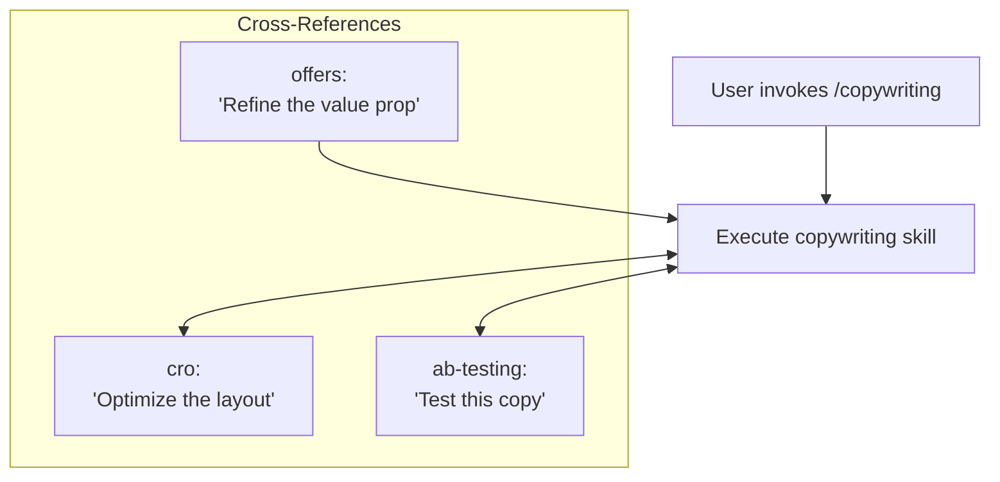

<!-- source: DeepWiki mcp.deepwiki.com · repo coreyhaines31/marketingskills · page 2.2 Using Your First Skill · fetched 2026-10-26 -->

# Using Your First Skill

<details>
<summary>Relevant source files</summary>

The following files were used as context for generating this wiki page:

- [.claude-plugin/marketplace.json](.claude-plugin/marketplace.json)
- [.claude-plugin/plugin.json](.claude-plugin/plugin.json)
- [README.md](README.md)
- [VERSIONS.md](VERSIONS.md)
- [skills/copywriting/SKILL.md](skills/copywriting/SKILL.md)
- [skills/launch/SKILL.md](skills/launch/SKILL.md)
- [skills/pricing/SKILL.md](skills/pricing/SKILL.md)
- [skills/sales-enablement/SKILL.md](skills/sales-enablement/SKILL.md)

</details>


## Purpose and Scope

This document walks through invoking your first marketing skill after installation, covering both implicit (natural language) and explicit (direct command) invocation methods. It explains the skill execution lifecycle, what to expect during interaction, how skills integrate with `product-marketing-context.md`, and how to discover related skills. The repository now contains 47 specialized skills [README.md:56-80]() and over 60 CLI tools [README.md:3-3]().

---

## Invocation Methods

Skills can be invoked through two distinct methods: **implicit invocation** (natural language triggers) and **explicit invocation** (direct commands). Both methods ultimately load and execute the same `SKILL.md` file, but differ in how the AI agent identifies which skill to use.

### Implicit Invocation (Natural Language)

Implicit invocation relies on trigger matching against the skill's description field in the YAML front matter. When you describe a task in conversational terms, the agent's trigger engine matches keywords and intent to the appropriate skill by comparing against the trigger patterns defined in each skill's `SKILL.md` file [README.md:13-16]().

**Diagram: Implicit Invocation - Natural Language Trigger Matching**



**Common Natural Language Patterns**

| User Intent | Example Phrase | Matched Skill |
|------------|----------------|---------------|
| Improve conversion rates | "Help me optimize this landing page for conversions" | `cro` |
| Create marketing copy | "Write homepage copy for my SaaS" | `copywriting` |
| Set up analytics | "Set up GA4 tracking for signups" | `analytics` |
| Build email campaigns | "Create a 5-email welcome sequence" | `emails` |
| Fix SEO issues | "My page isn't ranking, audit my SEO" | `seo-audit` |
| Design a launch | "Help me launch my product on Product Hunt" | `launch` |

**Sources:** [README.md:13-16](), [README.md:56-80](), [skills/copywriting/SKILL.md:1-6](), [skills/cro/SKILL.md:1-6]()

### Explicit Invocation (Direct Commands)

Explicit invocation bypasses the trigger matching system and directly specifies which skill to load. Commands typically use a slash prefix followed by the skill directory name, which must match exactly.

**Diagram: Explicit Invocation - Direct Command Execution Path**



**Available Direct Commands**

| Command | Skill | Use When |
|---------|-------|----------|
| `/cro` | CRO | Optimizing any marketing page |
| `/copywriting` | Copywriting | Writing new marketing copy |
| `/emails` | Emails | Building email automation |
| `/seo-audit` | SEO Audit | Analyzing SEO issues |
| `/ab-testing` | A/B Testing | Designing experiments |
| `/analytics` | Analytics | Setting up event tracking |
| `/offers` | Offer Design | Designing the core value proposition |
| `/social` | Social Content | Creating social media posts |
| `/marketing-council` | Marketing Council | Getting expert advisor perspectives |

**Command to Directory Mapping**

| Direct Command | File Path | Skill Directory Name |
|---------------|-----------|---------------------|
| `/cro` | `skills/cro/SKILL.md` | `cro` |
| `/copywriting` | `skills/copywriting/SKILL.md` | `copywriting` |
| `/emails` | `skills/emails/SKILL.md` | `emails` |
| `/seo-audit` | `skills/seo-audit/SKILL.md` | `seo-audit` |
| `/churn-prevention` | `skills/churn-prevention/SKILL.md` | `churn-prevention` |
| `/ai-seo` | `skills/ai-seo/SKILL.md` | `ai-seo` |
| `/marketing-council` | `skills/marketing-council/SKILL.md` | `marketing-council` |

The command name must match the directory name exactly. All 47 available skills are listed in [VERSIONS.md:7-53]().

**Sources:** [VERSIONS.md:7-53](), [README.md:56-80](), [.claude-plugin/marketplace.json:12-19]()

---

## The Skill Execution Lifecycle

Every skill execution follows a consistent four-phase lifecycle, regardless of invocation method. Understanding this lifecycle helps set expectations for the interaction.

**Diagram: Skill Execution Lifecycle**



### Phase Breakdown

| Phase | Duration | What Happens | User Action Required |
|-------|----------|--------------|---------------------|
| **1. Loading** | Instant | Agent loads and parses `SKILL.md` file | None |
| **2. Context Gathering** | 30-60 sec | Agent checks context file and asks remaining questions | Answer questions |
| **3. Application** | 1-2 min | Agent applies frameworks and generates recommendations | None (AI processing) |
| **4. Delivery** | Instant | Agent presents output and suggests next steps | Review and act |

**Sources:** [README.md:13-16](), [skills/copywriting/SKILL.md:12-38](), [skills/sales-enablement/SKILL.md:12-38]()

---

## Product Marketing Context Integration

Skills check for a `product-marketing-context.md` file before asking context questions. This file reduces repetitive questioning by providing reusable product and market information. The `product-marketing` skill serves as the foundation for all other skills [README.md:19-19]().

**Diagram: Context File Discovery and Integration**



**Integration Pattern in Skills**

Every skill in the repository is designed to check the `product-marketing` context first to understand the product, audience, and positioning [README.md:19-19](). This is explicitly instructed in the "Before Starting" or "Before Writing" sections of skills like `sales-enablement` [skills/sales-enablement/SKILL.md:14-15]() and `copywriting` [skills/copywriting/SKILL.md:14-15]().

**Sources:** [README.md:17-25](), [skills/copywriting/SKILL.md:14-15](), [skills/sales-enablement/SKILL.md:14-15](), [skills/pricing/SKILL.md:14-15]()

---

## Example Walkthrough: Using the `copywriting` Skill

This section walks through a complete example using the `copywriting` skill [VERSIONS.md:20-20]().

### Step 1: Invocation

**Implicit (Natural Language):**
```
User: "Write homepage copy for my new SaaS"
```
→ Agent matches to `skills/copywriting/SKILL.md` based on keywords like "write, rewrite, or improve marketing copy for any page" [skills/copywriting/SKILL.md:3-3]().

### Step 2: Context Gathering

The agent performs an initial assessment:
1. Checks for `.agents/product-marketing.md` or `product-marketing-context.md` [skills/copywriting/SKILL.md:14-15]().
2. Asks for Page Purpose, Audience, Product/Offer details, and Context (traffic source) [skills/copywriting/SKILL.md:19-38]().

### Step 3: Methodology Application

The skill applies core principles and strategies:
- **Clarity Over Cleverness**: Prioritizing clear messaging [skills/copywriting/SKILL.md:43-44]().
- **Benefits Over Features**: Focusing on customer outcomes [skills/copywriting/SKILL.md:46-47]().
- **Page Structure Framework**: Applying Above the Fold and Core Section templates [skills/copywriting/SKILL.md:106-146]().

### Step 4: Output Delivery

The agent delivers structured recommendations including:
- **Headline & Subheadline**: Using specific formulas [skills/copywriting/SKILL.md:110-129]().
- **Strong CTAs**: Action-oriented button text [skills/copywriting/SKILL.md:149-168]().
- **Voice and Tone**: Adjusted for brand personality [skills/copywriting/SKILL.md:199-218]().

**Sources:** [skills/copywriting/SKILL.md:1-222](), [README.md:73-73]()

---

## Discovering Related Skills

Skills reference each other to create a guided discovery network. This is documented in the **Related Skills** section of each skill file [README.md:52-52]().

**Diagram: Skill Discovery and Cross-Reference Flow**



### Common Skill Chains

| Workflow | Skill Chain |
|----------|-------------|
| **Landing Page Optimization** | `customer-research` → `copywriting` ↔ `cro` ↔ `ab-testing` [README.md:46-49]() |
| **B2B Sales Outreach** | `revops` ↔ `sales-enablement` ↔ `cold-email` [README.md:47-47]() |
| **SEO Authority** | `seo-audit` ↔ `schema` ↔ `ai-seo` [README.md:48-48]() |
| **Monetization Setup** | `offers` → `pricing` ↔ `churn-prevention` [skills/pricing/SKILL.md:223-226]() |

**Sources:** [README.md:45-52](), [skills/pricing/SKILL.md:223-226](), [skills/copywriting/SKILL.md:3-3]()

---

## Summary of First Use Patterns

1. **Provide Specific Context**: Detailed inputs lead to better recommendations.
2. **Explicit Commands**: Use `/skill-name` for speed if you know the task.
3. **Implicit Discovery**: Describe the problem naturally to find the right skill.
4. **Leverage Context Files**: Use the `product-marketing` skill first to build a foundation [README.md:19-19]().
5. **Follow Recommendations**: Use the "Related Skills" suggestions to complete full marketing workflows [README.md:52-52]().

**Sources:** [README.md:13-25](), [README.md:52-52](), [skills/sales-enablement/SKILL.md:12-38]()

---

