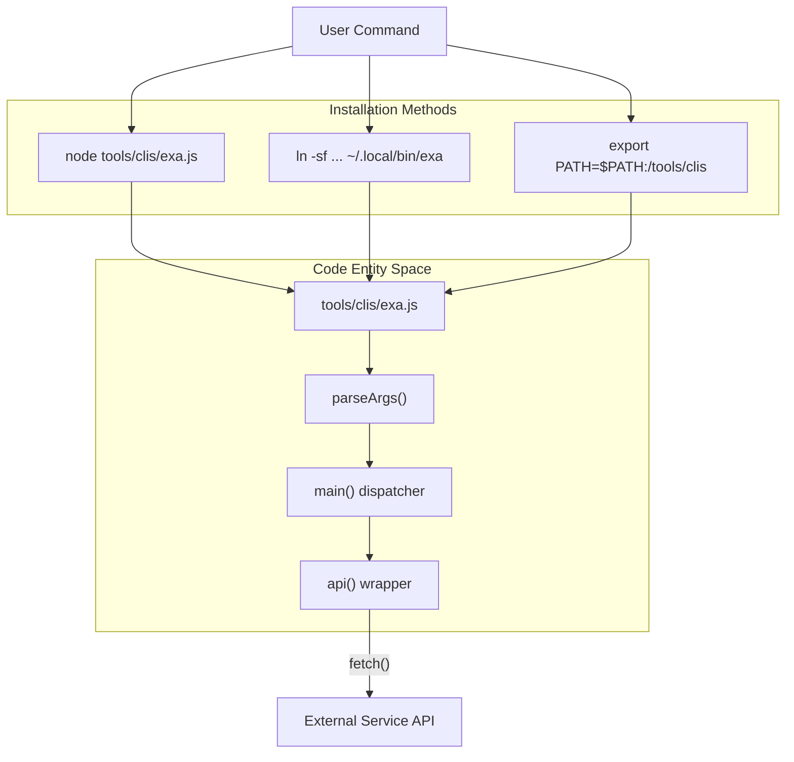
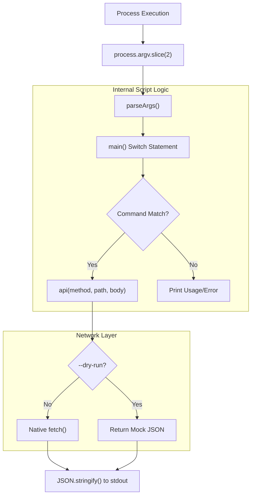

<!-- source: DeepWiki mcp.deepwiki.com · repo coreyhaines31/marketingskills · page 2.3 Using CLI Tools · fetched 2026-10-26 -->

# Using CLI Tools

<details>
<summary>Relevant source files</summary>

The following files were used as context for generating this wiki page:

- [tools/REGISTRY.md](tools/REGISTRY.md)
- [tools/clis/README.md](tools/clis/README.md)
- [tools/clis/exa.js](tools/clis/exa.js)
- [tools/integrations/exa.md](tools/integrations/exa.md)
- [tools/integrations/gong.md](tools/integrations/gong.md)
- [tools/integrations/rb2b.md](tools/integrations/rb2b.md)
- [tools/integrations/zapier.md](tools/integrations/zapier.md)

</details>


## Purpose and Scope

This page documents how to install, configure, and use the 60+ command-line API integration tools provided in the `tools/clis/` directory. Each CLI is a zero-dependency, single-file Node.js script that wraps a marketing platform API with a consistent command interface. These tools are designed for technical marketers and AI agents to interact with third-party services like Ahrefs, Mixpanel, and Resend directly from the terminal without the overhead of heavy SDKs or `npm install` steps.

For information about the skills system and how AI agents use skills to generate recommendations, see [Using Your First Skill](2.2). For detailed documentation of specific CLI commands and API integrations, see [CLI Tools Reference](5).

**Sources:** [tools/clis/README.md:1-8](), [tools/REGISTRY.md:1-10]()

---

## Installation Methods

The CLI tools are standalone Node.js scripts (Node 18+) that require no external dependencies. They support three installation approaches.

### Method 1: Direct Execution

Execute any CLI directly using Node.js. This is the simplest way to run a tool without any system modifications:

```bash
node tools/clis/ahrefs.js backlinks list --target example.com
node tools/clis/resend.js send --from you@example.com --to them@example.com --subject "Test"
```

This method is the most secure as it requires no environment modifications and works immediately after cloning the repository [tools/clis/README.md:9-13]().

### Method 2: Symlink for Global Access

Create symbolic links to specific CLIs in your local bin directory to make them available as global commands across your system:

```bash
# Create symlinks in a directory that's already in your PATH
ln -sf "$(pwd)/tools/clis/ahrefs.js" ~/.local/bin/ahrefs
ln -sf "$(pwd)/tools/clis/resend.js" ~/.local/bin/resend

# Then invoke directly from any directory
ahrefs backlinks list --target example.com
resend send --from you@example.com --to them@example.com --subject "Test"
```

**Sources:** [tools/clis/README.md:15-25]()

### Method 3: Add Directory to PATH

Add the entire `tools/clis/` directory to your system `PATH` to make all 60+ CLIs available instantly without individual symlinking:

```bash
export PATH="$PATH:/path/to/marketingskills/tools/clis"
```

**Sources:** [tools/clis/README.md:27-31]()

### Installation to Execution Flow

The following diagram bridges the natural language installation request to the code entities involved in execution, using `exa.js` as a reference implementation.

**Installation to Execution Flow**

**Sources:** [tools/clis/README.md:7-31](), [tools/clis/exa.js:11-141]()

---

## Authentication

All CLIs read credentials exclusively from environment variables. To maintain security, no API keys are hardcoded or accepted as command-line arguments.

### Setting Environment Variables

Store credentials in your shell profile (`~/.zshrc`, `~/.bashrc`) or a `.env` file in the root of the repository.

```bash
export AHREFS_API_KEY="your_key_here"
export EXA_API_KEY="your_exa_key"
```

The `.env` file is explicitly ignored by git to prevent accidental credential leaks [tools/clis/README.md:96-98]().

### Common Authentication Patterns

| CLI | Environment Variables Required | Source |
|-----|-------------------------------|--------|
| `ahrefs` | `AHREFS_API_KEY` | [tools/clis/README.md:41]() |
| `exa` | `EXA_API_KEY` | [tools/clis/exa.js:3]() |
| `meta-ads`| `META_ACCESS_TOKEN`, `META_AD_ACCOUNT_ID` | [tools/clis/README.md:67]() |
| `ga4` | `GA4_ACCESS_TOKEN` | [tools/clis/README.md:55]() |
| `google-ads` | `GOOGLE_ADS_TOKEN`, `GOOGLE_ADS_DEVELOPER_TOKEN` | [tools/clis/README.md:56]() |

**Sources:** [tools/clis/README.md:33-90](), [tools/clis/exa.js:3-9]()

---

## Command Structure and Usage

All CLIs follow a standard command pattern to ensure a predictable user experience across different marketing platforms.

```bash
{tool} <resource> <action> [options]
```

### Examples
- **SEO**: `ahrefs backlinks list --target example.com --limit 50` [tools/clis/README.md:112]()
- **AI Search**: `exa search --query "SaaS onboarding" --type neural` [tools/clis/exa.js:133]()
- **Links**: `dub links create --url https://example.com --key promo` [tools/clis/README.md:116]()

### Output Handling
All tools output structured JSON to `stdout`. This allows for easy piping to utilities like `jq` or redirection to files:
```bash
ahrefs backlinks list --target example.com | jq '.backlinks[].url_from'
semrush keywords overview --phrase "saas" > keywords.json
```

**Sources:** [tools/clis/README.md:100-132]()

---

## Shared CLI Architecture

Every CLI in the `tools/clis/` directory shares a common internal structure. This "Zero-Dependency" design ensures portability.

### Internal Logic Flow

**Shared CLI Implementation Pattern**

**Sources:** [tools/clis/exa.js:11-141]()

### Key Code Entities

1.  **`parseArgs(args)`**: A robust helper function that converts the `process.argv` array into a structured object. It maps keys starting with `--` to values and places positional arguments in a `_` array [tools/clis/exa.js:32-50]().
2.  **`api(method, path, body)`**: The central HTTP client wrapper. It handles header construction (e.g., `x-api-key`, `Content-Type`) and implements the `--dry-run` logic [tools/clis/exa.js:11-30]().
3.  **`main()`**: The dispatcher that uses a `switch` statement on the primary command to route requests to specific API endpoints like `search`, `find-similar`, or `contents` [tools/clis/exa.js:75-142]().

---

## Dry-Run Mode

Every CLI tool includes a `--dry-run` flag. This is a critical safety feature for both human users and AI agents to verify operations before execution.

### How it Works
When the `--dry-run` flag is passed, the `api()` function intercepts the request before it reaches the network. Instead of performing a `fetch()`, it returns a JSON object describing the intended request.

**Code Implementation:**
[tools/clis/exa.js:12-14]()
```javascript
if (args['dry-run']) {
  return { _dry_run: true, method, url: `${BASE_URL}${path}`, headers: { 'x-api-key': '***', ... }, body: body || undefined }
}
```

### Benefits
- **Security**: Credentials are masked as `***` in the dry-run output [tools/clis/exa.js:13-13]().
- **Validation**: Verify the final constructed URL, HTTP method, and JSON body payload.
- **Cost Control**: Test complex agent loops without consuming API credits from providers like Ahrefs or Semrush [tools/clis/README.md:98]().

**Sources:** [tools/clis/README.md:98](), [tools/clis/exa.js:12-14]()

---

