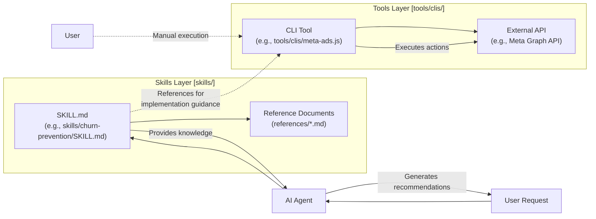
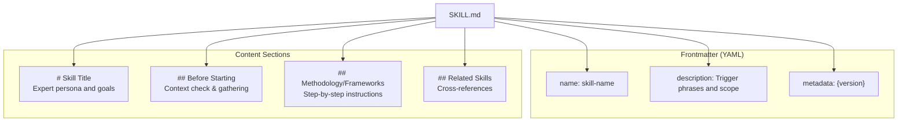
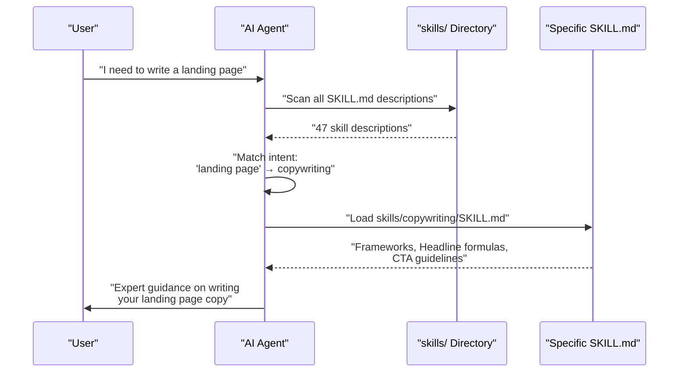
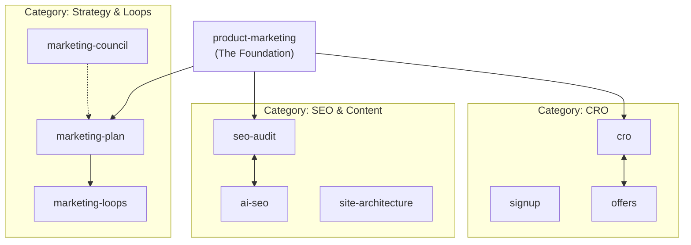

<!-- source: DeepWiki mcp.deepwiki.com · repo coreyhaines31/marketingskills · page 3 Core Concepts · fetched 2026-10-26 -->

# Core Concepts

<details>
<summary>Relevant source files</summary>

The following files were used as context for generating this wiki page:

- [.claude-plugin/marketplace.json](.claude-plugin/marketplace.json)
- [.claude-plugin/plugin.json](.claude-plugin/plugin.json)
- [AGENTS.md](AGENTS.md)
- [CONTRIBUTING.md](CONTRIBUTING.md)
- [README.md](README.md)
- [VERSIONS.md](VERSIONS.md)

</details>


This page explains the fundamental concepts underlying the marketingskills repository: what skills are, how they're structured as markdown files, how they integrate with product context, and how they reference each other to form complex workflows. 

For installation and basic usage of skills, see [Getting Started](#2). For the complete catalog of available skills and their detailed documentation, see [Skills Reference](#4). For information about CLI tools, see [CLI Tools Reference](#5).

---

## Skills as Knowledge Modules for AI Agents

Skills in this repository are **markdown-based knowledge modules** designed for consumption by AI coding assistants (Claude Code, Cursor, Windsurf, etc.). They provide specialized expertise for specific marketing tasks without executing code themselves. When an AI agent processes a skill file, it gains access to frameworks, best practices, benchmarks, and workflows for that marketing domain.

**Sources:** [README.md:13-16]()

### Key Characteristics

| Characteristic | Description |
|---------------|-------------|
| **Format** | Markdown files (`SKILL.md`) stored in subdirectories of `skills/` |
| **Purpose** | Provide knowledge and frameworks, not code execution |
| **Invocation** | Natural language matching (implicit) or explicit command |
| **Independence** | Function without external dependencies or API access |
| **Composition** | Reference related skills for multi-step workflows |
| **Context-aware** | Check for `product-marketing-context.md` to reduce repetitive questions |

**Sources:** [README.md:13-16](), [.claude-plugin/marketplace.json:12-19](), [AGENTS.md:100-104]()

### Distinction: Skills vs. CLI Tools



**Diagram: Skills provide knowledge, CLI tools execute actions**

Skills contain frameworks and strategies (knowledge layer) while CLI tools provide executable integrations with external services (execution layer). Skills may reference CLI tools to inform implementation recommendations, but never invoke them directly. For more on the tools architecture, see [CLI Tools Reference](#5).

**Sources:** [README.md:13-16](), [AGENTS.md:23-27]()

---

## Skill File Structure

Each skill is contained in a directory under `skills/` with a standardized structure. As of v2.8.11, the repository contains 47 marketing skills.

```
skills/
└── {skill-name}/
    ├── SKILL.md              # Core skill definition (Required)
    ├── references/           # Detailed docs (Optional) loaded on demand
    ├── scripts/              # Executable code (Optional)
    └── assets/               # Templates/Data (Optional)
```

**Sources:** [AGENTS.md:98-104](), [.claude-plugin/marketplace.json:15-15]()

### SKILL.md Format



**Diagram: Standard SKILL.md file structure**

**Sources:** [AGENTS.md:70-85](), [CONTRIBUTING.md:19-30]()

### Natural Language Matching

The `description` field in the YAML frontmatter is critical for **implicit invocation**. When users describe a task, the AI agent matches their intent against these descriptions.



**Diagram: Natural language skill invocation flow**

**Sources:** [AGENTS.md:135-144](), [README.md:73-73]()

---

## Product Marketing Context Integration

The `product-marketing-context.md` file (and its standard counterpart `product-marketing`) is the foundation of the system. It reduces repetitive questions by providing persistent product-specific information to all skills.

### Context File Location
Skills are designed to check for this file to understand the product, audience, and positioning before performing tasks. The `product-marketing` skill is the prerequisite for all other operations.

```
project-root/
└── .agents/
    └── product-marketing.md    # Foundation for all skills
```

**Sources:** [README.md:17-25](), [AGENTS.md:7-7]()

### Skill Context Checking Pattern

Skills follow a standard "Check for context first" pattern. The `product-marketing` skill acts as the primary source of truth that every other skill reads first to ensure alignment with the brand's positioning.

**Sources:** [README.md:19-25]()

For details on setting up this file, see [Product Marketing Context](#3.3).

---

## Skill Composition and Relationships

Skills reference each other to form multi-step workflows. The repository contains 47 skills organized into functional categories that cover the entire customer lifecycle.

### Skill Relationships Map



**Diagram: High-level skill interdependencies**

**Sources:** [README.md:21-50](), [VERSIONS.md:29-32]()

### Related Skills Pattern
Every skill is designed to work within a larger ecosystem. For example, the `marketing-plan` skill orchestrates other skills like `seo-audit` or `ads`, while the `marketing-council` (added in v2.8.6) provides expert perspectives that hand off to execution skills like `copywriting` or `offers`.

**Sources:** [VERSIONS.md:29-32](), [README.md:45-52]()

For detailed dependency maps, see [Skill Relationships](#3.4).

---

## Skill Evals System

The system includes automated evaluations (evals) distributed across the skills to ensure consistent agent behavior.

- **Structure**: Each eval consists of a prompt, expected output patterns, and specific assertions.
- **Purpose**: To prevent regression in agent behavior and verify that trigger phrases correctly activate the intended skills.
- **Example**: New evals are added for every major feature, such as the `video` skill's viral edit reverse-engineering (eval id 7) or the `prospecting` skill's demand-signal discovery (eval id 7).

For details on running and writing evals, see [Skill Evals System](#3.5).

**Sources:** [VERSIONS.md:59-59](), [VERSIONS.md:67-67]()

---

**Page Sources:**
- [README.md:1-80]()
- [VERSIONS.md:1-54]()
- [AGENTS.md:1-192]()
- [.claude-plugin/marketplace.json:1-19]()
- [CONTRIBUTING.md:1-89]()

---

