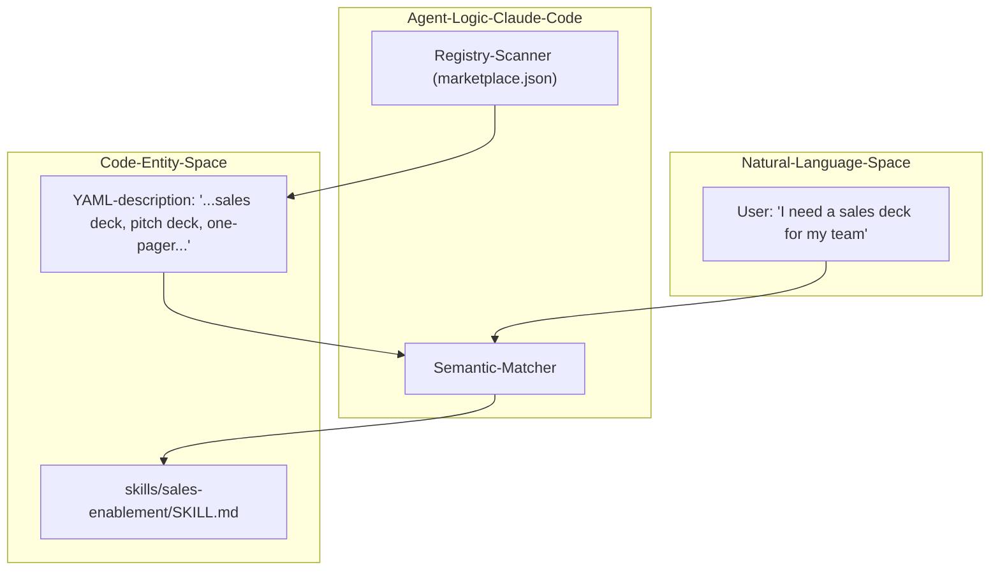
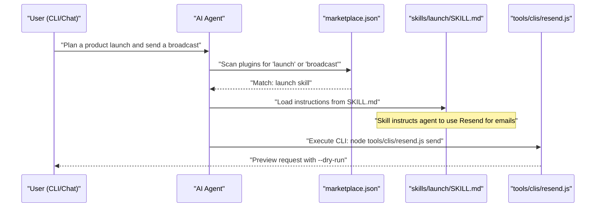

<!-- source: DeepWiki mcp.deepwiki.com · repo coreyhaines31/marketingskills · page 3.2 Skill File Format · fetched 2026-10-26 -->

# Skill File Format

<details>
<summary>Relevant source files</summary>

The following files were used as context for generating this wiki page:

- [.claude-plugin/marketplace.json](.claude-plugin/marketplace.json)
- [.claude-plugin/plugin.json](.claude-plugin/plugin.json)
- [AGENTS.md](AGENTS.md)
- [CONTRIBUTING.md](CONTRIBUTING.md)
- [README.md](README.md)
- [VERSIONS.md](VERSIONS.md)

</details>


This page documents the technical specification of the `SKILL.md` file format used throughout the Marketing Skills repository. It details the YAML frontmatter schema, mandatory naming conventions, and the structural patterns required for AI agents to discover and execute these skills.

## Technical Overview

Skills are defined as markdown-based knowledge modules. Each skill resides in its own directory within the `skills/` root, containing a mandatory `SKILL.md` file [AGENTS.md:20-22](). This format follows the [Agent Skills specification](https://agentskills.io/specification.md) [AGENTS.md:64-66]().

### Directory Structure
```text
skills/
└── [skill-name]/          # Must be lowercase alphanumeric + hyphens
    ├── SKILL.md           # Required: Main instructions (<500 lines)
    ├── references/        # Optional: Detailed docs loaded on demand
    ├── scripts/           # Optional: Executable code
    └── assets/            # Optional: Templates and data files
```
**Sources:** [AGENTS.md:16-31](), [AGENTS.md:98-104](), [CONTRIBUTING.md:42-50]()

---

## YAML Frontmatter Specification

Every `SKILL.md` must begin with a YAML frontmatter block. This metadata is the primary mechanism for skill discovery and natural language triggering [AGENTS.md:68-75]().

### Schema and Constraints

| Field | Required | Constraints | Purpose |
| :--- | :--- | :--- | :--- |
| `name` | Yes | 1-64 chars, lowercase `a-z`, `0-9`, `-`. No `--`. | Canonical ID; must match parent directory exactly [AGENTS.md:81](). |
| `description` | Yes | 1-1024 chars. Must include trigger phrases. | Used by agents to decide when to activate the skill [AGENTS.md:82](). |
| `license` | No | Default: `MIT` | Legal permissions [AGENTS.md:83](). |
| `metadata` | No | Key-value pairs (e.g., `version`, `author`) | Versioning and attribution [AGENTS.md:84](). |

**Sources:** [AGENTS.md:71-84](), [CONTRIBUTING.md:19-25](), [CONTRIBUTING.md:32-39]()

### Implementation Example
The following snippet demonstrates a standard valid frontmatter implementation as required by the specification [AGENTS.md:70-75]():

```yaml
---
name: copywriting
description: "When the user wants to write, rewrite, or improve marketing copy for any page — including homepage, landing pages, pricing pages, feature pages, about pages, or product pages. Also use when the user says 'write copy for,' 'improve this copy,' 'rewrite this page,' 'marketing copy,' 'headline help,' 'CTA copy,' 'value proposition,' 'tagline,' 'subheadline,' 'hero section copy,' 'above the fold,' 'this copy is weak,' 'make this more compelling,' or 'help me describe my product.' Use this whenever someone is working on website text that needs to persuade or convert. For email copy, see emails. For popup copy, see popups. For editing existing copy, see copy-editing. For the offer underneath the copy (bonuses, guarantees, value framing), see offers."
metadata:
  version: 2.0.1
---
```
**Sources:** [README.md:73](), [VERSIONS.md:20](), [AGENTS.md:142-144](), [CONTRIBUTING.md:21-25]()

---

## Natural Language Triggering

The `description` field acts as the bridge between "Natural Language Space" (user intent) and "Code Entity Space" (the specific skill file). The description is critical for skill discovery and must include specific trigger phrases [AGENTS.md:135-144]().

### Trigger Mapping Logic

**Diagram: Triggering Flow from Intent to File Entity**
**Sources:** [README.md:34](), [README.md:87](), [AGENTS.md:135-144](), [CONTRIBUTING.md:21-25]()

---

## Markdown Content Structure

While the frontmatter is for discovery, the Markdown content is for execution. The repository enforces specific writing styles to ensure agent reliability.

### Standard Section Patterns

1.  **Context Check**: All skills are designed to check `product-marketing` first to understand product, audience, and positioning [README.md:17-19]().
2.  **Core Instructions**: Use H2 (`##`) for main sections and H3 (`###`) for subsections [AGENTS.md:110-111]().
3.  **Tool Integrations**: Skills reference relevant tools from the registry to provide actionable implementation steps [AGENTS.md:181-189]().
4.  **Related Skills**: Skills explicitly link to other relevant skills to define scope boundaries and dependencies [README.md:45-52]().

### Content Constraints
*   **Length**: `SKILL.md` files must be kept under 500 lines to prevent context window saturation. Detailed reference material must be moved to the `references/` subdirectory [AGENTS.md:110](), [CONTRIBUTING.md:55-56]().
*   **Tone**: Direct and instructional, using the second person ("You are a...") [AGENTS.md:117-118]().
*   **Formatting**: Use bold (`**text**`) for key terms and code blocks for examples and templates [AGENTS.md:123-124]().

**Sources:** [AGENTS.md:106-134](), [CONTRIBUTING.md:53-60](), [README.md:17-52]()

---

## System Integration Flow

The following diagram illustrates how a `SKILL.md` file interacts with the broader repository architecture, including the distribution layer and tool layer.


**Diagram: Skill Execution and Tool Composition**
**Sources:** [README.md:81](), [AGENTS.md:18-27](), [AGENTS.md:41-46](), [AGENTS.md:146-155]()

---

## Validation Checklist for Contributors

Before submitting a new skill via Pull Request, ensure the following technical requirements are met [CONTRIBUTING.md:79-86]():

*   [ ] `name` in YAML matches the directory name exactly [AGENTS.md:37]().
*   [ ] `name` is 1-64 chars, lowercase `a-z`, numbers, and hyphens only [AGENTS.md:38]().
*   [ ] `description` is 1-1024 characters and includes trigger phrases [AGENTS.md:39]().
*   [ ] `SKILL.md` file size is under 500 lines [CONTRIBUTING.md:55]().
*   [ ] No sensitive data or credentials are included in the file [CONTRIBUTING.md:84]().

**Sources:** [AGENTS.md:35-40](), [AGENTS.md:173-180](), [CONTRIBUTING.md:34-39]()

---

