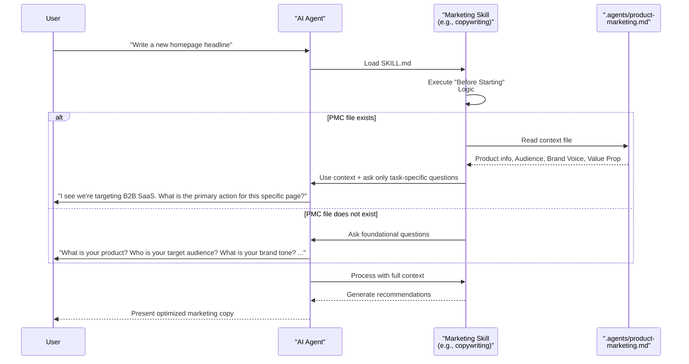
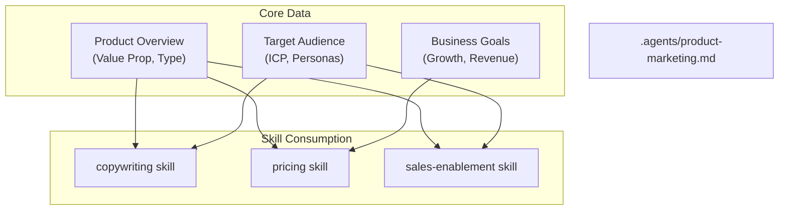

<!-- source: DeepWiki mcp.deepwiki.com · repo coreyhaines31/marketingskills · page 3.3 Product Marketing Context · fetched 2026-10-26 -->

# Product Marketing Context

<details>
<summary>Relevant source files</summary>

The following files were used as context for generating this wiki page:

- [.claude-plugin/marketplace.json](.claude-plugin/marketplace.json)
- [.claude-plugin/plugin.json](.claude-plugin/plugin.json)
- [README.md](README.md)
- [VERSIONS.md](VERSIONS.md)
- [skills/copywriting/SKILL.md](skills/copywriting/SKILL.md)
- [skills/launch/SKILL.md](skills/launch/SKILL.md)
- [skills/pricing/SKILL.md](skills/pricing/SKILL.md)
- [skills/sales-enablement/SKILL.md](skills/sales-enablement/SKILL.md)

</details>


This document explains the `product-marketing-context.md` file, a centralized context document that skills check before asking questions. This file reduces repetitive information gathering by storing reusable product, market, and business context that AI agents can reference across all marketing skills.

For information about the product-marketing-context skill itself (which helps users create this file), see [Skills Overview](4.1). For information about how individual skills are structured and triggered, see [What is a Skill](3.1) and [Skill File Format](3.2).

---

## Purpose and Scope

The `product-marketing-context.md` file serves as a single source of truth for product and marketing information that would otherwise be asked repeatedly across different skills. When a skill is invoked, it checks for this file first and uses the context to skip redundant questions [README.md:17-19]().

**What it stores:**
- **Product Overview:** Value proposition, differentiators, and outcomes [skills/sales-enablement/SKILL.md:19-22]().
- **Target Audience:** Ideal customer profiles (ICP), decision-makers, and personas [skills/sales-enablement/SKILL.md:27](), [skills/copywriting/SKILL.md:23-28]().
- **Market Strategy:** Competitive landscape and alternatives [skills/pricing/SKILL.md:25-29]().
- **Brand Identity:** Voice, tone, and personality [skills/copywriting/SKILL.md:199-217]().
- **Evidence:** Proof points including metrics, logos, and testimonials [skills/copywriting/SKILL.md:33]().

**What it doesn't store:**
- **Task-Specific Details:** Page-specific purposes, traffic sources, or unique experiment hypotheses [skills/copywriting/SKILL.md:19-38]().
- **Temporary Project State:** Active progress or transient data.

Sources: [README.md:17-19](), [skills/sales-enablement/SKILL.md:14-38](), [skills/copywriting/SKILL.md:12-38](), [skills/pricing/SKILL.md:12-39]()

---

## File Location and Format

The product marketing context file lives at a conventional location that all skills recognize. While older setups used the `.claude/` directory or a legacy filename in the root, the current standard is within the `.agents/` directory.

**File characteristics:**
- **Markdown format:** Optimized for agent readability and structured parsing.
- **Location:** `.agents/product-marketing.md` (preferred) [skills/sales-enablement/SKILL.md:15]().
- **Backward Compatibility:** Skills also check for `.claude/product-marketing.md` or the legacy `product-marketing-context.md` in the project root [skills/sales-enablement/SKILL.md:15]().

Sources: [skills/sales-enablement/SKILL.md:14-15](), [skills/copywriting/SKILL.md:14-15](), [skills/pricing/SKILL.md:14-15]()

---

## How Skills Check for Context

Every skill implements a standard pattern for checking and using the product marketing context file. This pattern ensures the agent understands the product before applying specific marketing frameworks [README.md:17-19]().

### Context Check Flow



Sources: [README.md:17-25](), [skills/copywriting/SKILL.md:12-15](), [skills/sales-enablement/SKILL.md:12-15]()

---

## Standard Context Check Pattern

All skills implement the same check at the beginning of their "Before Starting" or "Before Writing" section. This pattern is a mandatory requirement for all skills to ensure they don't "hallucinate" product details.

### Code Pattern in Skill Files

Each skill file contains a block similar to this:

```markdown
## Before Starting

**Check for product marketing context first:**
If `.agents/product-marketing.md` exists (or `.claude/product-marketing.md`, or the legacy `product-marketing-context.md` filename, in older setups), read it before asking questions. 
Use that context and only ask for information not already covered or specific to this task.
```

### Implementation Reference

| Skill | File Path | Section |
|-------|-----------|---------|
| Sales Enablement | [skills/sales-enablement/SKILL.md:12-15]() | Before Starting |
| Copywriting | [skills/copywriting/SKILL.md:12-15]() | Before Writing |
| Pricing Strategy | [skills/pricing/SKILL.md:12-15]() | Before Starting |
| Launch Strategy | [skills/launch/SKILL.md:12-15]() | Before Starting |

Sources: [skills/sales-enablement/SKILL.md:12-15](), [skills/copywriting/SKILL.md:12-15](), [skills/pricing/SKILL.md:12-15](), [skills/launch/SKILL.md:12-15]()

---

## Context Requirements by Skill Category

Different skills prioritize different aspects of the product marketing context stored in the file.

### Context Mapping



### Category Priorities

| Skill Category | Key Context Utilized | Implementation Detail |
|----------------|----------------------|-----------------------|
| **Copywriting** | Brand Voice, Audience, Transformation | Mirroring voice-of-customer and establishing tone [skills/copywriting/SKILL.md:53-55](), [skills/copywriting/SKILL.md:199-217](). |
| **Sales/GTM** | Differentiators, Personas, Proof Points | Creating scannable collateral like one-pagers and decks [skills/sales-enablement/SKILL.md:41-55](). |
| **Strategy** | Value Metric, Competitive Landscape | Aligning price with perceived value vs. alternatives [skills/pricing/SKILL.md:57-68](). |

Sources: [skills/copywriting/SKILL.md:53-217](), [skills/sales-enablement/SKILL.md:41-55](), [skills/pricing/SKILL.md:57-68]()

---

## Skill-Specific Context Gathering

Even with a context file, skills still gather task-specific information. The system differentiates between **reusable context** (in the file) and **task-specific context** (gathered at runtime).

**Example: Copywriting Skill Intake**
1. **Check PMC:** Read product info, audience, and voice from `.agents/product-marketing.md` [skills/copywriting/SKILL.md:14-15]().
2. **Gather Task Context:**
   - **Page Purpose:** Is it a homepage or pricing page? [skills/copywriting/SKILL.md:19-20]().
   - **Primary Action:** What is the ONE goal? [skills/copywriting/SKILL.md:21]().
   - **Traffic Source:** Where are visitors coming from? [skills/copywriting/SKILL.md:36-37]().

Sources: [skills/copywriting/SKILL.md:12-38]()

---

## Related Skills

- **[Product Marketing Context Skill](4.1)**: The skill used to generate and maintain the context file.
- **[Copywriting](4.4.1)**: Consumes Brand Voice and Value Proposition context [skills/copywriting/SKILL.md:1-6]().
- **[Sales Enablement](4.9.1)**: Consumes Differentiator and Sales Motion context [skills/sales-enablement/SKILL.md:1-6]().
- **[Pricing Strategy](4.3.2)**: Consumes Value Metric and Competitive context [skills/pricing/SKILL.md:1-6]().
- **[Launch Strategy](4.8.2)**: Consumes foundational context to plan the ORB framework [skills/launch/SKILL.md:12-15]().

Sources: [skills/copywriting/SKILL.md:1-6](), [skills/sales-enablement/SKILL.md:1-6](), [skills/pricing/SKILL.md:1-6](), [skills/launch/SKILL.md:12-15]()

---

