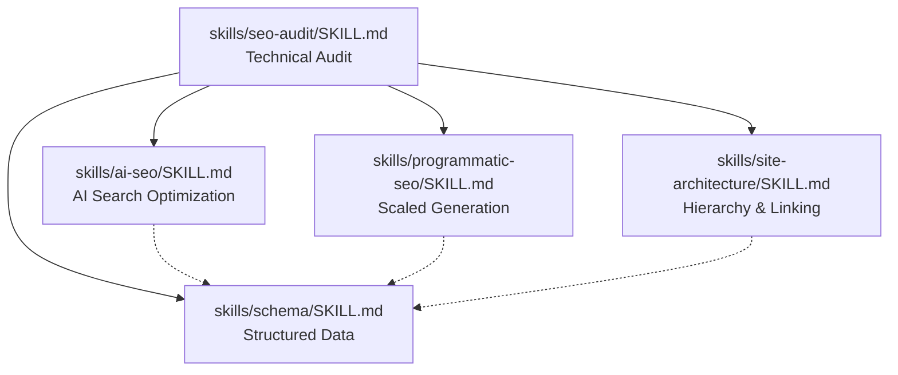
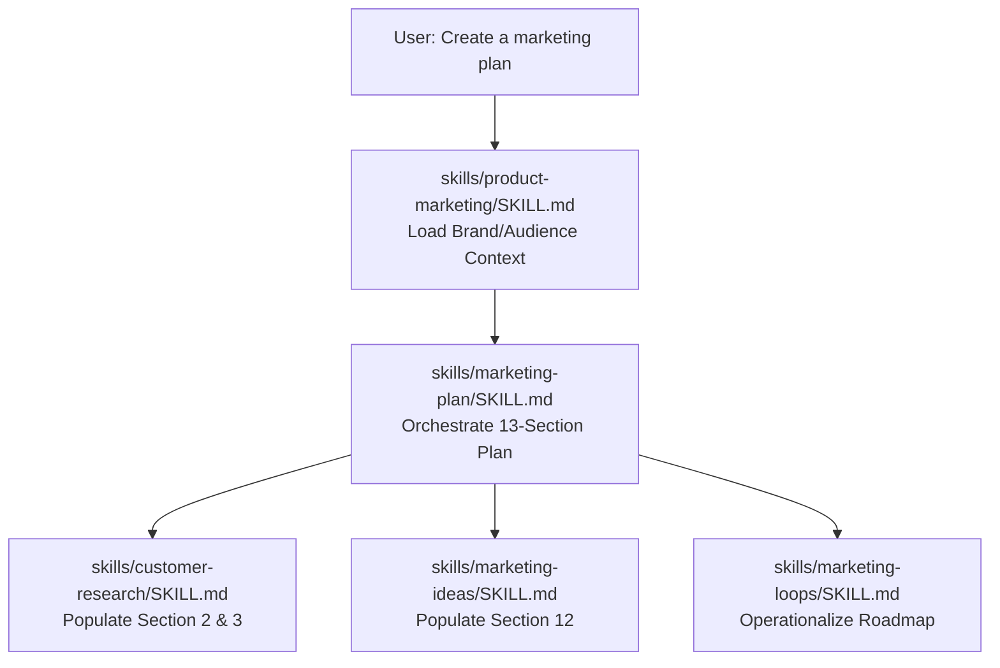

<!-- source: DeepWiki mcp.deepwiki.com · repo coreyhaines31/marketingskills · page 3.4 Skill Relationships · fetched 2026-10-26 -->

# Skill Relationships

<details>
<summary>Relevant source files</summary>

The following files were used as context for generating this wiki page:

- [.claude-plugin/marketplace.json](.claude-plugin/marketplace.json)
- [.claude-plugin/plugin.json](.claude-plugin/plugin.json)
- [README.md](README.md)
- [VERSIONS.md](VERSIONS.md)
- [skills/customer-research/SKILL.md](skills/customer-research/SKILL.md)
- [skills/customer-research/evals/evals.json](skills/customer-research/evals/evals.json)
- [skills/customer-research/references/source-guides.md](skills/customer-research/references/source-guides.md)
- [tools/integrations/sparktoro.md](tools/integrations/sparktoro.md)

</details>


This document explains how skills reference and compose with each other in the `marketingskills` repository. Each skill operates independently but includes explicit references to related skills that users may need for complementary tasks. The system implements a hub-and-spoke pattern where highly connected "hub" skills coordinate with specialized "spoke" skills to enable complex multi-skill workflows.

For information about what skills are and their file format, see [What is a Skill](3.1) and [Skill File Format](3.2). For a complete catalog of available skills, see [Skills Overview](4.1).

---

## The Related Skills Pattern

Every skill file follows a consistent pattern for declaring relationships to other skills. At the bottom of each `SKILL.md` file, a "Related Skills" section lists other skills that users commonly need before, during, or after using the current skill.

### Related Skills Section Structure

Each related skill reference includes:
- **Skill name** (referenced by its directory name)
- **Brief context** explaining when and why you'd use that skill in relation to the current one

**Example from [README.md:45-52]()**:

```markdown
Skills cross-reference each other:
  copywriting ↔ cro ↔ ab-testing
  revops ↔ sales-enablement ↔ cold-email
  seo-audit ↔ schema ↔ ai-seo
  customer-research → copywriting, cro, competitors
```

### Relationship Types

Skills reference each other in three primary patterns:

| Relationship Type | Description | Example |
|------------------|-------------|---------|
| **Sequential** | One skill leads naturally to the next in a workflow | `customer-research` → `copywriting` → `cro` |
| **Complementary** | Skills address different aspects of the same problem | `seo-audit` ↔ `ai-seo` (technical SEO + AI search optimization) |
| **Hierarchical** | One skill provides strategic direction, another handles execution | `marketing-plan` → `ads` (plan sets budget, ads implements campaigns) |

Sources: [README.md:17-52](), [VERSIONS.md:55-63]()

---

## Hub Skills and Connection Patterns

Seven skills emerge as highly interconnected "hubs" that coordinate multiple other skills. These hub skills serve as entry points for complex marketing workflows.

### Hub Skill Network

```mermaid
graph TB
    subgraph ["Hub Skills - Strategic Entry Points"]
        PMC["skills/product-marketing/SKILL.md<br/>(Foundational Context)"]
        PLAN["skills/marketing-plan/SKILL.md<br/>(Orchestration)"]
        LOOPS["skills/marketing-loops/SKILL.md<br/>(Operations)"]
        RESEARCH["skills/customer-research/SKILL.md<br/>(Input Data)"]
        COUNCIL["skills/marketing-council/SKILL.md<br/>(Expert Perspectives)"]
    end
    
    subgraph ["SEO & Discovery"]
        SEOAUDIT["skills/seo-audit/SKILL.md"]
        AISEO["skills/ai-seo/SKILL.md"]
        PROGSEO["skills/programmatic-seo/SKILL.md"]
        SCHEMA["skills/schema/SKILL.md"]
    end
    
    subgraph ["Conversion & Sales"]
        COPY["skills/copywriting/SKILL.md"]
        CRO["skills/cro/SKILL.md"]
        OFFERS["skills/offers/SKILL.md"]
        SALES["skills/sales-enablement/SKILL.md"]
    end
    
    PMC ==> PLAN
    PMC ==> RESEARCH
    
    PLAN --> SEOAUDIT
    PLAN --> COPY
    PLAN --> SALES
    PLAN --> LOOPS
    
    LOOPS --> SEOAUDIT
    LOOPS --> AISEO
    LOOPS --> CRO
    
    RESEARCH --> COPY
    RESEARCH --> CRO
    RESEARCH --> OFFERS
    
    COUNCIL --> OFFERS
    COUNCIL --> COPY
    COUNCIL --> PMC
    
    SEOAUDIT --> AISEO
    SEOAUDIT --> PROGSEO
    SEOAUDIT --> SCHEMA
    
    OFFERS --> COPY
    OFFERS --> SALES
```

**Diagram: Hub Skills and Their Primary Connections**

Sources: [README.md:21-50](), [VERSIONS.md:58-67](), [skills/customer-research/SKILL.md:3]()

### Hub Skill Characteristics

| Hub Skill | Role | Primary Connections |
|-----------|------|---------------------|
| `product-marketing` | **Foundational** | Read by all other skills first to understand product/audience. [README.md:19-20]() |
| `marketing-plan` | **Orchestrator** | Coordinates 46 skills across AARRR stages. [README.md:12625-12630]() |
| `marketing-loops` | **Operational** | Orchestrates existing skills into repeatable, scheduled workflows. [VERSIONS.md:31]() |
| `marketing-council` | **Strategic Advisor** | Provides 12 expert perspectives to guide `offers`, `copywriting`, or `ads`. [VERSIONS.md:29]() |
| `seo-audit` | **Technical** | Foundation for `ai-seo`, `programmatic-seo`, and `schema`. [README.md:48]() |
| `customer-research` | **Input** | Feeds data into `copywriting`, `cro`, and `competitors`. [README.md:49]() |
| `offers` | **Structural** | Defines the core deal for `pricing`, `copywriting`, and `sales-enablement`. [VERSIONS.md:34]() |

Sources: [README.md:19-50](), [VERSIONS.md:29-67](), [skills/customer-research/SKILL.md:3]()

---

## Skill Clusters

Skills naturally group into functional clusters based on shared problem domains. These clusters form dense subgraphs with strong internal dependencies.

### SEO & Discovery Cluster

Skills focused on search visibility and content discovery:



**Diagram: SEO Cluster Dependencies**

**Workflow pattern**: `seo-audit` (identify issues) → `site-architecture` (plan structure) → `ai-seo` or `programmatic-seo` (generate content) → `schema` (add JSON-LD).

Sources: [README.md:33-39](), [README.md:48]()

### Sales & Revenue Cluster

This cluster translates product value into revenue-generating assets.

| Skill | Focus | Primary Related Skills |
|-------|-------|----------------------|
| `offers` | Core deal design | `pricing`, `copywriting`, `sales-enablement` |
| `pricing` | Tiers & metrics | `offers`, `paywalls`, `ab-testing` |
| `sales-enablement` | B2B assets | `offers`, `revops`, `competitors` |
| `revops` | Lead lifecycle | `sales-enablement`, `cold-email`, `analytics` |
| `churn-prevention` | Revenue recovery | `offers`, `emails`, `pricing` |

Sources: [VERSIONS.md:59-67](), [README.md:47]()

---

## Skill Composition Workflows

Skills compose to enable complex, multi-step workflows. The "Plan-to-Execution" workflow shows how the `marketing-plan` hub coordinates tactical execution.

### Multi-Skill Workflow: The AARRR Marketing Plan



**Diagram: Marketing Plan Orchestration Workflow**

### Workflow Stages

1. **Context Initialization**: The agent reads `product-marketing` to ensure the plan aligns with the overall positioning and voice [README.md:19-20]().
2. **Current State Audit**: `customer-research` is used to conduct ICP research and analyze existing assets [skills/customer-research/SKILL.md:19-25]().
3. **Tactical Selection**: `marketing-ideas` provides the library of 140+ tactics to fill the roadmap [README.md:80]().
4. **Operationalization**: `marketing-loops` takes the one-off tactics and converts them into recurring agent workflows [VERSIONS.md:31]().

Sources: [README.md:19-50](), [skills/customer-research/SKILL.md:19-27](), [VERSIONS.md:31]()

---

## Skill Metadata and Navigation

### Trigger-Based Navigation

Each skill's frontmatter includes a `description` that explicitly directs the agent to other skills if the user's intent falls outside the current skill's scope.

**Example from [skills/customer-research/SKILL.md:3]():**
The `customer-research` skill description directs users to other skills for execution: "For writing copy informed by research, see copywriting. For acting on research to improve pages, see cro."

### Skill Reference Patterns in Files

All related skill references follow a strict format in the repository:
- **Location**: Defined in the `description` metadata and listed in the `README.md` cross-reference section [README.md:45-52]().
- **Format**: `**skill-name**: [Context for usage]`.
- **Resolution**: Agents resolve these names to the corresponding directory in `skills/`.

Sources: [README.md:57-112](), [skills/customer-research/SKILL.md:1-6]()

---

