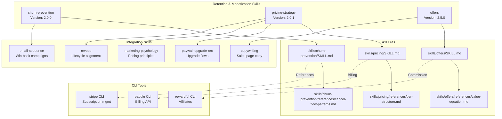
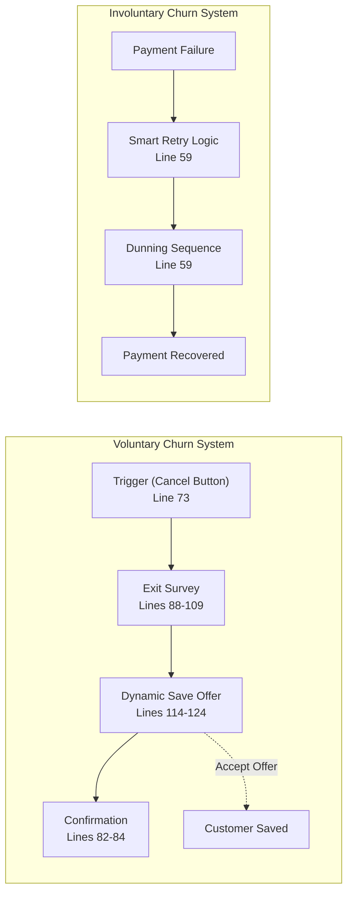
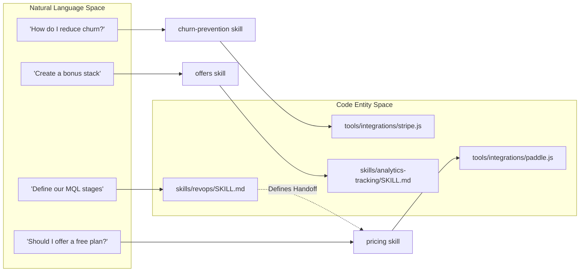

<!-- source: DeepWiki mcp.deepwiki.com · repo coreyhaines31/marketingskills · page 4.3 Retention & Monetization · fetched 2026-10-26 -->

# Retention & Monetization

Relevant source files

The following files were used as context for generating this wiki page:

- [skills/churn-prevention/SKILL.md](skills/churn-prevention/SKILL.md)
- [skills/cold-email/SKILL.md](skills/cold-email/SKILL.md)
- [skills/revops/SKILL.md](skills/revops/SKILL.md)

## Purpose and Scope

This section covers skills for maximizing customer lifetime value through retention strategies, pricing optimization, and the fundamental design of product offers. It encompasses three core skill modules that address different aspects of revenue protection and growth:

*   **Churn Prevention**: Reducing both voluntary churn (cancellations) and involuntary churn (failed payments) through systematic cancel flows and dunning sequences.
*   **Pricing Strategy**: Optimizing pricing structure, tiers, and value metrics to maximize revenue and align with customer willingness to pay.
*   **Offer Design**: Designing the core "thing" being sold using the Value Equation and psychological components like scarcity, bonuses, and guarantees.

For in-app upgrade moments and feature gates, see [Paywall & Upgrade CRO](#4.2.4). For post-cancel win-back email campaigns, see [Email Sequences](#4.4.3). For initial onboarding optimization that prevents early churn, see [Onboarding CRO](#4.2.5).

**Sources:** [skills/churn-prevention/SKILL.md:1-10](), [skills/pricing/SKILL.md:1-10](), [skills/offers/SKILL.md:1-10]()

---

## Skills Architecture Overview

**Diagram: Retention & Monetization Skill System Architecture**

This diagram shows the high-level architecture: skill modules reference detailed implementation guides and integrate with other skills, plus CLI tools for execution. The `offers` skill specifically bridges the gap between `pricing` and `copywriting` [skills/offers/SKILL.md:3](). The `revops` skill provides the lifecycle framework (Subscriber → Lead → MQL → SQL → Customer) that supports these monetization efforts [skills/revops/SKILL.md:50-58]().

**Sources:** [skills/churn-prevention/SKILL.md:225-228](), [skills/pricing/SKILL.md:225-230](), [skills/offers/SKILL.md:1-6](), [skills/revops/SKILL.md:46-59]()

---

## Churn Types and System Boundaries

The `churn-prevention` skill divides churn into two distinct types requiring different strategies:

| Type | Cause | Solution | Code Reference |
| :--- | :--- | :--- | :--- |
| **Voluntary** | Customer chooses to cancel | Cancel flows, save offers, exit surveys | [skills/churn-prevention/SKILL.md:50]() |
| **Involuntary** | Payment fails | Dunning emails, smart retries, card updaters | [skills/churn-prevention/SKILL.md:51]() |

**Diagram: Churn Prevention System Flow by Type**

This diagram maps the two parallel churn systems to specific code sections. Voluntary churn focuses on the UI/UX of the cancellation path [skills/churn-prevention/SKILL.md:65-87](), while involuntary churn focuses on the billing backend and communication [skills/churn-prevention/SKILL.md:59]().

**Sources:** [skills/churn-prevention/SKILL.md:48-61](), [skills/churn-prevention/SKILL.md:65-87]()

---

## Pricing & Offer Strategy

While `pricing` focuses on tiers and metrics, `offers` focuses on the psychological framing and components of the sale.

### Pricing Framework
The `pricing` skill implements a three-axis framework:
1.  **Packaging**: What's included at each tier [skills/pricing/SKILL.md:45-47]().
2.  **Pricing Metric**: What you charge for (e.g., per user, per usage) [skills/pricing/SKILL.md:49-51]().
3.  **Price Point**: The actual dollar amounts based on perceived value [skills/pricing/SKILL.md:53-55]().

### Offer Anatomy
The `offers` skill defines the six components of a high-converting offer:
*   **Core Deliverable**: The primary product or service [skills/offers/SKILL.md:118]().
*   **Bonus Stack**: Additional value to handle objections [skills/offers/SKILL.md:124]().
*   **Guarantee**: Risk reversal (e.g., Unconditional, Results-based) [skills/offers/SKILL.md:131]().
*   **Scarcity & Urgency**: Honest reasons to buy now [skills/offers/SKILL.md:144]().
*   **Naming**: A name that communicates the outcome [skills/offers/SKILL.md:154]().
*   **Price Structure**: How the price is presented (e.g., pay-in-full vs. installments) [skills/offers/SKILL.md:159]().

**Sources:** [skills/pricing/SKILL.md:41-68](), [skills/offers/SKILL.md:110-165]()

---

## Child Pages

### [Churn Prevention](#4.3.1)
Comprehensive documentation of the `churn-prevention` skill. It covers the design of multi-step cancel flows [skills/churn-prevention/SKILL.md:65-87](), the mapping of exit survey reasons to dynamic save offers [skills/churn-prevention/SKILL.md:114-124](), and involuntary churn recovery via dunning [skills/churn-prevention/SKILL.md:59]().

### [Pricing Strategy](#4.3.2)
Detailed guide for the `pricing` skill. Includes the "Good-Better-Best" tier framework [skills/pricing/SKILL.md:103-108](), pricing research methodologies like Van Westendorp [skills/pricing/SKILL.md:122-130](), and strategies for communicating price increases [skills/pricing/SKILL.md:161-166]().

### [Offer Design](#4.3.3)
Documentation of the `offers` skill. Focuses on the **Value Equation** (Dream Outcome × Perceived Likelihood / Time Delay × Effort) [skills/offers/SKILL.md:95-108]() and the six-component offer anatomy [skills/offers/SKILL.md:110-165]().

---

## Integration with Analytics & Tools

Retention and monetization strategies rely heavily on data instrumentation and billing APIs:

*   **Analytics**: Use `analytics-tracking` to monitor feature usage dropoffs [skills/churn-prevention/SKILL.md:32-33]().
*   **Billing Tools**: The system integrates with CLI tools for **Stripe**, **Paddle**, and **Braintree** to manage subscription states and payment retries [skills/churn-prevention/SKILL.md:26-29]().
*   **Revenue Operations**: The `revops` skill manages the lead lifecycle and MQL/SQL handoffs that precede monetization [skills/revops/SKILL.md:46-77]().
*   **Testing**: A/B testing of pricing tiers or save offers is handled via the `ab-test-setup` skill [skills/pricing/SKILL.md:229]().

**Diagram: Natural Language to Code Entity Bridge**

This diagram illustrates how user intent triggers specific skills, which then reference the underlying CLI tools and tracking configurations to execute the strategy.

**Sources:** [skills/churn-prevention/SKILL.md:26-29](), [skills/pricing/SKILL.md:1-6](), [skills/offers/SKILL.md:1-6](), [skills/revops/SKILL.md:8-10]()

---

