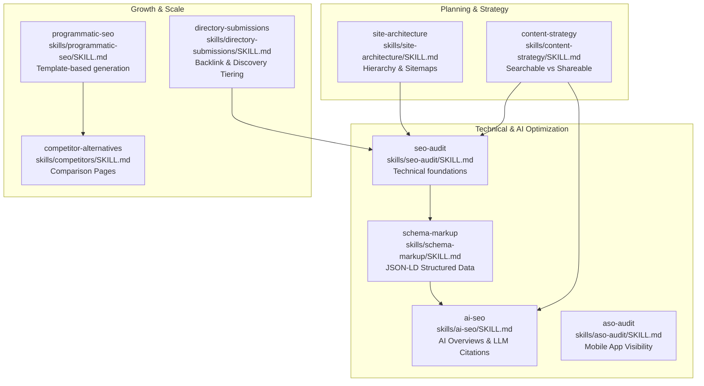
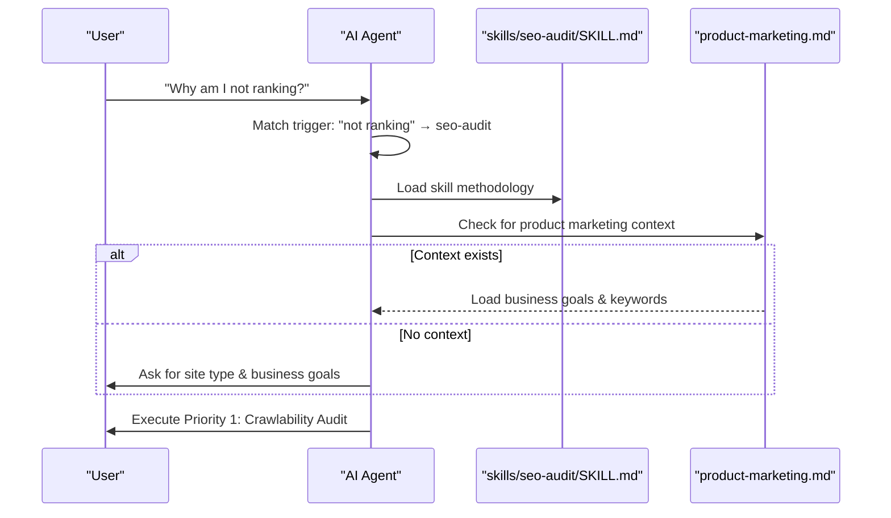

<!-- source: DeepWiki mcp.deepwiki.com · repo coreyhaines31/marketingskills · page 4.5 SEO & Discovery · fetched 2026-10-26 -->

# SEO & Discovery

Relevant source files

The following files were used as context for generating this wiki page:

- [skills/ai-seo/SKILL.md](skills/ai-seo/SKILL.md)
- [skills/ai-seo/evals/evals.json](skills/ai-seo/evals/evals.json)
- [skills/ai-seo/references/citations-vs-recommendations.md](skills/ai-seo/references/citations-vs-recommendations.md)
- [skills/ai-seo/references/content-patterns.md](skills/ai-seo/references/content-patterns.md)
- [skills/ai-seo/references/content-types.md](skills/ai-seo/references/content-types.md)
- [skills/ai-seo/references/okf.md](skills/ai-seo/references/okf.md)
- [skills/ai-seo/references/platform-ranking-factors.md](skills/ai-seo/references/platform-ranking-factors.md)
- [skills/competitors/SKILL.md](skills/competitors/SKILL.md)
- [skills/content-strategy/SKILL.md](skills/content-strategy/SKILL.md)
- [skills/programmatic-seo/SKILL.md](skills/programmatic-seo/SKILL.md)
- [skills/seo-audit/SKILL.md](skills/seo-audit/SKILL.md)

## Purpose and Scope

This document provides an overview of the nine skills focused on search engine optimization, app store optimization, and organic content discovery. These skills help users improve technical SEO, optimize for AI search engines (AI SEO), plan content strategy, design site architecture, create pages at scale, capture competitive search traffic, perform app store audits (ASO), and manage directory submissions.

The SEO & Discovery category bridges traditional search optimization with emerging AI search platforms (Google AI Overviews, ChatGPT, Perplexity, Claude, Gemini). Each skill is implemented as a `SKILL.md` file under `skills/[skill-name]/` containing YAML metadata for trigger matching and markdown instructions for AI agent execution.

**Related pages:** For skill invocation patterns, see [Using Your First Skill](#2.2). For conversion optimization of landing pages, see [Conversion Optimization Skills](#4.2). For content writing, see [Content & Copywriting](#4.4).

**Sources:** [skills/seo-audit/SKILL.md:1-11](), [skills/ai-seo/SKILL.md:1-11](), [skills/content-strategy/SKILL.md:1-10](), [skills/programmatic-seo/SKILL.md:1-10]()

---

## Overview of SEO & Discovery Skills

The SEO & Discovery category contains specialized skills organized by function:

| Skill Name | File Location | Primary Function | Key Deliverable |
|------------|---------------|------------------|-----------------|
| `seo-audit` | [skills/seo-audit/SKILL.md:1-6]() | Technical and on-page SEO analysis | Prioritized issue list with fixes |
| `ai-seo` | [skills/ai-seo/SKILL.md:1-6]() | Optimization for AI search engines | AI visibility strategy and content patterns |
| `programmatic-seo` | [skills/programmatic-seo/SKILL.md:1-6]() | Template-based page generation at scale | Page templates and data schemas |
| `schema-markup` | [skills/schema-markup/SKILL.md:1-6]() | Structured data implementation | JSON-LD schema markup code |
| `competitor-alternatives` | [skills/competitors/SKILL.md:1-6]() | Comparison and alternative pages | Competitor profiles and comparison pages |
| `content-strategy` | [skills/content-strategy/SKILL.md:1-6]() | Content planning and topic selection | Content pillars and prioritized topics |
| `site-architecture` | [skills/site-architecture/SKILL.md:1-6]() | Website hierarchy and navigation design | Sitemap and internal linking strategy |
| `aso-audit` | [skills/aso-audit/SKILL.md:1-6]() | Mobile app listing optimization | Multi-dimensional scoring & action plan |
| `directory-submissions` | [skills/directory-submissions/SKILL.md:1-6]() | Backlink and discovery placement | Submission tracker and positioning |

**Sources:** [skills/seo-audit/SKILL.md:1-11](), [skills/ai-seo/SKILL.md:1-6](), [skills/content-strategy/SKILL.md:1-6](), [skills/programmatic-seo/SKILL.md:1-6](), [skills/competitors/SKILL.md:1-6]()

---

## SEO Skill Categories

### The SEO & Discovery Ecosystem

**Diagram: SEO Skills Functional Architecture**

The skills are organized into functional layers. **Planning & Strategy** determines what content to create. **Optimization** skills improve technical foundations, mobile app presence, and AI visibility. **Growth & Scale** skills focus on high-volume page generation and external link building.

**Sources:** [skills/content-strategy/SKILL.md:42-49](), [skills/seo-audit/SKILL.md:51-57](), [skills/ai-seo/SKILL.md:135-141](), [skills/programmatic-seo/SKILL.md:143-154](), [skills/competitors/SKILL.md:67-145]()

---

## Traditional SEO vs AI Search Optimization

### The Shift from Rankings to Citations

| Dimension | Traditional SEO (`seo-audit`) | AI Search (`ai-seo`) |
|-----------|----------------------------|-------------------|
| **Goal** | Rank on page 1 of search results | Get cited in AI-generated answers |
| **Audience** | Search engine algorithms | AI systems (GPT, Perplexity, Gemini, etc.) |
| **Content unit** | Full page ranking | Extractable passages cited as sources |
| **Structure** | Keywords in title/H1/URL | Self-contained answer blocks, FAQ schema |
| **Authority** | Backlinks, domain authority | E-E-A-T, citations, machine-readability |

**Key insight from `ai-seo` skill:** Traditional SEO gets you ranked; AI SEO gets you **cited**. In AI search, a well-structured page can get cited even if it ranks on page 2 or 3 because AI systems select sources based on content quality, structure, and relevance. [skills/ai-seo/SKILL.md:56-60]()

The `ai-seo` skill introduces the **AI Visibility Ladder**, distinguishing between being retrieved, cited, mentioned, or recommended. [skills/ai-seo/references/citations-vs-recommendations.md:9-23]() It also covers the **Open Knowledge Format (OKF)**, a markdown spec for representing site content as an agent-readable bundle. [skills/ai-seo/references/okf.md:1-4]()

For details, see [AI SEO](#4.5.2).

**Sources:** [skills/ai-seo/SKILL.md:41-68](), [skills/seo-audit/SKILL.md:51-157](), [skills/ai-seo/references/okf.md:1-4](), [skills/ai-seo/references/citations-vs-recommendations.md:1-23]()

---

## Technical SEO Audit Framework

The `seo-audit` skill implements a five-tier priority framework for diagnosing SEO issues:

1.  **Crawlability & Indexation:** Can Google find and index it? (`robots.txt`, sitemaps, canonicals). [skills/seo-audit/SKILL.md:62-108]()
2.  **Technical Foundations:** Is the site fast and functional? (Core Web Vitals, HTTPS, mobile-friendliness). [skills/seo-audit/SKILL.md:109-155]()
3.  **On-Page Optimization:** Is content optimized? (Title tags, H1s, meta descriptions). [skills/seo-audit/SKILL.md:158-205]()
4.  **Content Quality:** Does it deserve to rank? (E-E-A-T, thin content, depth). [skills/seo-audit/SKILL.md:206-231]()
5.  **Authority & Links:** Does it have credibility? (Backlinks, internal linking). [skills/seo-audit/SKILL.md:232-261]()

**Critical limitation:** `web_fetch` and `curl` cannot reliably detect schema markup injected via JavaScript. Use browser tools or Google Rich Results Test for accurate auditing. [skills/seo-audit/SKILL.md:38-50]()

For details, see [SEO Audit](#4.5.1).

**Sources:** [skills/seo-audit/SKILL.md:51-261](), [skills/seo-audit/SKILL.md:38-50]()

---

## Programmatic SEO & Scaling

The `programmatic-seo` skill focuses on building SEO-optimized pages at scale using templates and data.

**The 12 Playbooks:**
- **Comparisons:** "[X] vs [Y]" (e.g., "webflow vs wordpress"). [skills/programmatic-seo/SKILL.md:77]()
- **Integrations:** "[Product A] [Product B] integration". [skills/programmatic-seo/SKILL.md:81]()
- **Locations:** "[Service] in [Location]". [skills/programmatic-seo/SKILL.md:79]()
- **Templates:** "[Type] template" (e.g., "resume template"). [skills/programmatic-seo/SKILL.md:74]()

**Key Principle:** Proprietary data wins. Every page must provide unique value specific to that page, not just swapped variables, to avoid thin content penalties. [skills/programmatic-seo/SKILL.md:38-50]()

For details, see [Programmatic SEO](#4.5.3) and [Competitor Alternatives](#4.5.5).

**Sources:** [skills/programmatic-seo/SKILL.md:10-86](), [skills/programmatic-seo/SKILL.md:38-50]()

---

## Site Architecture & Schema

### Website Hierarchy Planning
The `site-architecture` skill manages website page hierarchy, URL structure, and internal linking. It ensures important pages are within 3 clicks of the homepage and uses a logical hierarchy. [skills/seo-audit/SKILL.md:76-81]()

For details, see [Site Architecture](#4.5.7).

### Structured Data (JSON-LD)
The `schema-markup` skill implements `schema.org` markup to help search engines understand content. 
- **Organization:** name, url, logo. [skills/schema-markup/SKILL.md:72-74]()
- **Product:** name, image, offers. [skills/schema-markup/SKILL.md:80-82]()
- **FAQPage:** Q&A array for rich results. [skills/schema-markup/SKILL.md:84-85]()

For details, see [Schema Markup](#4.5.4).

**Sources:** [skills/seo-audit/SKILL.md:76-81](), [skills/schema-markup/SKILL.md:51-105]()

---

## Discovery & External Presence

### ASO Audit
The `aso-audit` skill optimizes mobile app listings on the App Store and Google Play. It assesses platform-specific indexing logic (e.g., Apple keyword field vs. Google full-description indexing). [skills/aso-audit/SKILL.md:1-11]()

For details, see [ASO Audit](#4.5.8).

### Directory Submissions
The `directory-submissions` skill manages the process of submitting products to startup, SaaS, and AI directories. It provides a tiered strategy for backlink acquisition and discovery. [skills/directory-submissions/SKILL.md:1-11]()

For details, see [Directory Submissions](#4.5.9).

---

## Skill Execution Pattern

**Diagram: SEO Skill Execution Pattern**

Execution begins with trigger matching, followed by a check for the `.agents/product-marketing.md` file to reduce repetitive questions. The agent then follows the structured methodology defined in the specific `SKILL.md` file.

**Sources:** [skills/seo-audit/SKILL.md:1-15](), [skills/ai-seo/SKILL.md:1-15](), [skills/content-strategy/SKILL.md:12-16]()

---

