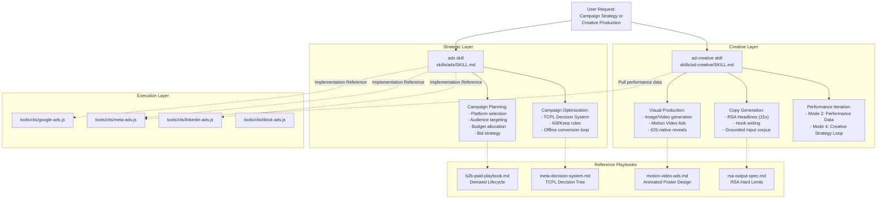

<!-- source: DeepWiki mcp.deepwiki.com · repo coreyhaines31/marketingskills · page 4.6 Paid Advertising · fetched 2026-10-26 -->

# Paid Advertising

Relevant source files

The following files were used as context for generating this wiki page:

- [skills/ad-creative/SKILL.md](skills/ad-creative/SKILL.md)
- [skills/ad-creative/references/generative-tools.md](skills/ad-creative/references/generative-tools.md)
- [skills/ad-creative/references/motion-video-ads.md](skills/ad-creative/references/motion-video-ads.md)
- [skills/ads/SKILL.md](skills/ads/SKILL.md)
- [skills/ads/references/abm-playbook.md](skills/ads/references/abm-playbook.md)
- [skills/ads/references/b2b-paid-playbook.md](skills/ads/references/b2b-paid-playbook.md)
- [skills/ads/references/google-search-playbook.md](skills/ads/references/google-search-playbook.md)
- [skills/ads/references/linkedin-b2b-playbook.md](skills/ads/references/linkedin-b2b-playbook.md)
- [skills/ads/references/meta-decision-system.md](skills/ads/references/meta-decision-system.md)
- [skills/ads/references/rsa-output-spec.md](skills/ads/references/rsa-output-spec.md)

This page provides an overview of the paid advertising capabilities within the repository, covering campaign strategy, creative production, and performance optimization. The system comprises two primary skills: `ads` (Paid Ads Strategy) for strategic planning and `ad-creative` for high-volume asset generation and visual production.

For detailed documentation on campaign strategy, targeting, and optimization across B2B and B2C channels, see [Paid Ads Strategy](#4.6.1). For ad creative generation, performance iteration, and visual production workflows using AI and code-based video, see [Ad Creative](#4.6.2).

**Sources:** [skills/ads/SKILL.md:1-10](), [skills/ad-creative/SKILL.md:1-10]()

---

## System Overview

The paid advertising system supports multi-channel campaign management across Google Ads, Meta (Facebook/Instagram), LinkedIn, TikTok, and Twitter/X [skills/ads/SKILL.md:59-68](). It separates high-level performance marketing strategy (bidding, structure, and budget) from the high-velocity production of copy and visuals.

### Two-Skill Architecture

**Workflow separation:**

- **ads**: Focuses on the "operating layer": platform selection, budget allocation, and bid strategy progression. It includes specialized playbooks for LinkedIn B2B [skills/ads/references/linkedin-b2b-playbook.md:1-15](), Google Search [skills/ads/references/google-search-playbook.md:1-18](), and ABM [skills/ads/references/abm-playbook.md:1-14]().
- **ad-creative**: Focuses on the "Performance Creative" loop: defining angles, generating spec-compliant copy, and producing AI visuals using a grounded input corpus (winning ads, reviews, comments) [skills/ad-creative/SKILL.md:71-94]().

**Sources:** [skills/ads/SKILL.md:43-56](), [skills/ad-creative/SKILL.md:47-68]()

---

## Strategic Decision Systems

The `ads` skill provides quantified frameworks for account management, moving away from "vibes-based" decisions to arithmetic ones centered around unit economics.

### The TCPL Anchor

The system uses **TCPL (Target Cost Per Qualified Lead)** as the anchor variable for all Meta and B2B decisions [skills/ads/references/meta-decision-system.md:22-30]().

| Decision Point | Rule / Multiplier | Action |
|-----------|---------|--------------|
| **Ad-count Ceiling** | (Budget × 14) / (2 × TCPL) | Prevents budget starvation [skills/ads/references/meta-decision-system.md:32-38]() |
| **Delivery Check** | < 0.5x fair share spend at Day 7 | Kill (Platform deprioritized it) [skills/ads/references/meta-decision-system.md:51-59]() |
| **Non-performer** | 2-3x TCPL with zero conversions | Kill (concept abandoned) [skills/ads/references/b2b-paid-playbook.md:66]() |
| **Maintenance** | 1.5-2x over target CPL | Kill (structural underperformance) [skills/ads/references/b2b-paid-playbook.md:67]() |

**Sources:** [skills/ads/references/meta-decision-system.md:22-70](), [skills/ads/references/b2b-paid-playbook.md:53-70]()

---

## Creative Production Pipeline

The `ad-creative` skill handles high-volume generation across four operational modes, including a "Creative Strategy Loop" for deciding which ads are worth making before production begins [skills/ad-creative/SKILL.md:49-68]().

### Visual Generation Frameworks

The system supports two primary visual production paths: **Generative AI** and **Motion-Style Video**.

#### 1. Generative AI Tools
Used for static and short-form video production [skills/ad-creative/references/generative-tools.md:1-22]().
- **Ideogram**: Specialized for ad banners with high-accuracy typography [skills/ad-creative/references/generative-tools.md:95-115]().
- **Flux**: Best for photorealistic product consistency using multi-image references [skills/ad-creative/references/generative-tools.md:63-91]().
- **Google Veo**: High-quality 9:16 vertical video for social (Stories/Reels) [skills/ad-creative/references/generative-tools.md:131-152]().

#### 2. Motion Video Ads
A "faceless" video ad pipeline that converts concept posters into 15-45s explainers using a 5-stage pipeline (Script → Stills → Animate → VO → Assemble) [skills/ad-creative/references/motion-video-ads.md:5-35](). It includes a library of proven styles:
- **Screen-print collage**: Editorial newsprint energy [skills/ad-creative/references/motion-video-ads.md:50-51]().
- **Papercraft diorama**: Tactile, premium-crafty feel [skills/ad-creative/references/motion-video-ads.md:56-57]().
- **Swiss typographic**: Minimalist, brand-first design [skills/ad-creative/references/motion-video-ads.md:86-87]().

**Sources:** [skills/ad-creative/references/generative-tools.md:1-180](), [skills/ad-creative/references/motion-video-ads.md:1-87]()

---

## Platform-Specific Implementation

The system enforces strict output specifications for every platform to ensure ad approval and optimal delivery.

### Google RSA Output Spec
The `ad-creative` skill enforces a mandatory output template for Google Responsive Search Ads [skills/ads/references/rsa-output-spec.md:1-5]().
- **Headlines**: Exactly 15, ≤ 30 characters each [skills/ads/references/rsa-output-spec.md:7]().
- **Descriptions**: Exactly 4, ≤ 90 characters each [skills/ads/references/rsa-output-spec.md:8]().
- **Sidecar Artifacts**: Must include ≥ 8 negative keywords and ≥ 4 sitelinks/callouts [skills/ads/references/rsa-output-spec.md:14-18]().

### LinkedIn B2B Progression
- **Bidding**: Launch on maximum delivery for 1 week, then switch to manual CPC ~20% below average [skills/ads/references/linkedin-b2b-playbook.md:19-23]().
- **Audience**: Cold prospecting requires 50K–300K members; use **Job Function + Seniority** over Title targeting for cheaper reach [skills/ads/references/linkedin-b2b-playbook.md:27-41]().

**Sources:** [skills/ads/references/rsa-output-spec.md:1-76](), [skills/ads/references/linkedin-b2b-playbook.md:19-41]()

---

## Automation and Feedback Loops

### The Offline Conversion Loop
The single highest-impact move in B2B accounts is pushing CRM stage changes (MQL → SQL → Opportunity) back to platforms via CAPI or GCLID imports [skills/ads/references/b2b-paid-playbook.md:71-80](), [skills/ads/references/google-search-playbook.md:98-101](). This prevents the "optimize-to-quality trap" where algorithms buy cheap, low-quality form-fills.

### Creative Review Page
For stakeholder approval, the system produces a self-contained HTML `creative-review-page.md` artifact. This includes concept tabs, in-feed previews, and frame-by-frame storyboards for motion assets [skills/ad-creative/SKILL.md:64]().

**Sources:** [skills/ads/references/b2b-paid-playbook.md:71-80](), [skills/ad-creative/SKILL.md:64-68]()

---

