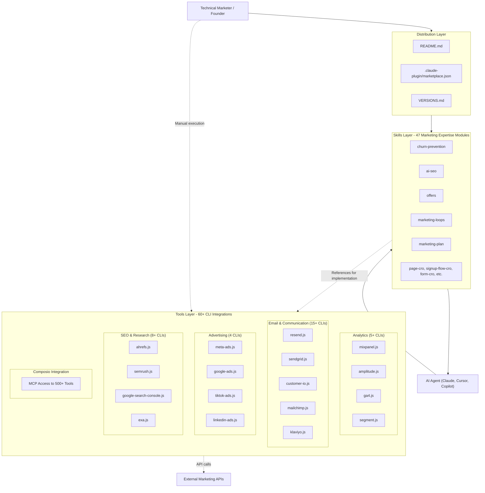
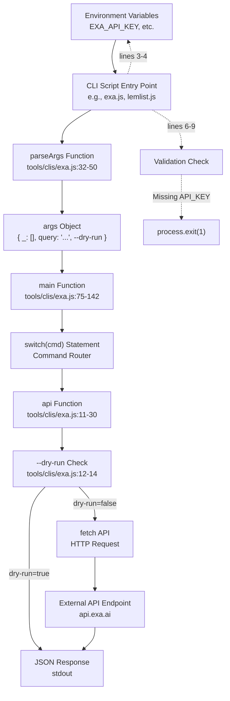

<!-- source: DeepWiki mcp.deepwiki.com · repo coreyhaines31/marketingskills · page 5 CLI Tools Reference · fetched 2026-10-26 -->

# CLI Tools Reference

Relevant source files

The following files were used as context for generating this wiki page:

- [tools/REGISTRY.md](tools/REGISTRY.md)
- [tools/clis/README.md](tools/clis/README.md)
- [tools/clis/exa.js](tools/clis/exa.js)
- [tools/integrations/exa.md](tools/integrations/exa.md)
- [tools/integrations/gong.md](tools/integrations/gong.md)
- [tools/integrations/rb2b.md](tools/integrations/rb2b.md)
- [tools/integrations/zapier.md](tools/integrations/zapier.md)

This document provides a high-level overview of the 60+ command-line interface (CLI) tools that integrate with external marketing platforms. These tools form the **Tools Layer** of the three-tier architecture, providing executable API wrappers for services that don't ship their own CLIs.

For detailed implementation patterns and shared architecture, see [CLI Tools Overview](#5.1). For specific tool documentation organized by category, see [Analytics Tools](#5.2), [Email & Communication Tools](#5.3), [Advertising Tools](#5.4), [SEO & Research Tools](#5.5), [Composio MCP Integration](#5.6), and [Other Integration Tools](#5.7).

## Architecture Overview

The CLI tools implement a **zero-dependency, single-file architecture** optimized for portability. Each CLI is a standalone Node.js script (Node 18+) that requires no `npm install` and can be executed directly or symlinked for global access [tools/clis/README.md:3-5]().

**Diagram: Three-Tier Architecture - CLI Layer Position**

Sources: [tools/clis/README.md:1-90](), [tools/REGISTRY.md:1-87](), [tools/clis/README.md:133-187]()

## Internal CLI Architecture

Every CLI in `tools/clis/` follows an identical structural pattern consisting of three core functions: `parseArgs`, `api`, and `main`. This architectural duplication prioritizes CLI independence and portability.

**Diagram: CLI Internal Structure - Code Entity Map**

Sources: [tools/clis/exa.js:1-148](), [tools/clis/README.md:101-117]()

### Core Functions

All CLIs implement three functions with identical signatures:

| Function | Purpose | Example Reference |
|----------|---------|-------------------|
| `parseArgs(args)` | Convert `process.argv` array into `{ _: [], key: value }` object | [tools/clis/exa.js:32-50]() |
| `api(method, path, body)` | HTTP client with authentication and dry-run support | [tools/clis/exa.js:11-30]() |
| `main()` | Command dispatcher using `switch(cmd)` statement | [tools/clis/exa.js:75-142]() |

Sources: [tools/clis/exa.js:32-50](), [tools/clis/exa.js:11-30](), [tools/clis/exa.js:75-142]()

## Installation and Authentication

CLIs are designed to be invoked directly via `node` or symlinked for global access. They read credentials exclusively from environment variables [tools/clis/README.md:35]().

| Method | Command |
|--------|---------|
| Direct execution | `node tools/clis/ahrefs.js backlinks list --target example.com` |
| Symlink | `ln -sf "$(pwd)/tools/clis/ahrefs.js" ~/.local/bin/ahrefs` |
| PATH addition | `export PATH="$PATH:/path/to/marketingskills/tools/clis"` |

**Security Note:** All CLIs support a `--dry-run` flag which allows users to preview the request (with masked credentials) without actually sending it [tools/clis/README.md:98](). Credentials must be stored in environment variables like `RESEND_API_KEY` or `AHREFS_API_KEY` [tools/clis/README.md:37-90]().

Sources: [tools/clis/README.md:9-31](), [tools/clis/README.md:37-90](), [tools/clis/README.md:93-99]()

## Integration Categories

The repository organizes tools into several functional hubs. For details on each, refer to the child pages:

### [CLI Tools Overview](#5.1)
Covers the shared architecture, the `parseArgs` and `api` function logic, and the standard `--dry-run` behavior used across all 60+ tools.

### [Analytics Tools](#5.2)
Includes tools for behavioral and product analytics.
*   **Mixpanel**: Event tracking and funnels [tools/clis/mixpanel.js]()
*   **Amplitude**: Product analytics [tools/clis/amplitude.js]()
*   **GA4**: Reports and Measurement Protocol [tools/clis/ga4.js]()
*   **Segment**: Customer Data Platform [tools/clis/segment.js]()
*   **OneSignal**: Push notifications and user segments [tools/clis/onesignal.js]()

### [Email & Communication Tools](#5.3)
Tools for lifecycle marketing and transactional messaging.
*   **Resend**: Developer-friendly transactional email [tools/clis/resend.js]()
*   **Customer.io**: Marketing automation [tools/clis/customer-io.js]()
*   **SendGrid**: Email campaigns and stats [tools/clis/sendgrid.js]()
*   **Klaviyo**: E-commerce email/SMS [tools/clis/klaviyo.js]()
*   **Mailchimp**: Marketing automation and campaigns [tools/clis/mailchimp.js]()

### [Advertising Tools](#5.4)
Management of paid acquisition channels.
*   **Meta Ads**: Facebook and Instagram campaign management [tools/clis/meta-ads.js]()
*   **Google Ads**: Search and display ads [tools/clis/google-ads.js]()
*   **TikTok Ads**: Video ad management [tools/clis/tiktok-ads.js]()
*   **LinkedIn Ads**: Professional network advertising [tools/clis/linkedin-ads.js]()

### [SEO & Research Tools](#5.5)
Search visibility and competitive intelligence.
*   **Ahrefs**: Backlink and keyword analysis [tools/clis/ahrefs.js]()
*   **Semrush**: Domain and organic search research [tools/clis/semrush.js]()
*   **Exa**: AI-powered web search and content retrieval [tools/clis/exa.js]()
*   **Google Search Console**: Search performance and indexing [tools/clis/google-search-console.js]()

### [Composio MCP Integration](#5.6)
Documented integration layer for accessing 500+ tools via the Model Context Protocol (MCP). This allows AI agents to interact with OAuth-heavy platforms like HubSpot, Salesforce, and Slack without custom CLI wrappers.

### [Other Integration Tools](#5.7)
Remaining tools including:
*   **Zapier**: Automation SDK for 8,000+ apps [tools/integrations/zapier.md:1-245]()
*   **Dub**: Link management [tools/clis/dub.js]()
*   **Rewardful**: Affiliate programs [tools/clis/rewardful.js]()
*   **Paddle**: Billing and payments [tools/clis/paddle.js]()
*   **Gong**: Revenue intelligence and call analysis [tools/integrations/gong.md:1-145]()
*   **RB2B**: Visitor identification [tools/integrations/rb2b.md:1-111]()
*   **Outreach Tools**: Includes `lemlist.js`, `instantly.js`, `snov.js`, and `hunter.js` [tools/clis/README.md:158-164]()

Sources: [tools/REGISTRY.md:13-87](), [tools/clis/README.md:133-187](), [tools/integrations/zapier.md:1-13](), [tools/integrations/gong.md:1-13](), [tools/integrations/rb2b.md:1-12]()

---

