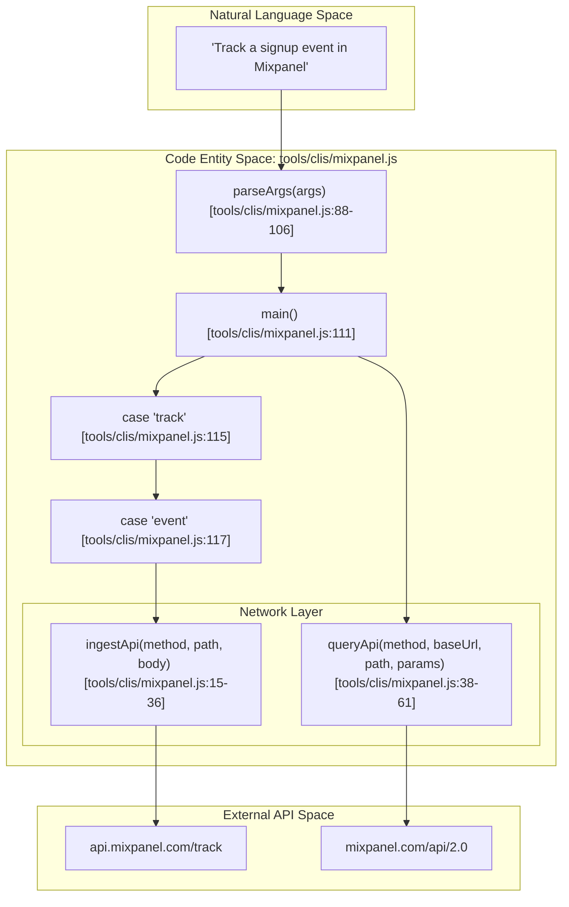
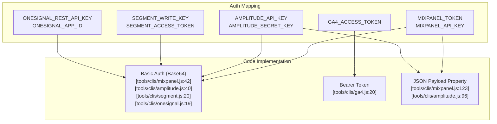
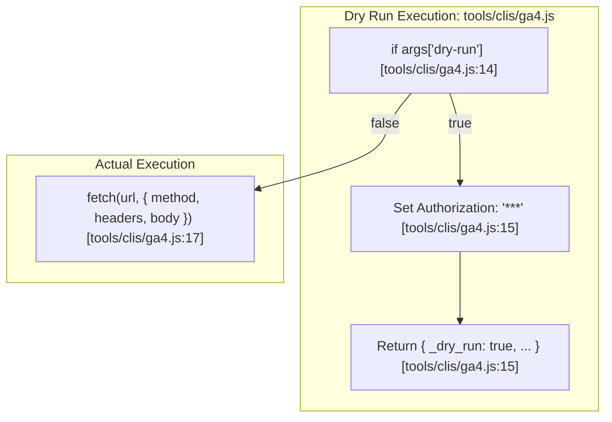

<!-- source: DeepWiki mcp.deepwiki.com · repo coreyhaines31/marketingskills · page 5.2 Analytics Tools · fetched 2026-10-26 -->

# Analytics Tools

Relevant source files

The following files were used as context for generating this wiki page:

- [tools/clis/amplitude.js](tools/clis/amplitude.js)
- [tools/clis/ga4.js](tools/clis/ga4.js)
- [tools/clis/livestorm.js](tools/clis/livestorm.js)
- [tools/clis/mixpanel.js](tools/clis/mixpanel.js)
- [tools/clis/onesignal.js](tools/clis/onesignal.js)
- [tools/clis/paddle.js](tools/clis/paddle.js)
- [tools/clis/segment.js](tools/clis/segment.js)
- [tools/clis/semrush.js](tools/clis/semrush.js)
- [tools/clis/sendgrid.js](tools/clis/sendgrid.js)

This page documents the analytics CLI tools that provide command-line interfaces for tracking user behavior, measuring product performance, and managing customer communications. These tools support implementation of `analytics-tracking`, `ab-test-setup`, `churn-prevention`, and other measurement-focused skills.

For general CLI architecture patterns (`parseArgs`, `api` functions, `--dry-run` mode), see [CLI Tools Overview](#5.1).

---

## Tool Inventory

The repository includes 5 analytics-focused CLI tools:

| CLI Tool | File | Primary Use Case |
|----------|------|------------------|
| **mixpanel** | [tools/clis/mixpanel.js]() | Event tracking, funnels, retention analysis |
| **amplitude** | [tools/clis/amplitude.js]() | Event tracking, user activity, batch ingestion |
| **ga4** | [tools/clis/ga4.js]() | Google Analytics reporting, realtime data, conversions |
| **segment** | [tools/clis/segment.js]() | Customer data platform, unified tracking API |
| **onesignal** | [tools/clis/onesignal.js]() | Push notifications, in-app messaging, user segments |

All tools implement the standard zero-dependency CLI pattern: `parseArgs` → `main` dispatcher → `api` function → `--dry-run` support.

Sources: [tools/clis/mixpanel.js:1-108](), [tools/clis/amplitude.js:1-78](), [tools/clis/ga4.js:1-74](), [tools/clis/segment.js:1-82](), [tools/clis/onesignal.js:1-61]()

---

## Architecture Overview

The following diagram maps the natural language command space to the specific code entities responsible for execution.

**Diagram: Mapping Intent to Code Entities in Mixpanel CLI**

Sources: [tools/clis/mixpanel.js:15-109](), [tools/clis/mixpanel.js:111-130]()

---

## Authentication Patterns

Each analytics tool uses specific environment variables and authentication headers to secure API requests.

**Diagram: Authentication Flow from Environment to Request Headers**

### Implementation Details

| Tool | Environment Variables | Auth Implementation |
|------|----------------------|---------------------|
| **mixpanel** | `MIXPANEL_TOKEN`, `MIXPANEL_API_KEY`, `MIXPANEL_SECRET` | Uses `MIXPANEL_TOKEN` in body for ingestion [tools/clis/mixpanel.js:123-144](); uses Basic Auth for queries [tools/clis/mixpanel.js:42](). |
| **amplitude** | `AMPLITUDE_API_KEY`, `AMPLITUDE_SECRET_KEY` | `api_key` in JSON body for ingestion [tools/clis/amplitude.js:96](); Basic Auth for queries [tools/clis/amplitude.js:40](). |
| **ga4** | `GA4_ACCESS_TOKEN` | Bearer token in `Authorization` header [tools/clis/ga4.js:20](). |
| **segment** | `SEGMENT_WRITE_KEY`, `SEGMENT_ACCESS_TOKEN` | Basic Auth using `WRITE_KEY` for tracking [tools/clis/segment.js:20]() and `ACCESS_TOKEN` for profiles [tools/clis/segment.js:44](). |
| **onesignal** | `ONESIGNAL_REST_API_KEY`, `ONESIGNAL_APP_ID` | Basic Auth using `REST_API_KEY` [tools/clis/onesignal.js:19](). |

Sources: [tools/clis/mixpanel.js:3-5](), [tools/clis/amplitude.js:3-4](), [tools/clis/ga4.js:3](), [tools/clis/segment.js:3-4](), [tools/clis/onesignal.js:3-4]()

---

## Mixpanel CLI

The Mixpanel CLI provides capabilities for both data ingestion (events/profiles) and data querying (insights/funnels/retention).

### Core Functions
- `ingestApi(method, path, body)`: Handles requests to `api.mixpanel.com` [tools/clis/mixpanel.js:15-36]().
- `queryApi(method, baseUrl, path, params)`: Handles GET requests to `mixpanel.com/api/2.0` with Basic Auth [tools/clis/mixpanel.js:38-61]().
- `queryApiPost(path, body)`: Handles POST requests for complex queries like Insights [tools/clis/mixpanel.js:63-86]().

### Subcommands
- `track event`: Tracks an event with `--distinct-id`, `--event`, and optional `--properties` [tools/clis/mixpanel.js:117-129]().
- `profiles set`: Updates user properties using the `$set` operation [tools/clis/mixpanel.js:138-148]().
- `query events`: Retrieves event insights via the `/insights` endpoint [tools/clis/mixpanel.js:157-171]().
- `funnels get`: Fetches funnel conversion data for a specific `--funnel-id` [tools/clis/mixpanel.js:180-187]().
- `retention get`: Retrieves retention reports [tools/clis/mixpanel.js:196-203]().

Sources: [tools/clis/mixpanel.js:15-86,111-204]()

---

## Amplitude CLI

Amplitude CLI manages event ingestion and behavioral analysis queries.

### Core Functions
- `ingestApi(method, path, body)`: Interfaces with `api2.amplitude.com` for event data [tools/clis/amplitude.js:13-30]().
- `queryApi(method, path, params)`: Interfaces with `amplitude.com/api/2` for behavioral data [tools/clis/amplitude.js:32-54]().

### Subcommands
- `track event`: Sends a single event to the `/2/httpapi` endpoint [tools/clis/amplitude.js:85-98]().
- `track batch`: Sends an array of events to the `/batch` endpoint [tools/clis/amplitude.js:101-108]().
- `users activity`: Fetches the activity stream for a specific `--user-id` [tools/clis/amplitude.js:117-122]().
- `export events`: Downloads raw event data for a date range [tools/clis/amplitude.js:131-139]().
- `retention get`: Fetches retention metrics [tools/clis/amplitude.js:147-157]().

Sources: [tools/clis/amplitude.js:13-54,83-162]()

---

## GA4 CLI

The GA4 CLI interacts with three distinct Google APIs: Data API, Admin API, and Measurement Protocol.

### Implementation Detail
- `api(method, baseUrl, path, body)`: Generic helper for Data and Admin APIs using Bearer auth [tools/clis/ga4.js:13-31]().
- `mpApi(measurementId, apiSecret, body)`: Specialized helper for the Measurement Protocol [tools/clis/ga4.js:33-50]().

### Subcommands
- `reports run`: Runs a report on a GA4 `--property` using `--dimensions` and `--metrics` [tools/clis/ga4.js:81-97]().
- `realtime run`: Executes a `runRealtimeReport` for immediate data [tools/clis/ga4.js:106-118]().
- `conversions list`: Lists configured conversion events [tools/clis/ga4.js:126-130]().
- `conversions create`: Creates a new conversion event [tools/clis/ga4.js:132-139]().
- `events send`: Sends server-side events via Measurement Protocol [tools/clis/ga4.js:148-169]().

Sources: [tools/clis/ga4.js:13-50,79-175]()

---

## Segment CLI

Segment CLI provides access to the Tracking API for data collection and the Profiles API for person-level data.

### Core Functions
- `trackApi(method, path, body)`: Hits `api.segment.io/v1` with the `WRITE_KEY` [tools/clis/segment.js:13-35]().
- `profileApi(method, path)`: Hits `profiles.segment.com/v1` with the `ACCESS_TOKEN` [tools/clis/segment.js:37-58]().

### Subcommands
- `track event`: Dispatches a `/track` call [tools/clis/segment.js:89-100]().
- `identify user`: Dispatches an `/identify` call with user `--traits` [tools/clis/segment.js:109-117]().
- `page view`: Dispatches a `/page` call [tools/clis/segment.js:125-134]().
- `batch send`: Sends an array of events in a single batch request [tools/clis/segment.js:142-147]().
- `profiles traits`: Retrieves computed traits for a `--user-id` in a specific `--space-id` [tools/clis/segment.js:156-160]().
- `profiles events`: Retrieves events for a `--user-id` in a specific `--space-id` [tools/clis/segment.js:162-166]().

Sources: [tools/clis/segment.js:13-58,87-171]()

---

## OneSignal CLI

OneSignal CLI manages notifications, segments, and user identities.

### Subcommands
- `notifications send`: Sends messages to specific segments, emails, player IDs, or aliases [tools/clis/onesignal.js:70-101]().
- `notifications list`: Lists notifications [tools/clis/onesignal.js:103-105]().
- `notifications get`: Retrieves a specific notification by `--id` [tools/clis/onesignal.js:107-111]().
- `notifications cancel`: Cancels a scheduled notification by `--id` [tools/clis/onesignal.js:113-117]().
- `segments list`: Lists existing user segments [tools/clis/onesignal.js:126-128]().
- `segments create`: Creates a user segment with specific `--filters` [tools/clis/onesignal.js:130-136]().
- `segments delete`: Deletes a segment by `--id` [tools/clis/onesignal.js:138-142]().
- `users get`: Retrieves a user by `--alias-label` and `--alias-id` [tools/clis/onesignal.js:151-156]().
- `users create`: Creates a new user with `--external-id`, `--email`, and `--tags` [tools/clis/onesignal.js:158-169]().
- `users delete`: Deletes a user by `--alias-label` and `--alias-id` [tools/clis/onesignal.js:171-176]().
- `templates list`: Lists message templates for reuse [tools/clis/onesignal.js:186-189]().
- `templates get`: Retrieves a specific template by `--id` [tools/clis/onesignal.js:191-195]().
- `templates create`: Creates a new template with `--name` and `--message` [tools/clis/onesignal.js:197-202]().

Sources: [tools/clis/onesignal.js:68-205]()

---

## Dry Run Mode

All analytics tools implement a `--dry-run` flag that prevents network execution and masks sensitive credentials in the output.

**Diagram: Dry Run Implementation Logic**

Sources: [tools/clis/ga4.js:13-31](), [tools/clis/mixpanel.js:17-24](), [tools/clis/amplitude.js:14-18](), [tools/clis/segment.js:17-19](), [tools/clis/onesignal.js:23-25]()

---

