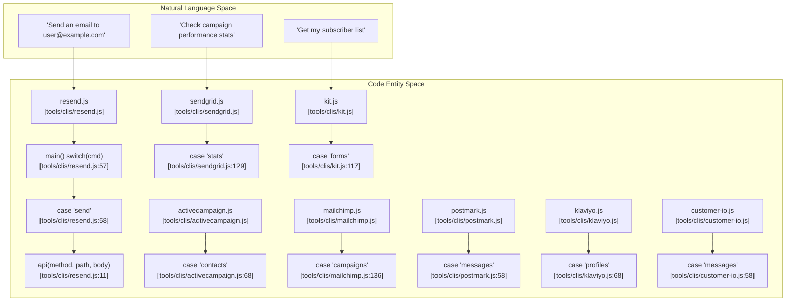
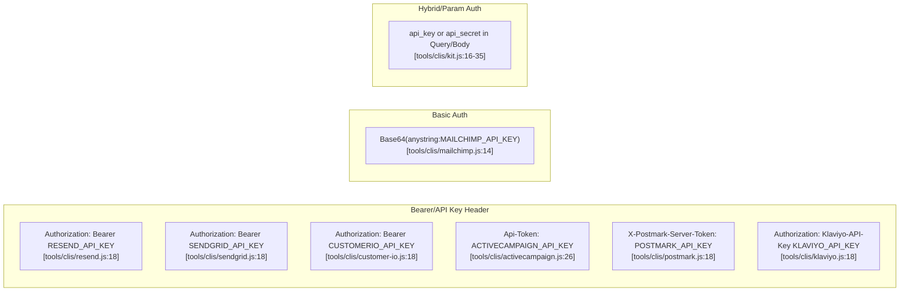
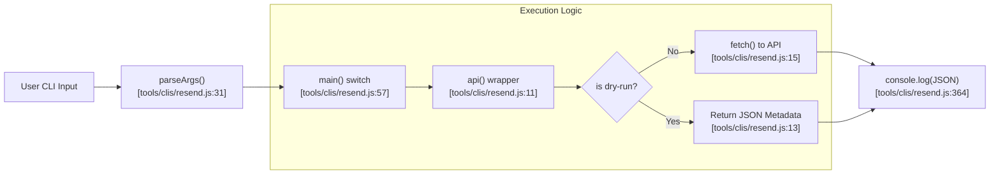

<!-- source: DeepWiki mcp.deepwiki.com · repo coreyhaines31/marketingskills · page 5.3 Email & Communication Tools · fetched 2026-10-26 -->

# Email & Communication Tools

Relevant source files

The following files were used as context for generating this wiki page:

- [tools/clis/activecampaign.js](tools/clis/activecampaign.js)
- [tools/clis/ahrefs.js](tools/clis/ahrefs.js)
- [tools/clis/dub.js](tools/clis/dub.js)
- [tools/clis/google-search-console.js](tools/clis/google-search-console.js)
- [tools/clis/kit.js](tools/clis/kit.js)
- [tools/clis/mailchimp.js](tools/clis/mailchimp.js)
- [tools/clis/meta-ads.js](tools/clis/meta-ads.js)
- [tools/clis/resend.js](tools/clis/resend.js)
- [tools/clis/rewardful.js](tools/clis/rewardful.js)
- [tools/clis/tiktok-ads.js](tools/clis/tiktok-ads.js)
- [tools/clis/wistia.js](tools/clis/wistia.js)

## Purpose and Scope

This document covers the command-line interface (CLI) tools for email and communication platforms. These tools provide zero-dependency, single-file implementations for sending transactional and marketing emails, managing contacts and audiences, tracking email performance, and orchestrating automated campaigns. Each CLI implements the shared architectural pattern documented in [CLI Tools Overview](#5.1) while exposing platform-specific email operations.

These tools enable skills like [Email Sequences](#4.4.3), [Cold Email](#4.4.4), and [Churn Prevention](#4.3.1) to provide implementation guidance without executing API calls directly.

## Email & Communication CLI Architecture

The email/communication layer consists of specialized CLIs that handle the full spectrum of email operations: transactional sending, marketing automation, and customer lifecycle messaging.

### System Entity Mapping

This diagram bridges the Natural Language commands used by agents to the specific code entities in the CLI tools.

**Sources:** [tools/clis/resend.js:11-73](), [tools/clis/sendgrid.js:129-142](), [tools/clis/kit.js:117-137](), [tools/clis/activecampaign.js:68-127](), [tools/clis/mailchimp.js:136-174](), [tools/clis/postmark.js:58-80](), [tools/clis/klaviyo.js:68-127](), [tools/clis/customer-io.js:58-100]()

## Authentication Patterns

Email CLIs use diverse authentication patterns. All CLIs check for required environment variables at startup and exit with an error if missing [tools/clis/resend.js:6-9](), [tools/clis/sendgrid.js:6-9](), [tools/clis/kit.js:7-10]().

### Authentication Flow

**Sources:** [tools/clis/resend.js:18-20](), [tools/clis/sendgrid.js:17-20](), [tools/clis/customer-io.js:17-20](), [tools/clis/activecampaign.js:25-28](), [tools/clis/mailchimp.js:14-18](), [tools/clis/postmark.js:17-20](), [tools/clis/klaviyo.js:17-20](), [tools/clis/kit.js:12-37]()

### Environment Variable Requirements

| CLI | Required Variables | Authentication Method |
|-----|-------------------|----------------------|
| `resend.js` | `RESEND_API_KEY` [tools/clis/resend.js:3]() | Bearer token |
| `sendgrid.js` | `SENDGRID_API_KEY` [tools/clis/sendgrid.js:3]() | Bearer token |
| `customer-io.js` | `CUSTOMERIO_API_KEY`, `CUSTOMERIO_TRACKING_SITE_ID` [tools/clis/customer-io.js:3-4]() | Bearer token |
| `activecampaign.js` | `ACTIVECAMPAIGN_API_KEY`, `ACTIVECAMPAIGN_API_URL` [tools/clis/activecampaign.js:3-4]() | API Token header |
| `mailchimp.js` | `MAILCHIMP_API_KEY` [tools/clis/mailchimp.js:3]() | Basic auth (parsed DC) [tools/clis/mailchimp.js:10-14]() |
| `postmark.js` | `POSTMARK_API_KEY` [tools/clis/postmark.js:3]() | Custom header (`X-Postmark-Server-Token`) |
| `klaviyo.js` | `KLAVIYO_API_KEY` [tools/clis/klaviyo.js:3]() | Custom header (`Authorization: Klaviyo-API-Key`) |
| `kit.js` | `KIT_API_SECRET` / `KIT_API_KEY` [tools/clis/kit.js:3-4]() | Param injection (key or secret) |

## Resend CLI (resend.js)

Resend provides a comprehensive implementation for transactional sending, domain management, and marketing broadcasts.

- **Send**: Validates `--from`, `--to`, and `--subject` [tools/clis/resend.js:59-60](). Supports HTML, Text, CC, BCC, and scheduling [tools/clis/resend.js:61-66]().
- **Domains**: Supports `list`, `get`, `create`, `verify`, and `delete` [tools/clis/resend.js:94-117]().
- **Contacts**: Managed under an Audience ID [tools/clis/resend.js:158-160](). Supports `list`, `get`, `create`, `update`, and `delete` [tools/clis/resend.js:163-197]().
- **Templates**: CRUD operations for email templates [tools/clis/resend.js:250-287]().
- **Broadcasts**: Supports `list`, `get`, `create`, `update`, `send`, and `cancel` [tools/clis/resend.js:289-343]().

**Sources:** [tools/clis/resend.js:54-343]()

## SendGrid CLI (sendgrid.js)

The SendGrid CLI handles mail delivery, contact management, and delivery analytics.

- **Send**: Supports standard sending and dynamic templates [tools/clis/sendgrid.js:58-83](). Supports `template-id` and `template-data` JSON [tools/clis/sendgrid.js:67-71]().
- **Contacts**: Search and add contacts to marketing lists [tools/clis/sendgrid.js:85-110]().
- **Campaigns**: Supports `list`, `get`, `create`, `update`, `send`, and `schedule` [tools/clis/sendgrid.js:112-127]().
- **Stats**: Retrieve global stats within a date range [tools/clis/sendgrid.js:129-142]().
- **Suppression**: List bounces and spam reports [tools/clis/sendgrid.js:144-172]().
- **Validation**: Email address verification [tools/clis/sendgrid.js:174-188]().

**Sources:** [tools/clis/sendgrid.js:54-206]()

## Customer.io CLI (customer-io.js)

The Customer.io CLI focuses on customer data and messaging. It uses two API keys: one for the App API (`CUSTOMERIO_API_KEY`) and one for the Tracking API (`CUSTOMERIO_TRACKING_SITE_ID`) [tools/clis/customer-io.js:3-4]().

- **Customers**: Create, update, get, and delete customer profiles [tools/clis/customer-io.js:68-127]().
- **Events**: Track custom events for customers [tools/clis/customer-io.js:129-144]().
- **Messages**: Send transactional messages to customers [tools/clis/customer-io.js:58-66]().
- **Segments**: List customer segments [tools/clis/customer-io.js:146-155]().

**Sources:** [tools/clis/customer-io.js:54-172]()

## ActiveCampaign CLI (activecampaign.js)

The ActiveCampaign CLI manages contacts, lists, and campaigns. It requires both an API key and an API URL [tools/clis/activecampaign.js:3-4]().

- **Contacts**: List, get, create, update, delete, and sync contacts [tools/clis/activecampaign.js:68-127]().
- **Lists**: List, get, create, delete, subscribe, and unsubscribe contacts from lists [tools/clis/activecampaign.js:129-182]().
- **Campaigns**: List, get, create, and send campaigns [tools/clis/activecampaign.js:184-222]().
- **Automations**: List automations [tools/clis/activecampaign.js:224-233]().

**Sources:** [tools/clis/activecampaign.js:64-250]()

## Mailchimp CLI (mailchimp.js)

Mailchimp operations center on Lists (Audiences) and Campaigns. The CLI determines the Data Center (DC) from the API key suffix [tools/clis/mailchimp.js:10-11]().

- **Lists**: List and get audience lists [tools/clis/mailchimp.js:62-77]().
- **Members**: Add or update subscribers with merge fields (`FNAME`, `LNAME`) and tags [tools/clis/mailchimp.js:80-134]().
- **Campaigns**: Create and send regular campaigns [tools/clis/mailchimp.js:136-174]().
- **Reports**: Fetch campaign performance stats [tools/clis/mailchimp.js:176-185]().
- **Automations**: List automations [tools/clis/mailchimp.js:187-198]().

**Sources:** [tools/clis/mailchimp.js:10-216]()

## Postmark CLI (postmark.js)

The Postmark CLI is designed for fast and reliable transactional email. It uses a custom `X-Postmark-Server-Token` header for authentication [tools/clis/postmark.js:18]().

- **Messages**: Send single or batch emails [tools/clis/postmark.js:58-80]().
- **Templates**: List, get, create, update, and delete email templates [tools/clis/postmark.js:82-129]().
- **Servers**: List and get server details [tools/clis/postmark.js:131-146]().
- **Domains**: List and get sender signatures (domains) [tools/clis/postmark.js:148-163]().

**Sources:** [tools/clis/postmark.js:54-180]()

## Klaviyo CLI (klaviyo.js)

The Klaviyo CLI interacts with Klaviyo's customer data platform and marketing automation. It uses a custom `Authorization: Klaviyo-API-Key` header [tools/clis/klaviyo.js:18]().

- **Profiles**: Create, update, get, and delete customer profiles [tools/clis/klaviyo.js:68-127]().
- **Events**: Track custom events for profiles [tools/clis/klaviyo.js:129-144]().
- **Lists**: List, get, create, update, and delete lists [tools/clis/klaviyo.js:146-195]().
- **Segments**: List and get segments [tools/clis/klaviyo.js:197-212]().
- **Campaigns**: List, get, create, update, and send campaigns [tools/clis/klaviyo.js:214-269]().

**Sources:** [tools/clis/klaviyo.js:64-287]()

## Kit CLI (kit.js)

The Kit (formerly ConvertKit) CLI manages creator workflows. It implements a unique `api()` wrapper that injects authentication into either the URL search parameters or the request body depending on the HTTP method [tools/clis/kit.js:12-37]().

- **Subscribers**: List, get, update, and unsubscribe subscribers [tools/clis/kit.js:86-115]().
- **Forms**: List forms and subscribe users to them [tools/clis/kit.js:117-137]().
- **Sequences**: List sequences and subscribe users to them [tools/clis/kit.js:139-159]().
- **Tags**: List tags, subscribe users to tags, and remove tags from subscribers [tools/clis/kit.js:161-189]().
- **Broadcasts**: List and create email broadcasts [tools/clis/kit.js:191-209]().

**Sources:** [tools/clis/kit.js:12-209]()

## Common CLI Features

### Dry-Run Implementation

All communication CLIs support a `--dry-run` flag in their `api()` function. This prevents actual network requests and instead returns the request configuration (URL, headers, and body) for inspection [tools/clis/resend.js:12-14](), [tools/clis/sendgrid.js:12-14](), [tools/clis/customer-io.js:12-14](), [tools/clis/activecampaign.js:19-21](), [tools/clis/mailchimp.js:19-21](), [tools/clis/postmark.js:12-14](), [tools/clis/klaviyo.js:12-14](), [tools/clis/kit.js:38-49]().

### Request Dispatch Flow

**Sources:** [tools/clis/resend.js:11-370](), [tools/clis/kit.js:12-57](), [tools/clis/sendgrid.js:11-29](), [tools/clis/customer-io.js:11-29](), [tools/clis/activecampaign.js:18-36](), [tools/clis/mailchimp.js:18-32](), [tools/clis/postmark.js:11-29](), [tools/clis/klaviyo.js:11-29]()

---

