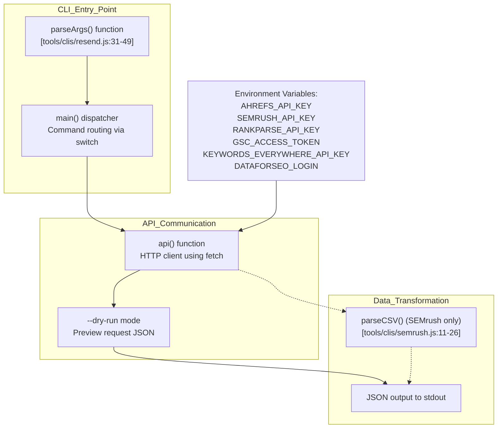
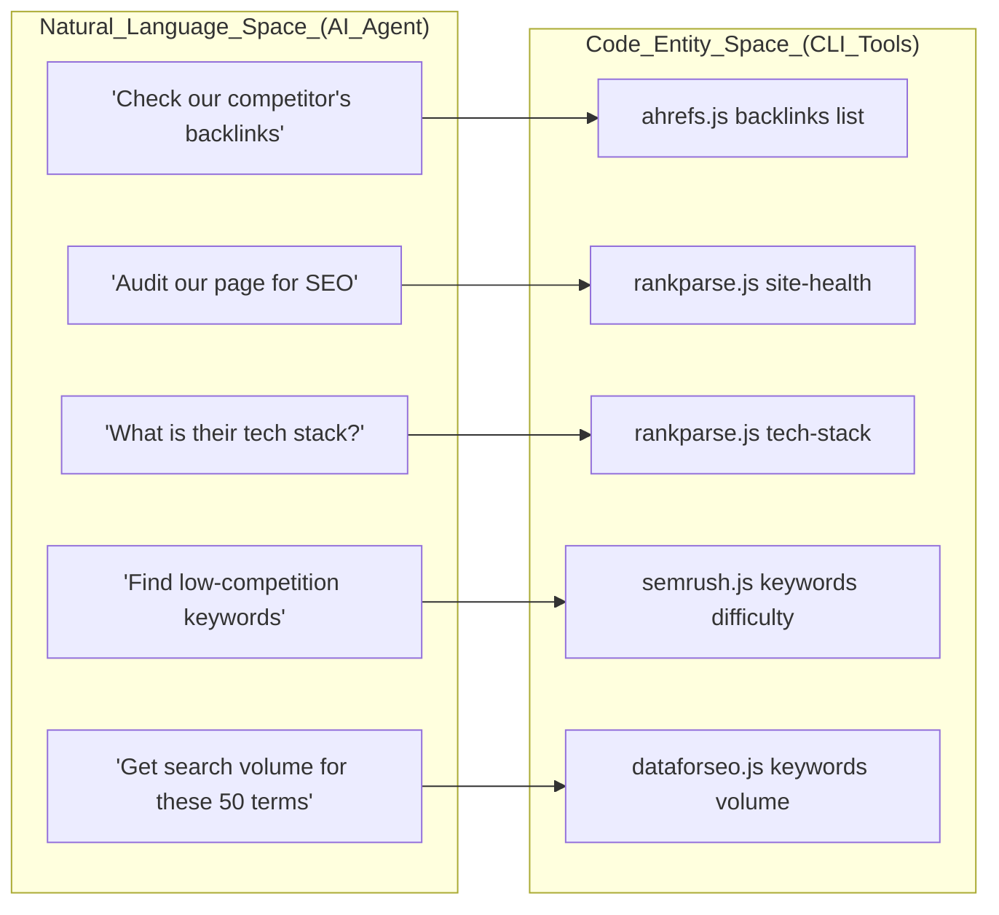

<!-- source: DeepWiki mcp.deepwiki.com · repo coreyhaines31/marketingskills · page 5.5 SEO & Research Tools · fetched 2026-10-26 -->

# SEO & Research Tools

<details>
<summary>Relevant source files</summary>

The following files were used as context for generating this wiki page:

- [tools/clis/dataforseo.js](tools/clis/dataforseo.js)
- [tools/clis/dub.js](tools/clis/dub.js)
- [tools/clis/google-search-console.js](tools/clis/google-search-console.js)
- [tools/clis/keywords-everywhere.js](tools/clis/keywords-everywhere.js)
- [tools/clis/rankparse.js](tools/clis/rankparse.js)
- [tools/clis/resend.js](tools/clis/resend.js)
- [tools/clis/rewardful.js](tools/clis/rewardful.js)
- [tools/integrations/dataforseo.md](tools/integrations/dataforseo.md)
- [tools/integrations/keywords-everywhere.md](tools/integrations/keywords-everywhere.md)
- [tools/integrations/rankparse.md](tools/integrations/rankparse.md)

</details>


This page documents the SEO and research CLI tools that provide command-line integrations with major SEO platforms and search analytics services. These tools enable keyword research, backlink analysis, rank tracking, and search console data retrieval through standardized command-line interfaces.

The SEO & Research category includes primary CLI tools: **Ahrefs** (domain authority, backlinks, keyword research), **SEMrush** (competitive analysis, keyword metrics), **Google Search Console** (search performance, URL inspection, sitemap management), **RankParse** (low-cost backlink and domain authority data), **Keywords Everywhere** (search volume and CPC), and **DataForSEO** (comprehensive SERP and keyword data).

## Tools Overview

| CLI Tool | File | API Provider | Primary Use Cases |
|----------|------|--------------|-------------------|
| **Ahrefs** | `ahrefs.js` | Ahrefs API v3 | Domain rating, backlink analysis, keyword research, SERP data, top pages analysis |
| **SEMrush** | `semrush.js` | SEMrush API | Competitive analysis, organic keyword tracking, keyword difficulty, domain metrics |
| **RankParse** | `rankparse.js` | RankParse API | Domain authority, backlinks, tech stack detection, site health, and top pages |
| **Google Search Console** | `google-search-console.js` | Google Search Console API | Search query performance, page indexing status, sitemap management, URL inspection |
| **Keywords Everywhere** | `keywords-everywhere.js` | Keywords Everywhere API | Search volume, CPC, related keywords, and domain traffic estimations |
| **DataForSEO** | `dataforseo.js` | DataForSEO API | SERP tracking, bulk keyword search volume, backlink summaries, and on-page audits |

Sources: [tools/clis/resend.js:1-210](), [tools/clis/google-search-console.js:1-167](), [tools/clis/dub.js:1-159](), [tools/clis/rewardful.js:1-161](), [tools/clis/rankparse.js:1-197](), [tools/clis/keywords-everywhere.js:1-186](), [tools/clis/dataforseo.js:1-240]()

## Shared Architecture Pattern

All SEO CLIs implement the standard zero-dependency CLI architecture pattern, utilizing a shared `parseArgs` function and a centralized `main` dispatcher.

### System Flow Diagram



Sources: [tools/clis/resend.js:31-49](), [tools/clis/google-search-console.js:31-49](), [tools/clis/dub.js:31-49](), [tools/clis/rewardful.js:33-51](), [tools/clis/rankparse.js:32-50](), [tools/clis/keywords-everywhere.js:33-51](), [tools/clis/dataforseo.js:34-52]()

## Ahrefs CLI

Provides access to Ahrefs' Site Explorer and Keywords Explorer APIs.

### Authentication
**Environment variable:** `AHREFS_API_KEY` [tools/clis/resend.js:3-9]()

### Command Reference
- **domain-rating get**: Get DR score for a domain. [tools/clis/resend.js:58-73]()
- **backlinks list**: List backlinks with `--mode` (domain, subdomains, prefix, exact). [tools/clis/resend.js:75-87]()
- **keywords organic**: Get ranking keywords for a domain/URL. [tools/clis/resend.js:103-116]()
- **top-pages list**: Retrieve the top performing pages by traffic for a target. [tools/clis/resend.js:118-131]()
- **keyword-suggestions get**: Get seed-based keyword ideas from Keywords Explorer. [tools/clis/resend.js:146-158]()

Sources: [tools/clis/resend.js:1-210]()

## SEMrush CLI

Provides competitive analysis and domain metrics. SEMrush returns CSV data which the CLI parses into JSON via the `parseCSV` function [tools/clis/resend.js:11-26]().

### Authentication
**Environment variable:** `SEMRUSH_API_KEY` (passed as query param `key`) [tools/clis/resend.js:3-9](), [tools/clis/resend.js:29]()

### Command Reference
- **domain overview**: High-level rank, traffic, and keyword counts. [tools/clis/resend.js:77-86]()
- **domain organic**: List organic keywords a domain ranks for. [tools/clis/resend.js:87-98]()
- **domain competitors**: Find competing domains by keyword overlap. [tools/clis/resend.js:99-110]()
- **keywords difficulty**: Get keyword difficulty score (KD%). [tools/clis/resend.js:141-151]()

Sources: [tools/clis/resend.js:1-210]()

## RankParse CLI

Agent-friendly SEO data API designed for low-cost operations. It provides domain authority, backlink analysis, and technical stack detection.

### Authentication
**Environment variable:** `RANKPARSE_API_KEY` (passed in `X-API-Key` header) [tools/clis/rankparse.js:3-9](), [tools/clis/rankparse.js:18]()

### Command Reference
- **domain-authority**: Returns authority score and registration details. [tools/clis/rankparse.js:69-80]()
- **backlinks**: Detailed backlink list with sorting and scoring options. [tools/clis/rankparse.js:82-92]()
- **tech-stack**: Detects the technologies used on a specific domain. [tools/clis/rankparse.js:71-80]()
- **site-explorer**: All-in-one snapshot of a domain's SEO profile. [tools/clis/rankparse.js:75-80]()
- **link-intersect**: Finds domains that link to two different targets. [tools/clis/rankparse.js:114-120]()

Sources: [tools/clis/rankparse.js:1-197](), [tools/integrations/rankparse.md:1-258]()

## Google Search Console CLI

Accesses search performance and indexing data. Requires OAuth 2.0 access tokens.

### Authentication
**Environment variable:** `GSC_ACCESS_TOKEN` [tools/clis/google-search-console.js:3-9]()

### Command Reference
- **search query**: Performance metrics (clicks, impressions, CTR, position) grouped by query. [tools/clis/google-search-console.js:84-87]()
- **inspect url**: Check index status and mobile usability for a specific page via `v1/urlInspection/index:inspect` [tools/clis/google-search-console.js:108-115]().
- **sitemaps submit**: Submit a new sitemap URL to Google using a `PUT` request [tools/clis/google-search-console.js:131-139]().

Sources: [tools/clis/google-search-console.js:1-167]()

## Keywords Everywhere CLI

Provides lightweight keyword volume and domain traffic metrics.

### Authentication
**Environment variable:** `KEYWORDS_EVERYWHERE_API_KEY` [tools/clis/keywords-everywhere.js:3-9]()

### Command Reference
- **keywords data**: Get volume, CPC, and competition for up to 100 keywords. [tools/clis/keywords-everywhere.js:65-70]()
- **domain keywords**: Identify what a domain ranks for. [tools/clis/keywords-everywhere.js:90-95]()
- **domain traffic**: Get estimated monthly traffic for a domain. [tools/clis/keywords-everywhere.js:96-101]()

Sources: [tools/clis/keywords-everywhere.js:1-186](), [tools/integrations/keywords-everywhere.md:1-208]()

## DataForSEO CLI

Comprehensive API for SERP and programmatic SEO workflows.

### Authentication
**Environment variables:** `DATAFORSEO_LOGIN` and `DATAFORSEO_PASSWORD` (Basic Auth). [tools/clis/dataforseo.js:3-12]()

### Command Reference
- **serp google**: Get live Google organic search results for a keyword. [tools/clis/dataforseo.js:68-77]()
- **keywords volume**: Bulk search volume data for comma-separated keywords. [tools/clis/dataforseo.js:91-99]()
- **backlinks summary**: High-level backlink stats for a target domain. [tools/clis/dataforseo.js:138-146]()
- **onpage audit**: Instant on-page SEO audit for a specific URL. [tools/clis/dataforseo.js:186-195]()

Sources: [tools/clis/dataforseo.js:1-240](), [tools/integrations/dataforseo.md:1-166]()

## Research Workflow Integration

This diagram bridges the Natural Language requests handled by AI agents to the specific code entities (CLI tools) executed.

### NL to Code Entity Mapping



Sources: [tools/clis/resend.js:75](), [tools/clis/rankparse.js:71](), [tools/clis/rankparse.js:72](), [tools/clis/resend.js:141](), [tools/clis/dataforseo.js:91]()

## Dry-Run and Testing

All SEO CLIs support the `--dry-run` flag to validate request structures without consuming API credits or making network calls. When active, the `api()` function returns a preview object instead of executing the `fetch` call.

```bash
node rankparse.js site-explorer --domain example.com --dry-run
```

The output will include the `_dry_run: true` flag and the target URL/headers [tools/clis/rankparse.js:12-14]().

Sources: [tools/clis/resend.js:12-14](), [tools/clis/google-search-console.js:12-14](), [tools/clis/dub.js:12-14](), [tools/clis/rewardful.js:13-15](), [tools/clis/rankparse.js:12-14](), [tools/clis/keywords-everywhere.js:17-19](), [tools/clis/dataforseo.js:15-17]()

---

