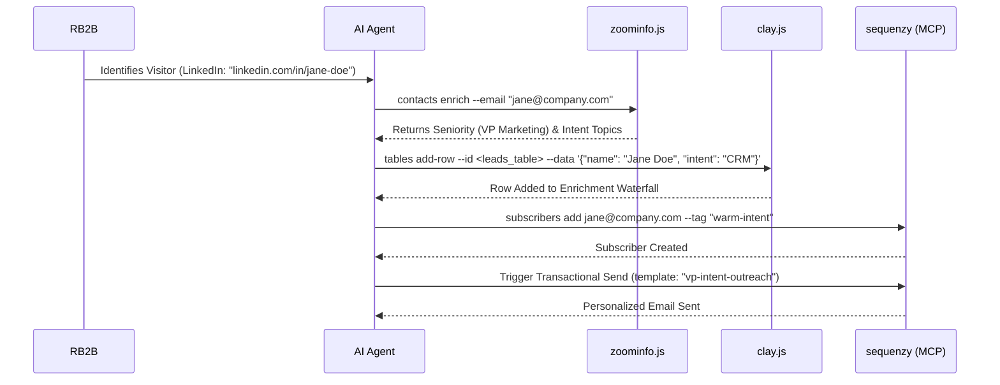

<!-- source: DeepWiki mcp.deepwiki.com · repo coreyhaines31/marketingskills · page 5.7 Other Integration Tools · fetched 2026-10-26 -->

# Other Integration Tools

Relevant source files

The following files were used as context for generating this wiki page:

- [tools/REGISTRY.md](tools/REGISTRY.md)
- [tools/clis/adobe-analytics.js](tools/clis/adobe-analytics.js)
- [tools/clis/airops.js](tools/clis/airops.js)
- [tools/clis/beehiiv.js](tools/clis/beehiiv.js)
- [tools/clis/brevo.js](tools/clis/brevo.js)
- [tools/clis/buffer.js](tools/clis/buffer.js)
- [tools/clis/calendly.js](tools/clis/calendly.js)
- [tools/clis/clay.js](tools/clis/clay.js)
- [tools/clis/clearbit.js](tools/clis/clearbit.js)
- [tools/clis/coupler.js](tools/clis/coupler.js)
- [tools/clis/demio.js](tools/clis/demio.js)
- [tools/clis/g2.js](tools/clis/g2.js)
- [tools/clis/hunter.js](tools/clis/hunter.js)
- [tools/clis/instantly.js](tools/clis/instantly.js)
- [tools/clis/intercom.js](tools/clis/intercom.js)
- [tools/clis/lemlist.js](tools/clis/lemlist.js)
- [tools/clis/supermetrics.js](tools/clis/supermetrics.js)
- [tools/clis/trustpilot.js](tools/clis/trustpilot.js)
- [tools/clis/typeform.js](tools/clis/typeform.js)
- [tools/clis/zapier.js](tools/clis/zapier.js)
- [tools/clis/zoominfo.js](tools/clis/zoominfo.js)
- [tools/integrations/airops.md](tools/integrations/airops.md)
- [tools/integrations/close.md](tools/integrations/close.md)
- [tools/integrations/gong.md](tools/integrations/gong.md)
- [tools/integrations/hunter.md](tools/integrations/hunter.md)
- [tools/integrations/instantly.md](tools/integrations/instantly.md)
- [tools/integrations/lemlist.md](tools/integrations/lemlist.md)
- [tools/integrations/pendo.md](tools/integrations/pendo.md)
- [tools/integrations/postscript.md](tools/integrations/postscript.md)
- [tools/integrations/rb2b.md](tools/integrations/rb2b.md)
- [tools/integrations/sequenzy.md](tools/integrations/sequenzy.md)
- [tools/integrations/snov.md](tools/integrations/snov.md)
- [tools/integrations/supermetrics.md](tools/integrations/supermetrics.md)
- [tools/integrations/twilio.md](tools/integrations/twilio.md)
- [tools/integrations/zapier.md](tools/integrations/zapier.md)

This page documents CLI integrations for diverse marketing services including link management, affiliate programs, video hosting, billing systems, data enrichment, and product analytics. These tools provide the execution layer for complex marketing workflows that span multiple platforms.

## Purpose and Scope

The "Other Integration Tools" category encompasses 60+ CLI wrappers for specialized marketing services. This section specifically details integrations for:

- **Link Management**: URL shortening and click analytics via Dub ([tools/clis/dub.js:1-10]()).
- **Affiliate Management**: Rewardful for tracking and managing affiliate programs ([tools/REGISTRY.md:41]()).
- **Video Hosting**: Wistia for video content management and analytics ([tools/REGISTRY.md:250]()).
- **Billing & Payments**: Paddle for subscription billing and merchant of record services ([tools/clis/paddle.js:1-10]()).
- **Webinars**: Livestorm for hosting and managing webinars ([tools/REGISTRY.md:251]()).
- **Data Enrichment**: Prospect and company data waterfall using Clay, ZoomInfo, and Clearbit ([tools/clis/clay.js:1-10](), [tools/clis/zoominfo.js:1-10](), [tools/clis/clearbit.js:1-8]()).
- **Marketing Operations**: Data pipelines and AI workflows via Supermetrics, Coupler, and AirOps ([tools/clis/airops.js:1-15](), [tools/integrations/supermetrics.md:1-12](), [tools/clis/coupler.js:1-10]()).
- **Sales Engagement**: Outreach for sales sequencing and engagement ([tools/clis/outreach.js:1-10]()).
- **Partner Ecosystem**: Crossbeam for partner mapping and co-selling ([tools/clis/crossbeam.js:1-10]()).
- **Product Analytics**: In-app behavior and guidance with Pendo ([tools/integrations/pendo.md:1-5]()).
- **CRM**: Close for sales CRM and lead management ([tools/integrations/close.md:1-12]()).
- **Automation**: Zapier SDK for 8,000+ app access ([tools/clis/zapier.js:1-9]()).
- **SMS Platforms**: Twilio, Attentive, and Postscript for SMS marketing and communication ([tools/REGISTRY.md:58-61]()).
- **Email Sequencing**: Lemlist, Instantly, Snov, and Sequenzy for cold outreach and email automation ([tools/REGISTRY.md:64,69,70,50]()).
- **Specialized Integrations**:
    - **RB2B**: Visitor de-anonymization ([tools/integrations/rb2b.md:1-4]()).
    - **Gong**: Revenue intelligence and call transcription ([tools/integrations/gong.md:1-5]()).
    - **SparkToro**: Audience behavioral research ([tools/REGISTRY.md:252]()).
    - **Exa**: AI-native web search ([tools/REGISTRY.md:87]()).
    - **RankParse**: SERP parsing ([tools/REGISTRY.md:29]()).

Sources: [tools/clis/dub.js:1-10](), [tools/REGISTRY.md:41](), [tools/REGISTRY.md:250](), [tools/clis/paddle.js:1-10](), [tools/REGISTRY.md:251](), [tools/clis/clay.js:1-10](), [tools/clis/zoominfo.js:1-10](), [tools/clis/clearbit.js:1-8](), [tools/clis/airops.js:1-15](), [tools/integrations/supermetrics.md:1-12](), [tools/clis/coupler.js:1-10](), [tools/clis/outreach.js:1-10](), [tools/clis/crossbeam.js:1-10](), [tools/integrations/pendo.md:1-5](), [tools/integrations/close.md:1-12](), [tools/clis/zapier.js:1-9](), [tools/REGISTRY.md:58-61](), [tools/REGISTRY.md:64,69,70,50](), [tools/integrations/rb2b.md:1-4](), [tools/integrations/gong.md:1-5](), [tools/REGISTRY.md:252](), [tools/REGISTRY.md:87](), [tools/REGISTRY.md:29]()

## Data Flow Architecture

The following diagram bridges the gap between marketing objectives (Natural Language Space) and the specific CLI entities that execute them.

### Marketing Operations to Code Entity Map

```mermaid
graph TD
    subgraph "Natural Language Space (Objectives)"
        OBJ1["Enrich a list of domains with company size"]
        OBJ2["Create a personalized sales sequence"]
        OBJ3["Sync GA4 data to a Google Sheet"]
        OBJ4["Generate SEO content using AI workflows"]
        OBJ5["Trigger a Zapier workflow with JSON data"]
        OBJ6["Add subscriber to an onboarding sequence"]
        OBJ7["Extract competitor mentions from sales calls"]
        OBJ8["Shorten a URL and track clicks"]
        OBJ9["Find prospects by job title and company"]
        OBJ10["Parse SERP results for keywords"]
    end

    subgraph "Code Entity Space (CLIs & Functions)"
        CLAY["clay.js"]
        LEMLIST["lemlist.js"]
        SUPERMETRICS["supermetrics.js"]
        AIROPS["airops.js"]
        ZAPIER["zapier.js"]
        SEQUENZY["sequenzy.md / mcp"]
        GONG["gong.md"]
        DUB["dub.js"]
        ZOOMINFO["zoominfo.js"]
        RANKPARSE["rankparse.js"]
        
        ENRICH["companies/enrich --domain"]
        LEAD_ADD["leads add --campaign-id"]
        QUERY["query --ds-id GA4 --fields sessions"]
        FLOW["flows/execute --id <flow_id>"]
        HOOK["hooks/send --url <webhook_url> --data"]
        SEQ_ADD["POST /api/v1/subscribers"]
        CALLS["POST /v2/calls/transcript"]
        SHORTEN["links create --url"]
        CONTACT_SEARCH["contacts search --job-title"]
        SERP_PARSE["parse --keyword"]
    end

    OBJ1 --> CLAY
    CLAY --> ENRICH
    
    OBJ2 --> LEMLIST
    LEMLIST --> LEAD_ADD
    
    OBJ3 --> SUPERMETRICS
    SUPERMETRICS --> QUERY
    
    OBJ4 --> AIROPS
    AIROPS --> FLOW

    OBJ5 --> ZAPIER
    ZAPIER --> HOOK

    OBJ6 --> SEQUENZY
    SEQUENZY --> SEQ_ADD

    OBJ7 --> GONG
    GONG --> CALLS

    OBJ8 --> DUB
    DUB --> SHORTEN

    OBJ9 --> ZOOMINFO
    ZOOMINFO --> CONTACT_SEARCH

    OBJ10 --> RANKPARSE
    RANKPARSE --> SERP_PARSE
```

Sources: [tools/clis/clay.js:120-131](), [tools/clis/lemlist.js:42-56](), [tools/clis/supermetrics.js:60-81](), [tools/clis/airops.js:78-93](), [tools/clis/zapier.js:124-138](), [tools/integrations/sequenzy.md:106-123](), [tools/integrations/gong.md:25-33](), [tools/clis/dub.js:49-60](), [tools/clis/zoominfo.js:106-117](), [tools/clis/rankparse.js:49-60]()

## Shared Implementation Pattern

All tools in this category implement the consistent zero-dependency CLI pattern:

| Component | Implementation | Example Location |
|-----------|---------------|------------------|
| **Arg Parsing** | `parseArgs(args)` | [tools/clis/zoominfo.js:60-78]() |
| **API Client** | `async function api(method, path, body)` | [tools/clis/clay.js:11-30]() |
| **Dry Run** | `if (args['dry-run']) { return { _dry_run: true ... } }` | [tools/clis/supermetrics.js:18-20]() |
| **Dispatcher** | `switch (cmd) { case 'sub': ... }` | [tools/clis/zoominfo.js:88-194]() |

Sources: [tools/clis/zoominfo.js:60-194](), [tools/clis/clay.js:11-30](), [tools/clis/supermetrics.js:18-20]()

## Data Enrichment & Sales Intelligence

These tools are primarily used by the `prospecting`, `cold-email`, and `revops` skills to build and qualify targeted lists.

### Clay Integration ([tools/clis/clay.js]())
Clay is used for building enrichment waterfalls and managing table-based lead data.
- **Table Management**: `tables list`, `tables rows --id <id>`, `tables add-row` [tools/clis/clay.js:61-94]().
- **People Enrichment**: `people enrich --email <email>` or `--linkedin <url>` [tools/clis/clay.js:99-118]().
- **Company Enrichment**: `companies enrich --domain <domain>` [tools/clis/clay.js:120-131]().

### ZoomInfo Integration ([tools/clis/zoominfo.js]())
Provides deep B2B intelligence and intent data.
- **Authentication**: Uses `ZOOMINFO_USERNAME` and `ZOOMINFO_PRIVATE_KEY` to retrieve a JWT [tools/clis/zoominfo.js:12-37]().
- **Search**: `contacts search` and `companies search` with filters for revenue, employees, and seniority [tools/clis/zoominfo.js:106-145]().
- **Intent**: `intent search --topic <topic>` to find accounts researching specific solutions [tools/clis/zoominfo.js:163-178]().

### Clearbit Integration ([tools/clis/clearbit.js]())
Offers person and company data enrichment, as well as IP-based company reveal.
- **Person Enrichment**: `person find --email <email>` [tools/clis/clearbit.js:60-66]().
- **Company Enrichment**: `company find --domain <domain>` [tools/clis/clearbit.js:73-79]().
- **IP Reveal**: `reveal find --ip <ip>` to identify companies from website visitors [tools/clis/clearbit.js:98-104]().
- **Prospector**: `prospector search --domain <domain> [--role <role>]` for finding leads within a company [tools/clis/clearbit.js:124-136]().

### RB2B ([tools/integrations/rb2b.md]())
Used to de-anonymize website visitors into LinkedIn profiles and company data [tools/integrations/rb2b.md:42-50]().
- **Workflow**: Typically pushes data to Slack or CRM [tools/integrations/rb2b.md:33-40]().
- **Intent Scoring**: Agents use visit frequency and page-level signals (e.g., pricing page) to score leads [tools/integrations/rb2b.md:68-74]().

Sources: [tools/clis/clay.js:61-131](), [tools/clis/zoominfo.js:12-178](), [tools/clis/clearbit.js:60-136](), [tools/integrations/rb2b.md:33-74]()

## Sales & Sequencing Execution

### Lemlist ([tools/clis/lemlist.js]())
Cold email outreach platform for personalized campaigns.
- **Campaigns**: `campaigns list`, `campaigns get --id <id>`, `campaigns stats --id <id>` [tools/clis/lemlist.js:74-98]().
- **Leads**: `leads list --campaign-id <id>`, `leads add --campaign-id <id> --email <email>` [tools/clis/lemlist.js:103-136]().
- **Unsubscribes**: `unsubscribes add --email <email>` to manage suppression lists [tools/clis/lemlist.js:140-157]().

### Instantly.ai ([tools/integrations/instantly.md]())
Cold email platform with built-in warmup.
- **Campaign Control**: `campaigns launch` and `campaigns pause` via CLI [tools/integrations/instantly.md:35-39]().
- **Lead Ops**: `leads add --campaign-id <id> --email <email>` [tools/integrations/instantly.md:48-49]().
- **Warmup Status**: Monitoring account health via `accounts warmup-status` [tools/integrations/instantly.md:67-68]().

### Snov.io ([tools/clis/snov.js]())
Email finder, verifier, and sender.
- **Email Finder**: `emails find --domain <domain>` to get emails from a company domain [tools/clis/snov.js:60-66]().
- **Email Verifier**: `emails verify --email <email>` to check email validity [tools/clis/snov.js:68-74]().
- **Prospects**: `prospects list`, `prospects add` [tools/clis/snov.js:76-93]().

### Sequenzy Integration ([tools/integrations/sequenzy.md]())
A comprehensive platform for lifecycle sequences and transactional email.
- **MCP Server**: Provides a stdio server for AI agents to interact with subscribers and metrics [tools/integrations/sequenzy.md:32-46]().
- **Subscribers**: `subscribers add <email> --tag <tag>` [tools/integrations/sequenzy.md:70-75]().
- **Events**: `POST /api/v1/subscribers/events` to trigger lifecycle changes [tools/integrations/sequenzy.md:139-154]().

### Outreach ([tools/clis/outreach.js]())
Sales engagement platform for automating outreach.
- **Prospects**: `prospects list`, `prospects get --id <id>`, `prospects create` [tools/clis/outreach.js:60-94]().
- **Sequences**: `sequences list`, `sequences add-prospect --id <sequence_id> --prospect-id <prospect_id>` [tools/clis/outreach.js:96-120]().
- **Mailings**: `mailings list --prospect-id <id>` to view sent emails [tools/clis/outreach.js:122-128]().

Sources: [tools/clis/lemlist.js:74-157](), [tools/integrations/instantly.md:35-68](), [tools/clis/snov.js:60-93](), [tools/integrations/sequenzy.md:32-154](), [tools/clis/outreach.js:60-128]()

## SMS Platforms

### Twilio ([tools/clis/twilio.js]())
Programmable SMS, voice, and video.
- **SMS Send**: `sms send --to <number> --from <number> --body <body>` [tools/clis/twilio.js:60-68]().
- **Call Initiate**: `calls create --to <number> --from <number> --url <webhook_url>` [tools/clis/twilio.js:70-78]().
- **Message List**: `messages list` to retrieve message history [tools/clis/twilio.js:80-86]().

### Attentive ([tools/integrations/attentive.md]())
SMS marketing platform for e-commerce.
- **Subscribers**: API for adding/updating subscribers, managing segments.
- **Campaigns**: API for sending one-time campaigns and managing journeys.
- **Events**: Triggering messages based on customer behavior.

### Postscript ([tools/integrations/postscript.md]())
SMS marketing for Shopify stores.
- **Subscribers**: API for managing subscriber lists and custom properties.
- **Automations**: API for triggering and managing automated SMS flows.
- **Campaigns**: API for sending promotional SMS campaigns.

Sources: [tools/clis/twilio.js:60-86](), [tools/integrations/attentive.md:1-12](), [tools/integrations/postscript.md:1-12]()

## Marketing Operations & Pipelines

### Supermetrics ([tools/clis/supermetrics.js]())
Aggregates data from 200+ platforms into a unified JSON query interface.
- **Query Logic**: Requires `--ds-id`, `--ds-accounts`, `--date-range`, and `--fields` [tools/clis/supermetrics.js:61-75]().
- **Data Sources**: Maps common IDs like `GA4` (Google Analytics 4), `AW` (Google Ads), and `FB` (Facebook Ads) [tools/clis/supermetrics.js:145-157]().

### Coupler.io ([tools/clis/coupler.js]())
Data integration platform for syncing data between apps and spreadsheets.
- **Importers**: `importers list`, `importers run --id <id>` to execute data syncs [tools/clis/coupler.js:60-78]().
- **Sources/Destinations**: Supports various data sources (e.g., Google Sheets, HubSpot) and destinations.

### AirOps ([tools/clis/airops.js]())
Platform for building and deploying AI agents and workflows.
- **Flows**: `flows list`, `flows execute --id <flow_id> --input <json>` to run AI workflows [tools/clis/airops.js:60-86]().
- **Workflows**: `workflows list`, `workflows execute --id <workflow_id> --input <json>` [tools/clis/airops.js:88-114]().

### Zapier SDK ([tools/integrations/zapier.md]())
Provides programmatic access to 8,000+ apps.
- **SDK Initialization**: `createZapierSdk()` allows direct app proxying [tools/integrations/zapier.md:47-50]().
- **App Actions**: `zapier.apps.hubspot().createContact()` or `zapier.apps.slack().sendChannelMessage()` [tools/integrations/zapier.md:73-94]().
- **Webhook CLI**: `hooks send --url <url> --data <json>` for legacy Zap triggers [tools/clis/zapier.js:124-142]().

Sources: [tools/clis/supermetrics.js:61-157](), [tools/clis/coupler.js:60-78](), [tools/clis/airops.js:60-114](), [tools/integrations/zapier.md:47-94](), [tools/clis/zapier.js:124-142]()

## Other Key Integrations

### Dub.co ([tools/clis/dub.js]())
Link management platform for shortening URLs and tracking clicks.
- **Links**: `links create --url <long_url> [--slug <slug>]`, `links list`, `links get --id <id>` [tools/clis/dub.js:49-79]().
- **Analytics**: `analytics get --id <link_id> --interval <interval>` to retrieve click data [tools/clis/dub.js:81-90]().

### Rewardful ([tools/clis/rewardful.js]())
Affiliate and referral program management.
- **Campaigns**: `campaigns list`, `campaigns get --id <id>` [tools/clis/rewardful.js:60-74]().
- **Referrals**: `referrals list`, `referrals create --email <email> --campaign-id <id>` [tools/clis/rewardful.js:76-93]().
- **Commissions**: `commissions list`, `commissions approve --id <id>` [tools/clis/rewardful.js:95-112]().

### Paddle ([tools/clis/paddle.js]())
Merchant of record and subscription billing platform.
- **Customers**: `customers list`, `customers get --id <id>`, `customers create` [tools/clis/paddle.js:60-94]().
- **Subscriptions**: `subscriptions list`, `subscriptions get --id <id>`, `subscriptions update` [tools/clis/paddle.js:96-120]().
- **Products**: `products list`, `products get --id <id>` [tools/clis/paddle.js:122-136]().

### Pendo ([tools/integrations/pendo.md]())
Product analytics and in-app guidance.
- **Visitors**: API for tracking visitor behavior and attributes.
- **Accounts**: API for managing account-level data.
- **Guides**: API for deploying and managing in-app guides and messages.

### Close ([tools/clis/close.js]())
Sales CRM for managing leads, opportunities, and communications.
- **Leads**: `leads list`, `leads get --id <id>`, `leads create` [tools/clis/close.js:60-94]().
- **Opportunities**: `opportunities list`, `opportunities create --lead-id <id>` [tools/clis/close.js:96-114]().
- **Activities**: `activities list`, `activities create --lead-id <id> --type <type> --note <note>` [tools/clis/close.js:116-140]().

### Gong ([tools/integrations/gong.md]())
Revenue intelligence platform for analyzing sales conversations.
- **Calls**: `POST /v2/calls/extensive` to list calls, `POST /v2/calls/transcript` to get transcripts [tools/integrations/gong.md:25-33]().
- **Users & Stats**: `GET /v2/users`, `POST /v2/stats/activity/day-by-day` for rep performance [tools/integrations/gong.md:36-42]().
- **Competitive Intelligence**: Agents can query calls mentioning competitor names to extract objections and pricing discussions [tools/integrations/gong.md:81-87]().

### RankParse ([tools/clis/rankparse.js]())
SERP parsing API for extracting search engine results.
- **Parse**: `parse --keyword <keyword> [--country <country>] [--language <lang>]` to get organic, paid, and local results [tools/clis/rankparse.js:49-60]().
- **HTML**: `html --url <url>` to retrieve raw HTML of a search result page [tools/clis/rankparse.js:62-68]().

### Exa ([tools/clis/exa.js]())
AI-native web search API.
- **Search**: `search --query <query> [--num-results <n>] [--start-date <date>]` [tools/clis/exa.js:49-60]().
- **Contents**: `contents --url <url>` to retrieve the content of a webpage [tools/clis/exa.js:62-68]().

Sources: [tools/clis/dub.js:49-90](), [tools/clis/rewardful.js:60-112](), [tools/clis/paddle.js:60-136](), [tools/integrations/pendo.md:1-5](), [tools/clis/close.js:60-140](), [tools/integrations/gong.md:25-87](), [tools/clis/rankparse.js:49-68](), [tools/clis/exa.js:49-68]()

## Integration Summary Table

| Service | CLI/Integration File | Primary Auth | Key Subcommands |
|---------|----------|--------------|-----------------|
| **Clay** | `clay.js` | Bearer | `tables`, `people enrich`, `companies enrich` |
| **ZoomInfo**| `zoominfo.js` | JWT (via Auth) | `contacts search`, `intent search` |
| **Clearbit**| `clearbit.js` | Basic | `person find`, `company find`, `prospector search` |
| **AirOps** | `airops.js` | Bearer | `flows execute`, `workflows execute` |
| **Gong** | `gong.md` | Basic / OAuth2 | `POST /v2/calls/transcript` |
| **Zapier** | `zapier.js` | API Key | `hooks send`, `zaps list` |
| **Coupler** | `coupler.js` | Bearer | `importers run`, `importers create` |
| **Dub.co** | `dub.js` | Bearer | `links create`, `analytics get` |
| **Rewardful**| `rewardful.js` | Bearer | `campaigns list`, `referrals create` |
| **Paddle** | `paddle.js` | Bearer | `customers list`, `subscriptions create` |
| **Pendo** | `pendo.md` | API Key | `visitors track`, `accounts update` |
| **Close** | `close.js` | API Key | `leads create`, `opportunities list` |
| **Twilio** | `twilio.js` | Basic | `sms send`, `calls create` |
| **Lemlist** | `lemlist.js` | Basic | `campaigns list`, `leads add` |
| **Instantly**| `instantly.js` | API Key | `campaigns launch`, `leads add` |
| **Snov.io** | `snov.js` | API Key | `emails find`, `prospects add` |
| **Sequenzy**| `sequenzy.md` | Bearer | `subscribers add`, `campaigns schedule` |
| **RB2B** | `rb2b.md` | Native Integrations | (via webhooks/CRM push) |
| **RankParse**| `rankparse.js` | API Key | `parse --keyword`, `html --url` |
| **Exa** | `exa.js` | API Key | `search --query`, `contents --url` |

Sources: [tools/clis/clay.js:3-5](), [tools/clis/zoominfo.js:12-37](), [tools/clis/clearbit.js:3-5](), [tools/clis/airops.js:3-5](), [tools/integrations/gong.md:16-18](), [tools/clis/zapier.js:3-5](), [tools/clis/coupler.js:3-4](), [tools/clis/dub.js:3-5](), [tools/clis/rewardful.js:3-5](), [tools/clis/paddle.js:3-5](), [tools/integrations/pendo.md:1-5](), [tools/clis/close.js:3-5](), [tools/clis/twilio.js:3-5](), [tools/clis/lemlist.js:3-5](), [tools/clis/instantly.js:3-5](), [tools/clis/snov.js:3-5](), [tools/integrations/sequenzy.md:16-19](), [tools/integrations/rb2b.md:17-19](), [tools/clis/rankparse.js:3-5](), [tools/clis/exa.js:3-5]()

## Technical Workflow: Visitor Identification to Automated Enrichment

This diagram illustrates how these tools compose to execute a modern B2B GTM workflow.

Sources: [tools/integrations/rb2b.md:42-50](), [tools/clis/zoominfo.js:118-128](), [tools/clis/clay.js:79-93](), [tools/integrations/sequenzy.md:106-123](), [tools/integrations/sequenzy.md:225-243]()

---

