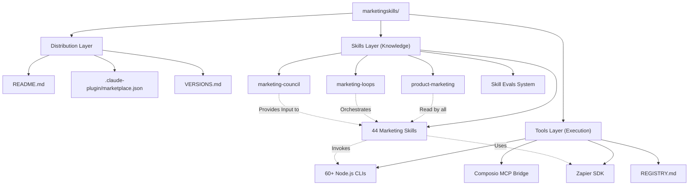
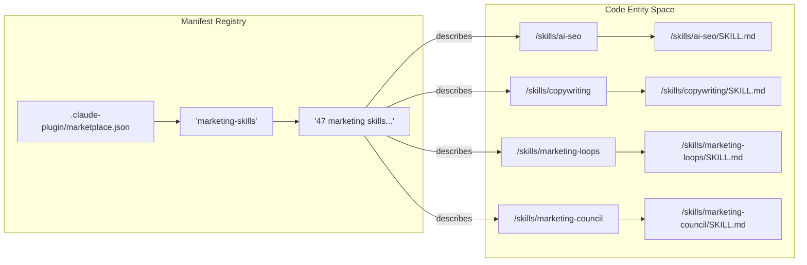
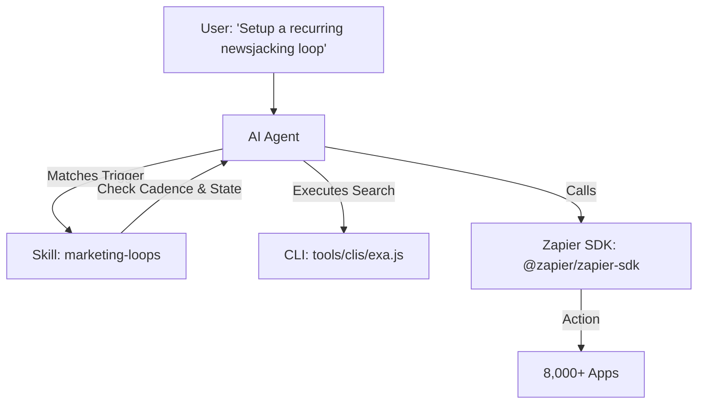

<!-- source: DeepWiki mcp.deepwiki.com · repo coreyhaines31/marketingskills · page 6 System Architecture · fetched 2026-10-26 -->

# System Architecture

<details>
<summary>Relevant source files</summary>

The following files were used as context for generating this wiki page:

- [.claude-plugin/marketplace.json](.claude-plugin/marketplace.json)
- [.claude-plugin/plugin.json](.claude-plugin/plugin.json)
- [AGENTS.md](AGENTS.md)
- [CONTRIBUTING.md](CONTRIBUTING.md)
- [README.md](README.md)
- [VERSIONS.md](VERSIONS.md)

</details>


This document provides a technical overview of the Marketing Skills repository architecture. The system implements a three-tier architecture optimized for AI agent consumption, featuring 47 specialized marketing skills and 60+ zero-dependency CLI tools. The architecture prioritizes skill independence, composability, and a strict separation between knowledge (markdown-based skills) and execution (Node.js CLI tools).

For detailed implementation of each architectural layer, see:
- [Three-Tier Architecture](#6.1) — Distribution (README, marketplace.json, VERSIONS.md), Skills (47 modules), and Tools (60+ CLIs) layers.
- [Customer Lifecycle Coverage](#6.2) — Mapping skills to awareness, consideration, conversion, activation, retention, and expansion.
- [Skill Interdependencies](#6.3) — Hub skills (churn-prevention, ai-seo, content-strategy, seo-audit, marketing-plan, marketing-loops, marketing-council) and composition patterns.

---

## Repository Structure

The repository follows a flat, file-based architecture. Each skill is a self-contained directory within `skills/`, and each CLI tool is a standalone script in `tools/clis/`.

### Physical Layout

```
marketingskills/
├── .claude-plugin/
│   └── marketplace.json          # Claude Code plugin manifest
├── skills/                       # 47 Skill modules
│   ├── ai-seo/
│   │   └── SKILL.md              # Logic & frameworks
│   ├── marketing-loops/
│   │   └── SKILL.md              # Operational workflows
│   ├── marketing-council/
│   │   └── SKILL.md              # Simulated expert board
│   ├── product-marketing/
│   │   └── SKILL.md              # Foundation context (referenced by all)
│   └── ... (44 other skills)
├── tools/
│   ├── clis/                     # 60+ Zero-dependency Node.js tools
│   │   ├── ga4.js
│   │   ├── resend.js
│   │   └── ...
│   ├── integrations/             # API guides and docs per tool
│   └── REGISTRY.md               # Tool capability index
├── VERSIONS.md                   # Version tracking for agents
└── README.md                     # Central catalog and entry point
```

**System Component Diagram**



**Sources:** [README.md:13-50](), [.claude-plugin/marketplace.json:1-19](), [VERSIONS.md:5-52](), [tools/REGISTRY.md:13-87]()

---

## Plugin Manifest Specification

The `.claude-plugin/marketplace.json` file enables Claude Code's plugin marketplace integration. It provides metadata for the `marketing-skills` plugin, allowing agents to understand the scope of the 47 included skills [.claude-plugin/marketplace.json:12-18]().

**Code Entity Mapping: Manifest to Files**



**Sources:** [.claude-plugin/marketplace.json:1-19](), [VERSIONS.md:56-58]()

---

## Execution & Integration Architecture

The system separates "thinking" (Skills) from "doing" (Tools). Skills provide the strategic framework and templates, while CLI tools and SDKs provide the execution capability.

### Tool Execution Flow
CLI tools in `tools/clis/` are designed as zero-dependency Node.js scripts. This allows agents to execute them directly via the terminal. For more complex workflows, the system leverages the Zapier SDK to access 8,000+ apps [tools/integrations/zapier.md:1-12]().

**Natural Language to Tool Execution**



**Sources:** [tools/REGISTRY.md:15-87](), [tools/integrations/zapier.md:179-194](), [VERSIONS.md:56-58]()

### Integration Methods
The system supports four primary integration patterns:
1. **Direct CLI**: Zero-dependency scripts for 60+ tools (e.g., `tools/clis/ga4.js`).
2. **Native MCP**: Direct Model Context Protocol support for specific tools.
3. **Composio Bridge**: An MCP integration layer for OAuth-heavy tools like HubSpot, Salesforce, and Meta Ads [tools/REGISTRY.md:15-87]().
4. **Zapier SDK**: Direct programmatic access to 8,000+ app actions [tools/integrations/zapier.md:12-12]().

**Sources:** [tools/REGISTRY.md:1-87](), [tools/integrations/zapier.md:1-12]()

---

## Update & Versioning Logic

To ensure agents use the most current frameworks, the system includes a `VERSIONS.md` file. Agents compare local skill versions against this remote source. The system currently tracks 47 skills, including the operational `marketing-loops` and specialized modules like `offers`, `prospecting`, and `marketing-council` [VERSIONS.md:5-52]().

| Mechanism | Implementation |
|-----------|----------------|
| **Version Tracking** | `VERSIONS.md` lists every skill's semantic version (e.g., `marketing-loops` at `1.2.0`, `marketing-council` at `1.0.0`) [VERSIONS.md:31-32](). |
| **Change Logs** | Recent updates (e.g., v2.8.11) document major refactors like the reverse-engineering of viral edits in `video` [VERSIONS.md:57-59](). |
| **State Management** | `marketing-loops` introduces state persistence via `.agents/loops/<loop>.json` to handle idempotency [VERSIONS.md:58-58](). |

**Sources:** [VERSIONS.md:1-73](), [README.md:17-50]()

---

