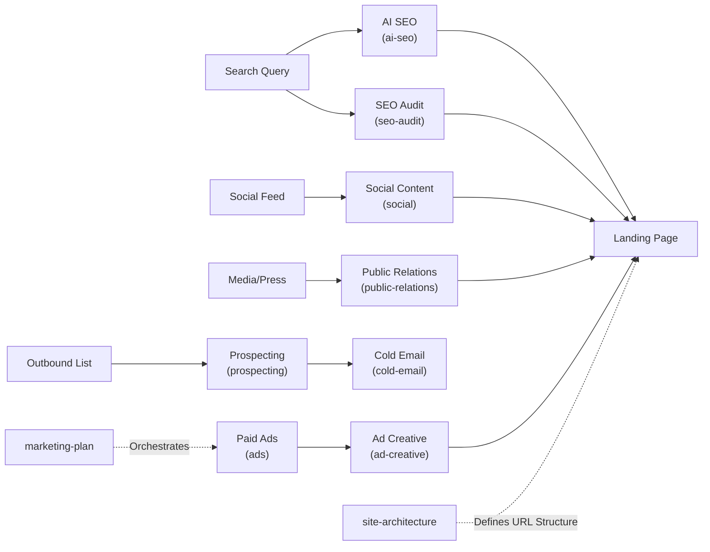
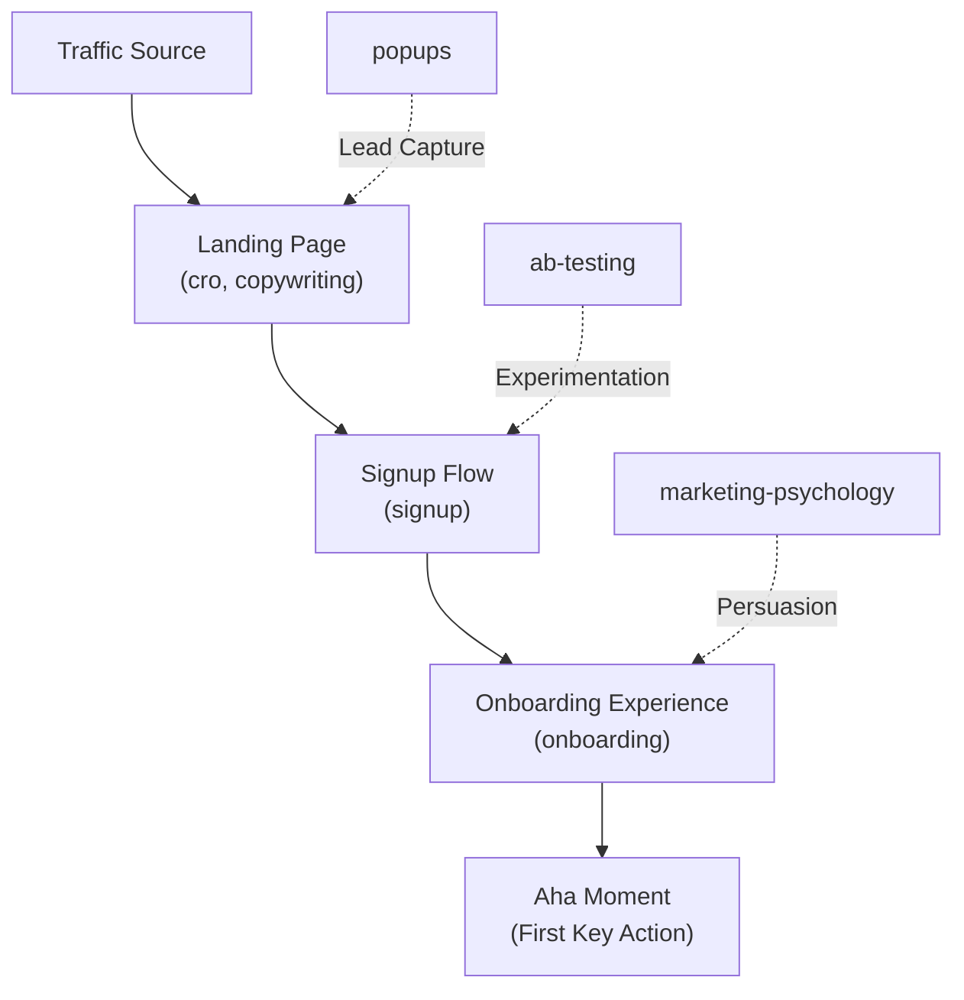
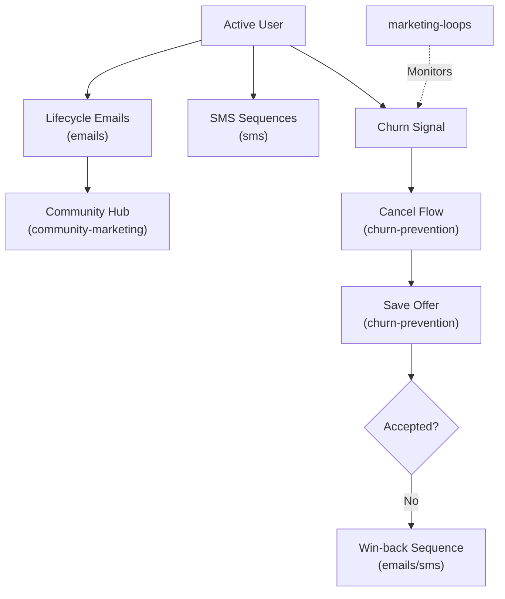
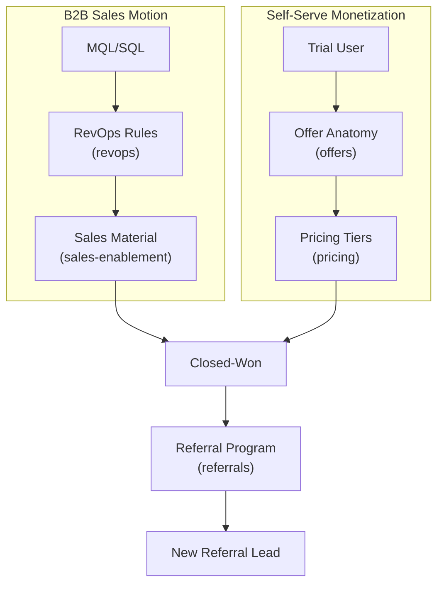
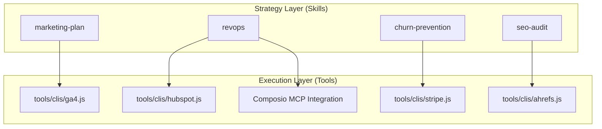

<!-- source: DeepWiki mcp.deepwiki.com · repo coreyhaines31/marketingskills · page 6.2 Customer Lifecycle Coverage · fetched 2026-10-26 -->

# Customer Lifecycle Coverage

Relevant source files

The following files were used as context for generating this wiki page:

- [.claude-plugin/marketplace.json](.claude-plugin/marketplace.json)
- [.claude-plugin/plugin.json](.claude-plugin/plugin.json)
- [README.md](README.md)
- [VERSIONS.md](VERSIONS.md)
- [skills/churn-prevention/SKILL.md](skills/churn-prevention/SKILL.md)
- [skills/cold-email/SKILL.md](skills/cold-email/SKILL.md)
- [skills/revops/SKILL.md](skills/revops/SKILL.md)

This document maps the 46 marketing skills to the six stages of the SaaS customer lifecycle (AARRR), showing how the repository provides comprehensive coverage from awareness through expansion. Each lifecycle stage has specialized skills that address the marketing challenges specific to that stage.

For the overall three-tier architecture, see [Three-Tier Architecture](6.1). For how skills interconnect beyond lifecycle stages, see [Skill Interdependencies](6.3).

---

## Lifecycle Stage Definitions

The repository organizes skills around the standard AARRR (Acquisition, Activation, Retention, Referral, Revenue) framework, which serves as the spine for strategic planning.

| Stage | Primary Goal | Key Metric | Typical Duration |
|-------|-------------|------------|------------------|
| **Acquisition** | Make prospects aware and drive traffic | Visits, MQLs, CPA | Days to weeks |
| **Activation** | Drive to "aha moment" and first value | Signup rate, Time-to-Value | Hours to days |
| **Retention** | Prevent churn and maintain engagement | Churn rate, WAU/MAU | Months to years |
| **Referral** | Turn users into an acquisition channel | Viral coefficient, NPS | Months to years |
| **Revenue** | Increase LTV and optimize monetization | ARPU, NRR, Expansion MRR | Months to years |

Sources: [skills/marketing-plan/references/aarrr-framework.md:5-15](), [skills/marketing-plan/references/measurement-framework.md:52-92]()

---

## Acquisition Stage

### Skills

| Skill | Purpose |
|-------|---------|
| `ai-seo` | Visibility in AI answer engines (ChatGPT, Perplexity, Claude, Gemini) |
| `seo-audit` | Technical foundations and on-page SEO health |
| `programmatic-seo` | Build template-driven SEO pages at scale (Location, Comparison, Integration) |
| `ads` | Plan and structure paid campaigns (Google, Meta, LinkedIn, TikTok) |
| `ad-creative` | Generate ad variations and iterate based on performance data |
| `social` | Plan and write social content for founder-led and brand channels |
| `public-relations` | Earned media strategy, newsjacking, and journalist pitching |
| `prospecting` | Building qualified B2B prospect lists based on ICP and growth signals |

### Flow: Discovery to Traffic

Title: Acquisition Stage: Discovery to Traffic

**Acquisition Stage: Discovery to Traffic**

Acquisition focuses on the organic compound (SEO, PR, Social) before layering on paid acquisition [skills/marketing-plan/references/aarrr-framework.md:89-90](). The `ai-seo` skill specifically future-proofs content for LLM citation and AI Overviews [skills/marketing-plan/references/ops-stack-mapping.md:24-24](). The `ads` skill was reframed around the "creative-as-targeting" shift, emphasizing that headlines and hooks now outperform hyper-precise targeting filters on platforms like Meta [VERSIONS.md:59-59](). The `prospecting` skill (v1.1.0) now includes a "Demand-signal discovery" branch for finding early customers based on recent public pain and timing signals, distinct from traditional firmographic list-building [VERSIONS.md:66-67]().

Sources: [skills/marketing-plan/references/ops-stack-mapping.md:19-37](), [skills/marketing-plan/references/aarrr-framework.md:74-90](), [VERSIONS.md:59-59](), [VERSIONS.md:66-67]()

---

## Activation Stage

### Skills

| Skill | Purpose |
|-------|---------|
| `onboarding` | Optimize user onboarding flows and activation rate tests |
| `signup` | Reduce friction in registration and signup completion |
| `cro` | Optimize marketing pages and lead capture forms |
| `paywalls` | Optimize trial-to-paid conversion and upgrade screens |
| `popups` | Lead capture prompts and activation modals |
| `copywriting` | Write persuasive copy for onboarding and CTAs |

### Activation Funnel

Title: Activation Stage: Traffic to First Value

**Activation Stage: Traffic to First Value**

The diagnostic question for activation is: where in the user's first session do they decide "this works for me"? [skills/marketing-plan/references/aarrr-framework.md:93-94](). The `onboarding` skill is often the most leveraged move in this stage [skills/marketing-plan/references/aarrr-framework.md:97-97]().

Sources: [skills/marketing-plan/references/ops-stack-mapping.md:39-54](), [skills/marketing-plan/references/aarrr-framework.md:91-103]()

---

## Retention Stage

### Skills

| Skill | Purpose |
|-------|---------|
| `emails` | Design lifecycle sequences (Welcome, Nurture, Re-engagement) |
| `churn-prevention` | Build cancel flows, save offers, and recovery mechanisms |
| `sms` | SMS/MMS programs for abandoned cart and win-back sequences |
| `community-marketing` | Design and scale communities for loyalty and support deflection |
| `marketing-loops` | Automated workflows for churn-signals and re-engagement |

### Retention and Recovery System

Title: Retention Stage: Engagement and Churn Prevention

**Retention Stage: Engagement and Churn Prevention**

Retention is driven by lifecycle flows and community engagement. The `churn-prevention` skill specifically addresses both voluntary churn (save offers) and involuntary churn (failed payments) [skills/marketing-plan/references/ops-stack-mapping.md:60-60](). The `marketing-loops` skill (v2.6.0) adds recurring workflows for monitoring churn signals and refreshing lifecycle emails on a set cadence [VERSIONS.md:58-58](). The `churn-prevention` skill provides detailed guidance on cancel flow structure, exit survey design, and dynamic save offers, mapping specific offers (discount, pause, downgrade) to cancellation reasons [skills/churn-prevention/SKILL.md:63-125]().

Sources: [skills/marketing-plan/references/ops-stack-mapping.md:55-63](), [skills/marketing-plan/references/aarrr-framework.md:105-118](), [VERSIONS.md:58-58](), [skills/churn-prevention/SKILL.md:63-125]()

---

## Referral & Revenue Stages

### Skills

| Stage | Skill | Purpose |
|-------|-------|---------|
| **Referral** | `referrals` | Plan and launch referral, affiliate, and ambassador programs |
| **Revenue** | `pricing` | Audit and optimize pricing tiers, metrics, and packaging |
| **Revenue** | `offers` | Design the Value Equation (Outcome x Likelihood / Time x Effort) |
| **Revenue** | `revops` | Manage lead lifecycle stages and lead scoring (MQL→SQL) |
| **Revenue** | `sales-enablement` | Build sales decks, one-pagers, and objection handling |

### Revenue Generation Flow

Title: Revenue Stage: Monetization and Expansion

**Revenue & Referral: The Growth Flywheel**

The `offers` skill focuses on the core deliverable and value equation, distinguishing it from `pricing` (packaging) and `copywriting` (execution) [skills/marketing-plan/references/ops-stack-mapping.md:79-82](). Referral programs are sequenced to lead with whoever is already an advocate [skills/marketing-plan/references/aarrr-framework.md:132-132](). The `revops` skill defines lead lifecycle stages (Subscriber → Lead → MQL → SQL → Opportunity → Customer → Evangelist) and provides frameworks for lead scoring (fit vs. engagement) and routing rules [skills/revops/SKILL.md:46-149]().

Sources: [skills/marketing-plan/references/ops-stack-mapping.md:65-84](), [skills/marketing-plan/references/aarrr-framework.md:120-132](), [skills/revops/SKILL.md:46-149]()

---

## Horizontal Infrastructure: CLI Tools

The 60+ CLI tools provide the execution layer for the strategies defined in the skills.

### Integration Mapping

Title: Bridging Strategy to Execution

**Bridging Strategy to Execution**

The `marketing-plan` skill orchestrates other skills and requires data from tools like `ahrefs` and `ga4` to populate the current state audit [skills/marketing-plan/references/methodology.md:90-101](). Revenue operations are executed via CRM CLIs and the Composio MCP, which provides access to 500+ tools including HubSpot and Salesforce [SKILL.md:15-15](). The `marketing-plan` skill specifically tracks progress via a `progress.md` file, ensuring a stateful transition through INIT, REVIEW, and FINALIZE phases [skills/marketing-plan/references/methodology.md:26-36]().

Sources: [skills/marketing-plan/references/ops-stack-mapping.md:94-123](), [skills/marketing-plan/references/aarrr-framework.md:31-34](), [skills/marketing-plan/references/methodology.md:26-101](), [README.md:15-15]()

---

