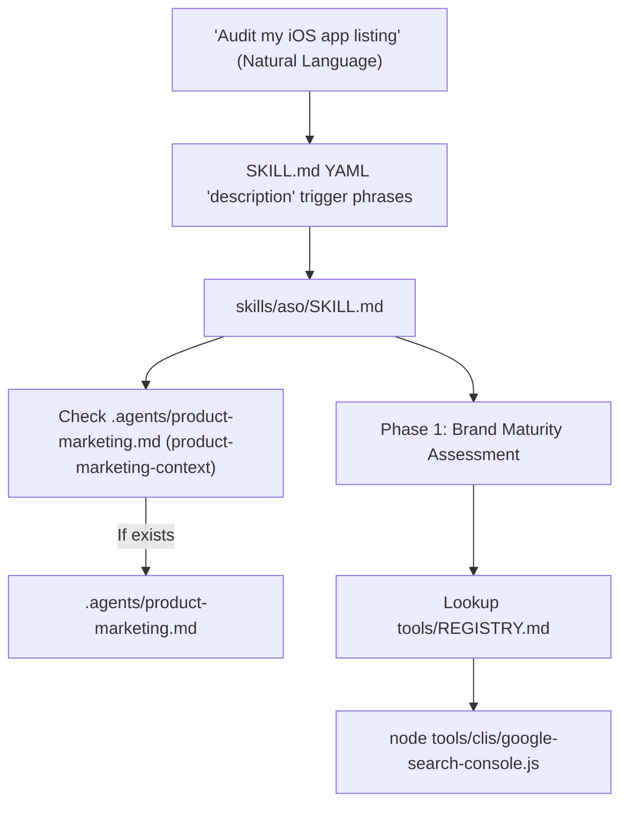
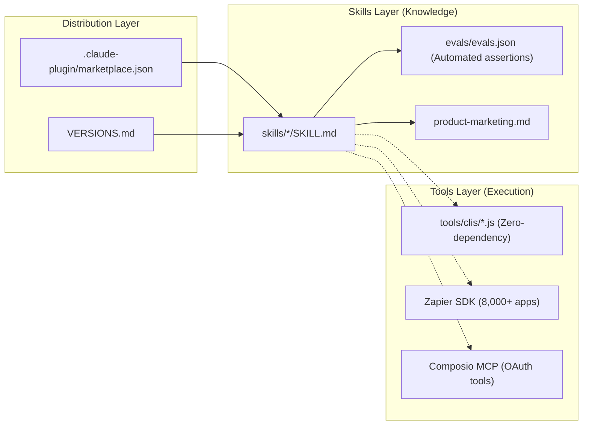

<!-- source: DeepWiki mcp.deepwiki.com · repo coreyhaines31/marketingskills · page 8 Glossary · fetched 2026-10-26 -->

# Glossary

Relevant source files

The following files were used as context for generating this wiki page:

- [.claude-plugin/marketplace.json](.claude-plugin/marketplace.json)
- [.claude-plugin/plugin.json](.claude-plugin/plugin.json)
- [README.md](README.md)
- [VERSIONS.md](VERSIONS.md)
- [skills/ad-creative/assets/creative-review-template.html](skills/ad-creative/assets/creative-review-template.html)
- [skills/ad-creative/evals/evals.json](skills/ad-creative/evals/evals.json)
- [skills/ad-creative/references/creative-review-page.md](skills/ad-creative/references/creative-review-page.md)
- [skills/ad-creative/references/creative-roadmap.md](skills/ad-creative/references/creative-roadmap.md)
- [skills/ad-creative/references/hook-system.md](skills/ad-creative/references/hook-system.md)
- [skills/ad-creative/references/imessage-video-ads.md](skills/ad-creative/references/imessage-video-ads.md)
- [skills/ad-creative/references/static-ad-templates.md](skills/ad-creative/references/static-ad-templates.md)
- [skills/ai-seo/SKILL.md](skills/ai-seo/SKILL.md)
- [skills/ai-seo/evals/evals.json](skills/ai-seo/evals/evals.json)
- [skills/ai-seo/references/citations-vs-recommendations.md](skills/ai-seo/references/citations-vs-recommendations.md)
- [skills/ai-seo/references/content-patterns.md](skills/ai-seo/references/content-patterns.md)
- [skills/ai-seo/references/content-types.md](skills/ai-seo/references/content-types.md)
- [skills/ai-seo/references/okf.md](skills/ai-seo/references/okf.md)
- [skills/ai-seo/references/platform-ranking-factors.md](skills/ai-seo/references/platform-ranking-factors.md)
- [skills/competitors/SKILL.md](skills/competitors/SKILL.md)
- [skills/image/SKILL.md](skills/image/SKILL.md)
- [skills/image/references/ai-image-prompting.md](skills/image/references/ai-image-prompting.md)
- [skills/marketing-council/SKILL.md](skills/marketing-council/SKILL.md)
- [skills/marketing-council/evals/evals.json](skills/marketing-council/evals/evals.json)
- [skills/marketing-council/references/advisor-template.md](skills/marketing-council/references/advisor-template.md)
- [skills/marketing-council/references/advisors/alex-hormozi.md](skills/marketing-council/references/advisors/alex-hormozi.md)
- [skills/marketing-council/references/advisors/ann-handley.md](skills/marketing-council/references/advisors/ann-handley.md)
- [skills/marketing-council/references/advisors/april-dunford.md](skills/marketing-council/references/advisors/april-dunford.md)
- [skills/marketing-council/references/advisors/byron-sharp.md](skills/marketing-council/references/advisors/byron-sharp.md)
- [skills/marketing-council/references/advisors/claude-hopkins.md](skills/marketing-council/references/advisors/claude-hopkins.md)
- [skills/marketing-loops/SKILL.md](skills/marketing-loops/SKILL.md)
- [skills/marketing-loops/references/loop-catalog.md](skills/marketing-loops/references/loop-catalog.md)
- [skills/prospecting/SKILL.md](skills/prospecting/SKILL.md)
- [skills/prospecting/evals/evals.json](skills/prospecting/evals/evals.json)
- [skills/prospecting/references/demand-signals.md](skills/prospecting/references/demand-signals.md)
- [skills/video/SKILL.md](skills/video/SKILL.md)
- [skills/video/evals/evals.json](skills/video/evals/evals.json)
- [skills/video/references/edit-anatomy.md](skills/video/references/edit-anatomy.md)

This glossary provides definitions for codebase-specific terms, marketing jargon, and technical abbreviations used throughout the `marketingskills` repository. It is designed to help onboarding engineers and marketers navigate the intersection of AI agents, marketing frameworks, and the tool integration layer.

## Marketing Domain Terms

| Term | Definition | Code Reference / Skill |
|:---|:---|:---|
| **A2P 10DLC** | Application-to-Person 10-Digit Long Code. A system in the US for sending business SMS messages over standard 10-digit phone numbers, requiring registration for higher throughput and deliverability. | [skills/sms/SKILL.md:3-3]() |
| **Aha Moment** | The moment a user first realizes the value of a product. A key focus for activation. | [skills/marketing-plan/references/plan-template.md:151-151]() |
| **AARRR** | Acquisition, Activation, Retention, Referral, Revenue. A popular framework for understanding and optimizing the customer lifecycle, often called "Pirate Metrics." | [skills/marketing-plan/SKILL.md:3-3]() |
| **ASO** | App Store Optimization. The process of improving app visibility and conversion in the Apple App Store and Google Play Store. | [skills/aso/SKILL.md:3-3]() |
| **CPP** | Custom Product Pages. Unique versions of an App Store product page that can be used for specific audiences or keywords. | [skills/aso/SKILL.md:148-150]() |
| **CRO** | Conversion Rate Optimization. The process of increasing the percentage of users who perform a desired action. | [skills/cro/SKILL.md:3-3]() |
| **CSL** | Customer Success Lead. A lead generated from existing customer interactions, often indicating expansion opportunities. | [skills/revops/SKILL.md:33-33]() |
| **CVR** | Conversion Rate. The percentage of visitors who complete a goal. | [skills/aso/SKILL.md:150-150]() |
| **Dunning** | The process of methodically communicating with customers to ensure the collection of accounts receivable (e.g., failed credit card retries). | [skills/churn-prevention/SKILL.md:3-3]() |
| **ICP** | Ideal Customer Profile. A description of the type of company/person that would get the most value from your product. | [skills/customer-research/SKILL.md:67-67]() |
| **JTBD** | Jobs To Be Done. A framework for understanding the "job" a customer is hiring a product to do. | [skills/marketing-psychology/SKILL.md:35-35]() |
| **MQL** | Marketing Qualified Lead. A lead judged more likely to become a customer compared to other leads. | [skills/revops/SKILL.md:33-33]() |
| **RSA** | Responsive Search Ads. Google Ads format that allows multiple headlines and descriptions to be tested automatically. | [skills/ad-creative/SKILL.md:69-83]() |
| **SQL** | Sales Qualified Lead. A prospective customer that has been researched and vetted by marketing/sales. | [skills/revops/SKILL.md:33-33]() |
| **TCPA** | Telephone Consumer Protection Act. US federal law restricting telemarketing calls and automated telephone equipment. Relevant for SMS marketing compliance. | [skills/sms/SKILL.md:3-3]() |

**Sources:** [README.md:57-76](), [skills/ad-creative/SKILL.md:69-83](), [skills/revops/SKILL.md:33-33](), [skills/aso/SKILL.md:2-5](), [skills/sms/SKILL.md:3-3](), [skills/marketing-plan/references/plan-template.md:151-151]()

---

## Technical & Infrastructure Terms

### Composio
An integration layer that provides MCP access to OAuth-heavy tools (like HubSpot or Salesforce) that don't have native MCP servers.
*   **Path**: [VERSIONS.md:63-63]()
*   **Integration**: [tools/REGISTRY.md:36-37]()

### GTM (Google Tag Manager)
A tag management system that allows you to quickly and easily update measurement codes and related code fragments (tags) on your website.
*   **Skill**: [skills/analytics/SKILL.md:60-60]()

### GROQ
A query language for JSON data, primarily used by the Sanity Headless CMS integration for content retrieval.
*   **Context**: Added in v1.2.0. [VERSIONS.md:64-64]()

### hreflang
HTML attributes used to specify the language and geographical targeting of a webpage.
*   **Reference**: [skills/seo-audit/references/international-seo.md:1-5]() (referenced via [skills/seo-audit/SKILL.md:162-177]())

### JSON-LD
JavaScript Object Notation for Linked Data. The preferred format for implementing Schema Markup.
*   **Skill**: [skills/schema/SKILL.md:3-3]()

### MCP (Model Context Protocol)
An open standard that enables AI models to safely and easily access data and tools. In this repo, tools like `ga4`, `stripe`, and `resend` are MCP-enabled via various distribution methods.
*   **Implementation**: Mentioned as a primary integration method in [tools/REGISTRY.md:15-87]().

### OKF (Open Knowledge Format)
A markdown specification for agent-readable site bundles, introduced by Google Cloud. It defines a directory of cross-linked markdown files with YAML frontmatter, intended to make content more easily consumable by AI systems.
*   **Skill**: [skills/ai-seo/SKILL.md:3-3]()
*   **Reference**: [skills/ai-seo/references/okf.md:1-1]()

### pSEO (Programmatic SEO)
The practice of creating landing pages at scale using a database and templates to target a high volume of long-tail keywords.
*   **Skill**: [skills/programmatic-seo/SKILL.md:3-3]()

### Zero-Dependency CLI
Node.js scripts located in `tools/clis/` that require no external `npm install` to run, ensuring high portability for AI agents.
*   **Path**: `tools/clis/*.js` [tools/REGISTRY.md:17-74]()

**Sources:** [VERSIONS.md:61-97](), [tools/REGISTRY.md:1-13](), [skills/seo-audit/SKILL.md:162-177](), [skills/ai-seo/SKILL.md:3-3](), [skills/ai-seo/references/okf.md:1-1](), [skills/schema/SKILL.md:3-3](), [skills/programmatic-seo/SKILL.md:3-3]()

---

## Skill-Specific Concepts

### AARRR
Acquisition, Activation, Retention, Referral, Revenue. A popular framework for understanding and optimizing the customer lifecycle, often called "Pirate Metrics."
*   **Skill**: [skills/marketing-plan/SKILL.md:3-3]()
*   **Reference**: [skills/marketing-plan/references/aarrr-framework.md:1-1]()

### AI Visibility Ladder
A framework describing how content is surfaced by AI systems, from "retrieved" to "cited," "mentioned," and ultimately "recommended."
*   **Reference**: [skills/ai-seo/references/citations-vs-recommendations.md:1-1]()

### AirDrop Reveal
A specific iOS-native video ad format where the hook is an incoming AirDrop request and the "Accept" tap serves as the product reveal.
*   **Skill**: [skills/ad-creative/SKILL.md:3-3]()
*   **Reference**: [skills/ad-creative/references/imessage-video-ads.md:63-63]()
*   **Implementation**: Added in `ad-creative` v2.8.0. [VERSIONS.md:63-63]()

### Beat Sheet
A table that decomposes a reference video's editing across nine dimensions (shot/framing, cut rhythm, on-screen text, caption style, motion/punch-ins, b-roll/overlays, sound design, first-2s hook, pacing curve) into a per-beat breakdown.
*   **Skill**: [skills/video/SKILL.md:3-3]()
*   **Reference**: [skills/video/references/edit-anatomy.md:1-1]()
*   **Implementation**: Added in `video` v2.1.0. [VERSIONS.md:59-59]()

### Citations vs. Recommendations
A distinction in AI SEO: content can be *cited* as a source without being *recommended* as the best solution. Recommendations often require offsite consensus (reviews, analysts, communities).
*   **Reference**: [skills/ai-seo/references/citations-vs-recommendations.md:1-1]()

### Community Flywheel
A model where member value leads to engagement, which creates content that attracts new members.
*   **Skill**: [skills/community-marketing/SKILL.md:52-62]()

### Creative Review Page
A shareable, self-contained HTML artifact for presenting ad creative concepts to stakeholders, featuring concept tabs, in-feed previews, storyboards, and grounding disclosures.
*   **Skill**: [skills/ad-creative/SKILL.md:3-3]()
*   **Reference**: [skills/ad-creative/references/creative-review-page.md:1-1]()
*   **Implementation**: Added in `ad-creative` v2.7.0. [VERSIONS.md:70-70]()

### Demand-Fit Scoring
A rubric used in the `prospecting` skill to evaluate potential first customers/design partners based on public pain-demand-timing signals. Scores pain, product fit, timing, reachability, and evidence quality.
*   **Skill**: [skills/prospecting/SKILL.md:3-3]()
*   **Reference**: [skills/prospecting/references/demand-signals.md:1-1]()
*   **Implementation**: Added in `prospecting` v1.1.0. [VERSIONS.md:67-67]()

### Designated Dissenter
A role within the `Marketing Council` skill, where at least one advisor is selected to provide a contrarian or challenging perspective to avoid groupthink.
*   **Skill**: [skills/marketing-council/SKILL.md:3-3]()
*   **Reference**: [skills/marketing-council/references/advisor-template.md:1-1]()

### Digital Watering Holes
Specific online locations where a target audience naturally congregates (e.g., specific subreddits, Slack groups).
*   **Concept**: Used in `community-marketing` and `customer-research`.

### Edit Anatomy
The nine dimensions used to decompose a video edit: shot/framing, cut rhythm, on-screen text, caption style, motion/punch-ins, b-roll/overlays, sound design, first-2s hook, and pacing curve.
*   **Skill**: [skills/video/SKILL.md:3-3]()
*   **Reference**: [skills/video/references/edit-anatomy.md:1-1]()
*   **Implementation**: Added in `video` v2.1.0. [VERSIONS.md:59-59]()

### Evals
A suite of automated tests (assertions) distributed across all skills to ensure that AI agents generate high-quality, consistent marketing output.
*   **Implementation**: Defined in `evals/evals.json` within each skill directory. [skills/marketing-loops/evals/evals.json:1-1]()

### Grounding Rules
Principles applied to skills like `Marketing Council` and `ad-creative` (e.g., iOS-native video ads) to ensure ethical AI behavior, such as persona simulation being labeled as such, never fabricating positions, or ensuring claims are verifiable.
*   **Skill**: [skills/marketing-council/SKILL.md:3-3]()
*   **Reference**: [skills/ad-creative/references/imessage-video-ads.md:29-35]()

### Loop Anatomy
The nine components of a marketing loop: check cadence, acts-when, purpose, skills used, loop body, self-check, state/idempotency, stop/bail-out, and output.
*   **Skill**: [skills/marketing-loops/SKILL.md:27-41]()
*   **Reference**: [skills/marketing-loops/references/loop-catalog.md:1-1]()

### Marketing Council
A skill that simulates a board of 12 legendary marketing advisors, providing conflicting expert perspectives on marketing decisions based on their documented frameworks.
*   **Skill**: [skills/marketing-council/SKILL.md:3-3]()
*   **Implementation**: Added in `marketing-council` v1.0.0. [VERSIONS.md:29-29]()

### Marketing Loops
Recurring, self-running marketing workflows. Each loop consists of a nine-part anatomy: check cadence, acts-when, purpose, skills used, loop body, self-check, state/idempotency, stop/bail-out, and output.
*   **Skill**: [skills/marketing-loops/SKILL.md:3-3]()
*   **Catalog**: [skills/marketing-loops/references/loop-catalog.md:1-1]()

### Offer Anatomy
The six components of a complete offer: core deliverable, bonus stack, guarantee, scarcity, name, and price structure.
*   **Skill**: [skills/offers/SKILL.md:3-3]()
*   **Reference**: [skills/offers/references/offer-anatomy.md:1-1]()

### ORB Framework
A specific cold email copywriting framework: **Observation → Problem → Proof → Ask**.
*   **Skill**: [skills/cold-email/SKILL.md:80-80]()

### Product Marketing Context
The `product-marketing-context.md` file is the "source of truth" for an AI agent. It contains foundational information about the product, audience, and positioning to prevent the agent from asking repetitive questions.
*   **Standard Path**: `.agents/product-marketing.md` [README.md:19-25]()

### Tier 1 / Tier 2 Actions
A guardrail system for marketing loops. Tier 1 actions are autonomous-safe (e.g., drafting, sensing), while Tier 2 actions require human-in-the-loop approval (e.g., spending budget, publishing).
*   **Reference**: [skills/marketing-loops/references/loop-guardrails.md:1-1]()

### Trigger Phrases
Specific natural language strings included in a skill's YAML frontmatter `description` that help an agent decide when to activate that skill.
*   **Example**: "build a community", "community strategy" for `community-marketing`. [skills/community-marketing/SKILL.md:3-3]()

### Value Equation
A framework for designing compelling offers: (Dream Outcome × Perceived Likelihood) / (Time Delay × Effort).
*   **Skill**: [skills/offers/SKILL.md:3-3]()
*   **Reference**: [skills/offers/references/value-equation.md:1-1]()

### Watermark Pattern
A state management pattern for loops where a `last_run` timestamp or ID is stored in `.agents/loops/<loop>.json` to ensure idempotency and prevent duplicate actions.
*   **Reference**: [skills/marketing-loops/references/loop-state.md:1-1]()

### Waterfall Enrichment
The process of using multiple data providers in sequence (e.g., Apollo → Clearbit → Hunter) to find a prospect's contact information.
*   **Tools**: [tools/REGISTRY.md:30-33]()

**Sources:** [README.md:19-25](), [skills/community-marketing/SKILL.md:3-62](), [VERSIONS.md:61-70](), [skills/marketing-plan/SKILL.md:3-3](), [skills/marketing-loops/SKILL.md:58-58](), [skills/offers/SKILL.md:3-3](), [skills/marketing-loops/references/loop-guardrails.md:1-1](), [skills/ad-creative/references/imessage-video-ads.md:29-35](), [skills/video/references/edit-anatomy.md:1-1](), [skills/prospecting/references/demand-signals.md:1-1](), [skills/ai-seo/references/citations-vs-recommendations.md:1-1]()

---

## Tool-Specific Terms

### Hyperframes
A programmatic video framework that uses HTML/CSS for video production. It is recommended for AI agents due to its plain HTML/CSS/JS nature.
*   **Skill**: [skills/video/SKILL.md:3-3]()
*   **Implementation**: [skills/video/SKILL.md:55-83]()

### Nano Banana
An AI image generation model (specifically Nano Banana Pro / Gemini).
*   **Reference**: [skills/image/references/ai-image-prompting.md:1-1]()

### Remotion
A React-based framework for programmatic video production, offering more advanced animation capabilities than Hyperframes but requiring React knowledge.
*   **Skill**: [skills/video/SKILL.md:3-3]()
*   **Implementation**: [skills/video/SKILL.md:85-113]()

### Zapier SDK
A TypeScript SDK that provides programmatic access to over 8,000 applications integrated with Zapier.
*   **Tool**: [tools/REGISTRY.md:75-75]()

**Sources:** [skills/video/SKILL.md:3-3](), [skills/image/references/ai-image-prompting.md:1-1](), [tools/REGISTRY.md:75-75]()

---

## Architecture Diagrams

### From Natural Language to Code Entity
This diagram shows how a user's intent is mapped to specific files and logic within the repository.

**Intent Mapping Flow**

**Sources:** [README.md:19-25](), [skills/aso/SKILL.md:3-5](), [tools/REGISTRY.md:1-13]()

### The Three-Tier Architecture
The relationship between the distribution manifest, the knowledge skills, and the execution tools.

**System Entity Relationship**

**Sources:** [.claude-plugin/marketplace.json:12-19](), [tools/REGISTRY.md:15-87](), [VERSIONS.md:53-65](), [README.md:19-25]()

---

## Tool Registry Categories

| Category | Description | Key Code Symbols / Paths |
|:---|:---|:---|
| **Analytics** | Tracking and measurement tools. | `tools/clis/ga4.js`, `mixpanel.js` |
| **Data Enrichment** | Tools to find more info on leads. | `tools/clis/clearbit.js`, `apollo.js`, `clay.js` |
| **Email Outreach** | B2B cold outreach platforms. | `tools/clis/resend.js`, `lemlist.js`, `instantly.js` |
| **Payments** | Billing and subscription data. | `tools/clis/stripe.js`, `paddle.js` |
| **Ads** | Paid advertising API wrappers. | `tools/clis/meta-ads.js`, `google-ads.js`, `tiktok-ads.js` |
| **Automation** | Multi-app workflow orchestration. | `tools/clis/zapier.js` |
| **SMS/Voice** | Tools for SMS and voice communication. | `tools/clis/twilio.js`, `tools/integrations/postscript.md` |

**Sources:** [tools/REGISTRY.md:15-87](), [VERSIONS.md:68-68](), [tools/integrations/postscript.md:1-1]()