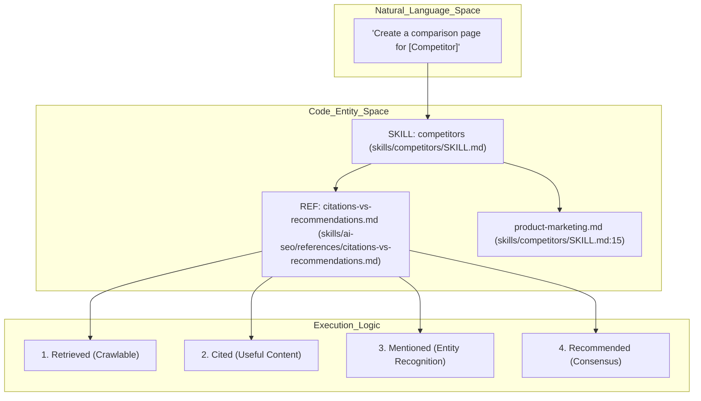
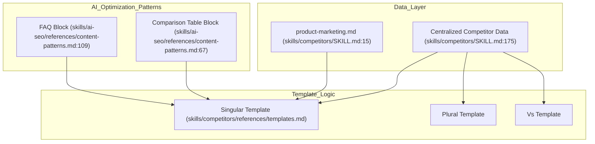

<!-- source: DeepWiki mcp.deepwiki.com · repo coreyhaines31/marketingskills · extra page Competitor Alternatives · fetched 2026-10-26 -->

# Competitor Alternatives

Relevant source files

The following files were used as context for generating this wiki page:

- [skills/ai-seo/SKILL.md](skills/ai-seo/SKILL.md)
- [skills/ai-seo/evals/evals.json](skills/ai-seo/evals/evals.json)
- [skills/ai-seo/references/citations-vs-recommendations.md](skills/ai-seo/references/citations-vs-recommendations.md)
- [skills/ai-seo/references/content-patterns.md](skills/ai-seo/references/content-patterns.md)
- [skills/ai-seo/references/content-types.md](skills/ai-seo/references/content-types.md)
- [skills/ai-seo/references/okf.md](skills/ai-seo/references/okf.md)
- [skills/ai-seo/references/platform-ranking-factors.md](skills/ai-seo/references/platform-ranking-factors.md)
- [skills/competitors/SKILL.md](skills/competitors/SKILL.md)

This page documents the `competitor-alternatives` skill (aliased as `competitors`) for building high-intent comparison and alternative pages. These pages are designed to rank for search terms like "[Competitor] vs [Product]" or "[Competitor] alternatives," providing genuine value to evaluators while effectively positioning a product against its rivals.

For broader content planning, see [Content Strategy](#4.5.6). For sales-specific internal documents, see [Sales Enablement](#4.9.1). To generate the underlying data required for these pages, see [Competitor Profiling](#4.8.8).

**Sources:** [skills/competitors/SKILL.md:1-10]()

---

## Skill Overview

The `competitor-alternatives` skill is a specialized SEO and sales enablement module. It provides frameworks for four distinct page formats, a centralized content architecture for scaling, and a research process for maintaining accuracy.

### Skill Metadata

| Property | Value |
|----------|-------|
| **Skill ID** | `competitors` |
| **Directory** | `skills/competitors/` |
| **Category** | SEO & Discovery |
| **Version** | 2.0.1 |

### Core Principles
1. **Honesty Builds Trust**: Acknowledge competitor strengths and be accurate about limitations. Readers will verify claims. [skills/competitors/SKILL.md:42-47]()
2. **Depth Over Surface**: Explain *why* differences matter beyond simple feature checklists. Include use cases. [skills/competitors/SKILL.md:48-53]()
3. **Help Them Decide**: Be clear about who the competitor is best for vs. who you are best for. Reduce friction. [skills/competitors/SKILL.md:54-59]()
4. **Modular Architecture**: Centralize competitor data so updates propagate across all comparison pages. [skills/competitors/SKILL.md:60-64]()

**Sources:** [skills/competitors/SKILL.md:40-65]()

---

## Data Sourcing and AI Search Integration

The `competitor-alternatives` skill bridges the gap between traditional SEO and AI-native discovery. It uses structured data to ensure pages are both human-readable and agent-extractable.

### The AI Visibility Ladder
When building comparison pages, the system considers the "AI Visibility Ladder." While a self-ranked comparison page might earn a **Citation** (Rung 2), earning a **Recommendation** (Rung 4) depends on offsite consensus.

**Diagram: Mapping Intent to AI Visibility Rungs**

**Sources:** [skills/competitors/SKILL.md:107-108](), [skills/ai-seo/references/citations-vs-recommendations.md:1-20]()

---

## Page Formats and Search Intent

The skill defines four specific formats based on how users search for alternatives. [skills/competitors/SKILL.md:67-147]()

| Format | Search Intent | URL Pattern | Key Sections |
|--------|---------------|-------------|--------------|
| **Singular Alternative** | User wants to switch from one specific tool. | `/alternatives/[competitor]` | Why switch, migration path, social proof from switchers. [skills/competitors/SKILL.md:69-85]() |
| **Plural Alternatives** | User is researching options early in the journey. | `/alternatives/[competitor]-alternatives` | Criteria framework, list of 4-7 real options, recommendation by use case. [skills/competitors/SKILL.md:88-106]() |
| **You vs. Competitor** | User is directly comparing two specific tools. | `/vs/[competitor]` | TL;DR summary, head-to-head table, detailed category breakdown. [skills/competitors/SKILL.md:111-129]() |
| **Competitor A vs. B** | User compares two rivals; you are the "third option." | `/compare/[comp-a]-vs-[comp-b]` | Overview of both, then introduce your product as the better alternative. [skills/competitors/SKILL.md:131-147]() |

---

## Technical Implementation & Data Flow

### Modular Content Architecture
To manage comparisons at scale, the skill recommends a "Single Source of Truth" approach where competitor data is stored as modular entities and injected into templates. [skills/competitors/SKILL.md:173-185]()

**Diagram: Modular Data Flow for Comparison Pages**

**Sources:** [skills/competitors/SKILL.md:15-16](), [skills/competitors/SKILL.md:173-185](), [skills/ai-seo/references/content-patterns.md:67-112]()

### Content Optimization Patterns
To ensure these pages are cited by AI search engines (ChatGPT, Perplexity, etc.), the skill utilizes specific markdown patterns.

| Pattern | Implementation | AI SEO Benefit |
|---------|----------------|----------------|
| **Comparison Table** | `| Feature | You | Comp |` | Optimal for table snippets and extraction. [skills/ai-seo/references/content-patterns.md:67-83]() |
| **FAQ Block** | `### [Question]?` | Essential for FAQ schema and "People Also Ask." [skills/ai-seo/references/content-patterns.md:109-127]() |
| **Pricing Table** | Structured pricing breakdown | AI cites pages with visible pricing data. [skills/ai-seo/references/content-types.md:18]() |

**Sources:** [skills/ai-seo/references/content-patterns.md:67-127](), [skills/ai-seo/references/content-types.md:18]()

---

## Relationship with Other Skills

The `competitor-alternatives` skill frequently composes with other modules:

*   **[AI SEO](#4.5.2)**: Provides the structural patterns (AEO/GEO) to ensure comparison pages are cited in AI search results. [skills/ai-seo/SKILL.md:3]()
*   **[Competitor Profiling](#4.8.8)**: Supplies the raw research, brand maturity tiers, and intelligence synthesis. [skills/competitors/SKILL.md:3]()
*   **[Sales Enablement](#4.9.1)**: Uses comparison data to build internal battle cards and objection handling talk tracks. [skills/competitors/SKILL.md:3]()
*   **[Product Marketing Context](#3.3)**: Provides the baseline product information (via `.agents/product-marketing.md`) needed for relative positioning. [skills/competitors/SKILL.md:15]()

**Sources:** [skills/competitors/SKILL.md:3-15](), [skills/ai-seo/SKILL.md:3]()

---

## Summary Checklist for Comparison Pages

Before publishing, verify the following:
- [ ] **TL;DR Summary**: Does the page start with a 2-3 sentence key difference summary? [skills/competitors/SKILL.md:151-153]()
- [ ] **Honest Who-It's-For**: Are you explicit about the ideal customer for the competitor? [skills/competitors/SKILL.md:163-165]()
- [ ] **Migration Section**: Does it cover what transfers and support offered? [skills/competitors/SKILL.md:166-168]()
- [ ] **Structured Tables**: Are there comparison tables for features and pricing? [skills/competitors/SKILL.md:157-162]()
- [ ] **AI-Ready Structure**: Does it use H2/H3 hierarchy with answer-first paragraphs? [skills/ai-seo/references/platform-ranking-factors.md:58-59]()

**Sources:** [skills/competitors/SKILL.md:150-169](), [skills/ai-seo/references/platform-ranking-factors.md:58-59]()

---

