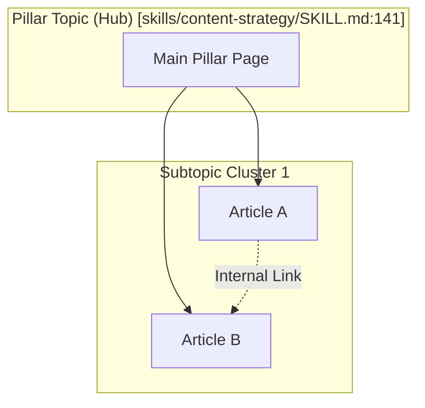
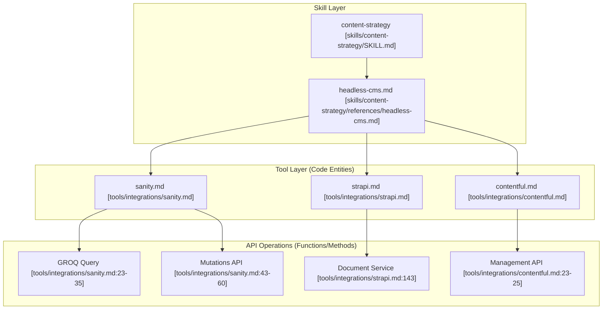

<!-- source: DeepWiki mcp.deepwiki.com · repo coreyhaines31/marketingskills · extra page Content Strategy · fetched 2026-10-26 -->

# Content Strategy

<details>
<summary>Relevant source files</summary>

The following files were used as context for generating this wiki page:

- [skills/content-strategy/SKILL.md](skills/content-strategy/SKILL.md)
- [skills/content-strategy/references/headless-cms.md](skills/content-strategy/references/headless-cms.md)
- [skills/programmatic-seo/SKILL.md](skills/programmatic-seo/SKILL.md)
- [skills/seo-audit/SKILL.md](skills/seo-audit/SKILL.md)
- [tools/integrations/contentful.md](tools/integrations/contentful.md)
- [tools/integrations/sanity.md](tools/integrations/sanity.md)
- [tools/integrations/strapi.md](tools/integrations/strapi.md)

</details>


The `content-strategy` skill provides a systematic framework for planning content that drives traffic, builds authority, and generates leads through searchable or shareable content formats. It orchestrates content ideation from multiple sources (keyword data, customer research, competitor analysis), applies prioritization scoring, and outputs structured content plans with topic clusters and buyer journey mapping.

**Scope boundaries:**
- For writing individual content pieces after strategy is defined, see [Copywriting](#4.4.1)
- For technical SEO optimization of content pages, see [SEO Audit](#4.5.1)
- For AI search engine optimization, see [AI SEO](#4.5.2)
- For scaled content generation from templates, see [Programmatic SEO](#4.5.3)
- For email-based content campaigns, see [Email Sequences](#4.4.3)
- For social media content, see [Social Content](#4.4.5)

---

## Skill Activation

The skill is triggered by natural language queries matching patterns defined in the skill metadata [skills/content-strategy/SKILL.md:2-3]():

| Trigger Pattern | Example Query |
|----------------|---------------|
| `content strategy` | "Help me build a content strategy" |
| `what should I write about` | "What topics should I cover?" |
| `topic clusters` | "How do I organize topics into clusters?" |
| `content planning` | "Create a content plan for Q2" |
| `editorial calendar` | "I need an editorial calendar for my blog" |

Before execution, the skill checks for `.agents/product-marketing.md` (or the legacy `.agents/product-marketing-context.md`) [skills/content-strategy/SKILL.md:14-15]() to ingest existing business context.

**Sources:** [skills/content-strategy/SKILL.md:1-15]()

---

## Core Framework: Searchable vs Shareable

The skill implements a binary classification system for all content production [skills/content-strategy/SKILL.md:42-49]():

```mermaid
graph TB
    ["Content Piece"] --> Decision{"Searchable, Shareable,<br/>or Both?"}
    
    Decision -->|Priority 1| ["Searchable Content<br/>Captures existing demand"]
    Decision -->|Priority 2| ["Shareable Content<br/>Creates demand"]
    Decision -->|Best of both| Both["Both<br/>Hybrid approach"]
    
    ["Searchable Content<br/>Captures existing demand"] --> SearchOptimization["Optimization [skills/content-strategy/SKILL.md:50-60]:<br/>- Target specific keyword<br/>- Match search intent<br/>- Keywords in title/H1/URL<br/>- Comprehensive coverage<br/>- AI/LLM discovery"]
    
    ["Shareable Content<br/>Creates demand"] --> ShareOptimization["Optimization [skills/content-strategy/SKILL.md:61-69]:<br/>- Novel insight or data<br/>- Challenge conventional wisdom<br/>- Emotional storytelling<br/>- Share-worthy insights<br/>- Trend connection"]
    
    Both --> SearchOptimization
    Both --> ShareOptimization
```

### Searchable Content Characteristics
Defined in [skills/content-strategy/SKILL.md:50-60](), this content is optimized for people actively looking for answers. It requires matching search intent exactly and structuring content for both humans and AI/LLM discovery.

### Shareable Content Characteristics
Defined in [skills/content-strategy/SKILL.md:61-69](), this content spreads ideas. It leads with novel insights, original data (product or public data analysis), or counterintuitive takes that challenge conventional wisdom.

**Sources:** [skills/content-strategy/SKILL.md:42-70]()

---

## Content Types and Infrastructure

The skill categorizes content into searchable and shareable types, while also providing guidance on the underlying infrastructure (CMS) required to manage them.

### Searchable Content Types
| Type | Formula / Structure | Implementation |
|------|--------------------|----------------|
| **Use-Case Content** | `[persona] + [use-case]` | Targets long-tail keywords (e.g., "Project management for designers") [skills/content-strategy/SKILL.md:76-80]() |
| **Hub and Spoke** | Hub (Overview) -> Spokes (Subtopics) | Strategic interlinking; usually lives under `/blog` unless depth requires custom URL paths [skills/content-strategy/SKILL.md:82-92]() |
| **Template Libraries** | High-intent keywords + Product | Targets searches like "marketing plan template" to drive product adoption [skills/content-strategy/SKILL.md:94-98]() |

### Shareable Content Types
Defined in [skills/content-strategy/SKILL.md:100-120]():
- **Thought Leadership:** Articulating concepts everyone feels but hasn't named.
- **Data-Driven Content:** Original research or product data analysis.
- **Expert Roundups:** 15-30 experts answering one specific question for built-in distribution.
- **Meta Content:** Behind-the-scenes transparency (e.g., "How we got our first $5k MRR").

### Content Infrastructure (Headless CMS)
For modern marketing stacks, the skill references a `headless-cms.md` guide [skills/content-strategy/references/headless-cms.md:1-4]() to help teams choose and model content.

```mermaid
graph LR
    subgraph "Natural Language Space"
        ["Content Strategy Request"]
        ["'How should I model my blog?'"]
    end

    subgraph "Code & Config Space"
        CMS_Ref["headless-cms.md [skills/content-strategy/references/headless-cms.md]"]
        Sanity_Tool["sanity.md [tools/integrations/sanity.md]"]
        Contentful_Tool["contentful.md [tools/integrations/contentful.md]"]
        Strapi_Tool["strapi.md [tools/integrations/strapi.md]"]
    end

    ["Content Strategy Request"] --> CMS_Ref
    ["'How should I model my blog?'"] --> CMS_Ref
    CMS_Ref -->|Platform Specifics| Sanity_Tool
    CMS_Ref -->|Platform Specifics| Contentful_Tool
    CMS_Ref -->|Platform Specifics| Strapi_Tool
```

**Sources:** [skills/content-strategy/SKILL.md:72-122](), [skills/content-strategy/references/headless-cms.md:1-120](), [tools/integrations/sanity.md:1-10](), [tools/integrations/contentful.md:1-10](), [tools/integrations/strapi.md:1-10]()

---

## Content Pillars and Buyer Journey

The skill implements a pillar-based architecture for content organization and maps topics to the buyer's journey [skills/content-strategy/SKILL.md:125-163]().

### Pillar Structure
Content pillars are 3-5 core topics the brand "owns" [skills/content-strategy/SKILL.md:127](). 



### Keyword Research by Buyer Stage
The skill maps specific keyword modifiers to stages [skills/content-strategy/SKILL.md:166-201]():

| Stage | Modifiers | Example |
|-------|-----------|---------|
| **Awareness** | `what is`, `how to`, `guide to` | "What is Agile Project Management" [skills/content-strategy/SKILL.md:171-177]() |
| **Consideration** | `best`, `top`, `vs`, `alternatives` | "Asana vs Trello vs Monday" [skills/content-strategy/SKILL.md:178-185]() |
| **Decision** | `pricing`, `reviews`, `demo` | "Project Management Tool Pricing" [skills/content-strategy/SKILL.md:186-193]() |
| **Implementation**| `templates`, `tutorial`, `setup` | "Project Template Library" [skills/content-strategy/SKILL.md:194-201]() |

**Sources:** [skills/content-strategy/SKILL.md:125-201]()

---

## Prioritization Framework

The skill applies a weighted scoring system to filter content ideas [skills/content-strategy/SKILL.md:283-316]():

| Factor | Weight | Description |
|--------|--------|-------------|
| **Customer Impact** | 40% | Frequency in research, pain point intensity, LTV potential. |
| **Content-Market Fit**| 30% | Alignment with product solutions and unique insights. |
| **Search Potential** | 20% | Volume, difficulty, and long-tail opportunities. |
| **Resource Req.** | 10% | Expertise availability and required assets. |

**Scoring Calculation [skills/content-strategy/SKILL.md:310-316]():**
`Total = (Impact * 0.4) + (Fit * 0.3) + (Search * 0.2) + (Resources * 0.1)`

**Sources:** [skills/content-strategy/SKILL.md:283-316]()

---

## Integration and Implementation

The `content-strategy` skill acts as a high-level orchestrator for other marketing skills and technical integrations.

### Data Flow to CMS Tools
When a strategy moves to execution, it interfaces with CMS-specific integrations for content modeling and document management.



### Skill Interdependencies
Defined in [skills/content-strategy/SKILL.md:351-359]():
- **Downstream Writing:** Defer to `copywriting` for individual pieces.
- **SEO Optimization:** Defer to `seo-audit` for technical checks [skills/seo-audit/SKILL.md:60-62]() or `ai-seo` for LLM discovery.
- **Scale:** Defer to `programmatic-seo` for template-based generation [skills/programmatic-seo/SKILL.md:8-10]().
- **Distribution:** Defer to `email-sequence` or `social-content`.

**Sources:** [skills/content-strategy/SKILL.md:351-359](), [skills/programmatic-seo/SKILL.md:8-10](), [skills/seo-audit/SKILL.md:60-62](), [tools/integrations/sanity.md:23-60](), [tools/integrations/strapi.md:140-143](), [tools/integrations/contentful.md:23-25]()

---

