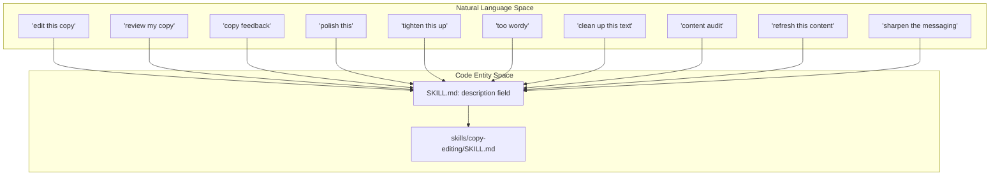
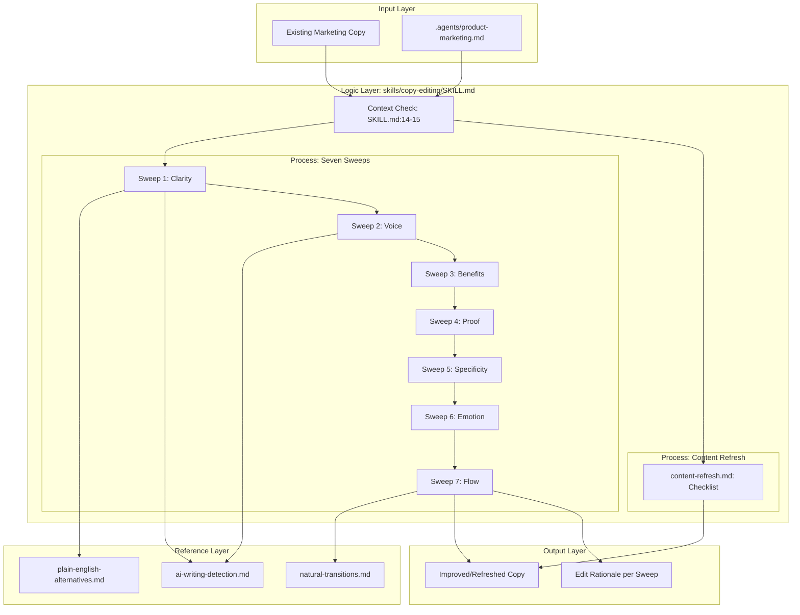

<!-- source: DeepWiki mcp.deepwiki.com · repo coreyhaines31/marketingskills · extra page Copy Editing · fetched 2026-10-26 -->

# Copy Editing

Relevant source files

The following files were used as context for generating this wiki page:

- [skills/copy-editing/SKILL.md](skills/copy-editing/SKILL.md)
- [skills/copy-editing/references/content-refresh.md](skills/copy-editing/references/content-refresh.md)
- [skills/copy-editing/references/plain-english-alternatives.md](skills/copy-editing/references/plain-english-alternatives.md)
- [skills/copywriting/references/natural-transitions.md](skills/copywriting/references/natural-transitions.md)
- [skills/seo-audit/references/ai-writing-detection.md](skills/seo-audit/references/ai-writing-detection.md)

This document describes the `copy-editing` skill, which provides AI agents with frameworks and best practices for reviewing, improving, and polishing existing marketing copy. This skill focuses on editing copy that already exists through a systematic "multi-pass" approach, rather than creating new copy from scratch.

For creating new marketing copy, see [Copywriting](#4.4.1). For email-specific content, see [Email Sequences](#4.4.3) or [Cold Email](#4.4.4).

---

## Skill Overview

The `copy-editing` skill enables AI agents to systematically review and improve marketing copy across all marketing surfaces—landing pages, product pages, emails, ads, and CTAs. It follows a "Seven Sweeps" framework to ensure every dimension of the copy is optimized without losing the core message.

### Skill File Location

The skill is defined in [skills/copy-editing/SKILL.md](), following the standard skill file format documented in [Skill File Format](#3.2).

| Property | Value |
|----------|-------|
| **Skill Name** | `copy-editing` |
| **Category** | Content & Copy |
| **Version** | 2.0.0 |
| **Implementation** | [skills/copy-editing/SKILL.md]() |

Sources: [skills/copy-editing/SKILL.md:2-5](), [README.md:28]()

---

## Trigger Patterns

The AI agent invokes this skill when users request copy editing, review, or refinement. The skill's metadata defines specific natural language triggers:

Sources: [skills/copy-editing/SKILL.md:3]()

---

## The Seven Sweeps Framework

The core implementation of the `copy-editing` skill relies on the **Seven Sweeps Framework**, a sequential process where the agent performs focused passes on the text.

### Implementation Logic

The agent is instructed to perform these sweeps in order, looping back after each edit to ensure previous improvements aren't compromised [skills/copy-editing/SKILL.md:29]().

| Sweep | Focus | Key Checks |
|-------|-------|------------|
| **1. Clarity** | Understanding | Jargon, confusing structures, ambiguous statements [skills/copy-editing/SKILL.md:31-55]() |
| **2. Voice & Tone** | Consistency | Shifts between formal/casual, brand personality [skills/copy-editing/SKILL.md:58-82]() |
| **3. So What** | Benefits | Features without benefits, missing "which means..." bridges [skills/copy-editing/SKILL.md:84-115]() |
| **4. Prove It** | Evidence | Missing social proof, unsubstantiated claims [skills/copy-editing/SKILL.md:117-151]() |
| **5. Specificity** | Concreteness | Vague language ("improve", "optimize"), generic numbers [skills/copy-editing/SKILL.md:152-187]() |
| **6. Emotion** | Feeling | Flat language, missing pain points or aspirations [skills/copy-editing/SKILL.md:188-221]() |
| **7. Flow & Friction** | Readability | Visual friction, sentence length, transition logic [skills/copy-editing/SKILL.md:223-255]() |

Sources: [skills/copy-editing/SKILL.md:27-255]()

---

## Content Refresh Editing

Beyond editing new copy, the skill includes logic for **Content Refreshing** to combat content decay. This applies to published pages that have outdated stats, stale examples, or drifted brand voice [skills/copy-editing/references/content-refresh.md:3]().

### Refresh Logic
The agent assesses if a refresh is needed based on signals like declining traffic, data older than 12 months, or product changes [skills/copy-editing/references/content-refresh.md:5-11]().

| Action | Signal |
|--------|--------|
| **Refresh** | Core message valid, details (stats/facts) outdated [skills/copy-editing/references/content-refresh.md:26]() |
| **Voice Rewrite** | Brand voice has evolved significantly [skills/copy-editing/references/content-refresh.md:27]() |
| **Full Rewrite** | Topic angle or audience has shifted [skills/copy-editing/references/content-refresh.md:28-29]() |

### Refresh Checklist
1. **Freshness Pass:** Update dates and remove deprecated features [skills/copy-editing/references/content-refresh.md:15]().
2. **Accuracy Pass:** Verify links and pricing [skills/copy-editing/references/content-refresh.md:16]().
3. **SEO Pass:** Check for new keywords and search intent shifts [skills/copy-editing/references/content-refresh.md:18]().

Sources: [skills/copy-editing/references/content-refresh.md:1-39]()

---

## System Architecture & Data Flow

The `copy-editing` skill sits within the Content & Copywriting cluster and interacts heavily with the product marketing context and specialized linguistic references.

Sources: [skills/copy-editing/SKILL.md:14-255](), [skills/copy-editing/references/content-refresh.md:13-21](), [skills/copy-editing/references/plain-english-alternatives.md:1-5](), [skills/copywriting/references/natural-transitions.md:1-7]()

---

## Linguistic Optimization & AI Detection

The skill utilizes specialized references to ensure copy sounds human and accessible.

### Plain English & Transitions
*   **Plain English:** The agent uses [skills/copy-editing/references/plain-english-alternatives.md]() to replace complex words (e.g., "ameliorate") with simple ones (e.g., "improve") [skills/copy-editing/references/plain-english-alternatives.md:29-49]().
*   **Natural Transitions:** During the Flow sweep, the agent applies transitions from [skills/copywriting/references/natural-transitions.md]() to guide readers without sounding mechanical [skills/copywriting/references/natural-transitions.md:1-7]().

### AI Writing Mitigation
The agent specifically checks for "AI Tells" documented in [skills/seo-audit/references/ai-writing-detection.md]():
*   **Em Dashes:** Overuse of em dashes (—) is flagged as a primary AI marker [skills/seo-audit/references/ai-writing-detection.md:19-29]().
*   **Overused Verbs:** Words like "delve," "leverage," and "foster" are replaced with more natural alternatives [skills/seo-audit/references/ai-writing-detection.md:50-60]().
*   **Structural Patterns:** Patterns like "In today's fast-paced world..." or "Whether you're a X, Y, or Z..." are identified and removed [skills/seo-audit/references/ai-writing-detection.md:111-138]().

Sources: [skills/copy-editing/references/plain-english-alternatives.md:1-300](), [skills/copywriting/references/natural-transitions.md:260-273](), [skills/seo-audit/references/ai-writing-detection.md:1-145]()

---

## Integration with Product Marketing Context

A critical step in the `copy-editing` workflow is checking for the existence of `.agents/product-marketing.md` (or the legacy filenames).

*   **Context Retrieval:** The agent is instructed to read this file before editing to align with brand voice and customer language [skills/copy-editing/SKILL.md:14-15]().
*   **Consistency:** The "Voice and Tone" sweep (Sweep 2) specifically uses the PMC to identify inconsistent brand personalities [skills/copy-editing/SKILL.md:64]().

Sources: [skills/copy-editing/SKILL.md:14-15](), [skills/copy-editing/SKILL.md:58-67]()

---

## Copy Editing vs. Copywriting

The system distinguishes between improving existing text and generating new content.

| Dimension | `copy-editing` | `copywriting` |
|-----------|----------------|---------------|
| **Core Goal** | Enhance, don't rewrite [skills/copy-editing/SKILL.md:17-20]() | Create from scratch |
| **Preservation** | Preserve author's voice [skills/copy-editing/SKILL.md:23]() | Establish new voice |
| **Process** | Seven sequential sweeps [skills/copy-editing/SKILL.md:27]() | Structural frameworks (AIDA, PAS, etc.) |

**Workflow Bridge:** If the agent determines that a "Major rewrite" is required rather than a polish, it should transition to the `copywriting` skill [skills/copy-editing/SKILL.md:3]().

Sources: [skills/copy-editing/SKILL.md:3](), [skills/copy-editing/SKILL.md:17-23]()

---

## Usage Patterns & Examples

### Specificity Upgrades
The skill provides concrete transformation patterns for the agent to follow during Sweep 5:

| Vague (Input) | Specific (Output) |
|---------------|-------------------|
| "Save time" | "Save 4 hours every week" |
| "Many customers" | "2,847 teams" |
| "Fast results" | "Results in 14 days" |
| "Improve your workflow" | "Cut your reporting time in half" |

Sources: [skills/copy-editing/SKILL.md:164-171]()

### Proof Gaps
During Sweep 4, the agent identifies unsupported assertions like "Trusted by thousands" and recommends adding specific customer logos, review scores, or case study references [skills/copy-editing/SKILL.md:127-141]().

Sources: [skills/copy-editing/SKILL.md:117-151]()

---

## Related Documentation

- **[Copywriting](#4.4.1)** - For creating new copy when editing is insufficient.
- **[Product Marketing Context](#3.3)** - The source of truth for brand voice and audience data used during editing.
- **[Email Sequences](#4.4.3)** - For applying copy editing to automated email flows.
- **[Page CRO](#4.2.1)** - For editing copy specifically to improve conversion rates.
- **[AI SEO](#4.5.2)** - For optimizing refreshed content for AI search visibility [skills/copy-editing/references/content-refresh.md:11]().

Sources: [skills/copy-editing/SKILL.md:3](), [README.md:150-164](), [skills/copy-editing/references/content-refresh.md:11]()

---

