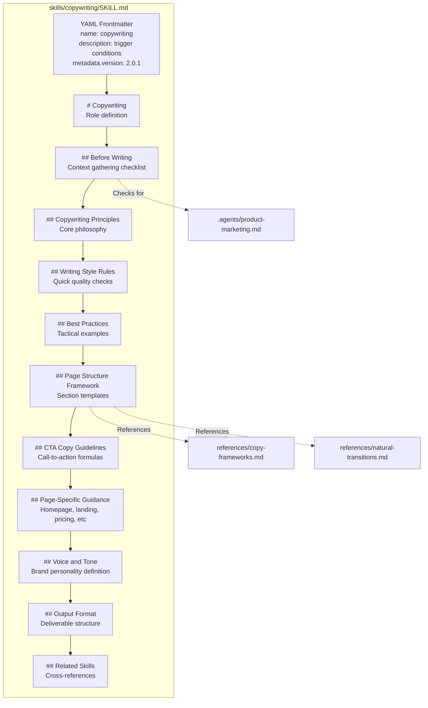
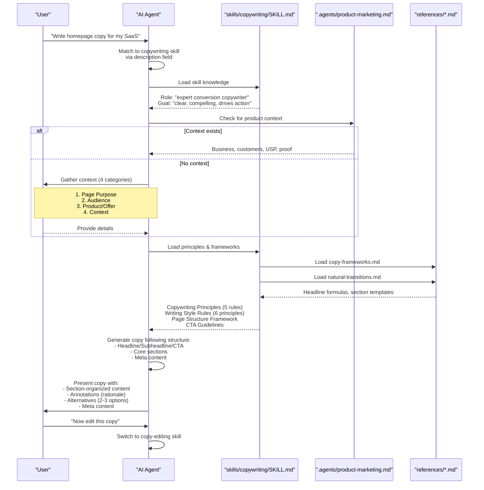
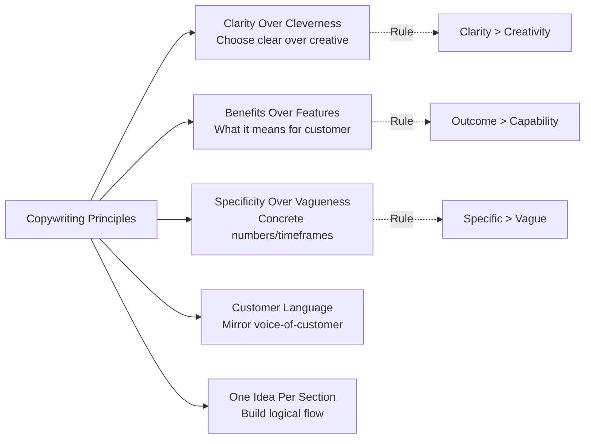
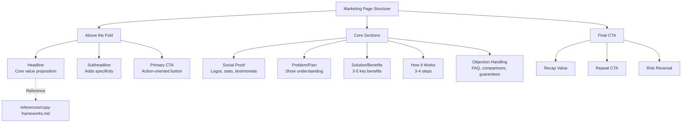

<!-- source: DeepWiki mcp.deepwiki.com · repo coreyhaines31/marketingskills · extra page Copywriting · fetched 2026-10-26 -->

# Copywriting

<details>
<summary>Relevant source files</summary>

The following files were used as context for generating this wiki page:

- [skills/copywriting/SKILL.md](skills/copywriting/SKILL.md)
- [skills/copywriting/evals/evals.json](skills/copywriting/evals/evals.json)
- [skills/copywriting/references/copy-frameworks.md](skills/copywriting/references/copy-frameworks.md)
- [skills/launch/SKILL.md](skills/launch/SKILL.md)
- [skills/pricing/SKILL.md](skills/pricing/SKILL.md)
- [skills/sales-enablement/SKILL.md](skills/sales-enablement/SKILL.md)
- [skills/seo-audit/evals/evals.json](skills/seo-audit/evals/evals.json)

</details>


This page documents the `copywriting` skill, which provides AI agents with specialized knowledge for writing marketing copy across various page types (homepage, landing pages, pricing pages, feature pages, about pages, product pages). The skill emphasizes clarity, benefit-driven messaging, and conversion-focused structures.

For editing and improving existing copy, see [Copy Editing](4.4.2). For email copywriting, see [Email Sequences](4.4.3). For popup and modal copy, see [Popup CRO](4.2.5).

---

## Skill Overview

The copywriting skill is a markdown-based knowledge module that guides AI agents through a structured copywriting process. It does not generate copy automatically; instead, it provides frameworks, principles, and best practices that the agent applies based on user context.

**File location:** [skills/copywriting/SKILL.md:1-253]()

**Skill metadata:**
- **Name:** `copywriting`
- **Version:** `2.0.1`
- **Description:** Triggered when users want to write, rewrite, or improve marketing copy for pages. Use when users mention "headline help," "CTA copy," "value proposition," or "hero section copy."

Sources: [skills/copywriting/SKILL.md:1-6]()

---

## Skill File Structure

The skill file follows a standardized format with YAML frontmatter and structured markdown sections:



Sources: [skills/copywriting/SKILL.md:1-253]()

---

## Skill Invocation Workflow

The copywriting skill can be invoked implicitly (through natural language) or explicitly (via command). The skill follows a structured workflow from context gathering to output generation:



Sources: [skills/copywriting/SKILL.md:1-6](), [skills/copywriting/SKILL.md:12-38](), [skills/copywriting/SKILL.md:220-243]()

---

## Context Gathering System

Before generating copy, the skill directs the agent to gather context through a prioritized checklist. The skill first checks for an existing product marketing context file to avoid redundant questions.

### Context File Check

[skills/copywriting/SKILL.md:14-15]():
```
If .agents/product-marketing.md exists (or .claude/product-marketing.md, or the legacy product-marketing-context.md filename, in older setups), read it before asking questions. 
Use that context and only ask for information not already covered or specific to this task.
```

### Four-Category Context Model

| Category | Information Needed | Location in Skill |
|----------|-------------------|-------------------|
| **Page Purpose** | Page type (homepage, landing, etc.), primary action | [skills/copywriting/SKILL.md:19-21]() |
| **Audience** | Ideal customer, problems, objections, voice-of-customer | [skills/copywriting/SKILL.md:23-27]() |
| **Product/Offer** | Selling point, differentiators, outcomes, proof points | [skills/copywriting/SKILL.md:29-33]() |
| **Context** | Traffic sources (ads, organic), visitor awareness | [skills/copywriting/SKILL.md:35-37]() |

Sources: [skills/copywriting/SKILL.md:12-38]()

---

## Core Copywriting Principles

The skill defines five foundational principles that guide all copywriting decisions:



Sources: [skills/copywriting/SKILL.md:41-58]()

---

## Writing Style Rules

The skill provides six core style principles with accompanying quality checks:

| Principle | Rule | Example |
|-----------|------|---------|
| **Simple over complex** | Use common words | "Use" not "utilize", "help" not "facilitate" [skills/copywriting/SKILL.md:65]() |
| **Specific over vague** | Avoid empty buzzwords | Remove "streamline", "optimize", "innovative" [skills/copywriting/SKILL.md:66]() |
| **Active over passive** | Subject acts on object | "We generate reports" not "Reports are generated" [skills/copywriting/SKILL.md:67]() |
| **Confident over qualified** | Remove hedging | Remove "almost", "very", "really" [skills/copywriting/SKILL.md:68]() |
| **Show over tell** | Describe outcomes | Describe outcome instead of using adverbs [skills/copywriting/SKILL.md:69]() |
| **Honest over sensational** | Maintain integrity | Avoid fabricated statistics or testimonials [skills/copywriting/SKILL.md:70]() |

### Quick Quality Check

[skills/copywriting/SKILL.md:72-79]() defines five quick checks the agent performs:
- Jargon that could confuse outsiders?
- Sentences trying to do too much?
- Passive voice constructions?
- Exclamation points? (remove them)
- Marketing buzzwords without substance?

Sources: [skills/copywriting/SKILL.md:61-81]()

---

## Page Structure Framework

The skill defines a hierarchical structure for marketing pages with specific content blocks:



### Headline Formulas

[skills/copywriting/SKILL.md:115-119]() provides four formula patterns:
- `"{Achieve outcome} without {pain point}"`
- `"The {category} for {audience}"`
- `"Never {unpleasant event} again"`
- `"{Question highlighting main pain point}"`

Sources: [skills/copywriting/SKILL.md:106-146](), [skills/copywriting/references/copy-frameworks.md:11-101]()

---

## CTA Copy Guidelines

The skill provides a structured approach to call-to-action copy with weak/strong comparisons and a formula:

### CTA Formula

**Pattern:** `[Action Verb] + [What They Get] + [Qualifier if needed]` [skills/copywriting/SKILL.md:161]()

### Example Applications

[skills/copywriting/SKILL.md:163-166]():
- "Start My Free Trial"
- "Get the Complete Checklist"
- "See Pricing for My Team"

Sources: [skills/copywriting/SKILL.md:149-167]()

---

## Page-Specific Guidance

The skill provides differentiated strategies for five page types:

| Page Type | Core Strategy | Skill Reference |
|-----------|---------------|-----------------|
| **Homepage** | Serve multiple audiences; lead with broadest value prop. | [skills/copywriting/SKILL.md:172-175]() |
| **Landing Page** | Single message/CTA; match headline to traffic source. | [skills/copywriting/SKILL.md:177-180]() |
| **Pricing Page** | Help visitors choose; address "which is right for me?" anxiety. | [skills/copywriting/SKILL.md:182-185]() |
| **Feature Page** | Connect feature → benefit → outcome; show use cases. | [skills/copywriting/SKILL.md:187-190]() |
| **About Page** | Tell origin story; connect mission to customer benefit. | [skills/copywriting/SKILL.md:192-195]() |

Sources: [skills/copywriting/SKILL.md:170-196]()

---

## Supporting References

The skill leverages external reference files to ensure linguistic quality and natural flow:

- **Natural Transitions**: Provides phrases for previewing structure, introducing topics, and indicating contrast while avoiding "AI tells." [skills/copywriting/references/natural-transitions.md:1-273]()
- **Copy Frameworks**: Provides exhaustive lists of outcome-focused, problem-focused, and audience-focused headline formulas, along with landing page section templates. [skills/copywriting/references/copy-frameworks.md:1-212]()

Sources: [skills/copywriting/references/natural-transitions.md:1-273](), [skills/copywriting/references/copy-frameworks.md:1-212]()

---

## Evaluation System

The `copywriting` skill includes a suite of evaluations to ensure consistent agent performance across various prompts, from writing full SaaS homepages to improving specific CTAs.

| Eval ID | Prompt Focus | Key Assertions |
|---------|--------------|----------------|
| 1 | Full SaaS Homepage | Checks for PMC, includes all structure sections, provides alternatives. |
| 2 | Headline Rewrite | Identifies jargon/vagueness, applies formulas with rationale. |
| 3 | Pricing Page | Addresses plan selection anxiety, benefit-oriented feature lists. |
| 5 | CTA Improvement | Identifies weak CTAs, applies formula: [Verb]+[Get]+[Qualifier]. |
| 6 | Sequence Deferral | Recognizes email tasks and defers to `emails` skill. |

Sources: [skills/copywriting/evals/evals.json:1-100]()

---

## Skill Relationships

The copywriting skill integrates with related skills through explicit cross-references:

| Related Skill | Purpose | When to Use |
|---------------|---------|-------------|
| **copy-editing** | Polish existing copy | After draft completion, for line-by-line review. [skills/copywriting/SKILL.md:80]() |
| **emails** | Email copywriting | For automated campaigns and drip sequences. [skills/copywriting/SKILL.md:3]() |
| **popups** | Overlay copy | For exit intent and email capture popups. [skills/copywriting/SKILL.md:3]() |
| **offers** | Offer structure | For bonuses, guarantees, and value framing underneath the copy. [skills/copywriting/SKILL.md:3]() |
| **sales-enablement** | Sales collateral | For pitch decks and one-pagers used by reps. [skills/sales-enablement/SKILL.md:3]() |
| **pricing** | Pricing strategy | For tiers, packaging, and value metrics on pricing pages. [skills/pricing/SKILL.md:226]() |
| **launch** | Launch planning | For preparation and release strategy of new features. [skills/launch/SKILL.md:3]() |

Sources: [skills/copywriting/SKILL.md:3](), [skills/sales-enablement/SKILL.md:3](), [skills/pricing/SKILL.md:223-227](), [skills/launch/SKILL.md:1-6]()

---

