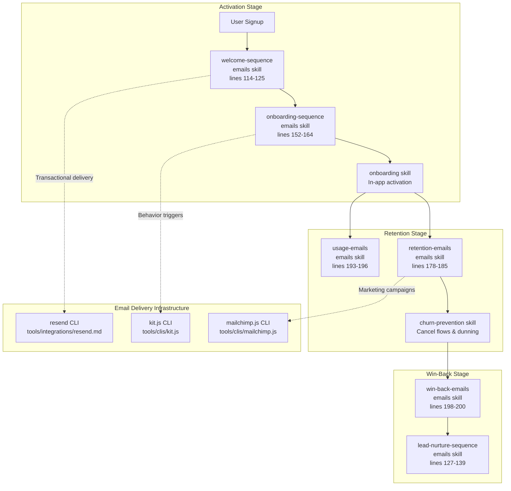
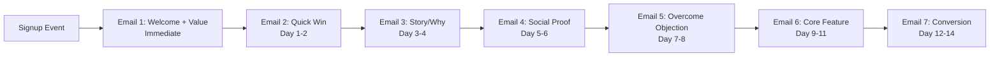
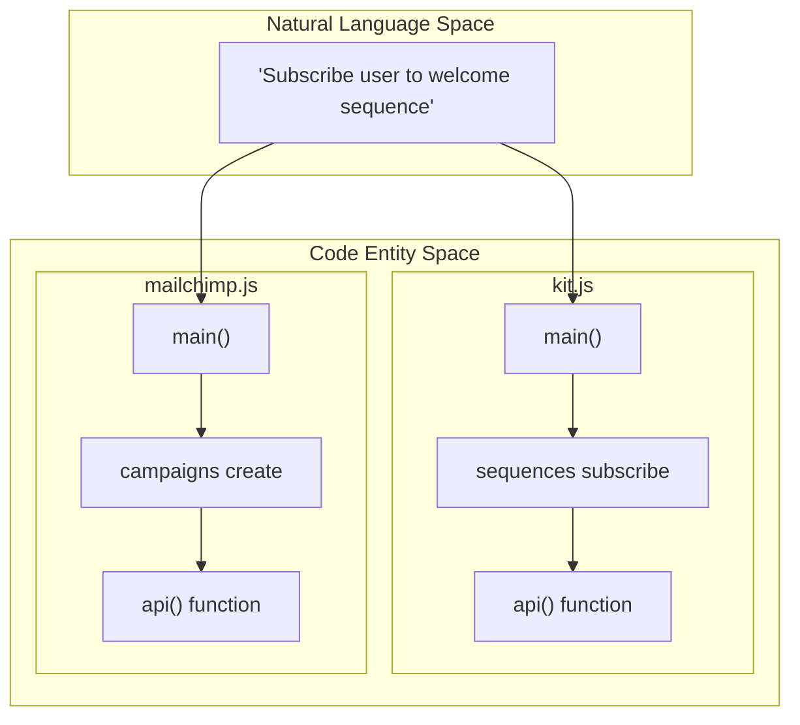
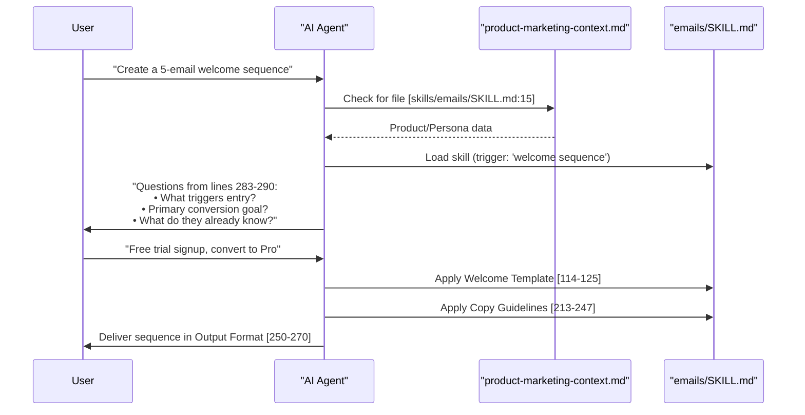

<!-- source: DeepWiki mcp.deepwiki.com · repo coreyhaines31/marketingskills · extra page Email Sequences · fetched 2026-10-26 -->

# Email Sequences

<details>
<summary>Relevant source files</summary>

The following files were used as context for generating this wiki page:

- [.claude-plugin/marketplace.json](.claude-plugin/marketplace.json)
- [.claude-plugin/plugin.json](.claude-plugin/plugin.json)
- [README.md](README.md)
- [VERSIONS.md](VERSIONS.md)

</details>


## Overview

The `email-sequence` skill provides structured guidance for designing, implementing, and optimizing automated email campaigns. This skill covers lifecycle email sequences (welcome, nurture, re-engagement, onboarding), transactional emails (billing, usage notifications), campaign emails, and win-back sequences [skills/emails/SKILL.md:3-27]().

### Skill Positioning in Marketing Stack

Email sequences coordinate with multiple other marketing capabilities:
- **Activation stage**: Works with `onboarding` to support in-app activation [skills/emails/SKILL.md:152-155]().
- **Retention stage**: Supports `churn-prevention` with win-back and dunning sequences [skills/emails/SKILL.md:198-201]().
- **Conversion stage**: Links to `copywriting` for landing pages CTAs point to [skills/emails/SKILL.md:305]().
- **Operations**: Interfaces with `revops` for lead lifecycle management (MQL/SQL stages) and handoffs [skills/revops/SKILL.md:3-4, 46-59]().
- **Referral loops**: Integrates with `referrals` to trigger sharing prompts after milestones [skills/referrals/SKILL.md:191-216]().

**Sources**: [skills/emails/SKILL.md:1-6](), [skills/emails/SKILL.md:302-308](), [skills/revops/SKILL.md:3-4](), [skills/referrals/SKILL.md:191-216]()

### Email Sequence Role in Customer Lifecycle

Title: Email Sequence Lifecycle Integration


**Sources**: [skills/emails/SKILL.md:112-208](), [skills/emails/SKILL.md:288-298](), [tools/clis/kit.js:1-5](), [tools/clis/mailchimp.js:1-11]()

---

## File Structure

The skill is defined in a single markdown file with YAML metadata:

```
skills/emails/SKILL.md
```

### Metadata

| Field | Value |
|-------|-------|
| `name` | `emails` |
| `description` | When the user wants to create or optimize an email sequence, drip campaign, automated email flow, or lifecycle email... |
| `metadata.version` | `2.0.0` |

**Sources**: [skills/emails/SKILL.md:1-6](), [VERSIONS.md:24]()

---

## Trigger Conditions and Invocation

The skill activates when user input matches trigger keywords defined in the YAML front matter [skills/emails/SKILL.md:3]().

### Trigger Keywords

| Trigger Phrase | Example User Input | Matched Intent |
|----------------|-------------------|----------------|
| `email sequence` | "Create a welcome email sequence" | Sequence design from scratch |
| `drip campaign` | "Build a drip campaign for leads" | Lead nurture automation |
| `nurture sequence` | "Set up a nurture sequence" | Educational email series |
| `onboarding emails` | "Design onboarding emails" | Post-signup activation |
| `email automation` | "Help with email automation" | General automation setup |
| `lifecycle emails` | "Audit our lifecycle emails" | Full program review |

**Sources**: [skills/emails/SKILL.md:3]()

---

## Content Structure

The skill file is organized into functional sections that guide sequence design.

### Primary Sections

| Section | Lines | Purpose |
|---------|-------|---------|
| **Initial Assessment** | [12-39]() | Determines sequence type, audience context, and goals |
| **Core Principles** | [42-63]() | Foundational rules: One Email One Job, Value Before Ask, Relevance Over Volume, Clear Path Forward |
| **Email Sequence Strategy** | [66-109]() | Tactical guidance for length, timing, subject lines, and preview text |
| **Sequence Types Overview** | [112-166]() | High-level templates for welcome, lead nurture, re-engagement, and onboarding |
| **Email Types by Category** | [170-209]() | Taxonomy of onboarding, retention, billing, usage, win-back, and campaign emails |
| **Email Copy Guidelines** | [213-247]() | Structure, formatting, tone, and CTA guidelines |
| **Output Format** | [250-270]() | Structured template for sequence deliverables |
| **Task-Specific Questions** | [283-290]() | Context-gathering questions |

**Sources**: [skills/emails/SKILL.md:1-309]()

---

## Sequence Templates

The skill defines four primary sequence templates with specific structure and timing [skills/emails/SKILL.md:112-166]().

### Sequence Template Comparison

| Sequence Type | Lines | Email Count | Duration | Primary Goal |
|--------------|-------|-------------|----------|--------------|
| **Welcome Sequence** | [114-125]() | 5-7 emails | 12-14 days | Activate, build trust, convert |
| **Lead Nurture Sequence** | [127-139]() | 6-8 emails | 2-3 weeks | Build trust, demonstrate expertise, convert |
| **Re-Engagement Sequence** | [141-150]() | 3-4 emails | 2 weeks | Win back or clean list |
| **Onboarding Sequence** | [152-164]() | 5-7 emails | 14 days | Activate, drive to "aha moment", upgrade |

**Sources**: [skills/emails/SKILL.md:112-166]()

---

### Welcome Sequence Flow

Title: Welcome Sequence Logic


**Template Structure** (defined at [skills/emails/SKILL.md:118-125]()):
1. **Welcome + deliver promised value**: Immediate delivery of the lead magnet or access.
2. **Quick win**: Helping the user achieve one small success within 48 hours.
3. **Story/Why**: Building a brand connection.
4. **Social proof**: Case studies or testimonials.
5. **Overcome objection**: Addressing common sales hurdles.
6. **Core feature highlight**: Deep dive into the product's primary value.
7. **Conversion**: The final hard push for the primary goal.

**Sources**: [skills/emails/SKILL.md:114-125]()

---

## Core Principles

The skill enforces four foundational principles that guide all sequence design decisions [skills/emails/SKILL.md:42-63]().

| Principle | Definition | Application Rules |
|-----------|-----------|------------------|
| **One Email, One Job** | Each email serves a single purpose | One main CTA per email; don't try to do everything. |
| **Value Before Ask** | Lead with usefulness before selling | Build trust through content; earn the right to sell. |
| **Relevance Over Volume** | Quality trumps quantity | Fewer, better emails; segment for relevance. |
| **Clear Path Forward** | Every email advances the relationship | Links should do something useful; make next steps obvious. |

**Sources**: [skills/emails/SKILL.md:42-63]()

---

## Email Copy Guidelines

The skill defines email structure, formatting, and tone rules to ensure consistency and readability [skills/emails/SKILL.md:213-247]().

### Email Structure
Every email follows this five-part structure [skills/emails/SKILL.md:215-220]():
1. **Hook**: First line grabs attention.
2. **Context**: Why this matters to them.
3. **Value**: The useful content.
4. **CTA**: What to do next.
5. **Sign-off**: Human, warm close.

### Formatting and Tone
- **Formatting**: Short paragraphs (1-3 sentences), bullet points for scanability, and mobile-first design [skills/emails/SKILL.md:223-227]().
- **Tone**: Conversational, first-person (I/we), and active voice [skills/emails/SKILL.md:230-233]().
- **Length**: 50-125 words for transactional; 150-300 for educational; 300-500 for story-driven [skills/emails/SKILL.md:236-238]().

**Sources**: [skills/emails/SKILL.md:213-247]()

---

## Implementation via CLI Tools

The skill provides technical instructions for executing sequences using zero-dependency CLI tools.

### Key Tool Logic
Most email CLIs follow a `main()` dispatcher pattern [tools/clis/mailchimp.js:58-61]() and a centralized `api()` function for authenticated requests [tools/clis/kit.js:12-57]().

| Tool | CLI Implementation | Key Command |
|------|----------|----------|
| **Kit (ConvertKit)** | `tools/clis/kit.js` | `sequences subscribe <id> --email <email>` [tools/clis/kit.js:144-153]() |
| **Mailchimp** | `tools/clis/mailchimp.js` | `campaigns create --list-id <id> --subject <subject>` [tools/clis/mailchimp.js:151-166]() |
| **Resend** | `tools/integrations/resend.md` | `resend emails send --from <f> --to <t> --subject <s>` [tools/integrations/resend.md:39]() |

### Code Entity Mapping

Title: Language to Code Entity Mapping


**Sources**: [tools/clis/kit.js:58-82](), [tools/clis/kit.js:139-159](), [tools/clis/mailchimp.js:58-61](), [tools/clis/mailchimp.js:151-174]()

---

## Context Gathering Flow

When a user requests an email sequence, the AI agent follows this execution path to ensure the output matches the product marketing context.

Title: Sequence Generation Flow


**Sources**: [skills/emails/SKILL.md:12-39](), [skills/emails/SKILL.md:283-290](), [skills/emails/SKILL.md:250-270]()

---

