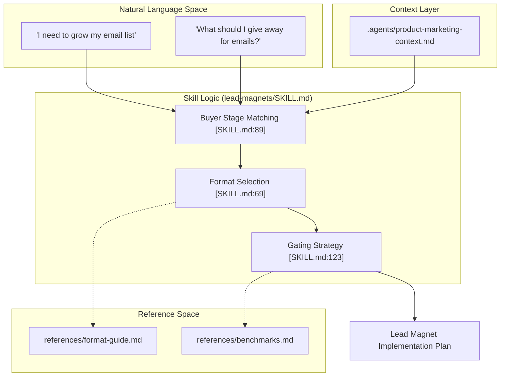
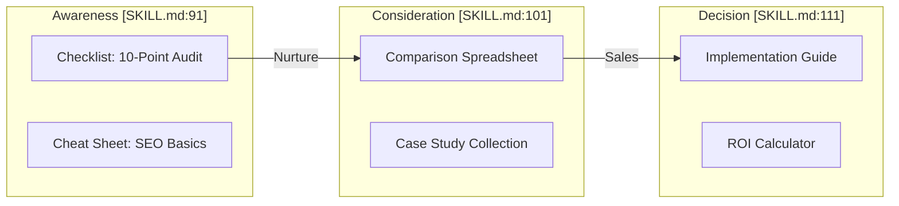
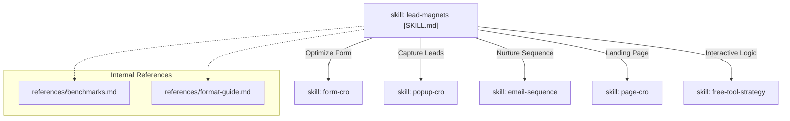

<!-- source: DeepWiki mcp.deepwiki.com · repo coreyhaines31/marketingskills · extra page Lead Magnets · fetched 2026-10-26 -->

# Lead Magnets

Relevant source files

The following files were used as context for generating this wiki page:

- [skills/lead-magnets/SKILL.md](skills/lead-magnets/SKILL.md)
- [skills/lead-magnets/references/benchmarks.md](skills/lead-magnets/references/benchmarks.md)
- [skills/lead-magnets/references/format-guide.md](skills/lead-magnets/references/format-guide.md)

The `lead-magnets` skill provides a technical and strategic framework for planning, creating, and optimizing high-conversion downloadable assets. This skill focuses on the "value exchange" of information for contact details, specifically for email capture and lead generation.

It is distinct from:
*   **`free-tool-strategy`**: Which handles interactive, code-based utilities (calculators, generators).
*   **`copywriting`**: Which handles the actual prose generation within the magnet.
*   **`email-sequence`**: Which handles the post-capture nurture flow.

## System Overview

The Lead Magnet system operates as a decision engine that matches business goals and buyer stages to specific content formats and gating strategies. It relies heavily on the `product-marketing-context.md` to align the offer with the product's value proposition.

### Core Data Flow

Title: Lead Magnet Planning Logic Flow

**Sources:** [skills/lead-magnets/SKILL.md:1-15](), [skills/lead-magnets/SKILL.md:150-152](), [skills/lead-magnets/references/format-guide.md:1-14]()

## Format Selection Framework

The skill categorizes magnets based on effort, time-to-create, and psychological "perceived value."

| Format | Best For | Effort | Creation Time | DIY Cost |
| :--- | :--- | :--- | :--- | :--- |
| **Checklist** | Quick wins, process steps | Low | 1-2 hours | Free |
| **Template** | Repeatable workflows (Notion/Sheet) | Low-Med | 2-8 hours | Free |
| **Swipe File** | Inspiration, examples | Medium | 4-8 hours | Free |
| **Quiz/Assessment** | Segmentation, engagement | Medium | 1-2 weeks | $0-100/mo |
| **Ebook/Guide** | Deep education, authority | High | 1-3 weeks | Free |
| **Mini-course** | Education + personality | High | 2-4 weeks | $0-200 (gear) |

**Sources:** [skills/lead-magnets/SKILL.md:69-84](), [skills/lead-magnets/references/benchmarks.md:89-101](), [skills/lead-magnets/references/format-guide.md:1-14]()

## Implementation Logic

### 1. Buyer Stage Alignment
The system maps the lead magnet to the user's journey to ensure relevance and conversion.

Title: Buyer Journey Mapping to Content Entities

**Sources:** [skills/lead-magnets/SKILL.md:89-120]()

### 2. Gating and Delivery Strategy
The skill evaluates the friction-to-value ratio to determine the optimal gating strategy.

*   **Full Gate**: High-value content, bottom-funnel. Max capture, lower reach. [skills/lead-magnets/SKILL.md:129]()
*   **Partial Gate**: Preview + full version. Balance of reach and capture. [skills/lead-magnets/SKILL.md:130]()
*   **Content Upgrade**: Blog post + bonus. Contextual, high-intent. [skills/lead-magnets/SKILL.md:132]()

**Delivery Methods:**
*   **Instant Download**: Immediate gratification but no email verification. [skills/lead-magnets/SKILL.md:172]()
*   **Email Delivery**: Verifies email and starts the relationship. [skills/lead-magnets/SKILL.md:173]()
*   **Thank You Page + Email**: Best of both worlds—instant access + email copy. [skills/lead-magnets/SKILL.md:174]()

**Sources:** [skills/lead-magnets/SKILL.md:123-142](), [skills/lead-magnets/SKILL.md:168-176]()

## Technical Reference: Benchmarks

The `references/benchmarks.md` file provides baseline metrics for evaluating proposed strategies.

| Format | Landing Page Conversion | Quality Signal |
| :--- | :--- | :--- |
| **Checklist** | 30-50% | Low-Medium |
| **Template** | 25-45% | High |
| **Ebook/Guide** | 20-35% | Medium |
| **Quiz** | 30-50% | Medium (Segmentable) |
| **Free Trial** | 5-15% | Very High |

**Sources:** [skills/lead-magnets/references/benchmarks.md:7-21](), [skills/lead-magnets/references/benchmarks.md:62-72]()

## Detailed Creation Guidance

For each format, the system provides structural and technical guidelines to ensure professional delivery.

### Templates and Spreadsheets
*   **Spreadsheets**: Must include a "How to Use" tab, pre-filled example data, and locked formula cells. [skills/lead-magnets/references/format-guide.md:86-91]()
*   **Notion**: Requires a duplicate link, a getting-started guide, and utilization of database views/filters. [skills/lead-magnets/references/format-guide.md:94-99]()
*   **Principle**: Templates should be usable within 5 minutes of downloading. [skills/lead-magnets/references/format-guide.md:107]()

### Mini-Courses
*   **Email-Based**: 3-5 emails over 5-7 days; structure follows teach → example → exercise. [skills/lead-magnets/references/format-guide.md:136-139]()
*   **Video-Based**: 3-5 videos (5-15 mins each) hosted on unlisted YouTube or Loom. [skills/lead-magnets/references/format-guide.md:143-145]()

**Sources:** [skills/lead-magnets/references/format-guide.md:82-152]()

## Cross-Skill Integration

The `lead-magnets` skill acts as a hub, delegating specific technical tasks to other modules in the ecosystem.

Title: Lead Magnet Skill Dependency Graph

**Sources:** [skills/lead-magnets/SKILL.md:150-151](), [skills/lead-magnets/SKILL.md:166](), [skills/lead-magnets/references/format-guide.md:174]()

## Optimization Principles

When implementing a lead magnet, the following criteria must be met for "High Perceived Value":
1.  **Specificity**: Address one clear pain point (e.g., "How to write cold emails that get replies" > "Marketing guide"). [skills/lead-magnets/SKILL.md:43-46]()
2.  **Consumability**: Target under 10-30 minutes of investment. [skills/lead-magnets/SKILL.md:52-55]()
3.  **Natural Path to Product**: Solve a problem that demonstrates your expertise or highlights a gap your product fills. [skills/lead-magnets/SKILL.md:57-61]()
4.  **Low Friction**: Request the minimum fields needed. Every extra field reduces conversion by 5-10%. [skills/lead-magnets/SKILL.md:134-141]()

**Sources:** [skills/lead-magnets/SKILL.md:41-66](), [skills/lead-magnets/SKILL.md:134-142]()

---

