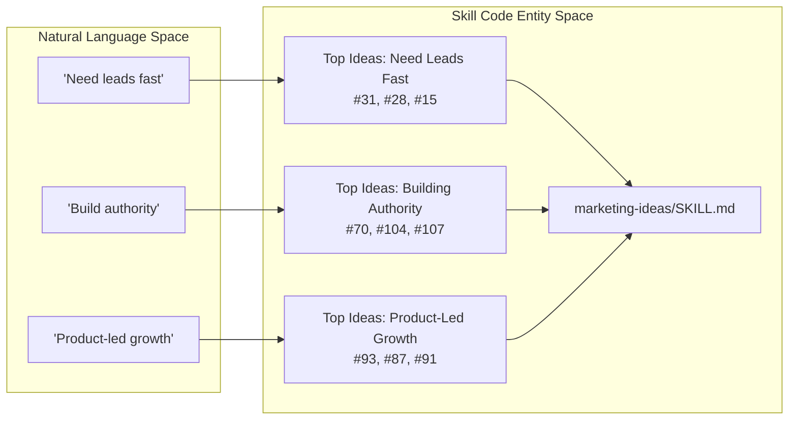
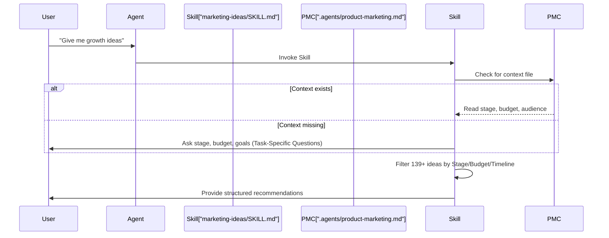

<!-- source: DeepWiki mcp.deepwiki.com · repo coreyhaines31/marketingskills · extra page Marketing Ideas · fetched 2026-10-26 -->

# Marketing Ideas

<details>
<summary>Relevant source files</summary>

The following files were used as context for generating this wiki page:

- [skills/marketing-ideas/SKILL.md](skills/marketing-ideas/SKILL.md)
- [skills/marketing-ideas/references/ideas-by-category.md](skills/marketing-ideas/references/ideas-by-category.md)
- [skills/programmatic-seo/references/playbooks.md](skills/programmatic-seo/references/playbooks.md)

</details>


## Purpose and Scope

This page documents the `marketing-ideas` skill, a strategic knowledge module containing 139+ proven SaaS marketing tactics organized into actionable frameworks. The skill serves as a tactical library for technical marketers and founders who need specific marketing strategies matched to their product stage, budget, and resources. [skills/marketing-ideas/SKILL.md:8-10]()

For hands-on implementation of specific tactics, see related skills: `programmatic-seo` for scaled content tactics, `competitors` for comparison pages, `free-tools` for engineering-as-marketing approaches, `referrals` for viral growth loops, and `emails` for automated lifecycle marketing. [skills/marketing-ideas/SKILL.md:161-168]()

**Sources:** [skills/marketing-ideas/SKILL.md:1-10](), [skills/marketing-ideas/SKILL.md:161-168]()

---

## Skill Architecture

The `marketing-ideas` skill implements a hierarchical organization system that maps discrete marketing tactics to multiple decision frameworks, enabling AI agents to recommend appropriate strategies based on user context. [skills/marketing-ideas/SKILL.md:10-22]()

### File Structure

```
skills/marketing-ideas/
├── SKILL.md                           # Main skill definition & logic
├── evals/
│   └── evals.json                     # Automated evaluation cases
└── references/
    └── ideas-by-category.md           # Complete list of 139+ tactics
```

The skill uses a two-file architecture where `SKILL.md` contains the metadata, usage patterns, and organizational frameworks, while a reference file `references/ideas-by-category.md` stores the complete tactical library. [skills/marketing-ideas/SKILL.md:47]()

**Sources:** [skills/marketing-ideas/SKILL.md:1-6](), [skills/marketing-ideas/SKILL.md:47]()

---

## Metadata and Trigger Patterns

### Skill Definition

The skill header declares its identity and activation criteria:

```yaml
name: marketing-ideas
description: "When the user needs marketing ideas, inspiration, or strategies for their SaaS or software product..."
metadata:
  version: 2.0.0
```

**Sources:** [skills/marketing-ideas/SKILL.md:1-6]()

### Natural Language Triggers

The skill activates on these user inputs:

| Trigger Type | Examples |
|--------------|----------|
| Direct requests | "marketing ideas", "growth ideas", "marketing strategies", "brainstorm marketing" |
| Strategic questions | "how to market", "ways to promote", "ideas to grow", "what else can I try" |
| Tactical inquiries | "marketing tactics", "I don't know how to market this" |

**Sources:** [skills/marketing-ideas/SKILL.md:3]()

---

## Organizational Framework

### Category-Based Organization

The skill organizes tactics into functional categories, providing a structural index for quick navigation. [skills/marketing-ideas/SKILL.md:25-45]()

**Marketing Ideas Category Map**

```mermaid
graph TB
    MKT_IDEAS["marketing-ideas skill"]
    
    subgraph "Content & Discovery"
        CAT_CONTENT["Content & SEO<br/>Ideas 1-10"]
        CAT_FORMATS["Content Formats<br/>Ideas 97-109"]
    end
    
    subgraph "Acquisition & Paid"
        CAT_COMP["Competitor<br/>Ideas 11-13"]
        CAT_TOOLS["Free Tools<br/>Ideas 14-22"]
        CAT_PAID["Paid Ads<br/>Ideas 23-34"]
    end
    
    subgraph "Channels & Growth"
        CAT_SOCIAL["Social & Community<br/>Ideas 35-44"]
        CAT_EMAIL["Email<br/>Ideas 45-53"]
        CAT_PARTNER["Partnerships<br/>Ideas 54-64"]
        CAT_PLG["Product-Led<br/>Ideas 87-96"]
    end
    
    subgraph "Outreach & Authority"
        CAT_EVENTS["Events<br/>Ideas 65-72"]
        CAT_PR["PR & Media<br/>Ideas 73-76"]
        CAT_LAUNCH["Launches<br/>Ideas 77-86"]
        CAT_UNCONV["Unconventional<br/>Ideas 110-122"]
    end
    
    MKT_IDEAS --> CAT_CONTENT
    MKT_IDEAS --> CAT_COMP
    MKT_IDEAS --> CAT_TOOLS
    MKT_IDEAS --> CAT_PAID
    MKT_IDEAS --> CAT_SOCIAL
    MKT_IDEAS --> CAT_EMAIL
    MKT_IDEAS --> CAT_PARTNER
    MKT_IDEAS --> CAT_EVENTS
    MKT_IDEAS --> CAT_PR
    MKT_IDEAS --> CAT_LAUNCH
    MKT_IDEAS --> CAT_PLG
    MKT_IDEAS --> CAT_FORMATS
    MKT_IDEAS --> CAT_UNCONV
```


**Sources:** [skills/marketing-ideas/SKILL.md:25-45]()

### Category Quick Reference Table

| Category | Idea Range | Key Examples |
|----------|-----------|--------------|
| Content & SEO | 1-10 | Programmatic SEO, Glossary marketing, Content repurposing [skills/marketing-ideas/references/ideas-by-category.md:24-34]() |
| Competitor | 11-13 | Comparison pages, Marketing jiu-jitsu [skills/marketing-ideas/references/ideas-by-category.md:48-52]() |
| Free Tools | 14-22 | Calculators, Generators, Chrome extensions [skills/marketing-ideas/references/ideas-by-category.md:58-70]() |
| Paid Ads | 23-34 | LinkedIn, Google, Retargeting, Podcast ads [skills/marketing-ideas/references/ideas-by-category.md:80-104]() |
| Social & Community | 35-44 | LinkedIn audience, Reddit marketing, Short-form video [skills/marketing-ideas/references/ideas-by-category.md:108-124]() |
| Email | 45-53 | Founder emails, Onboarding sequences, Win-back [skills/marketing-ideas/references/ideas-by-category.md:132-140]() |
| Partnerships | 54-64 | Affiliate programs, Integration marketing, Newsletter swaps [skills/marketing-ideas/SKILL.md:35]() |
| Events | 65-72 | Webinars, Conference speaking, Virtual summits [skills/marketing-ideas/SKILL.md:36]() |
| PR & Media | 73-76 | Press coverage, Documentaries [skills/marketing-ideas/SKILL.md:37]() |
| Launches | 77-86 | Product Hunt, Lifetime deals, Giveaways [skills/marketing-ideas/SKILL.md:38]() |
| Product-Led | 87-96 | Viral loops, Powered-by marketing, Free migrations [skills/marketing-ideas/SKILL.md:39]() |
| Content Formats | 97-109 | Podcasts, Courses, Annual reports, Year wraps [skills/marketing-ideas/SKILL.md:40]() |
| Unconventional | 110-122 | Awards, Challenges, Guerrilla marketing [skills/marketing-ideas/SKILL.md:41]() |
| Platforms | 123-130 | App marketplaces, Review sites, YouTube [skills/marketing-ideas/SKILL.md:42]() |
| International | 131-132 | Expansion, Price localization [skills/marketing-ideas/SKILL.md:43]() |
| Developer | 133-136 | DevRel, Certifications [skills/marketing-ideas/SKILL.md:44]() |
| Audience-Specific | 137-139 | Referrals, Podcast tours, Customer language [skills/marketing-ideas/SKILL.md:45]() |

**Sources:** [skills/marketing-ideas/SKILL.md:27-45](), [skills/marketing-ideas/references/ideas-by-category.md:1-140]()

---

## Multi-Dimensional Filtering Framework

The skill implements parallel organizational dimensions that map tactics to different decision contexts. [skills/marketing-ideas/SKILL.md:51-108]()

### Stage-Based Filtering

| Stage | Tactics | Examples |
|-------|---------|----------|
| **Pre-launch** | Referral loops, Pricing, Hype | Waitlist referrals (#79), Early access pricing (#81), Product Hunt prep (#78) |
| **Early stage** | High-effort, low-cost | Content & SEO (#1-10), Community (#35), Founder-led sales (#47) |
| **Growth stage** | Scalable channels | Paid acquisition (#23-34), Partnerships (#54-64), Events (#65-72) |
| **Scale** | Brand and expansion | Brand campaigns, International (#131-132), Media acquisitions (#73) |

**Sources:** [skills/marketing-ideas/SKILL.md:55-73]()

### Budget and Timeline Filtering

Tactics are categorized by resource requirements and time-to-impact. [skills/marketing-ideas/SKILL.md:75-108]()

| Filter Type | Category | Tactics |
|-------------|----------|---------|
| **Budget** | Free | Content & SEO, Community building, Social media, Comment marketing |
| | Low | Targeted ads, Sponsorships, Free tools |
| | High | Acquisitions, Conferences, Brand campaigns |
| **Timeline** | Quick wins | Ads, email, social posts |
| | Medium-term | Content, SEO, community |
| | Long-term | Brand, thought leadership, platform effects |

**Sources:** [skills/marketing-ideas/SKILL.md:77-107]()

---

## Use-Case Filtering

The skill provides pre-filtered tactical recommendations for common scenarios. [skills/marketing-ideas/SKILL.md:111-137]()

**Use-Case to Code Entity Mapping**


**Sources:** [skills/marketing-ideas/SKILL.md:113-132]()

---

## Context Gathering Workflow

The skill implements a structured context-gathering protocol before recommending tactics. [skills/marketing-ideas/SKILL.md:14-21]()

**Skill Execution Logic**


**Sources:** [skills/marketing-ideas/SKILL.md:14-21](), [skills/marketing-ideas/SKILL.md:152-157]()

---

## Recommendation Output Format

For each recommended tactic, the skill outputs a standardized structure to ensure actionable advice. [skills/marketing-ideas/SKILL.md:140-149]()

```markdown
- **Idea name**: One-line description
- **Why it fits**: Connection to their situation
- **How to start**: First 2-3 implementation steps
- **Expected outcome**: What success looks like
- **Resources needed**: Time, budget, skills required
```

**Sources:** [skills/marketing-ideas/SKILL.md:142-148]()

---

## Related Skills

The `marketing-ideas` skill acts as a "hub" that references specialized implementation skills. [skills/marketing-ideas/SKILL.md:161-168]()

| Implementation Skill | Connection |
|----------------------|------------|
| `marketing-plan` | For comprehensive AARRR planning and section 12 cross-referencing [skills/marketing-ideas/SKILL.md:163]() |
| `programmatic-seo` | For scaling SEO content (#4) using playbooks like templates or glossaries [skills/marketing-ideas/SKILL.md:164](); [skills/programmatic-seo/references/playbooks.md:20-201]() |
| `competitors` | For comparison pages (#11) [skills/marketing-ideas/SKILL.md:165]() |
| `emails` | For email marketing tactics [skills/marketing-ideas/SKILL.md:166]() |
| `free-tools` | For engineering as marketing (#15) [skills/marketing-ideas/SKILL.md:167]() |
| `referrals` | For viral growth (#93) [skills/marketing-ideas/SKILL.md:168]() |

**Sources:** [skills/marketing-ideas/SKILL.md:163-168](), [skills/programmatic-seo/references/playbooks.md:20-201]()

---

