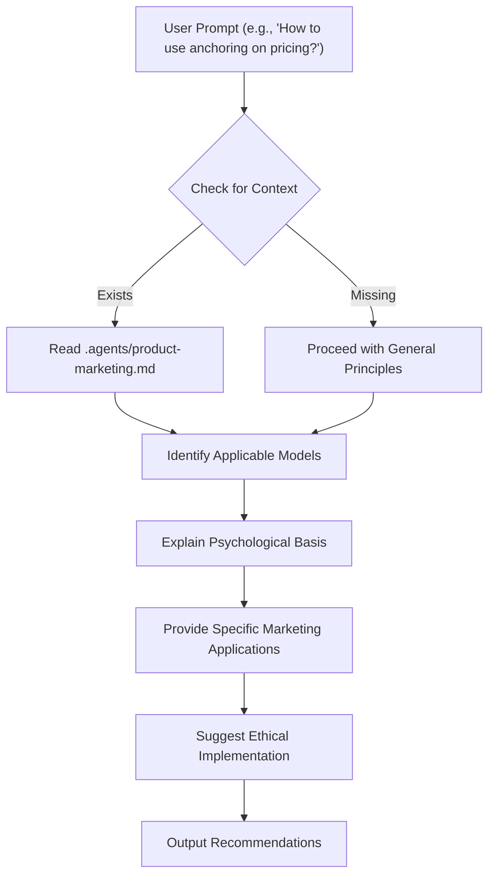
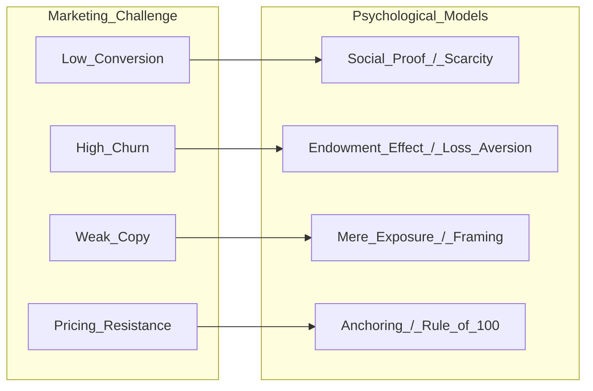

<!-- source: DeepWiki mcp.deepwiki.com · repo coreyhaines31/marketingskills · extra page Marketing Psychology · fetched 2026-10-26 -->

# Marketing Psychology

Relevant source files

The following files were used as context for generating this wiki page:

- [skills/marketing-psychology/SKILL.md](skills/marketing-psychology/SKILL.md)
- [skills/marketing-psychology/evals/evals.json](skills/marketing-psychology/evals/evals.json)
- [skills/sales-enablement/evals/evals.json](skills/sales-enablement/evals/evals.json)

The `marketing-psychology` skill provides a framework for applying behavioral science, cognitive biases, and mental models to marketing strategy, copywriting, and product design. It serves as a knowledge layer that translates abstract psychological principles into actionable tactics for increasing conversions, improving retention, and understanding consumer decision-making.

## Purpose and Scope

This skill is designed to help AI agents and marketers move beyond "best practices" by understanding the underlying drivers of human behavior. It covers:
*   **Foundational Thinking Models**: Strategic frameworks like First Principles, Inversion, and Second-Order Thinking to solve marketing problems [skills/marketing-psychology/SKILL.md:30-84]().
*   **Behavioral Science Principles**: Tactical biases such as Anchoring, Loss Aversion, and Social Proof [skills/marketing-psychology/SKILL.md:102-135]().
*   **Product Psychology**: Models for onboarding and engagement like the IKEA Effect, Goal-Gradient Effect, and Zeigarnik Effect [skills/marketing-psychology/SKILL.md:136-150]().
*   **Jobs to Be Done (JTBD)**: Framing products around outcomes rather than features [skills/marketing-psychology/SKILL.md:35-38]().
*   **Ethical Implementation**: Guidelines for using persuasion without manipulation, distinguishing real constraints from manufactured urgency [skills/marketing-psychology/evals/evals.json:21-30]().

Sources: [skills/marketing-psychology/SKILL.md:1-11](), [skills/marketing-psychology/evals/evals.json:21-30]()

## Core Implementation Logic

The skill operates by intercepting natural language requests related to "psychology," "persuasion," or specific biases and mapping them to a taxonomy of models. It follows a strict execution flow to ensure recommendations are grounded in the specific product's context.

### Execution Flow

Sources: [skills/marketing-psychology/SKILL.md:12-23](), [skills/marketing-psychology/evals/evals.json:6-17]()

## Key Psychological Principles

The skill categorizes principles based on the marketing challenge they solve.

### 1. Pricing & Value Perception
| Principle | Description | Marketing Application |
| :--- | :--- | :--- |
| **Anchoring** | People rely heavily on the first piece of information offered. | Show the most expensive plan first or use a decoy plan to make others look cheaper [skills/marketing-psychology/evals/evals.json:7](). |
| **Loss Aversion** | The pain of losing is twice as powerful as the joy of gaining. | Frame features as "What you lose by not upgrading" [skills/marketing-psychology/evals/evals.json:12](). |
| **Zero-Price Effect** | "Free" triggers an irrational emotional response. | Use free trials to remove the initial psychological barrier to start [skills/marketing-psychology/evals/evals.json:68](). |
| **Rule of 100** | For prices under 100, use percentage discounts; over 100, use dollar amounts. | "20% off" a $30 item vs "$500 off" a $2000 item [skills/marketing-psychology/evals/evals.json:10](). |
| **Charm Pricing** | Prices ending in .99 are perceived as significantly lower. | Consider $29 vs $30 to trigger "left-digit effect" [skills/marketing-psychology/evals/evals.json:7](). |

Sources: [skills/marketing-psychology/evals/evals.json:6-17](), [skills/marketing-psychology/evals/evals.json:63-72]()

### 2. Engagement & Product Adoption
| Principle | Description | Marketing Application |
| :--- | :--- | :--- |
| **IKEA Effect** | Users value products more if they helped build them. | Let users customize their dashboard or setup during onboarding [skills/marketing-psychology/evals/evals.json:50](). |
| **Goal-Gradient Effect** | Motivation increases as users get closer to a goal. | Use progress bars in sign-up flows that start partially complete [skills/marketing-psychology/evals/evals.json:50](). |
| **Zeigarnik Effect** | People remember uncompleted tasks better than completed ones. | Use checklists to drive users back to finish setup [skills/marketing-psychology/evals/evals.json:50](). |
| **Endowment Effect** | People value things more once they feel they own them. | Let users experience ownership during a trial to increase conversion [skills/marketing-psychology/evals/evals.json:64](). |

Sources: [skills/marketing-psychology/evals/evals.json:49-60](), [skills/marketing-psychology/evals/evals.json:63-72]()

## Quick-Reference Taxonomy

The skill includes a mapping system to match psychological principles to specific marketing challenges.

### Challenge-to-Model Mapping

Sources: [skills/marketing-psychology/evals/evals.json:34-45](), [skills/marketing-psychology/SKILL.md:102-135]()

## System Integration & Evals

The `marketing-psychology` skill is a "cross-cutting" skill, meaning it is often called by other skills to enhance their output.

### Skill Interdependencies
*   **`page-cro`**: Uses psychology for layout and CTA optimization.
*   **`copywriting`**: Uses framing and emotional triggers for better messaging [skills/marketing-psychology/evals/evals.json:36]().
*   **`onboarding-cro`**: Uses the Goal-Gradient and Zeigarnik effects [skills/marketing-psychology/evals/evals.json:50]().
*   **`pricing-strategy`**: Uses anchoring and the Zero-Price Effect [skills/marketing-psychology/evals/evals.json:7]().
*   **`ab-test-setup`**: Psychology provides the hypothesis (e.g., Scarcity vs Social Proof), while `ab-test-setup` handles the experiment design [skills/marketing-psychology/evals/evals.json:77-84]().

Sources: [skills/marketing-psychology/evals/evals.json:77-86](), [skills/marketing-psychology/evals/evals.json:49-60]()

### Evaluation Assertions
The system ensures quality through automated evals defined in `skills/marketing-psychology/evals/evals.json`. The `evals` check for:
1.  **Context Awareness**: Must check for `product-marketing.md` [skills/marketing-psychology/evals/evals.json:9]().
2.  **Model Identification**: Must reference specific mental models by name (e.g., "Rule of 100") [skills/marketing-psychology/evals/evals.json:15]().
3.  **Ethical Boundary**: Must distinguish between ethical persuasion and manipulative "dark patterns" [skills/marketing-psychology/evals/evals.json:29]().
4.  **Actionability**: Recommendations must be tied to specific user price points or UI elements [skills/marketing-psychology/evals/evals.json:14]().

Sources: [skills/marketing-psychology/evals/evals.json:1-88]()

---

