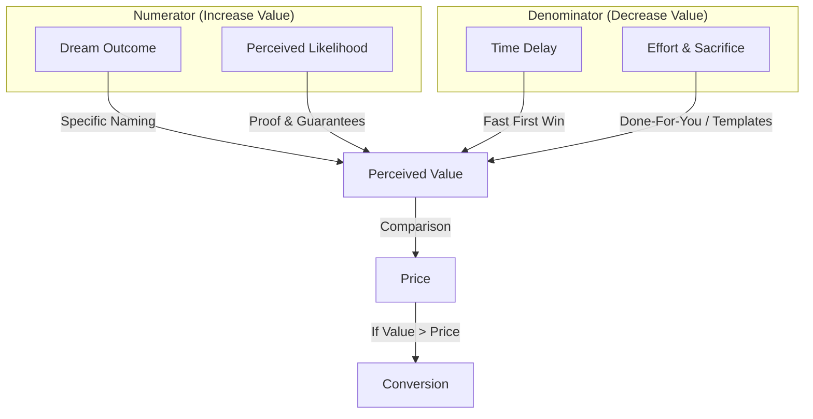
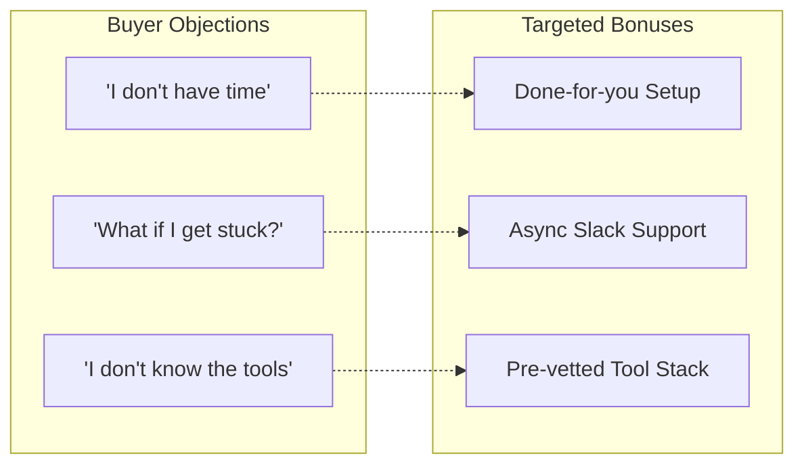

<!-- source: DeepWiki mcp.deepwiki.com · repo coreyhaines31/marketingskills · extra page Offer Design · fetched 2026-10-26 -->

# Offer Design

Relevant source files

The following files were used as context for generating this wiki page:

- [skills/offers/SKILL.md](skills/offers/SKILL.md)
- [skills/offers/references/bonus-stacking.md](skills/offers/references/bonus-stacking.md)
- [skills/offers/references/examples.md](skills/offers/references/examples.md)
- [skills/offers/references/guarantee-design.md](skills/offers/references/guarantee-design.md)
- [skills/offers/references/offer-anatomy.md](skills/offers/references/offer-anatomy.md)
- [skills/offers/references/offer-formats.md](skills/offers/references/offer-formats.md)
- [skills/offers/references/scarcity-urgency.md](skills/offers/references/scarcity-urgency.md)
- [skills/offers/references/value-equation.md](skills/offers/references/value-equation.md)

The **offers** skill (added v2.5.0) focuses on designing the core value proposition of what is being sold. It distinguishes itself from **pricing** (which handles tiers and packaging), **copywriting** (which handles the expression of the offer), and **launch** (the orchestration of the sales moment) by addressing the structural components that determine conversion: value framing, risk reversal, and urgency [skills/offers/SKILL.md:3-5](), [skills/offers/SKILL.md:21-23]().

## Core Philosophy: The Value Equation

The fundamental framework for offer design in this codebase is the **Value Equation**, adapted from the $100M Offers framework [skills/offers/SKILL.md:45-53](). It defines value through four levers:

1.  **Dream Outcome (↑)**: The specific, named goal the customer actually wants to achieve, usually emotional or identity-based [skills/offers/references/value-equation.md:19-21](), [skills/offers/references/value-equation.md:37-38]().
2.  **Perceived Likelihood of Achievement (↑)**: The buyer's belief that the outcome is possible for them, driven by proof, methodology specificity, and guarantees [skills/offers/references/value-equation.md:46-56]().
3.  **Time Delay (↓)**: The duration between purchase and the first win or final result [skills/offers/references/value-equation.md:64-67]().
4.  **Effort & Sacrifice (↓)**: The non-monetary cost to the buyer, including time, learning curves, and decisions [skills/offers/references/value-equation.md:82-84]().

### Value Equation Implementation Logic

*Sources: [skills/offers/SKILL.md:49-62](), [skills/offers/references/value-equation.md:7-13]()*

## Offer Anatomy: The Six Components

A complete offer is constructed from six specific components. Omitting any single component typically results in a measurable drop in conversion [skills/offers/references/offer-anatomy.md:3-5]().

| # | Component | Technical Role | Common Failure |
|---|-----------|----------------|----------------|
| 1 | **Core Deliverable** | Defines the outcome-based scope [skills/offers/references/offer-anatomy.md:18-22]() | Pitching features instead of outcomes |
| 2 | **Bonus Stack** | Handles objections and raises perceived value [skills/offers/references/offer-anatomy.md:53-61]() | Generic "extras" or inflated values |
| 3 | **Guarantee** | Reverses risk to increase likelihood [skills/offers/references/offer-anatomy.md:89-94]() | Wrong type for the business model |
| 4 | **Scarcity / Urgency** | Forces a decision timeline [skills/offers/references/offer-anatomy.md:104-107]() | Using fake/dishonest triggers |
| 5 | **Name** | Creates a repeatable, branded asset [skills/offers/references/offer-anatomy.md:125-133]() | Using internal jargon or generic terms |
| 6 | **Price Structure** | Defines payment flexibility and anchoring [skills/offers/references/offer-anatomy.md:154-156]() | Single price point with no flexibility |

*Sources: [skills/offers/SKILL.md:70-85](), [skills/offers/references/offer-anatomy.md:7-14]()*

## Guarantee Design and Risk Reversal

A guarantee directly raises perceived likelihood of achievement and lowers emotional risk [skills/offers/references/guarantee-design.md:3-4](). The system defines eight distinct guarantee types to match different business models [skills/offers/references/guarantee-design.md:7-19]():

1.  **Unconditional Money-Back**: "Refund anytime within X days, no questions" (Low-priced info, high-trust audience) [skills/offers/references/guarantee-design.md:11]().
2.  **Conditional Money-Back**: "Refund if you complete X and still don't see Y" (Courses/Programs) [skills/offers/references/guarantee-design.md:12]().
3.  **Better-Than-Money-Back**: "If it doesn't work, full refund + $X" (Confident delivery) [skills/offers/references/guarantee-design.md:13]().
4.  **Service-Level (SLA)**: "If we don't deliver X by Y, your money back" (Productized services) [skills/offers/references/guarantee-design.md:14]().
5.  **Performance-Based**: "Pay only when X happens" (B2B, rev-share) [skills/offers/references/guarantee-design.md:15]().
6.  **Anti-Guarantee**: "No refunds. Make sure you want it" (Premium/High-status) [skills/offers/references/guarantee-design.md:16]().
7.  **Outcome-or-Extension**: "If you don't get X by Y, we continue free" (Coaching) [skills/offers/references/guarantee-design.md:17]().
8.  **Comparison Guarantee**: "Beat [competitor]'s result or refund" [skills/offers/references/guarantee-design.md:18]().

*Sources: [skills/offers/references/guarantee-design.md:7-19]()*

## Bonus Stacking as Objection Handling

The codebase treats bonuses as functional tools to close specific buying objections [skills/offers/references/bonus-stacking.md:17-19](). A 4-bonus stack that closes 4 specific objections converts better than generic extras [skills/offers/references/bonus-stacking.md:36-37]().

### Objection-Bonus Mapping

*Sources: [skills/offers/references/bonus-stacking.md:21-35](), [skills/offers/references/offer-anatomy.md:66-73]()*

## Scarcity and Urgency Implementation

The system strictly enforces **Honest Scarcity** [skills/offers/references/scarcity-urgency.md:7-8](). Fake countdown timers or manufactured inventory limits are explicitly discouraged as they destroy long-term brand trust [skills/offers/references/scarcity-urgency.md:118-126]().

*   **Scarcity (Quantity)**: Capacity-based (N slots/quarter), Cohort size, or physical inventory [skills/offers/references/scarcity-urgency.md:24-38](), [skills/offers/references/scarcity-urgency.md:48-52]().
*   **Urgency (Time)**: Hard deadlines for cohorts, seasonal windows, or bonus expiration [skills/offers/references/scarcity-urgency.md:32-36](), [skills/offers/references/scarcity-urgency.md:56-71]().

## Diagnostic Workflow

When the `offers` skill is triggered, the agent follows a specific diagnostic loop [skills/offers/SKILL.md:103-114]():

1.  **Identify Business Type**: Selects the appropriate playbook (Service, Course, SaaS, etc.) [skills/offers/references/offer-formats.md:1-5]().
2.  **Score the Value Equation**: Rates each of the four levers 1–10 to find the binding constraint [skills/offers/references/value-equation.md:101-111]().
3.  **Audit Anatomy**: Checks for missing or weak components among the six [skills/offers/references/offer-anatomy.md:7-14]().
4.  **Iterate One Lever**: Recommends a single change (e.g., naming the methodology) to unblock the offer [skills/offers/SKILL.md:111-113]().

### Offer Formats by Business Type

The skill provides tailored defaults for different models [skills/offers/references/offer-formats.md:1-5]():

| Business Type | Core Focus | Preferred Guarantee |
|---------------|------------|---------------------|
| **Service** | Scoped engagement [skills/offers/references/offer-formats.md:17]() | First-milestone gate [skills/offers/references/offer-formats.md:19]() |
| **Course** | Curriculum + Delivery [skills/offers/references/offer-formats.md:53]() | Conditional money-back [skills/offers/references/offer-formats.md:55]() |
| **B2B SaaS** | Implementation/Time-to-Value [skills/offers/references/examples.md:132]() | SLA or pilot-gated [skills/offers/references/offer-formats.md:144]() |
| **Info Product** | Packaged assets [skills/offers/references/offer-formats.md:119]() | Unconditional (30-day) [skills/offers/references/offer-formats.md:121]() |

### Before/After Transformation Logic

The skill provides six anonymized examples to demonstrate how these components transform weak offers into high-converting ones [skills/offers/references/examples.md:1-160]().

*   **Fractional CMO**: Shifted from vague "growth" to "The 90-Day Marketing Reset" with a paid audit gate [skills/offers/references/examples.md:7-36]().
*   **High-Ticket Course**: Renamed to "The $5K Sales Page Bootcamp" with a conditional refund based on landing a client [skills/offers/references/examples.md:40-70]().
*   **Notion Template**: Anchored to the "in one Saturday" outcome to reduce perceived effort [skills/offers/references/examples.md:72-102]().
*   **Enterprise SaaS**: Introduced a 30-day production-ready SLA to address implementation time delay [skills/offers/references/examples.md:104-134]().

*Sources: [skills/offers/SKILL.md:103-114](), [skills/offers/references/examples.md:7-134](), [skills/offers/references/offer-formats.md:1-175]()*

---

