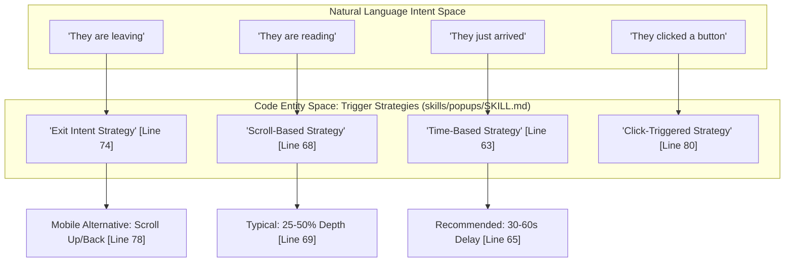
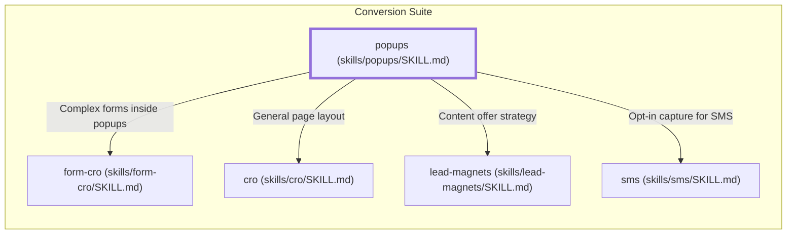

<!-- source: DeepWiki mcp.deepwiki.com · repo coreyhaines31/marketingskills · extra page Popup CRO · fetched 2026-10-26 -->

# Popup CRO

Relevant source files

The following files were used as context for generating this wiki page:

- [.claude-plugin/marketplace.json](.claude-plugin/marketplace.json)
- [.claude-plugin/plugin.json](.claude-plugin/plugin.json)
- [README.md](README.md)
- [VERSIONS.md](VERSIONS.md)

The `popup-cro` skill is a specialized knowledge module designed to optimize overlays, interstitials, and interrupt-style conversion elements. It provides technical and strategic guidance for implementing exit-intent triggers, time-based delays, scroll depth tracking, and frequency capping to maximize conversions while maintaining user experience and accessibility compliance.

## System Overview

The Popup CRO system operates as a decision-support layer for marketing engineers and growth hackers. It distinguishes between different "interrupt" patterns—such as modals, slide-ins, and sticky bars—and maps them to specific business goals like email capture, lead magnet delivery, or churn prevention.

### Data Flow and Integration

The skill follows the standard three-tier architecture of the `marketingskills` repository. It first attempts to ingest existing product data from the `product-marketing-context.md` file before generating recommendations.

| Step | Action | Entity |
| :--- | :--- | :--- |
| 1 | **Context Ingestion** | Reads `.agents/product-marketing.md` (or legacy context files) for ICP and positioning [skills/popups/SKILL.md:14-15]() |
| 2 | **Initial Assessment** | Evaluates Popup Purpose, Current State, and Traffic Context [skills/popups/SKILL.md:17-38]() |
| 3 | **Strategy Selection** | Maps business goals to specific Trigger Strategies (Time, Scroll, Exit, etc.) [skills/popups/SKILL.md:61-97]() |
| 4 | **Implementation** | Generates copy formulas, design specs, and frequency rules [skills/popups/SKILL.md:170-251]() |

**Sources:** [skills/popups/SKILL.md:1-97](), [.claude-plugin/plugin.json:1-12](), [README.md:17-25]()

---

## Trigger Logic and Implementation

The skill defines several programmatic triggers for displaying popups. Choosing the correct trigger is critical for balancing conversion rate (CVR) against user bounce rate.

### Trigger Matrix

| Trigger Type | Technical Implementation Logic | Best Use Case |
| :--- | :--- | :--- |
| **Time-Based** | Show after 30-60 seconds of active session (avoiding immediate 5s triggers) [skills/popups/SKILL.md:63-66]() | General site visitors |
| **Scroll-Based** | Trigger at 25-50% scroll depth to indicate content engagement [skills/popups/SKILL.md:68-71]() | Blog posts, long-form content |
| **Exit Intent** | Detect cursor movement toward browser chrome or close button [skills/popups/SKILL.md:74-77]() | E-commerce, lead generation |
| **Click-Triggered** | User-initiated (button/link click); has zero annoyance factor [skills/popups/SKILL.md:80-84]() | Lead magnets, gated content |
| **Session-Based** | Trigger after X page views or specific high-intent pages [skills/popups/SKILL.md:86-96]() | Comparison/Pricing pages |

### Trigger Workflow Diagram

This diagram maps natural language intent to the specific trigger strategies defined in the codebase.

**Sources:** [skills/popups/SKILL.md:61-97]()

---

## Popup Types and Best Practices

The system categorizes overlays into distinct types, each with unique design and copy requirements.

### Email & Lead Capture
Focuses on minimizing friction. The skill recommends a single-field (email only) approach and a clear value proposition rather than a generic "Subscribe" [skills/popups/SKILL.md:102-124](). It leverages the `lead-magnets` skill for planning the specific asset delivered [skills/popups/SKILL.md:275]().

### Exit Intent Saves
Designed as a "last-chance" conversion. Implementation should acknowledge the user is leaving and offer a different incentive than the entry popup to address objections [skills/popups/SKILL.md:134-148](). This pattern is also referenced in `churn-prevention` for cancellation flows [README.md:65]().

### Announcement Banners & Slide-ins
Less intrusive options. Banners are recommended for site-wide communication (sticky at top), while slide-ins are preferred for chat or secondary CTAs as they do not block core content [skills/popups/SKILL.md:149-167]().

**Sources:** [skills/popups/SKILL.md:100-168](), [skills/popups/SKILL.md:275](), [README.md:65]()

---

## Technical Constraints and Compliance

Implementation of popups must adhere to specific technical and legal standards to avoid SEO penalties and legal issues.

### Frequency Capping & Rules
To prevent "popup fatigue," the system enforces the following rules:
*   **Session Limits**: Maximum once per session [skills/popups/SKILL.md:234]().
*   **Persistence**: Use `localStorage` or cookies to remember dismissals for 7-30 days [skills/popups/SKILL.md:235-236]().
*   **Exclusion Logic**: Automatically exclude checkout flows and recently converted users [skills/popups/SKILL.md:243-247]().

### Accessibility and GDPR
*   **Keyboard Navigation**: Modals must be dismissable via the `Esc` key [skills/popups/SKILL.md:261]().
*   **Focus Trapping**: Focus should remain within the modal while active [skills/popups/SKILL.md:262]().
*   **GDPR**: Clear consent checkboxes are required for marketing opt-ins [skills/popups/SKILL.md:256-258]().

### Mobile Optimization
Mobile devices require different handling as "Exit Intent" (hover) cannot be detected. The skill suggests:
*   **Bottom Slide-ups**: These work better than center modals on small screens [skills/popups/SKILL.md:193]().
*   **Tap Targets**: Buttons must be large enough to tap (typically 44px+) [skills/popups/SKILL.md:194]().

**Sources:** [skills/popups/SKILL.md:190-196](), [skills/popups/SKILL.md:231-264]()

---

## Relationship to Other Skills

The `popup-cro` skill (located in `skills/popups/`) is part of a larger conversion optimization suite. It frequently delegates specific sub-tasks to other modules based on the component being optimized.

| Skill | Relationship | Citation |
| :--- | :--- | :--- |
| `form-cro` | Handles detailed field optimization and validation inside the popup modal. | [skills/popups/SKILL.md:3]() |
| `cro` | Manages the underlying page conversion elements that the popup interrupts. | [skills/popups/SKILL.md:3](), [README.md:74]() |
| `lead-magnets` | Used for planning the downloadable content (PDFs, checklists) delivered via popups. | [skills/popups/SKILL.md:275](), [README.md:38]() |
| `sms` | Popups are a primary growth strategy for SMS list building. | [README.md:40](), [VERSIONS.md:51]() |
| `copywriting` | Provides the persuasive text for headlines and CTAs. | [README.md:73]() |
| `churn-prevention`| Uses popups for cancellation flows and save offers. | [README.md:65]() |

**Sources:** [skills/popups/SKILL.md:1-6](), [skills/popups/SKILL.md:273-277](), [README.md:30-50](), [VERSIONS.md:38]()

---

