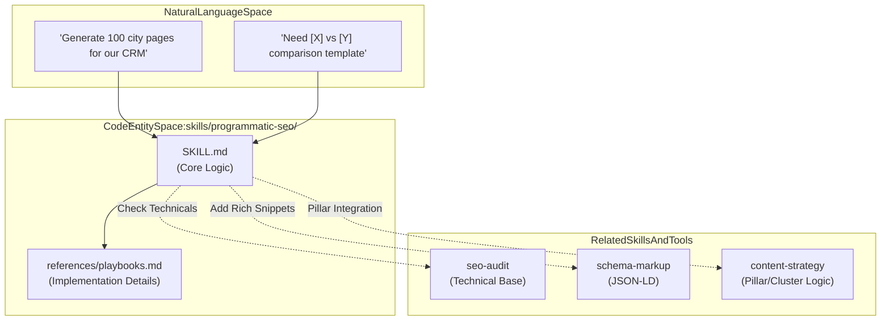
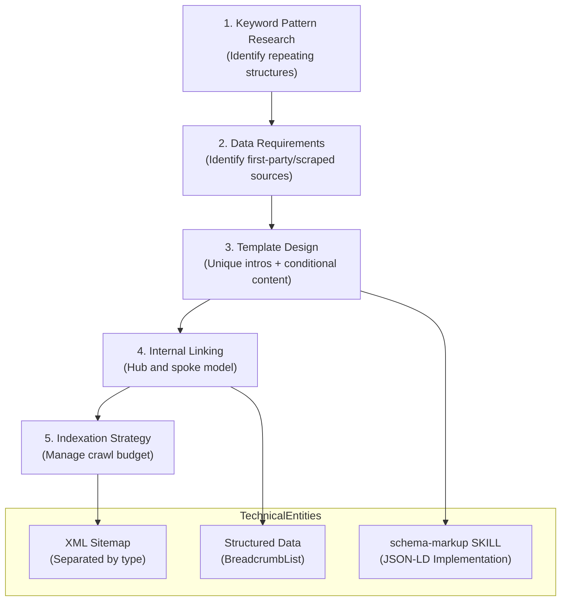

<!-- source: DeepWiki mcp.deepwiki.com · repo coreyhaines31/marketingskills · extra page Programmatic SEO · fetched 2026-10-26 -->

# Programmatic SEO

Relevant source files

The following files were used as context for generating this wiki page:

- [skills/content-strategy/SKILL.md](skills/content-strategy/SKILL.md)
- [skills/marketing-ideas/references/ideas-by-category.md](skills/marketing-ideas/references/ideas-by-category.md)
- [skills/programmatic-seo/SKILL.md](skills/programmatic-seo/SKILL.md)
- [skills/programmatic-seo/references/playbooks.md](skills/programmatic-seo/references/playbooks.md)
- [skills/seo-audit/SKILL.md](skills/seo-audit/SKILL.md)

## Purpose and Scope

This page documents the `programmatic-seo` skill, which provides specialized knowledge for creating SEO-driven pages at scale using templates and data sources. The skill guides AI agents through the process of planning, building, and maintaining programmatic SEO (pSEO) strategies that generate hundreds or thousands of pages targeting long-tail search patterns while avoiding "thin content" penalties from search engines. [skills/programmatic-seo/SKILL.md:1-10]()

For traditional technical SEO optimization, see [SEO Audit](4.5.1). For adding structured data to these scaled pages, see [Schema Markup](4.5.4). For overall content planning, see [Content Strategy](4.5.6).

**Sources:** [skills/programmatic-seo/SKILL.md:1-10](), [skills/seo-audit/SKILL.md:1-3]()

---

## Skill Metadata

The `programmatic-seo` skill is located at `skills/programmatic-seo/`.

| Attribute | Value |
|-----------|-------|
| **Version** | 2.0.0 |
| **Trigger Phrases** | "programmatic SEO", "template pages", "pages at scale", "directory pages", "location pages", "[keyword] + [city] pages", "comparison pages", "integration pages", "pSEO", "generate 100 pages", "data-driven pages", "templated landing pages" |
| **Primary Goal** | Create pages that rank, provide value, and avoid thin content penalties. |

**Sources:** [skills/programmatic-seo/SKILL.md:1-10]()

---

## System Integration Overview

The following diagram bridges the natural language triggers to the specific code entities and related skills involved in a programmatic SEO workflow.

### Code Entity Space Bridge

**Sources:** [skills/programmatic-seo/SKILL.md:3-5](), [skills/programmatic-seo/SKILL.md:233-235](), [skills/content-strategy/SKILL.md:121-121]()

---

## Core Principles of pSEO

The skill enforces six core principles to ensure scaled pages actually rank and provide utility:

1.  **Unique Value Per Page**: Every page must provide value specific to its variables, not just swapped strings in a template. [skills/programmatic-seo/SKILL.md:38-41]()
2.  **Proprietary Data Wins**: Uses a hierarchy of data defensibility: Proprietary (created by you) > Product-derived (from users) > User-generated (community) > Licensed > Public. [skills/programmatic-seo/SKILL.md:43-49]()
3.  **Clean URL Structure**: Preference for subfolders over subdomains to consolidate domain authority (e.g., `yoursite.com/templates/resume/` is good; `templates.yoursite.com/resume/` is bad). [skills/programmatic-seo/SKILL.md:51-54]()
4.  **Genuine Search Intent**: Pages must actually answer what people are searching for. [skills/programmatic-seo/SKILL.md:56-57]()
5.  **Quality Over Quantity**: 100 great pages are prioritized over 10,000 thin ones. [skills/programmatic-seo/SKILL.md:59-60]()
6.  **Penalty Avoidance**: Strict adherence to avoiding doorway pages, keyword stuffing, and duplicate content. [skills/programmatic-seo/SKILL.md:62-66]()

**Sources:** [skills/programmatic-seo/SKILL.md:36-67]()

---

## The 12 Playbooks

The skill categorizes pSEO opportunities into 12 distinct patterns (playbooks). [skills/programmatic-seo/SKILL.md:70-85]()

| Playbook | Pattern | Example |
|----------|---------|---------|
| **Templates** | "[Type] template" | "resume template" |
| **Curation** | "best [category]" | "best website builders" |
| **Conversions** | "[X] to [Y]" | "$10 USD to GBP" |
| **Comparisons** | "[X] vs [Y]" | "webflow vs wordpress" |
| **Examples** | "[type] examples" | "landing page examples" |
| **Locations** | "[service] in [location]" | "dentists in austin" |
| **Personas** | "[product] for [audience]" | "crm for real estate" |
| **Integrations** | "[product A] [product B] integration" | "slack asana integration" |
| **Glossary** | "what is [term]" | "what is pSEO" |
| **Translations** | Multilingual content | Localized versions |
| **Directory** | "[category] tools" | "ai copywriting tools" |
| **Profiles** | "[entity name]" | "stripe ceo" |

**Sources:** [skills/programmatic-seo/SKILL.md:72-85](), [skills/programmatic-seo/references/playbooks.md:1-20]()

---

## Implementation Framework

The skill guides the agent through a five-step implementation process. [skills/programmatic-seo/SKILL.md:108-161]()

### Data Flow and Implementation Logic

**Sources:** [skills/programmatic-seo/SKILL.md:108-161]()

### Step 4: Internal Linking Architecture
A critical component of pSEO implementation is the "Hub and Spoke" model. The hub serves as the main category page, while spokes are individual programmatic pages. The skill mandates using breadcrumbs with structured data and ensuring every page is reachable from the main site to avoid "orphan pages." [skills/programmatic-seo/SKILL.md:143-154]()

### Step 5: Indexation Strategy
For large-scale deployments, agents must manage the crawl budget by prioritizing high-volume patterns and applying `noindex` to very thin variations. The skill recommends separate XML sitemaps by page type. [skills/programmatic-seo/SKILL.md:155-161]()

**Sources:** [skills/programmatic-seo/SKILL.md:143-161]()

---

## Quality Checks

The skill includes built-in quality checks to ensure strategies are technically sound and avoid common mistakes like "thin content" (swapping names in identical text) or "keyword cannibalization." [skills/programmatic-seo/SKILL.md:197-204]()

### Pre-Launch Checklist
*   **Content**: Unique value provided, intent answered, readable and useful. [skills/programmatic-seo/SKILL.md:168-171]()
*   **Technical**: Unique titles/metas, heading hierarchy, Schema markup implemented, acceptable page speed. [skills/programmatic-seo/SKILL.md:173-177]()
*   **Linking**: Connected to architecture, related pages linked, no orphan pages. [skills/programmatic-seo/SKILL.md:179-182]()
*   **Indexation**: Included in XML sitemap, crawlable, no conflicting `noindex`. [skills/programmatic-seo/SKILL.md:184-188]()

**Sources:** [skills/programmatic-seo/SKILL.md:164-204]()

---

## Technical Integration with Other Skills

Programmatic SEO pages are highly dependent on technical foundations and structured data:

*   **`seo-audit`**: The `programmatic-seo` skill refers users to `seo-audit` for diagnosing existing issues or technical foundations like crawlability and mobile-friendliness. [skills/programmatic-seo/SKILL.md:235-235](), [skills/seo-audit/SKILL.md:51-56]()
*   **`content-strategy`**: Programmatic pages often serve as "spokes" in a hub-and-spoke model defined in content strategy. [skills/content-strategy/SKILL.md:82-90](), [skills/content-strategy/SKILL.md:121-121]()
*   **`marketing-ideas`**: The `marketing-ideas` skill explicitly lists Programmatic SEO as idea #4 for easy keyword ranking and idea #3 for glossary marketing. [skills/marketing-ideas/references/ideas-by-category.md:30-33]()

**Sources:** [skills/programmatic-seo/SKILL.md:233-237](), [skills/content-strategy/SKILL.md:82-90](), [skills/marketing-ideas/references/ideas-by-category.md:30-33]()

---

