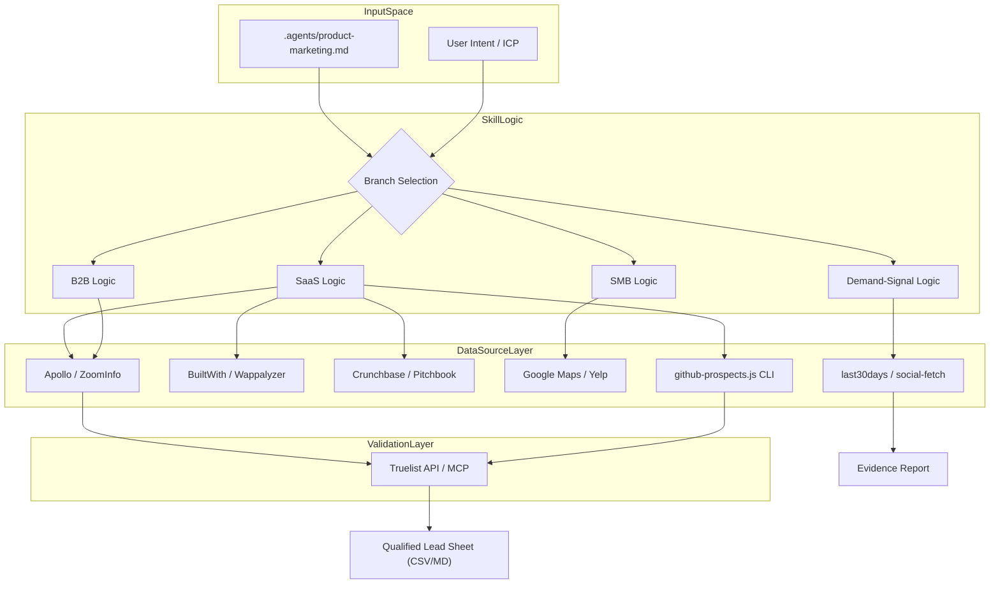
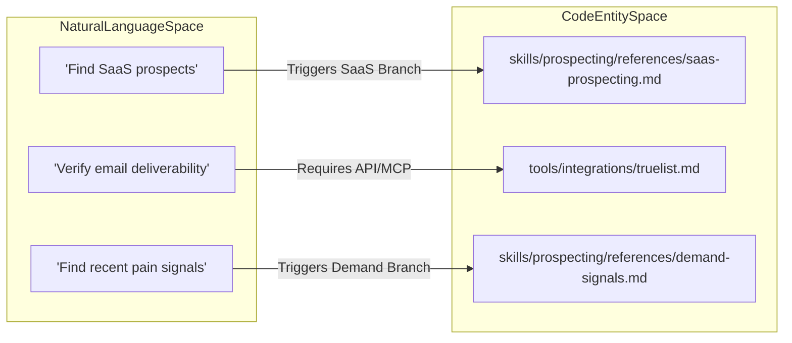

<!-- source: DeepWiki mcp.deepwiki.com · repo coreyhaines31/marketingskills · extra page Prospecting · fetched 2026-10-26 -->

# Prospecting

Relevant source files

The following files were used as context for generating this wiki page:

- [skills/prospecting/SKILL.md](skills/prospecting/SKILL.md)
- [skills/prospecting/evals/evals.json](skills/prospecting/evals/evals.json)
- [skills/prospecting/references/demand-signals.md](skills/prospecting/references/demand-signals.md)

The **prospecting** skill (updated to v1.1.0) is a knowledge module designed to build, qualify, and score prospect lists for outbound sales and marketing. It transforms a high-level Ideal Customer Profile (ICP) into a verified, ready-to-outreach lead sheet across four distinct motions: B2B SaaS, General B2B, Local SMB, and the newly added **Demand-signal discovery** [skills/prospecting/SKILL.md:1-10]().

The skill focuses on the **list-building and qualification phase**. It is explicitly distinguished from the `cold-email` skill (which handles outreach copy) and the `competitor-profiling` skill (which performs deep account-level research) [skills/prospecting/SKILL.md:3-3]().

## Prospecting Branches

Prospecting workflows fork based on the target audience, as the signals for qualification and the primary data sources vary significantly between them [skills/prospecting/SKILL.md:17-32]().

| Branch | Target Audience | Qualification Signals | Primary Data Sources |
| :--- | :--- | :--- | :--- |
| **SaaS** | SaaS / Digital businesses | Tech stack, funding, hiring, product velocity | LinkedIn, BuiltWith, Crunchbase, Apollo, Clay |
| **B2B** | Services, Mfg, Enterprise | Industry, size, geography, trigger events | Apollo, ZoomInfo, Clay, Industry Directories |
| **Local SMB** | Local shops, clinics, etc. | Active status, website quality, proximity | Google Maps, Yelp, Facebook, Local Directories |
| **Demand-signal** | Early-stage / Beta users | Pain/demand/timing signals in public discourse | Forums, GitHub issues, Reviews, `last30days` |

### 1. B2B SaaS Branch
Qualified by technographic fit (e.g., uses HubSpot, lacks a specific integration) and growth signals (Series B funding, hiring for specific roles) [skills/prospecting/references/saas-prospecting.md:7-25](). It includes specialized patterns like **GitHub Prospecting** for dev-tools, where stargazers of competitor repos are treated as high-intent signals [skills/prospecting/references/saas-prospecting.md:63-73]().

### 2. General B2B Branch
Focuses on firmographic signals (NAICS codes, revenue bands, ownership type) and trigger events such as new C-level hires, acquisitions, or IPOs [skills/prospecting/references/b2b-prospecting.md:7-24]().

### 3. Local SMB Branch
Evaluates businesses based on proximity and digital presence. A common use case is identifying businesses with "No site found" or "Social only" presence for web agency outreach [skills/prospecting/evals/evals.json:74-75]().

### 4. Demand-signal Discovery (v1.1.0)
This branch is used for finding first customers, design partners, or beta users. Unlike firmographic list-building, it mines public discourse (Reddit, Hacker News, GitHub) for evidence of exact pain points [skills/prospecting/references/demand-signals.md:1-5](). It prioritizes **recency** using tools like `last30days` to find people describing a problem *now* [skills/prospecting/references/demand-signals.md:45-50]().

Sources: [skills/prospecting/SKILL.md:17-32](), [skills/prospecting/references/saas-prospecting.md:7-25](), [skills/prospecting/references/b2b-prospecting.md:7-24](), [skills/prospecting/references/demand-signals.md:1-50]()

## Five-Phase Prospecting Framework

The skill implements a standardized state machine for list generation [skills/prospecting/SKILL.md:36-94]():

1.  **Phase 1: Define ICP**: Gathers firmographic, technographic, and buying signals. Pulls from `product-marketing.md` if available [skills/prospecting/SKILL.md:40-50]().
2.  **Phase 2: Discovery**: Sources 2-3x more candidates than requested. Uses multi-source verification (e.g., Apollo + BuiltWith) or signal mining (last30days) [skills/prospecting/SKILL.md:52-60]().
3.  **Phase 3: Qualification**: Scores candidates against the ICP checklist. Requires evidence (source URLs) for every claim [skills/prospecting/SKILL.md:61-71]().
4.  **Phase 4: Scoring**: Assigns a rubric of **Hot**, **Warm**, **Cold**, or **Skip** (or a 0-100 Demand-fit score for the discovery branch) [skills/prospecting/SKILL.md:72-84]().
5.  **Phase 5: Output**: Generates a markdown table or CSV. Always includes a "Top outreach targets" section with specific rationale for the top 3-5 leads [skills/prospecting/SKILL.md:85-94]().

### Data Flow and Tool Integration

The following diagram illustrates how the prospecting skill orchestrates various data sources and tools to produce a qualified list.

**Prospecting Data Flow**

Sources: [skills/prospecting/SKILL.md:36-94](), [skills/prospecting/references/data-sources.md:7-21](), [skills/prospecting/references/demand-signals.md:45-50]()

## Technical Implementation & Scoring

### Demand-Fit Scoring Rubric (Discovery Branch)
For early-stage discovery, the skill uses a weighted 0-100 scoring system rather than the standard Hot/Warm rubric [skills/prospecting/references/demand-signals.md:64-76]():

| Dimension | Weight | Measurement |
| :--- | :--- | :--- |
| **Pain strength** | 25% | Severity and cost of the stated problem |
| **Product fit** | 25% | How directly the product solves the evidenced job |
| **Timing** | 20% | Freshness of the signal + current trigger |
| **Public reachability** | 15% | Natural public/professional contact path exists |
| **Evidence quality** | 15% | Specificity and source reliability |

### Verification Logic (Truelist Integration)
The skill mandates using the Truelist API (`/api/v1/verify_inline`) or its MCP server to check `email_state` (ok, risky, invalid) before any lead is finalized [skills/prospecting/references/data-sources.md:121-136](). This prevents bounce rates from exceeding the 2% threshold that damages sender reputation [skills/prospecting/references/data-sources.md:134-134]().

**Entity Mapping: Natural Language to Code**

Sources: [skills/prospecting/references/demand-signals.md:64-76](), [skills/prospecting/references/data-sources.md:121-136](), [skills/prospecting/SKILL.md:76-81]()

## Compliance Posture

The prospecting skill enforces strict compliance guardrails to protect the user's reputation and legal standing [skills/prospecting/SKILL.md:96-107]():

*   **No Bulk Scraping**: Prohibits bulk extraction from LinkedIn or Google Maps. The browser is used as an "assisted research tool" only [skills/prospecting/SKILL.md:100-100]().
*   **Public Channels Only**: Focuses on `info@`, `hello@`, or named-role emails published on official business sites. For demand signals, reach out only where a reply is a normal part of the channel [skills/prospecting/references/demand-signals.md:98-100]().
*   **No Sensitive Traits**: Explicitly prohibits targeting based on protected/sensitive traits (health, religion, financial hardship) [skills/prospecting/SKILL.md:106-106]().
*   **Source Lineage**: Requires capturing the source URL and date for every contact to satisfy GDPR DSAR or CAN-SPAM challenges [skills/prospecting/SKILL.md:103-103]().

Sources: [skills/prospecting/SKILL.md:96-107](), [skills/prospecting/references/demand-signals.md:58-60](), [skills/prospecting/references/compliance.md:1-124]()

---

