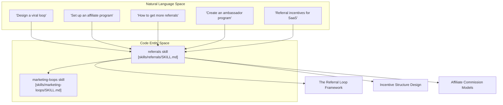
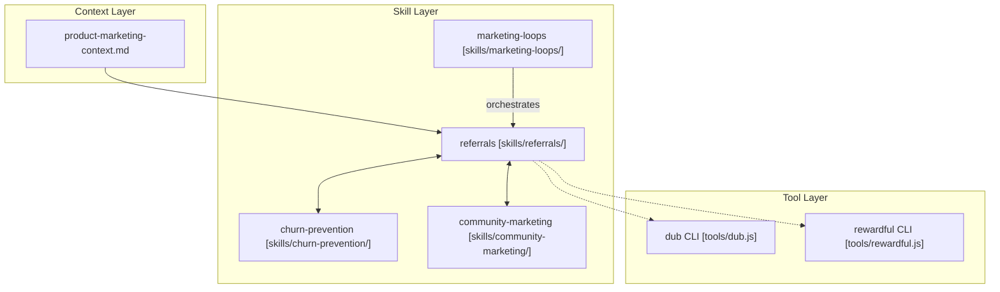
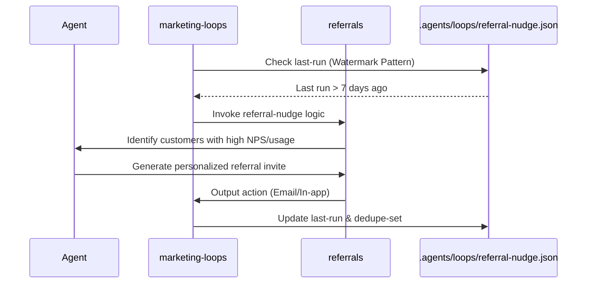

<!-- source: DeepWiki mcp.deepwiki.com · repo coreyhaines31/marketingskills · extra page Referral Programs · fetched 2026-10-26 -->

# Referral Programs

Relevant source files

The following files were used as context for generating this wiki page:

- [.claude-plugin/marketplace.json](.claude-plugin/marketplace.json)
- [.claude-plugin/plugin.json](.claude-plugin/plugin.json)
- [README.md](README.md)
- [VERSIONS.md](VERSIONS.md)

The `referral-program` skill provides specialized knowledge for designing and optimizing viral growth loops through customer referral and affiliate programs. This skill enables AI agents to architect referral mechanics, incentive structures, and program workflows that turn an existing customer base into a primary acquisition channel.

**Sources:** [README.md:33](), [VERSIONS.md:44]()

## Skill Overview

The `referral-program` skill is located at `skills/referrals/` and is categorized under **Growth & Retention** in the system architecture. It focuses on the mechanics of the "Referral" stage of the AARRR (Acquisition, Activation, Retention, Revenue, Referral) framework.

| Property | Value |
|----------|-------|
| **Skill Name** | `referrals` |
| **Category** | Growth & Retention |
| **Version** | 2.0.0 |
| **File Location** | `skills/referrals/SKILL.md` |

**Sources:** [README.md:33-41](), [VERSIONS.md:44]()

## Skill Triggering Patterns

The skill is triggered when an agent identifies intent related to viral loops, affiliate management, or word-of-mouth incentivization.

**Diagram: Mapping User Intent to Referral Skill Entities**

**Sources:** [README.md:81](), [VERSIONS.md:31](), [VERSIONS.md:44]()

## System Architecture & Dependencies

The `referrals` skill is a downstream consumer of the `product-marketing` context and frequently composes with retention and community skills.

**Diagram: Referral Program Dependency and Tool Mapping**

### Key Interdependencies
*   **Marketing Loops**: The `marketing-loops` skill (v2.6.0) includes specific recurring workflows for referrals, such as the `referral-nudge` loop and `review-and-UGC-harvest` loop. [VERSIONS.md:31](), [VERSIONS.md:67]()
*   **Community Marketing**: Used to identify "Super-users" or ambassadors within platforms like Discord or Slack to seed referral programs. [README.md:68]()
*   **Churn Prevention**: Often used to offer referral-based discounts or credits as a "save offer" during cancellation flows. [README.md:65]()
*   **Co-Marketing**: Complements referral strategy by finding external partners for joint campaigns. [README.md:66]()

**Sources:** [README.md:17-52](), [README.md:65-68](), [VERSIONS.md:31](), [VERSIONS.md:67]()

## Implementation and Tool Integration

The strategic output of the `referrals` skill is often implemented via specific CLI tools that handle link generation and attribution.

| Tool | Purpose | File Path Reference |
|------|---------|---------------------|
| **Dub** | Short link management and click attribution for referral links. | [README.md:111]() |
| **Rewardful** | Affiliate and referral management for Stripe-based SaaS. | [README.md:112]() |

**Sources:** [README.md:111-112]()

## Data Flow: Referral Loop Orchestration

With the introduction of `marketing-loops` in v2.6.0, referral programs are orchestrated as continuous sensing and action cycles.

**Diagram: Automated Referral Nudge Data Flow**

**Sources:** [VERSIONS.md:31](), [VERSIONS.md:67]()

## Key Frameworks and Metrics

The skill guides the agent to design programs based on specific structural components defined in the loop anatomy:

1.  **Incentive Design**: Choosing between single-sided (referrer only) vs. double-sided (referrer and referee) rewards.
2.  **Reward Type**: Cash/Commissions (Affiliates) vs. Credits/Features/Swag (Referrals).
3.  **Viral Coefficient (K-factor)**: Calculating invitations sent multiplied by conversion rate.
4.  **Loop State Management**: Utilizing the `.agents/loops/<loop>.json` pattern to manage state, including:
    *   **Watermark Pattern**: Tracking the last processed user/event.
    *   **Dedupe Set**: Ensuring a user isn't invited twice for the same trigger.
    *   **Cooldowns**: Enforcing a waiting period between referral requests.

**Sources:** [VERSIONS.md:31](), [VERSIONS.md:67]()

---

