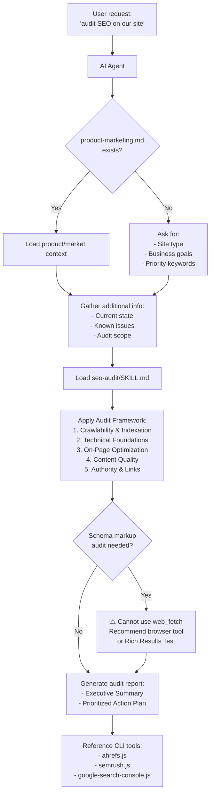
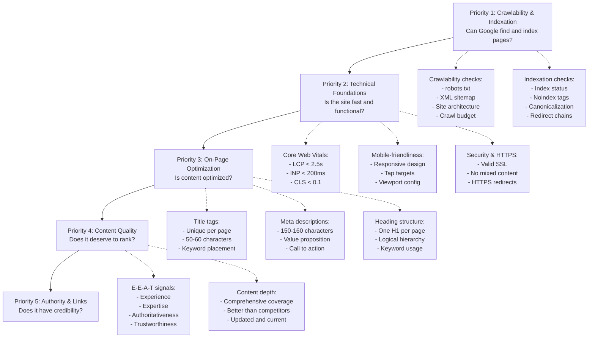
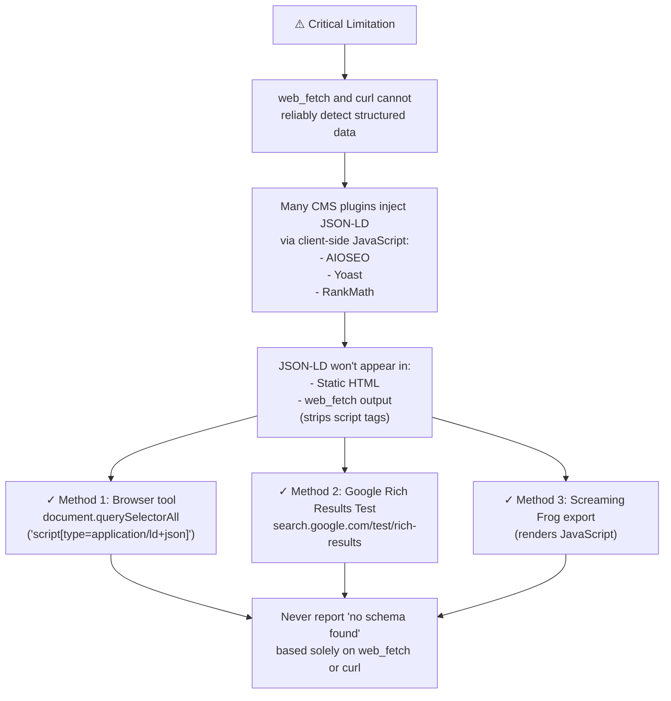

<!-- source: DeepWiki mcp.deepwiki.com · repo coreyhaines31/marketingskills · extra page SEO Audit · fetched 2026-10-26 -->

# SEO Audit

Relevant source files

The following files were used as context for generating this wiki page:

- [skills/content-strategy/SKILL.md](skills/content-strategy/SKILL.md)
- [skills/copywriting/evals/evals.json](skills/copywriting/evals/evals.json)
- [skills/programmatic-seo/SKILL.md](skills/programmatic-seo/SKILL.md)
- [skills/seo-audit/SKILL.md](skills/seo-audit/SKILL.md)
- [skills/seo-audit/evals/evals.json](skills/seo-audit/evals/evals.json)
- [skills/seo-audit/references/international-seo.md](skills/seo-audit/references/international-seo.md)

The SEO audit skill provides systematic guidance for identifying and resolving search engine optimization issues. It delivers a structured framework for auditing site crawlability, indexation, technical foundations, on-page optimization, content quality, and authority signals. The skill prioritizes issues by impact and provides actionable recommendations in a report format.

This page documents the `seo-audit` skill located at [skills/seo-audit/SKILL.md](). For AI-specific search optimization (AI Overviews, ChatGPT, Perplexity), see [4.5.2 AI SEO](). For building pages at scale to target keywords, see [4.5.3 Programmatic SEO](). For adding structured data, see [4.5.4 Schema Markup](). For broader content planning, see [4.5.6 Content Strategy]().

---

## Skill Metadata and Trigger Patterns

The skill is triggered by natural language mentions of SEO auditing, technical SEO diagnostics, or ranking issues.

| Property | Value |
|----------|-------|
| **Skill Name** | `seo-audit` |
| **Version** | 2.0.0 |
| **File Location** | [skills/seo-audit/SKILL.md:1-6]() |
| **Primary Role** | Identify SEO issues and provide actionable recommendations |

**Natural Language Triggers**:
- "SEO audit", "technical SEO", "why am I not ranking" [skills/seo-audit/SKILL.md:3]()
- "SEO issues", "on-page SEO", "meta tags review" [skills/seo-audit/SKILL.md:3]()
- "SEO health check", "my traffic dropped", "lost rankings" [skills/seo-audit/SKILL.md:3]()
- "not showing up in Google", "Google update hit me" [skills/seo-audit/SKILL.md:3]()
- "page speed", "core web vitals", "crawl errors", "indexing issues" [skills/seo-audit/SKILL.md:3]()

When invoked, the skill first checks for `.agents/product-marketing.md` [skills/seo-audit/SKILL.md:14-15]() (or the legacy paths) to avoid asking redundant questions about the product, market, and target audience.

**Sources**: [skills/seo-audit/SKILL.md:1-16]()

---

## Skill Invocation Flow

**Diagram: SEO Audit Skill Invocation and Execution Flow**

The skill follows a context-aware invocation pattern. If `product-marketing.md` exists, it loads context first to minimize questions [skills/seo-audit/SKILL.md:14-15](). The skill applies a five-level priority framework, with special handling for schema markup detection limitations. The expected output must include an **Executive Summary** and a **Prioritized Action Plan** [skills/seo-audit/evals/evals.json:7-19]().

**Sources**: [skills/seo-audit/SKILL.md:12-32](), [skills/seo-audit/SKILL.md:38-50](), [skills/seo-audit/evals/evals.json:7-19]()

---

## Audit Framework and Priority Order

The skill uses a five-tier priority framework for organizing audit findings. Each tier represents a foundational dependency—issues in higher tiers block effectiveness of lower tiers.

**Diagram: Five-Tier Audit Priority Framework**

**Priority 1: Crawlability & Indexation** ([skills/seo-audit/SKILL.md:62-108]())
- Robots.txt validation, XML sitemap checks, site architecture review.
- Index status verification, canonical tag implementation, redirect auditing.

**Priority 2: Technical Foundations** ([skills/seo-audit/SKILL.md:109-155]())
- Core Web Vitals: LCP < 2.5s, INP < 200ms, CLS < 0.1.
- Mobile-friendliness, HTTPS implementation, URL structure.

**Priority 3: On-Page Optimization** ([skills/seo-audit/SKILL.md:195-260]())
- Title tags (50-60 characters, keyword placement).
- Meta descriptions (150-160 characters).
- Heading hierarchy (H1 → H2 → H3).

**Priority 4: Content Quality** ([skills/seo-audit/SKILL.md:263-302]())
- E-E-A-T signals (Experience, Expertise, Authoritativeness, Trustworthiness).
- Content depth and comprehensiveness.

**Priority 5: Authority & Links**
- External backlink profile and referring domains.

**Sources**: [skills/seo-audit/SKILL.md:51-57](), [skills/seo-audit/SKILL.md:60-302]()

---

## Technical SEO Audit Components

### Crawlability Checks

| Check | Details | File Reference |
|-------|---------|----------------|
| **Robots.txt** | Verify no unintentional blocks, important pages allowed, sitemap reference included | [skills/seo-audit/SKILL.md:64-67]() |
| **XML Sitemap** | Exists and accessible, submitted to Search Console, contains only canonical URLs | [skills/seo-audit/SKILL.md:69-74]() |
| **Site Architecture** | Important pages within 3 clicks of homepage, logical hierarchy, no orphan pages | [skills/seo-audit/SKILL.md:76-80]() |
| **Crawl Budget** | Parameterized URLs controlled, faceted navigation handled, session IDs not in URLs | [skills/seo-audit/SKILL.md:82-87]() |

### Indexation Checks

| Check | Details | File Reference |
|-------|---------|----------------|
| **Index Status** | `site:domain.com` check, Search Console coverage report, compare indexed vs. expected | [skills/seo-audit/SKILL.md:90-93]() |
| **Indexation Issues** | Noindex tags on important pages, canonicals pointing wrong direction, redirect chains/loops | [skills/seo-audit/SKILL.md:95-100]() |
| **Canonicalization** | Self-referencing canonicals, HTTP→HTTPS consistency, www vs. non-www consistency | [skills/seo-audit/SKILL.md:102-108]() |

### Core Web Vitals Benchmarks

| Metric | Target | Description |
|--------|--------|-------------|
| **LCP** | < 2.5s | Largest Contentful Paint [skills/seo-audit/SKILL.md:112]() |
| **INP** | < 200ms | Interaction to Next Paint [skills/seo-audit/SKILL.md:113]() |
| **CLS** | < 0.1 | Cumulative Layout Shift [skills/seo-audit/SKILL.md:114]() |

**Speed factors audited**: Server response time (TTFB), image optimization, JavaScript execution, CSS delivery, caching headers, CDN usage, font loading [skills/seo-audit/SKILL.md:116-123]().

**Sources**: [skills/seo-audit/SKILL.md:109-124]()

---

## International SEO & Localization

When sites serve multiple languages or regions, the audit covers specific localization signals to prevent indexing suppression.

### Hreflang Implementation
- **Placement Methods**: Supports HTML `<link>`, HTTP headers, or XML sitemap `<xhtml:link>` [skills/seo-audit/SKILL.md:164]().
- **Reciprocal Requirement**: If page A points to B, B must point back to A [skills/seo-audit/SKILL.md:168]().
- **Self-Referencing**: Every page must include itself in its own hreflang set [skills/seo-audit/SKILL.md:167]().
- **Validation**: Codes must follow ISO 639-1 (language) and ISO 3166-1 Alpha 2 (region). `en-UK` is a common error; `en-GB` is correct [skills/seo-audit/SKILL.md:169]().

### Canonicalization for i18n
- Each locale page must self-canonical; cross-locale canonicals (e.g., French to English) are prohibited as they suppress the non-canonical locale [skills/seo-audit/SKILL.md:180-181]().
- The canonical URL must be present in the hreflang set, otherwise the markup is ignored [skills/seo-audit/SKILL.md:182]().

**Sources**: [skills/seo-audit/SKILL.md:158-183](), [skills/seo-audit/references/international-seo.md:7-101]()

---

## On-Page SEO Audit Components

### Title Tags and Meta Descriptions

**Title tag criteria** ([skills/seo-audit/SKILL.md:195-209]()):
- Unique titles for each page.
- Primary keyword near beginning.
- 50-60 characters (visible in SERP).
- Avoid putting the brand name at the beginning of the title [skills/seo-audit/SKILL.md:209]().

**Meta description criteria** ([skills/seo-audit/SKILL.md:211-224]()):
- Unique descriptions per page.
- 150-160 characters.
- Includes primary keyword and clear value proposition.

**Sources**: [skills/seo-audit/SKILL.md:195-224]()

### Heading Structure and Content Optimization

**Heading hierarchy audit** ([skills/seo-audit/SKILL.md:226-240]()):
- One H1 per page containing primary keyword.
- Logical hierarchy (H1 → H2 → H3, no level skipping).

**Content optimization audit** ([skills/seo-audit/SKILL.md:242-254]()):
- Primary keyword in first 100 words.
- Sufficient depth/length for topic; answers search intent.
- Thin content detection (tag/category pages, doorway pages, duplicates).

**Internal linking audit** ([skills/seo-audit/SKILL.md:267-280]()):
- Important pages well-linked with descriptive anchor text.
- No broken internal links; reasonable link count per page.

**Sources**: [skills/seo-audit/SKILL.md:226-280]()

---

## Content Quality Assessment

### E-E-A-T Framework

The skill audits content against Google's E-E-A-T quality framework [skills/seo-audit/SKILL.md:300-322]():

| Signal | Audit Points |
|--------|--------------|
| **Experience** | First-hand experience demonstrated, original insights/data |
| **Expertise** | Author credentials visible, detailed and accurate info |
| **Authoritativeness** | Recognized in the space, cited by others |
| **Trustworthiness** | Accurate info, transparent business info, secure site (HTTPS) |

**Sources**: [skills/seo-audit/SKILL.md:300-322]()

---

## Schema Markup Detection Limitation

**Diagram: Schema Markup Detection Warning**

The skill includes a critical warning about schema markup detection limitations [skills/seo-audit/SKILL.md:38-50](). The `web_fetch` tool and `curl` cannot reliably detect structured data because many CMS plugins (AIOSEO, Yoast, RankMath) inject JSON-LD via client-side JavaScript, which does not appear in static HTML or `web_fetch` output (which strips `<script>` tags during conversion) [skills/seo-audit/SKILL.md:40-42]().

**Required detection methods**:
1. Browser tool: `document.querySelectorAll('script[type="application/ld+json"]')` [skills/seo-audit/SKILL.md:45]()
2. Google Rich Results Test: https://search.google.com/test/rich-results [skills/seo-audit/SKILL.md:46]()
3. Screaming Frog export (renders JavaScript) [skills/seo-audit/SKILL.md:47]()

**Critical rule**: Never report "no schema found" based solely on `web_fetch` or `curl` [skills/seo-audit/SKILL.md:49]().

**Sources**: [skills/seo-audit/SKILL.md:38-50]()

---

## Related Skills and Interdependencies

**Related skills** ([skills/seo-audit/SKILL.md:3-4]()):
- **ai-seo** ([4.5.2 AI SEO]()): For optimizing content for AI search engines.
- **programmatic-seo** ([4.5.3 Programmatic SEO]()): For building SEO pages at scale using templates and data.
- **schema-markup** ([4.5.4 Schema Markup]()): For implementing structured data to enable rich results.
- **content-strategy** ([4.5.6 Content Strategy]()): For deciding what topics to cover and searchable vs shareable prioritization [skills/content-strategy/SKILL.md:42-49]().
- **site-architecture** ([4.5.7 Site Architecture]()): For planning page hierarchy and internal linking.

**Sources**: [skills/seo-audit/SKILL.md:3-4](), [skills/content-strategy/SKILL.md:3-5](), [skills/programmatic-seo/SKILL.md:3-5]()

---

