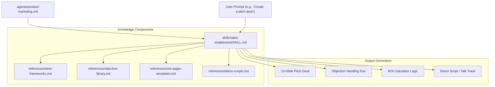
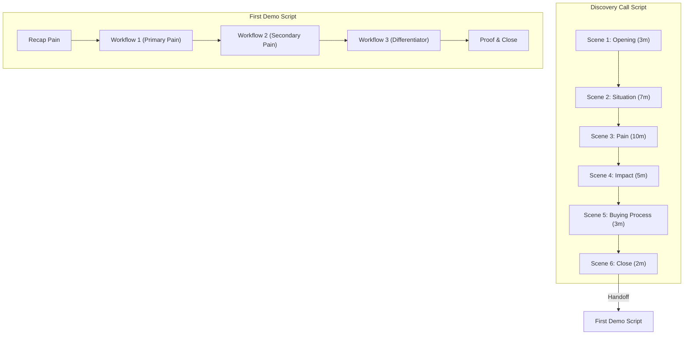
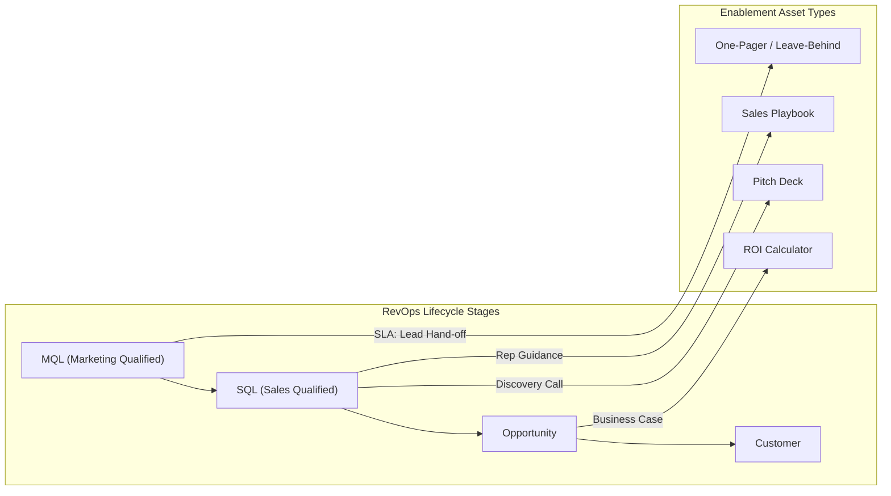

<!-- source: DeepWiki mcp.deepwiki.com · repo coreyhaines31/marketingskills · extra page Sales Enablement · fetched 2026-10-26 -->

# Sales Enablement

Relevant source files

The following files were used as context for generating this wiki page:

- [skills/copywriting/SKILL.md](skills/copywriting/SKILL.md)
- [skills/launch/SKILL.md](skills/launch/SKILL.md)
- [skills/pricing/SKILL.md](skills/pricing/SKILL.md)
- [skills/sales-enablement/SKILL.md](skills/sales-enablement/SKILL.md)
- [skills/sales-enablement/references/deck-frameworks.md](skills/sales-enablement/references/deck-frameworks.md)
- [skills/sales-enablement/references/demo-scripts.md](skills/sales-enablement/references/demo-scripts.md)
- [skills/sales-enablement/references/objection-library.md](skills/sales-enablement/references/objection-library.md)
- [skills/sales-enablement/references/one-pager-templates.md](skills/sales-enablement/references/one-pager-templates.md)

The `sales-enablement` skill is a technical knowledge module designed to generate high-conversion sales collateral, including pitch decks, one-pagers, objection handling frameworks, and demo scripts. It focuses on the transition from marketing-led interest to sales-led closing, providing structured frameworks that ensure consistency across the sales organization.

## Purpose and Scope

The primary goal of this skill is to equip sales representatives with materials they actually use, moving away from generic marketing copy toward situation-specific, outcome-oriented tools.

*   **Pitch Decks**: A 10-12 slide narrative framework focused on the "Story Arc" rather than a feature tour [skills/sales-enablement/SKILL.md:59-71]().
*   **Objection Handling**: A structured "Acknowledge-Reframe-Evidence-Bridge-Follow-up" model for neutralizing sales friction [skills/sales-enablement/SKILL.md:131-140]().
*   **One-Pagers**: Condensed "leave-behind" assets designed for internal champion selling [skills/sales-enablement/SKILL.md:91-105]().
*   **Sales Playbooks**: Comprehensive guides covering discovery, demoing, and closing [skills/sales-enablement/SKILL.md:186-200]().

**Distinctions:**
*   **vs. Competitor Alternatives**: Use `competitor-alternatives` for public-facing comparison pages and battle cards [skills/sales-enablement/SKILL.md:3-3]().
*   **vs. Cold Email**: Use `cold-email` for initial outbound outreach and sequence prospecting [skills/sales-enablement/SKILL.md:3-3]().
*   **vs. Copywriting**: Use `copywriting` for general website and marketing asset copy [skills/sales-enablement/SKILL.md:3-3]().
*   **vs. Offers**: Use `offers` for the actual core deliverable, bonuses, and guarantees [skills/sales-enablement/SKILL.md:3-3]().

## System Architecture and Data Flow

The `sales-enablement` skill operates by consuming product context and outputting structured sales assets. It relies heavily on the `product-marketing.md` context file to maintain brand and product consistency.

### Data Integration Flow

The following diagram illustrates how the skill processes input data to generate specific sales outputs.

**Sales Enablement Entity Relationship**

Sources: [skills/sales-enablement/SKILL.md:14-17](), [skills/sales-enablement/SKILL.md:87-87](), [skills/sales-enablement/SKILL.md:146-146](), [skills/sales-enablement/SKILL.md:173-173]()

## Implementation Details

### Pitch Deck Framework (10-12 Slides)
The skill implements a specific narrative structure designed to build urgency before presenting the solution:
1.  **Current World Problem**: The prospect's existing pain [skills/sales-enablement/SKILL.md:61-61]().
2.  **Cost of Problem**: Quantified risk/loss (time, money, risk) [skills/sales-enablement/SKILL.md:62-62]().
3.  **The Shift**: Market/Tech changes creating urgency [skills/sales-enablement/SKILL.md:63-63]().
4.  **Your Approach**: The unique POV or philosophy [skills/sales-enablement/SKILL.md:64-64]().
5.  **Product Walkthrough**: 3-4 key workflows, not a feature tour [skills/sales-enablement/SKILL.md:65-65]().
6.  **Proof Points**: Metrics, logos, and analyst recognition [skills/sales-enablement/SKILL.md:66-66]().
7.  **Case Study**: One customer story told well [skills/sales-enablement/SKILL.md:67-67]().
8.  **Implementation**: How they get from here to live [skills/sales-enablement/SKILL.md:68-68]().
9.  **ROI / Value**: Expected return and payback period [skills/sales-enablement/SKILL.md:69-69]().
10. **Pricing Overview**: Transparent and tiered [skills/sales-enablement/SKILL.md:70-70]().
11. **Next Steps**: Clear action with timeline [skills/sales-enablement/SKILL.md:71-71]().

The skill also provides persona-specific customizations for Technical Buyers (emphasizing architecture), Economic Buyers (emphasizing ROI), and Champions (emphasizing internal selling points) [skills/sales-enablement/references/deck-frameworks.md:200-242]().

### Objection Handling Logic
The system categorizes objections (Price, Timing, Competition, Authority, Status Quo, Technical) and applies a response framework [skills/sales-enablement/SKILL.md:120-131]().

**Response Framework Implementation:**
| Component | Description |
| :--- | :--- |
| **Objection Statement** | The exact phrasing used by the prospect [skills/sales-enablement/SKILL.md:135-135](). |
| **Why they say it** | The real concern behind the words [skills/sales-enablement/SKILL.md:136-136](). |
| **Response Approach** | How to acknowledge and redirect the concern [skills/sales-enablement/SKILL.md:137-137](). |
| **Proof Point** | Specific evidence or metrics to address the concern [skills/sales-enablement/SKILL.md:138-138](). |
| **Follow-up Question** | A bridge to keep the conversation moving [skills/sales-enablement/SKILL.md:139-139](). |

Sources: [skills/sales-enablement/SKILL.md:59-71](), [skills/sales-enablement/SKILL.md:120-140](), [skills/sales-enablement/references/objection-library.md:9-25]()

### Demo Script Orchestration
The skill utilizes scene-by-scene templates for different call types, ensuring reps follow a logical progression from discovery to technical deep-dives [skills/sales-enablement/references/demo-scripts.md:5-184]().

**Demo Script Workflow**

Sources: [skills/sales-enablement/references/demo-scripts.md:10-176]()

## Revenue Operations (RevOps) Integration

Sales Enablement outputs are designed to be triggered at specific stages of the lead lifecycle managed by the `revops` skill.

**Lead Lifecycle and Enablement Triggers**

Sources: [skills/sales-enablement/SKILL.md:150-169](), [skills/sales-enablement/SKILL.md:186-200]()

## Technical Reference: ROI Calculators

The skill generates logic for ROI calculators based on three primary data dimensions:
1.  **Inputs**: Prospect-provided metrics (Time spent, current tool costs, error rates, team size) [skills/sales-enablement/SKILL.md:154-158]().
2.  **Calculations**: Formulas for value (Time saved per period, cost reduction in headcount/errors, revenue impact via faster deals) [skills/sales-enablement/SKILL.md:160-163]().
3.  **Outputs**: Prospect-facing results (Annual ROI %, Payback period in months, Total 3-year value) [skills/sales-enablement/SKILL.md:165-168]().

## Related Skills

| Skill | Relationship |
| :--- | :--- |
| `revops` | Defines the stages where enablement assets are deployed. |
| `email-sequence` | Provides the automated "Sales Sequence" (3-7 emails) for follow-ups. |
| `launch-strategy` | Uses the ORB framework to drive traffic into the sales funnel [skills/launch/SKILL.md:31-33](). |
| `competitor-alternatives` | Provides the "Battle Cards" used during objection handling [skills/sales-enablement/SKILL.md:3-3](). |
| `competitor-profiling` | Researches competitors to inform the "Proof Points" and "Shift" slides in decks [skills/sales-enablement/SKILL.md:3-3](). |
| `pricing` | Informs the "Pricing Overview" slide and packaging logic [skills/pricing/SKILL.md:43-56](). |

Sources: [skills/sales-enablement/SKILL.md:3-3](), [skills/sales-enablement/SKILL.md:150-169](), [skills/launch/SKILL.md:31-33](), [skills/pricing/SKILL.md:43-56]()

---

