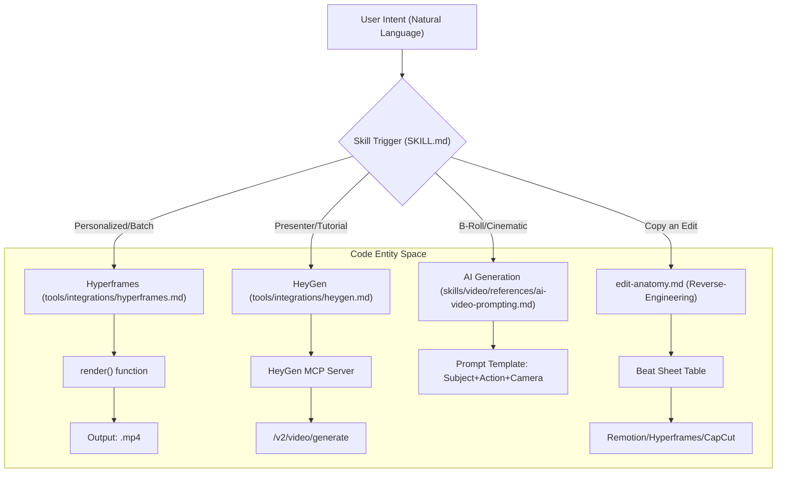
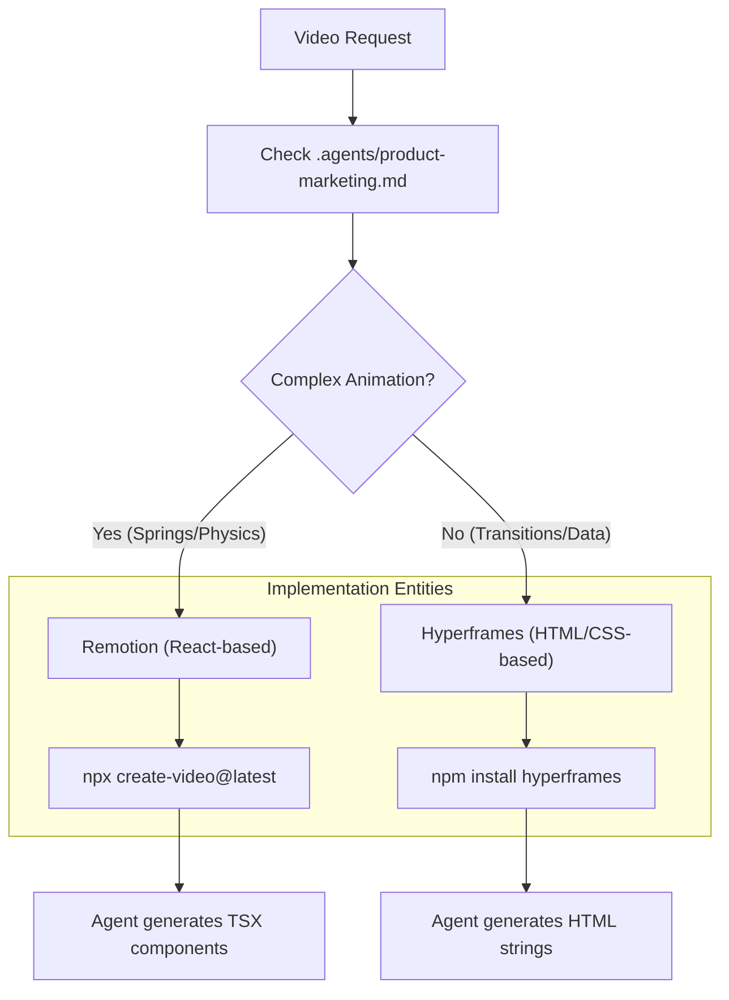

<!-- source: DeepWiki mcp.deepwiki.com · repo coreyhaines31/marketingskills · extra page Video Production · fetched 2026-10-26 -->

# Video Production

Relevant source files

The following files were used as context for generating this wiki page:

- [.gitignore](.gitignore)
- [skills/image/SKILL.md](skills/image/SKILL.md)
- [skills/image/references/ai-image-prompting.md](skills/image/references/ai-image-prompting.md)
- [skills/video/SKILL.md](skills/video/SKILL.md)
- [skills/video/evals/evals.json](skills/video/evals/evals.json)
- [skills/video/references/ai-video-prompting.md](skills/video/references/ai-video-prompting.md)
- [skills/video/references/edit-anatomy.md](skills/video/references/edit-anatomy.md)
- [tools/integrations/heygen.md](tools/integrations/heygen.md)
- [tools/integrations/hyperframes.md](tools/integrations/hyperframes.md)

The **Video Production** skill documents the creation, generation, and production of marketing video content. This includes using AI generation models for original footage, AI avatars for presenters, and programmatic frameworks for data-driven video at scale. It also covers the reverse-engineering of viral video edits into executable beat sheets.

## Scope and Distinctions
*   **Video Production:** Focuses on the *how*—the technical pipeline, generation workflows, and edit decomposition [skills/video/SKILL.md:3-10]().
*   **Social Content:** Focuses on the *what*—the content strategy, distribution, and platform-specific hooks [skills/video/SKILL.md:3-3]().
*   **Ad Creative:** Focuses on paid video ad specifications and bulk creative generation for performance marketing [skills/video/SKILL.md:3-3]().

---

## Agent-Native Video Pipeline

The system distinguishes between three primary production approaches based on the required output and technical constraints.

### 1. Programmatic Video (Code-Based)
Best for repeatable, data-driven, or personalized video at scale.

| Framework | Technology | Best For | Agent Compatibility |
|-----------|------------|----------|---------------------|
| **Hyperframes** | HTML/CSS/JS | Product updates, personalized outreach | **High** (Plain HTML/CSS) |
| **Remotion** | React/TS | Complex animations, interactive previews | **Medium** (Requires React DSL) |

#### Hyperframes Implementation
Hyperframes is the recommended framework for AI agents because LLMs generate high-quality HTML/CSS more reliably than complex React component logic [skills/video/SKILL.md:54-56](). Each "frame" is an HTML document with a specific duration [tools/integrations/hyperframes.md:66-73]().

**Key Function:** `render()` [tools/integrations/hyperframes.md:32-34]()
*   **Inputs:** An array of frame objects containing `html` and `duration`.
*   **Output:** A rendered MP4 file.
*   **Data Flow:** Data -> HTML Template -> Headless Chrome Rendering -> MP4 [tools/integrations/hyperframes.md:94-113]().

#### Remotion Implementation
Remotion uses React components as frames. It is preferred for complex animations using spring physics and interpolation [skills/video/SKILL.md:83-109]().

**Sources:** [skills/video/SKILL.md:50-121](), [tools/integrations/hyperframes.md:1-176]()

---

### 2. AI Video Generation (Model-Based)
Used for generating original footage (B-roll, hero shots) from text or image prompts.

| Model | Max Duration | Best For |
|-------|--------------|----------|
| **Veo 3** | Variable | Top overall quality, synced audio [skills/video/SKILL.md:133-133]() |
| **Sora 2** | ~20 sec | Cinematic quality, OpenAI ecosystem [skills/video/SKILL.md:134-134]() |
| **Runway Gen-4** | ~10 sec | Motion control, temporal consistency [skills/video/SKILL.md:135-135]() |
| **Kling 2.5/3.0** | Up to 2 min | Long-take generation, cost-efficiency [skills/video/SKILL.md:136-136]() |
| **Seedance** | Short clips | Fast generation, motion fidelity [skills/video/SKILL.md:137-137]() |
| **Hunyuan Video** | Variable | Open-source, self-hosted, full control [skills/video/SKILL.md:140-140]() |

**Prompting Formula:** `[Subject] + [Action] + [Camera movement] + [Visual style] + [Lighting/mood] + [Technical specs]` [skills/video/references/ai-video-prompting.md:9-12]().

**Sources:** [skills/video/SKILL.md:125-149](), [skills/video/references/ai-video-prompting.md:1-176]()

---

### 3. AI Avatars (Presenter-Based)
Generates talking-head videos from text scripts without filming a human presenter.

*   **HeyGen:** Offers a hosted MCP server [tools/integrations/heygen.md:20-23]() and REST API v2 for generating videos from avatars or custom digital twins [tools/integrations/heygen.md:47-71]().
*   **Synthesia:** Alternative for enterprise-scale avatar production [skills/video/SKILL.md:45-45]().

**Sources:** [tools/integrations/heygen.md:1-127](), [skills/video/SKILL.md:45-45]()

---

## Reverse-Engineer a Viral Edit (v2.1.0)

This workflow decomposes a reference video into a reusable **edit spec** (beat sheet) using the `edit-anatomy.md` reference [skills/video/references/edit-anatomy.md:1-5]().

### The Decomposition Process
1.  **Pull Reference:** Use `watch-video` to extract transcript and sample frames at cut points [skills/video/references/edit-anatomy.md:17-19]().
2.  **Extract Anatomy:** Log decisions across nine dimensions: shot/framing, cut rhythm, on-screen text, caption style, motion, b-roll, sound design, hook (first 2s), and pacing curve [skills/video/references/edit-anatomy.md:27-39]().
3.  **Generate Artifacts:**
    *   **Beat Sheet:** A per-beat table mapping time, shot, text, and audio [skills/video/references/edit-anatomy.md:47-55]().
    *   **Style Summary:** The 3-5 "signature moves" (e.g., "punch-in on every new sentence") [skills/video/references/edit-anatomy.md:57-60]().

### Guardrails
*   **Review-Once Gate:** The beat sheet must be reviewed to ensure text aligns with the user's message, not the reference's [skills/video/references/edit-anatomy.md:62-68]().
*   **Originality Guardrail:** Copy the *grammar* (editing technique), never the *creative* (script, footage, or specific bits) [skills/video/references/edit-anatomy.md:74-77]().

**Sources:** [skills/video/references/edit-anatomy.md:1-85]()

---

## Technical Architecture Diagrams

### Video Production Data Flow
This diagram bridges the Natural Language Space (User Intent) to the Code Entity Space (Tools and Frameworks).

**Sources:** [skills/video/SKILL.md:37-46](), [tools/integrations/hyperframes.md:31-62](), [tools/integrations/heygen.md:47-71](), [skills/video/references/edit-anatomy.md:43-72]()

### Programmatic Video Decision Logic
How the agent selects between HTML-based (Hyperframes) and React-based (Remotion) rendering.

**Sources:** [skills/video/SKILL.md:113-121](), [tools/integrations/hyperframes.md:161-175]()

---

## Implementation Details

### Context Gathering
Before production, the agent must check for `.agents/product-marketing.md` to ensure brand consistency [skills/video/SKILL.md:14-15](). It then identifies:
1.  **Video Goal:** Type, platform, and length [skills/video/SKILL.md:19-22]().
2.  **Production Approach:** Human presenter needs, existing footage, or required B-roll [skills/video/SKILL.md:24-28]().
3.  **Technical Context:** Tech stack (Node.js/Python), API keys, and budget [skills/video/SKILL.md:30-33]().

### Aspect Ratio Reference
| Platform | Ratio | Resolution |
|----------|-------|------------|
| TikTok/Reels/Shorts | 9:16 | 1080x1920 |
| YouTube/Website | 16:9 | 1920x1080 |
| Instagram Feed | 1:1 / 4:5 | 1080x1080 / 1080x1350 |

**Sources:** [skills/video/SKILL.md:12-34](), [skills/video/references/ai-video-prompting.md:155-166](), [tools/integrations/hyperframes.md:153-160]()

---

