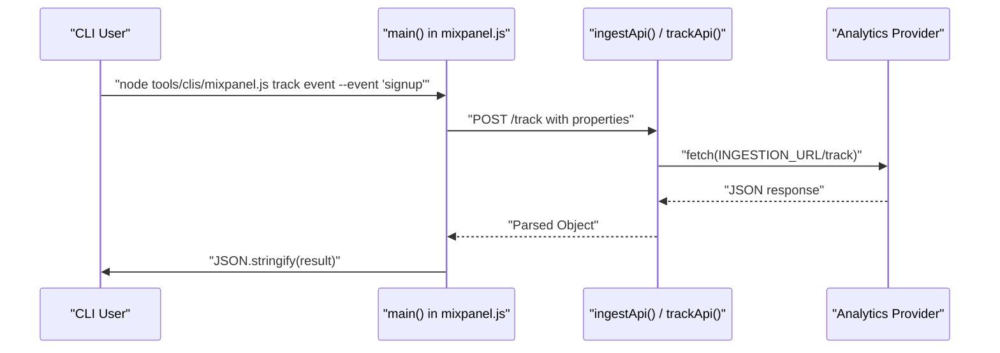

<!-- source: DeepWiki mcp.deepwiki.com · repo coreyhaines31/marketingskills · extra page Analytics Tracking · fetched 2026-10-26 -->

# Analytics Tracking

<details>
<summary>Relevant source files</summary>

The following files were used as context for generating this wiki page:

- [tools/clis/amplitude.js](tools/clis/amplitude.js)
- [tools/clis/ga4.js](tools/clis/ga4.js)
- [tools/clis/livestorm.js](tools/clis/livestorm.js)
- [tools/clis/mixpanel.js](tools/clis/mixpanel.js)
- [tools/clis/onesignal.js](tools/clis/onesignal.js)
- [tools/clis/paddle.js](tools/clis/paddle.js)
- [tools/clis/segment.js](tools/clis/segment.js)
- [tools/clis/semrush.js](tools/clis/semrush.js)
- [tools/clis/sendgrid.js](tools/clis/sendgrid.js)

</details>


This page documents the `analytics-tracking` skill, which provides knowledge and frameworks for implementing event instrumentation, measurement systems, and analytics setup. The skill helps define tracking plans that inform marketing and product decisions through proper event design, naming conventions, and tool implementation.

For A/B test measurement strategy, see [A/B Test Setup](4.7.2). For using tracking data to optimize conversions, see [Page CRO](4.2.1) and other CRO skills.

Sources: [skills/analytics-tracking/SKILL.md:1-250](), [skills/analytics-tracking/references/event-library.md:1-113]()

---

## Skill Purpose and Scope

The `analytics-tracking` skill focuses on three primary objectives:

1.  **Event Design** - Defining what to track based on business questions, creating tracking plans, and establishing naming conventions [skills/analytics-tracking/SKILL.md:27-46]().
2.  **Implementation** - Setting up GA4, Google Tag Manager (GTM), data layers, and custom event tracking [skills/analytics-tracking/SKILL.md:135-178]().
3.  **Data Quality** - Validation, debugging, privacy compliance, and maintaining clean data [skills/analytics-tracking/SKILL.md:202-244]().

The skill emphasizes tracking for actionable insights rather than collecting data for its own sake. Every recommended event should inform a specific business decision [skills/analytics-tracking/SKILL.md:27-30]().

Sources: [skills/analytics-tracking/SKILL.md:8-22]()

---

## Skill Invocation

### Natural Language Triggers

The skill activates when users mention tracking-related concepts:

| Trigger Pattern | Example |
|----------------|---------|
| Tool names | "set up GA4", "configure Mixpanel", "implement GTM", "Segment" |
| Tracking actions | "track conversions", "event tracking", "set up analytics" |
| Measurement goals | "measure signups", "track user behavior", "conversion tracking" |
| Implementation tasks | "UTM parameters", "data layer", "tracking plan", "attribution" |

Sources: [skills/analytics-tracking/SKILL.md:3]()

### Context Integration

The skill checks for `product-marketing-context.md` before asking questions, reducing repetitive information gathering:

```
If .agents/product-marketing-context.md exists → Read context
Only ask for information not covered or task-specific details
```

This pattern allows the AI agent to understand business context (key conversions, user segments, business model) without re-asking on every invocation [skills/analytics-tracking/SKILL.md:14-22]().

Sources: [skills/analytics-tracking/SKILL.md:14-22]()

---

## Core Tracking Principles

### Decision-Driven Tracking

Title: Logic Flow for Event Instrumentation
```mermaid
graph TB
    ["BusinessQuestion"] --> ["DecisionToMake"]
    ["DecisionToMake"] --> ["ActionBasedOnData"]
    ["ActionBasedOnData"] --> ["EventToTrack"]
    ["EventToTrack"] --> ["Properties"]
    
    ["Properties"] -.->|"Informs"| ["BusinessQuestion"]

    subgraph "Logic Definitions"
        ["BusinessQuestion"] ["Business Question:<br/>'What drives retention?'"]
        ["DecisionToMake"] ["Decision to Make:<br/>'Which features to prioritize?'"]
        ["ActionBasedOnData"] ["Action Based on Data:<br/>'Build/improve feature X'"]
        ["EventToTrack"] ["Event to Track:<br/>'feature_used'"]
        ["Properties"] ["Properties:<br/>'feature_name, user_id, session_duration'"]
    end
```

**Principle: Track for Decisions, Not Data**
The skill emphasizes working backward from decisions to required data. Each event must answer "What will we do differently based on this data?" [skills/analytics-tracking/SKILL.md:27-35]().

Sources: [skills/analytics-tracking/SKILL.md:27-35]()

### Naming Consistency

The skill recommends the **Object-Action** naming pattern [skills/analytics-tracking/SKILL.md:73-81]():

| Pattern | Examples |
|---------|----------|
| Object-Action | `signup_completed`, `button_clicked`, `form_submitted` |
| Format Rules | Lowercase, underscores, no spaces |
| Context Location | In properties, not event name |

**Example:**
- Good: `cta_hero_clicked` with property `button_text: "Start Free Trial"` [skills/analytics-tracking/SKILL.md:85-86]()
- Bad: `start_free_trial_button_hero_clicked` (too specific in name)

Sources: [skills/analytics-tracking/SKILL.md:71-89]()

---

## Tool Layer Integration

The system includes dedicated CLI tools for interacting with major analytics platforms. These tools follow a zero-dependency design and use standard environment variables for authentication.

### Analytics CLI Tool Mapping

Title: CLI Tool to Analytics Service Mapping
```mermaid
graph LR
    subgraph "Code Entity Space (tools/clis/)"
        ["mixpanel.js"]
        ["amplitude.js"]
        ["ga4.js"]
        ["segment.js"]
        ["onesignal.js"]
        ["semrush.js"]
        ["paddle.js"]
        ["livestorm.js"]
    end

    subgraph "Natural Language Space (Services)"
        ["MixpanelService"] ["Mixpanel API"]
        ["AmplitudeService"] ["Amplitude API"]
        ["GA4Service"] ["Google Analytics 4"]
        ["SegmentService"] ["Segment.io"]
        ["OneSignalService"] ["OneSignal Push"]
        ["SemrushService"] ["Semrush SEO"]
        ["PaddleService"] ["Paddle Billing"]
        ["LivestormService"] ["Livestorm Webinars"]
    end

    ["mixpanel.js"] --> ["MixpanelService"]
    ["amplitude.js"] --> ["AmplitudeService"]
    ["ga4.js"] --> ["GA4Service"]
    ["segment.js"] --> ["SegmentService"]
    ["onesignal.js"] --> ["OneSignalService"]
    ["semrush.js"] --> ["SemrushService"]
    ["paddle.js"] --> ["PaddleService"]
    ["livestorm.js"] --> ["LivestormService"]
```

Sources: [tools/clis/mixpanel.js:6-8](), [tools/clis/amplitude.js:5-6](), [tools/clis/ga4.js:4-6](), [tools/clis/segment.js:5-6](), [tools/clis/onesignal.js:5-5](), [tools/clis/semrush.js:4-4](), [tools/clis/paddle.js:4-6](), [tools/clis/livestorm.js:4-4]()

### Common CLI Implementation Pattern

All analytics tools implement a standard `main` dispatcher and `parseArgs` function [tools/clis/mixpanel.js:88-114](). They support a `--dry-run` flag to preview API requests without executing them [tools/clis/amplitude.js:14-18](), [tools/clis/ga4.js:14-16]().

Title: Data Flow for CLI Tracking Request


Sources: [tools/clis/mixpanel.js:15-36](), [tools/clis/mixpanel.js:115-134](), [tools/clis/segment.js:13-35](), [tools/clis/amplitude.js:83-113]()

---

## Tracking Implementation Patterns

### Server-Side Tracking (Measurement Protocol)

For high-accuracy tracking that bypasses ad-blockers, the system supports server-side event ingestion via the Measurement Protocol or Ingestion APIs.

| Platform | CLI Command | Implementation Details |
|----------|-------------|------------------------|
| **GA4** | `ga4.js events send` | Uses `MP_URL` and `api_secret` [tools/clis/ga4.js:33-50]() |
| **Mixpanel** | `mixpanel.js track event` | Targets `INGESTION_URL/track` [tools/clis/mixpanel.js:15-36]() |
| **Amplitude** | `amplitude.js track event` | Targets `INGESTION_URL/2/httpapi` [tools/clis/amplitude.js:83-100]() |
| **Segment** | `segment.js track event` | Targets `TRACKING_URL/track` [tools/clis/segment.js:13-35]() |

Sources: [tools/clis/ga4.js:146-169](), [tools/clis/mixpanel.js:115-130](), [tools/clis/amplitude.js:83-100](), [tools/clis/segment.js:87-101]()

### User Profile and Identity Management

Tracking is not limited to events; maintaining user state is critical for retention analysis.

*   **Identify**: The `segment.js identify` command maps traits to a `userId` [tools/clis/segment.js:107-121]().
*   **Profiles**: `mixpanel.js profiles set` updates user properties in the Mixpanel People database [tools/clis/mixpanel.js:136-153]().
*   **OneSignal**: `onesignal.js users create` allows setting external IDs and tags for cross-channel messaging [tools/clis/onesignal.js:149-182]().

Sources: [tools/clis/segment.js:107-121](), [tools/clis/mixpanel.js:136-153](), [tools/clis/onesignal.js:149-182]()

---

## Querying and Reporting

Beyond instrumentation, the analytics tools allow retrieving data for analysis.

*   **Funnel Analysis**: `mixpanel.js funnels get` retrieves conversion data for specific funnel IDs [tools/clis/mixpanel.js:178-192]().
*   **Retention**: Both `mixpanel.js` [tools/clis/mixpanel.js:194-208]() and `amplitude.js` [tools/clis/amplitude.js:145-162]() support retention queries to measure long-term user engagement.
*   **GA4 Reporting**: `ga4.js reports run` allows querying dimensions and metrics from the Data API [tools/clis/ga4.js:79-102]().
*   **External Signals**: `semrush.js domain overview` and `backlinks list` provide external competitive analytics [tools/clis/semrush.js:77-86](), [tools/clis/semrush.js:168-178]().
*   **Revenue Analytics**: `paddle.js subscriptions list` and `products list` provide financial performance data [tools/clis/paddle.js:190-206]().

Sources: [tools/clis/mixpanel.js:178-208](), [tools/clis/amplitude.js:145-162](), [tools/clis/ga4.js:79-102](), [tools/clis/semrush.js:75-182](), [tools/clis/paddle.js:70-206]()

---

## Skill Relationships

### Direct Dependencies

Title: Analytics Skill Dependency Graph
```mermaid
graph LR
    ["AnalyticsTracking"] -->|"Enables"| ["ABTestSetup"]
    ["AnalyticsTracking"] -->|"Provides data for"| ["PageCRO"]
    ["AnalyticsTracking"] -->|"Provides data for"| ["OnboardingCRO"]

    subgraph "Skill Code Entities"
        ["AnalyticsTracking"] ["analytics-tracking<br/>Event instrumentation"]
        ["ABTestSetup"] ["ab-test-setup<br/>Experiment tracking"]
        ["PageCRO"] ["page-cro<br/>Conversion optimization"]
        ["OnboardingCRO"] ["onboarding-cro<br/>Activation metrics"]
    end
```

**Related Skills:**
- [ab-test-setup](4.7.2): Uses analytics tracking to measure experiment results and define metrics [skills/analytics-tracking/SKILL.md:3]().
- [page-cro](4.2.1): Uses tracking data to identify high-impact pages and measure conversion improvements [skills/page-cro/SKILL.md:168-171]().
- [onboarding-cro](4.2.5): Tracks activation rates, "aha moments," and funnel drop-offs [skills/onboarding-cro/SKILL.md:146-163]().

Sources: [skills/analytics-tracking/SKILL.md:304-309](), [skills/page-cro/SKILL.md:1-183](), [skills/onboarding-cro/SKILL.md:1-221]()

---

