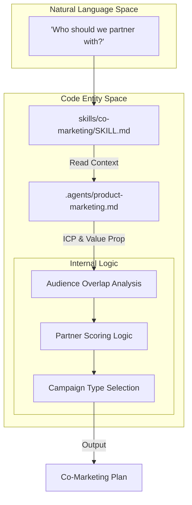
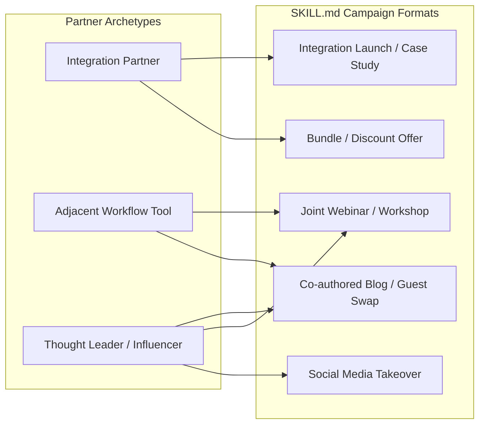

<!-- source: DeepWiki mcp.deepwiki.com · repo coreyhaines31/marketingskills · extra page Co-Marketing · fetched 2026-10-26 -->

# Co-Marketing

<details>
<summary>Relevant source files</summary>

The following files were used as context for generating this wiki page:

- [skills/co-marketing/SKILL.md](skills/co-marketing/SKILL.md)

</details>


The **Co-Marketing** skill provides a structured framework for identifying potential partners, planning joint campaigns, and formalizing partnership agreements. It is designed to help SaaS companies leverage audience overlap to drive growth through collaborative efforts like co-authored content, joint webinars, and integration spotlights.

This skill is distinct from [referral-program](4.8.4) (which focuses on customer-led growth loops) and [launch-strategy](4.8.2) (which handles the broader execution of a product launch) [skills/co-marketing/SKILL.md:3]().

## Partner Identification Framework

The system utilizes a multi-dimensional scoring and identification framework to ensure partner alignment and high ROI.

### 1. Audience Overlap Analysis
The core logic for identification rests on finding partners who share the same buyer persona but solve a different problem or exist adjacent to the product in the user's workflow [skills/co-marketing/SKILL.md:27-35](). Key identifiers include:
*   Tools used before/after the product [skills/co-marketing/SKILL.md:39-40]().
*   Most requested integrations by existing customers [skills/co-marketing/SKILL.md:41]().

### 2. Partner Scoring Criteria
Potential partners are evaluated on a 1-5 scale across technical and business dimensions [skills/co-marketing/SKILL.md:43-55]():

| Criteria | Technical/Business Evaluation |
| :--- | :--- |
| **Audience Fit** | How closely does their audience match your ICP? |
| **Audience Size** | Do they have reach worth partnering for? |
| **Brand Alignment** | Would you be proud to be associated? |
| **Engagement Quality** | Do they have an active, engaged audience? |
| **Reciprocity Potential** | Can you offer them equal value? |
| **Ease of Execution** | Do they have a partnerships team? History of co-marketing? |

Sources: [skills/co-marketing/SKILL.md:43-55]()

### 3. Where to Find Partners
The skill identifies partners through four primary vectors [skills/co-marketing/SKILL.md:56-79]():
*   **Integration Ecosystem:** Existing partners in app marketplaces or platforms the product plugs into.
*   **Adjacent Categories:** Tools solving the "before" or "after" steps in a user's workflow.
*   **Community Signals:** Shared podcast sponsors, conference exhibitors, and content engagement.
*   **Data Sources:** Utilizing tools like Crossbeam or Reveal for account overlap data.

Sources: [skills/co-marketing/SKILL.md:56-79]()

## Co-Marketing Campaign Types

The skill categorizes joint efforts by format, effort level, lead-sharing mechanics, and primary objective [skills/co-marketing/SKILL.md:82]().

### Content Partnerships

| Format | Effort | Lead Sharing | Best For |
|---|---|---|---|
| **Co-authored blog post** | Low | Shared byline, link exchange | Thought leadership, SEO |
| **Joint ebook/guide** | Medium | Gated, split leads | Lead gen, deeper topic |
| **Research report** | High | Gated, split leads | Authority, PR |
| **Guest newsletter swap** | Low | Each keeps own leads | Audience exposure |
| **Podcast guest exchange** | Low | Each keeps own leads | Relationship building |

Sources: [skills/co-marketing/SKILL.md:84-93]()

### Webinars & Events

| Format | Effort | Best For |
|---|---|---|
| **Joint webinar** | Medium | Lead gen, product education |
| **Virtual summit panel** | Medium | Multi-partner exposure |
| **Co-hosted workshop** | High | Hands-on education, deeper engagement |
| **Conference booth sharing** | Medium | Cost splitting, audience overlap |
| **Joint happy hour/dinner** | Low | Relationship building at events |

Sources: [skills/co-marketing/SKILL.md:94-102]()

### Product & Integration Marketing

| Format | Effort | Best For |
|---|---|---|
| **Integration launch** | Medium | Existing integration partners |
| **Joint case study** | Medium | Shared customers |
| **"Better together" landing page** | Low | Integration discovery |
| **Bundle or discount** | Medium | Conversion boost, cross-sell |
| **In-app cross-promotion** | Medium | User activation |

Sources: [skills/co-marketing/SKILL.md:105-113]()

### Community & Social

| Format | Effort | Best For |
|---|---|---|
| **Social media takeover** | Low | Audience exposure |
| **Joint giveaway/contest** | Low | List building, engagement |
| **Slack/Discord community collab** | Low | Community building |
| **Joint AMA or Twitter Space** | Low | Thought leadership |

Sources: [skills/co-marketing/SKILL.md:115-122]()

## Brainstorming Partner Campaigns

When brainstorming with a specific partner, the skill guides consideration of shared audience moments, combined value propositions, and unique assets each party brings [skills/co-marketing/SKILL.md:127-150]().

### Campaign Idea Prompts
The skill provides prompts to generate campaign ideas:
*   "What would we create if we had to launch something in 2 weeks?" [skills/co-marketing/SKILL.md:154]()
*   "What content do both our audiences desperately need?" [skills/co-marketing/SKILL.md:155]()
*   "What would make customers say 'finally, someone did this'?" [skills/co-marketing/SKILL.md:156]()
*   "What exclusive thing could we offer together?" [skills/co-marketing/SKILL.md:157]()
*   "What data do we both have that would make a compelling story?" [skills/co-marketing/SKILL.md:158]()

Sources: [skills/co-marketing/SKILL.md:151-159]()

## Approaching Potential Partners

The skill includes a template for cold outreach and a checklist for call preparation.

### Cold Outreach Template
```
Subject: [Your Company] + [Their Company] co-marketing idea

Hey [Name],

I'm [Role] at [Your Company]. We [one-line description].

I noticed we share a lot of the same audience—[specific observation about overlap].

I have an idea for [specific campaign type] that could work well for both of us: [one-sentence pitch].

Would you be open to a quick call to explore?

[Your name]
```
Sources: [skills/co-marketing/SKILL.md:166-180]()

### What to Prepare for the Call
1.  **Account overlap data** (if available via Crossbeam/Reveal) [skills/co-marketing/SKILL.md:184]()
2.  **2-3 specific campaign ideas** (not just "let's do something") [skills/co-marketing/SKILL.md:185]()
3.  **Your audience metrics** (list size, traffic, engagement) [skills/co-marketing/SKILL.md:186]()
4.  **Examples of past partnerships** (shows you can execute) [skills/co-marketing/SKILL.md:187]()
5.  **Clear ask** (what you want from them, what you'll provide) [skills/co-marketing/SKILL.md:188]()

Sources: [skills/co-marketing/SKILL.md:182-189]()

## Structuring the Partnership

A successful partnership requires alignment on lead ownership and promotion commitments.

### Key Questions to Align On
The skill provides a checklist for structuring the partnership agreement [skills/co-marketing/SKILL.md:192-202]():
*   **Lead ownership**: How are leads split or shared?
*   **Promotion commitments**: What will each party do to promote the campaign?
*   **Timeline**: Key dates and deadlines for content creation, launch, and promotion.
*   **Success metrics**: How will success be measured and reported?
*   **Legal/IP**: Who owns the content or assets created?
*   **Budget/Resources**: Any shared costs or resource allocation?

Sources: [skills/co-marketing/SKILL.md:192-202]()

### Success Metrics
Performance is tracked via the following KPIs [skills/co-marketing/SKILL.md:204-213]():
*   **Leads Generated:** Total number of shared leads.
*   **Audience Reach:** Total impressions across both partners' channels.
*   **Integration Adoption:** Number of users who connected the integration (if applicable).
*   **Customer Acquisition Cost (CAC):** Comparing co-marketing spend/effort against standard channels.
*   **Brand Mentions/PR:** Increased visibility and media coverage.
*   **Revenue Attributed:** Direct sales or upgrades resulting from the partnership.
*   **Website Traffic:** Referral traffic from partner channels.
*   **Engagement Rates:** Webinar attendance, content downloads, social interactions.

Sources: [skills/co-marketing/SKILL.md:204-213]()

## System Integration & Data Flow

The `co-marketing` skill interacts with the `product-marketing-context.md` (or `.agents/product-marketing.md`) to ensure all partnership suggestions are grounded in the product's actual target audience and value proposition [skills/co-marketing/SKILL.md:12-13]().

### Data Flow: Partnership Strategy Generation
This diagram shows how the agent processes the marketing context to generate a partnership plan.


Sources: [skills/co-marketing/SKILL.md:2-13](), [skills/co-marketing/SKILL.md:25-55]()

### Mapping Partner Types to Campaign Structures
This diagram bridges the conceptual "Partner Type" to the specific "Campaign Formats" defined in the skill metadata.


Sources: [skills/co-marketing/SKILL.md:82-122]()

---

