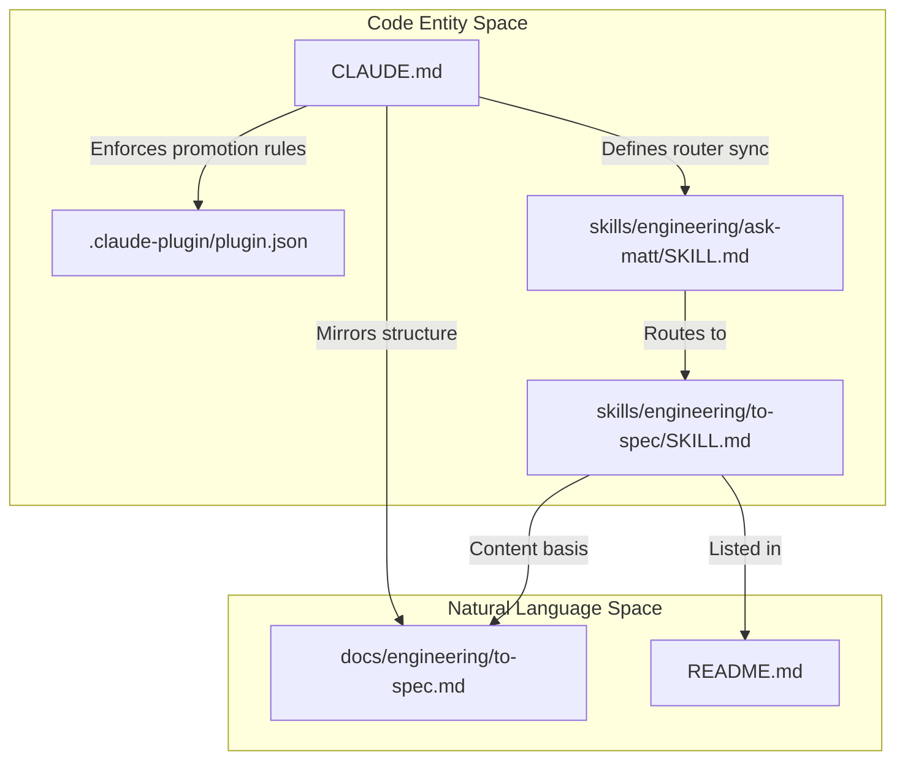
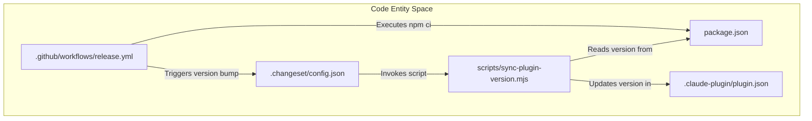

<!-- source: DeepWiki mcp.deepwiki.com · repo mattpocock/skills · page 1.2 Repository Conventions and Release Pipeline · fetched 2026-10-26 -->

# Repository Conventions and Release Pipeline

Relevant source files

The following files were used as context for generating this wiki page:

- [.agents/adr/0001-explicit-setup-pointer-only-for-hard-dependencies.md](.agents/adr/0001-explicit-setup-pointer-only-for-hard-dependencies.md)
- [.agents/writing-docs.md](.agents/writing-docs.md)
- [.changeset/README.md](.changeset/README.md)
- [.changeset/config.json](.changeset/config.json)
- [.github/ISSUE_TEMPLATE/bug.yml](.github/ISSUE_TEMPLATE/bug.yml)
- [.github/ISSUE_TEMPLATE/config.yml](.github/ISSUE_TEMPLATE/config.yml)
- [.github/ISSUE_TEMPLATE/idea.yml](.github/ISSUE_TEMPLATE/idea.yml)
- [.github/workflows/needs-info.yml](.github/workflows/needs-info.yml)
- [.github/workflows/release.yml](.github/workflows/release.yml)
- [.github/workflows/triage-label.yml](.github/workflows/triage-label.yml)
- [.gitignore](.gitignore)
- [.out-of-scope/harness-name-collisions.md](.out-of-scope/harness-name-collisions.md)
- [.out-of-scope/native-question-tool.md](.out-of-scope/native-question-tool.md)
- [.out-of-scope/new-skills.md](.out-of-scope/new-skills.md)
- [CHANGELOG.md](CHANGELOG.md)
- [CLAUDE.md](CLAUDE.md)
- [package-lock.json](package-lock.json)
- [package.json](package.json)
- [scripts/link-skills.sh](scripts/link-skills.sh)
- [scripts/sync-plugin-version.mjs](scripts/sync-plugin-version.mjs)

This page details the conventions and rules governing the `mattpocock/skills` repository, focusing on maintainer guidelines, documentation standards, architectural decision records, GitHub issue templates and workflows, and the automated release pipeline. The goal is to ensure consistency, maintainability, and a clear understanding of how changes are introduced and released.

## Repository Conventions

The repository adheres to strict conventions to ensure consistency and maintainability across skills, manifests, and documentation.

### Skill Buckets and Promotion

Skills are organized into distinct bucket folders under `skills/` [CLAUDE.md:1-7](). These buckets categorize skills by their purpose and determine their promotion status:

*   `engineering/`: Daily code work [CLAUDE.md:3-3]()
*   `productivity/`: Daily non-code workflow tools [CLAUDE.md:4-4]()
*   `misc/`: Kept around but rarely used, not promoted [CLAUDE.md:5-5]()
*   `in-progress/`: Public beta skills, feedback wanted, not shipped in the plugin [CLAUDE.md:6-6]()
*   `deprecated/`: Skills no longer used [CLAUDE.md:7-7]()

The `engineering/` and `productivity/` buckets are considered **promoted** [CLAUDE.md:9-9](). Skills in these buckets must have a reference in the top-level `README.md` and an entry in `.claude-plugin/plugin.json`'s `skills` array [CLAUDE.md:9-9](). Skills in `misc/`, `in-progress/`, and `deprecated/` must not appear in either [CLAUDE.md:9-9](). Additionally, `AGENTS.md` is maintained as a symlink to `CLAUDE.md` so that Codex and other harnesses read identical instructions.

Sources: [CLAUDE.md:1-16]()

### Manifest, Router, and Documentation Synchronization

Maintaining consistency between skill definitions, plugin manifests, and routers is required for correct execution.

*   **Plugin Manifest**: The `.claude-plugin/plugin.json` file lists the promoted skills shipped with the Claude Code plugin [CLAUDE.md:9-9](). The `scripts/sync-plugin-version.mjs` script ensures that the version in `plugin.json` matches `package.json`.
*   **Marketplace and Validation**: `.claude-plugin/marketplace.json` serves as the repo's own marketplace, allowing non-Claude Code agents to install from it for automatic updates [CLAUDE.md:11-11](). Maintainers run `claude plugin validate . --strict` after touching either manifest [CLAUDE.md:11-11]().
*   **`ask-matt` Router**: The `ask-matt` skill acts as a router mapping user-reachable skills and their relationships [CLAUDE.md:21-21](). Any addition, renaming, removal, or change in how a user-reachable skill fits the flows requires updating `ask-matt`'s `SKILL.md` to keep the routing accurate [CLAUDE.md:21-21]().
*   **Documentation**: Promoted skills maintain human-facing documentation pages at `docs/<bucket>/<skill-name>.md` [CLAUDE.md:17-17]().

Title for diagram: Natural Language to Code Entity Synchronization

Sources: [CLAUDE.md:1-25](), [CHANGELOG.md:31-36]()

### Prose Standard: No Em-Dashes

A strict prose standard forbids the use of em-dashes anywhere in the repository's prose, including `SKILL.md` files, documentation pages, `README.md`, `CHANGELOG.md`, ADRs, changesets, and code comments [CLAUDE.md:25-25](). Sentences that would typically use an em-dash must be rewritten using commas, colons, periods, parentheses, or conjunctions [CLAUDE.md:25-25]().

Sources: [CLAUDE.md:25-25]()

## Documentation Authoring Standard

The `.agents/writing-docs.md` file defines the standard for authoring human-facing documentation pages for promoted skills [CLAUDE.md:17-17]().

*   **Location and URL**: Docs pages reside at `docs/<bucket>/<skill-name>.md` and publish to `https://aihero.dev/skills-<skill-name>` regardless of bucket organization [.agents/writing-docs.md:1-3](). Every link must be absolute [.agents/writing-docs.md:9-9]().
*   **Structure**: Each published page requires specific fixed sections [.agents/writing-docs.md:14-17]():
    *   `## What it does`: One or two plain-language paragraphs leading with the skill's primary job and defining constraint [.agents/writing-docs.md:23-26]().
    *   `## When to reach for it`: Explains the invocation mode and trigger boundary [.agents/writing-docs.md:28-33]().
    *   `## Common questions`: Addresses frequently asked questions sourced from the wiki, issues, and `CHANGELOG.md` [.agents/writing-docs.md:44-53]().
    *   `## It's working if`: Describes observable expected outcomes.
*   **Archived Pages**: When a promoted skill is removed outright, its documentation page remains in the repository tree marked as archived [.agents/writing-docs.md:7-8]().

Sources: [CLAUDE.md:17-18](), [.agents/writing-docs.md:1-59]()

## Architectural Decision Records and Out-of-Scope Decisions

The repository maintains explicit records for design choices and boundary constraints:

*   **ADRs (`.agents/adr/`)**: Document significant architectural decisions and their underlying rationale, such as `0002-ship-as-a-claude-code-plugin.md` [CLAUDE.md:11-11]() and `0001-explicit-setup-pointer-only-for-hard-dependencies.md`.
*   **Out-of-Scope (`.out-of-scope/`)**: Clarifies boundaries and features explicitly rejected, such as native question tools, harness name collisions, new standalone skills, and frozen misc skills [.github/ISSUE_TEMPLATE/idea.yml:7-10]().

Sources: [CLAUDE.md:11-11](), [.github/ISSUE_TEMPLATE/idea.yml:7-10]()

## GitHub Issue Templates and Workflows

Automations and structured forms ensure issues and PRs follow project standards:

*   **Issue Templates**: Templates for bugs (`.github/ISSUE_TEMPLATE/bug.yml`) and ideas (`.github/ISSUE_TEMPLATE/idea.yml`) enforce strict criteria, such as checking `SCOPE.md` and `.out-of-scope/` [.github/ISSUE_TEMPLATE/idea.yml:7-10]().
*   **Triage Label Workflow**: `.github/workflows/triage-label.yml` automatically applies `needs-triage` to newly opened issues [.github/workflows/triage-label.yml:1-23]().
*   **Needs Info Workflow**: `.github/workflows/needs-info.yml` closes inactive `needs-info` issues after 14 days [.github/workflows/needs-info.yml:1-38]().

Sources: [.github/ISSUE_TEMPLATE/idea.yml:1-40](), [.github/ISSUE_TEMPLATE/bug.yml:1-43](), [.github/workflows/triage-label.yml:1-23](), [.github/workflows/needs-info.yml:1-38]()

## Release Pipeline and Local Linking

Local development and automated releases are coordinated through shell scripts, changesets, and GitHub Actions workflows.

### Local Skill Linking

Maintainers run `scripts/link-skills.sh` to symlink active skills into local harness directories (`~/.claude/skills`, `~/.agents/skills`) [scripts/link-skills.sh:9-11](). The script automatically excludes `deprecated/` and `misc/`, but includes `in-progress/` skills to facilitate local feedback loops [scripts/link-skills.sh:18-24](). It includes a recursion guard to prevent symlinking the repo into itself [scripts/link-skills.sh:35-45]().

Sources: [scripts/link-skills.sh:1-62]()

### Automated Release Workflow

Releases are managed via `changesets` and GitHub Actions [package.json:11-18](), [.github/workflows/release.yml:1-37]().

Title for diagram: Release Pipeline Execution Flow

Sources: [package.json:11-15](), [.github/workflows/release.yml:1-37](), [scripts/sync-plugin-version.mjs:1-41]()

1.  **Trigger**: Pushes to `main` trigger the release workflow [.github/workflows/release.yml:4-6]().
2.  **Versioning**: The `changesets/action` executes `npm run version` [.github/workflows/release.yml:29-32](), which invokes `changeset version` followed immediately by `scripts/sync-plugin-version.mjs` [package.json:11-14]().
3.  **Manifest Sync**: `scripts/sync-plugin-version.mjs` reads `package.json` and ensures `.claude-plugin/plugin.json` matches the new version.
4.  **Tag and Publish**: Changesets commits the chore changes, tags the commit, and opens a pull request back to `main` [.github/workflows/release.yml:33-37]().

Sources: [package.json:11-15](), [.github/workflows/release.yml:1-37](), [scripts/sync-plugin-version.mjs:1-41]()

---

