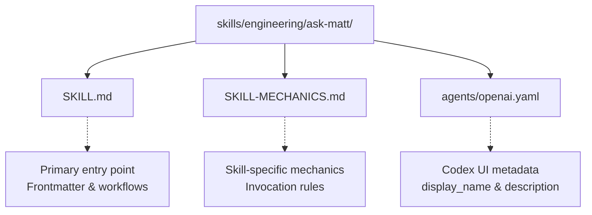
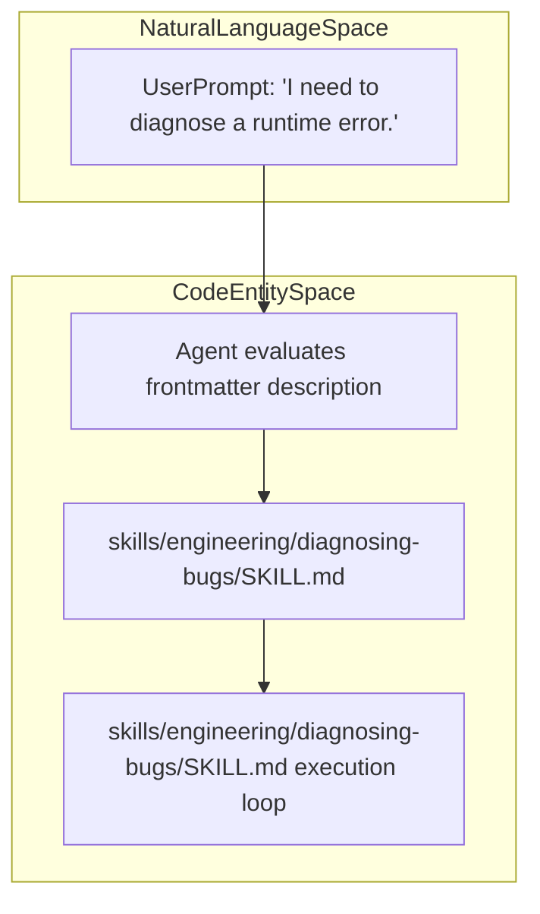
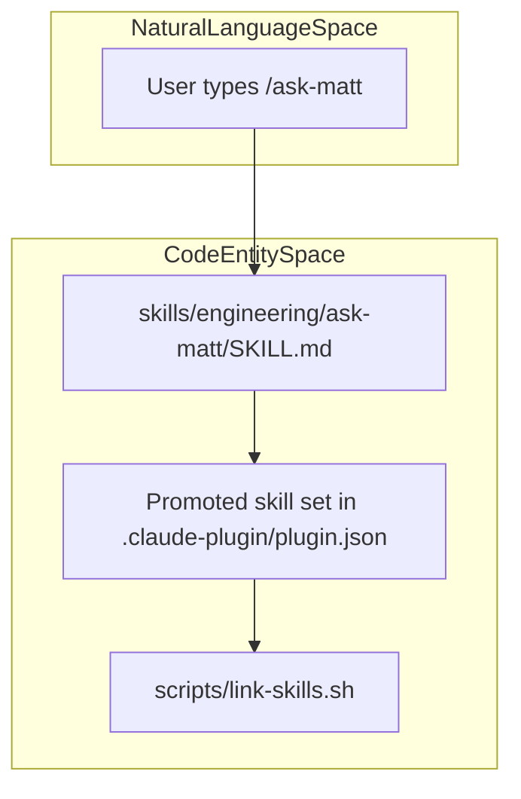

<!-- source: DeepWiki mcp.deepwiki.com · repo mattpocock/skills · page 2 Skills Framework · fetched 2026-10-26 -->

# Skills Framework

Relevant source files

The following files were used as context for generating this wiki page:

- [.agents/writing-docs.md](.agents/writing-docs.md)
- [.claude-plugin/plugin.json](.claude-plugin/plugin.json)
- [CLAUDE.md](CLAUDE.md)
- [scripts/link-skills.sh](scripts/link-skills.sh)
- [skills/in-progress/README.md](skills/in-progress/README.md)

## Purpose and Scope

This document explains the structural framework that all skills in this repository follow. It covers the standardized directory layout, the `SKILL.md` file format with YAML front matter, metadata requirements for AI agent skill selection, and guidelines for organizing supporting documentation. The framework is designed to optimize for predictability and information hierarchy [CLAUDE.md:1-26](). It also details the deployment mechanism via symlinks [scripts/link-skills.sh:8-13](), the native Claude Code plugin manifest [.claude-plugin/plugin.json:1-50](), and bucket taxonomies [CLAUDE.md:1-10]().

For specific details on invocation types, deployment pipelines, documentation writing standards, and routing mechanics, see the child pages:
- [Skill Invocation Model](#2.1) — Details on user-invoked vs model-invoked taxonomy, the `disable-model-invocation` flag, and trigger conventions. For details, see [Skill Invocation Model](#2.1).
- [Plugin Manifest and Deployment](#2.2) — Documentation on `.claude-plugin/plugin.json`, bucket organization (`engineering/`, `productivity/`, etc.), and the symlink deployment script `scripts/link-skills.sh`. For details, see [Plugin Manifest and Deployment](#2.2).
- [Writing Skills and Docs for Agents](#2.3) — Documenting the principles for writing effective agent-facing documentation and human-facing docs pages via `.agents/writing-docs.md`. For details, see [Writing Skills and Docs for Agents](#2.3).
- [Ask-Matt Router, Flows and Phase Boundaries](#2.4) — Overview of the central `ask-matt` router skill (`skills/engineering/ask-matt/SKILL.md`) and its role in orchestrating complex workflows. For details, see [Ask-Matt Router, Flows and Phase Boundaries](#2.4).

Sources: [CLAUDE.md:1-26](), [scripts/link-skills.sh:8-13](), [.claude-plugin/plugin.json:1-50]()

---

## Skill Directory Structure

Each skill is organized as a self-contained directory under a specific bucket folder: `engineering/`, `productivity/`, `in-progress/`, `misc/`, or `deprecated/` [CLAUDE.md:1-8]().

Sources: [CLAUDE.md:1-10](), [.claude-plugin/plugin.json:21-49]()

| File | Required | Purpose |
|------|----------|---------|
| `SKILL.md` | Yes | Primary entry point containing frontmatter metadata and core workflow instructions. |
| `SKILL-MECHANICS.md` | No | Skill-specific documentation on invocation rules, mechanics, and router interactions. |
| `agents/openai.yaml` | Yes | Holds Codex UI metadata like `display_name`, `short_description`, and `policy.allow_implicit_invocation`. |

Sources: [CLAUDE.md:1-20]()

---

## Skill Selection and Discovery

The AI agent selects skills by evaluating the `description` field in the `SKILL.md` frontmatter. This field acts as the model-facing trigger for autonomous execution.

Sources: [CLAUDE.md:19-21](), [.claude-plugin/plugin.json:23]()

### Invocation Model and Routing

Skills operate under two invocation models: **User-invoked** (requiring explicit human command execution) and **Model-invoked** (selectable automatically by the agent based on context) [CLAUDE.md:15-19](). 

Sources: [CLAUDE.md:19-24](), [.claude-plugin/plugin.json:21-49](), [scripts/link-skills.sh:15-32]()

For details on invocation hierarchies, see [Skill Invocation Model](#2.1). For details on routing logic and phase boundaries, see [Ask-Matt Router, Flows and Phase Boundaries](#2.4).

---

## Distribution and Deployment

Promoted skills (housed in `engineering/` and `productivity/`) are published via the Claude Code plugin manifest (`.claude-plugin/plugin.json`) and synced locally via `scripts/link-skills.sh` [CLAUDE.md:9-24](). Non-promoted buckets (`misc/`, `in-progress/`, `deprecated/`) are excluded from the default plugin distribution, though `in-progress/` betas can be installed individually [CLAUDE.md:9-11](), [skills/in-progress/README.md:5-9]().

For details on plugin packaging, manifest structures, and symlink recursion guards, see [Plugin Manifest and Deployment](#2.2).

Sources: [CLAUDE.md:9-24](), [.claude-plugin/plugin.json:1-50](), [scripts/link-skills.sh:1-62](), [skills/in-progress/README.md:1-16]()

---

